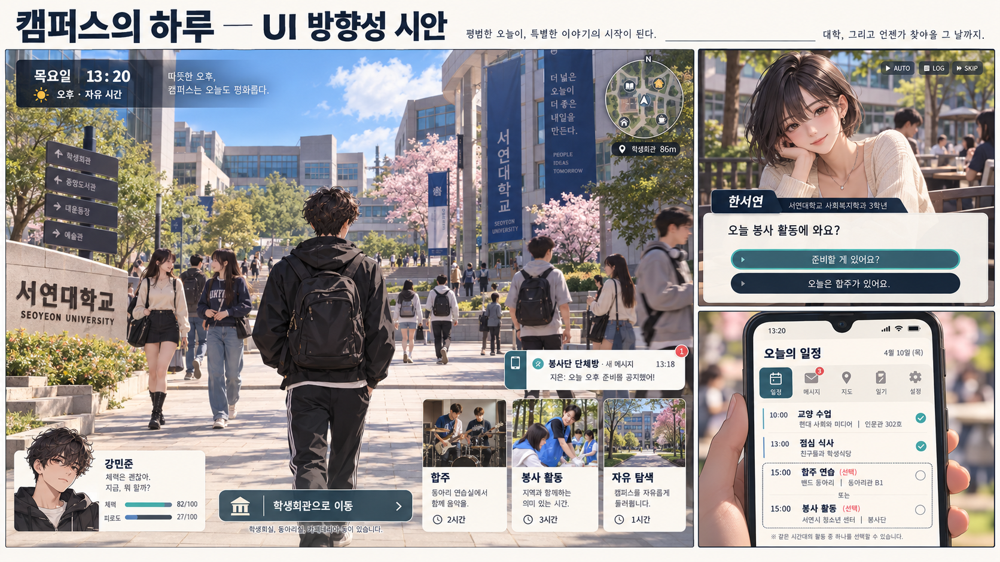

# 기본 UI 방향성 시안

상태: 검토용 시각 제안. 이미지 시안은 실제 Unity 실행 화면이 아니며 구현 완료를 뜻하지 않는다.

이미지 생성 과정에서 잘못 들어간 표기: 주인공의 이름은 강민준이 아니라 김태이, 학교는 서연대학교가 아니라 백석대학교다. 한서연은 치위생과이며 학년은 미정이다. 이미지의 잘못된 글자는 설정 변경이 아니다. 외형 역시 확정 모델이 아닌 방향성 참고다.

## 화면 구성

- 탐색: 애니메이션풍 3D 대학 캠퍼스를 넓게 보여준다. 시간·시간대·지역을 상단에, 작은 지도를 우측 상단에 배치한다.
- 행동 선택: 상황에 따라 합주·봉사 활동·자유 탐색 등을 제시한다. 시간 비용과 알고 있는 약속 충돌을 선택 전에 안내한다.
- 대화: 탐색 HUD를 줄이고 2D 초상화, 이름, 대사, 선택지에 집중한다. 무관한 인물의 속마음은 노출하지 않는다.
- 휴대폰: 일정, 실제 받은 메시지, 알고 있는 지도, 일지를 모은다. 모든 인물의 현재 위치나 숨은 관계 수치를 보여주지 않는다.
- 상태: 체력·피로는 간결하게 표시한다. 평화로운 일상에 전투용 HUD를 상시 노출하지 않는다.

## 미술 방향 제안

크림색과 짙은 남색을 바탕으로 청록색을 강조색으로 사용한다. 관계 관련 강조에는 절제된 코랄색을 사용한다.
색만으로 상태를 구분하지 않고 텍스트와 아이콘을 함께 사용한다.
초상화와 3D 모델의 머리·복장·대표 특징을 일치시킨다.
일상과 재난에서 기본 메뉴 위치는 유지하고 조명·알림·정보의 우선순위로 분위기를 바꾼다.

## 시안 범위

평화로운 캠퍼스 탐색을 큰 화면으로, 한서연과의 대화 및 휴대폰 일정 화면을 보조 화면으로 제시한다.
시안 속 요일, 시각, 대사, 수업 배치 등은 화면 설명용 예시이며 이야기의 확정 설정이 아니다.
자유 탐색 중에는 공간 이동을 기본으로 하고 행동 카드는 해당 선택 지점에서만 표시하는 방향을 검토한다.
이미지의 텍스트와 배치는 구현 단계에서 실제 가독성과 입력 방식에 맞게 검증한다.

## 구현 시 확인

- 시간 소비와 약속 충돌을 사용자가 이해할 수 있는가.
- 알림이 세계의 독립 진행을 전달하면서도 탐색을 방해하지 않는가.
- 직접 관찰한 정보와 전해 들은 정보가 구분되는가.
- 초상화·대사 글자 크기를 조절하고 키보드와 마우스로 선택할 수 있는가.
- 대화 진입과 종료 후 기존 탐색 상태가 유지되는가.

시각 방향 승인 후 임시 UI로 하루의 선택 흐름을 구현한다. 이 문서 단계에서는 동작 검증을 수행하지 않았다.
