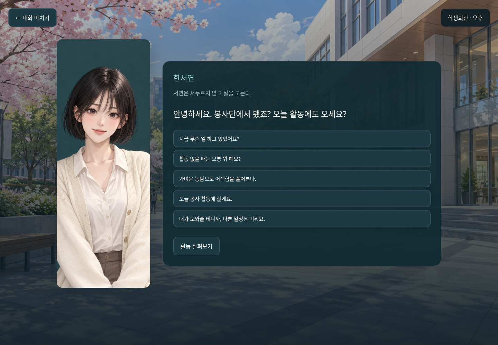
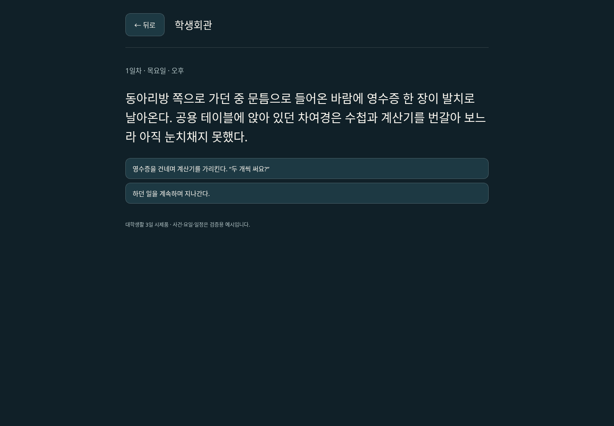
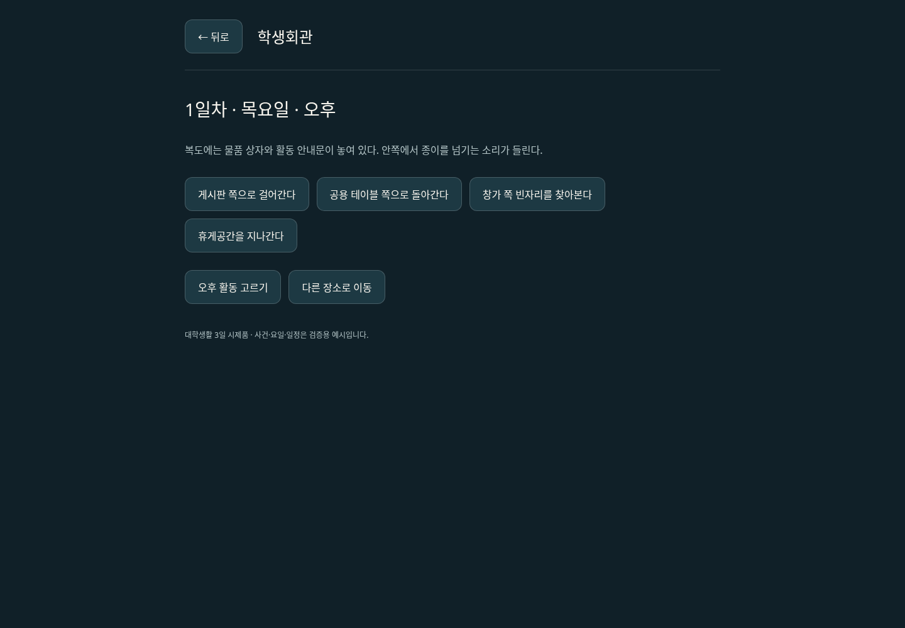
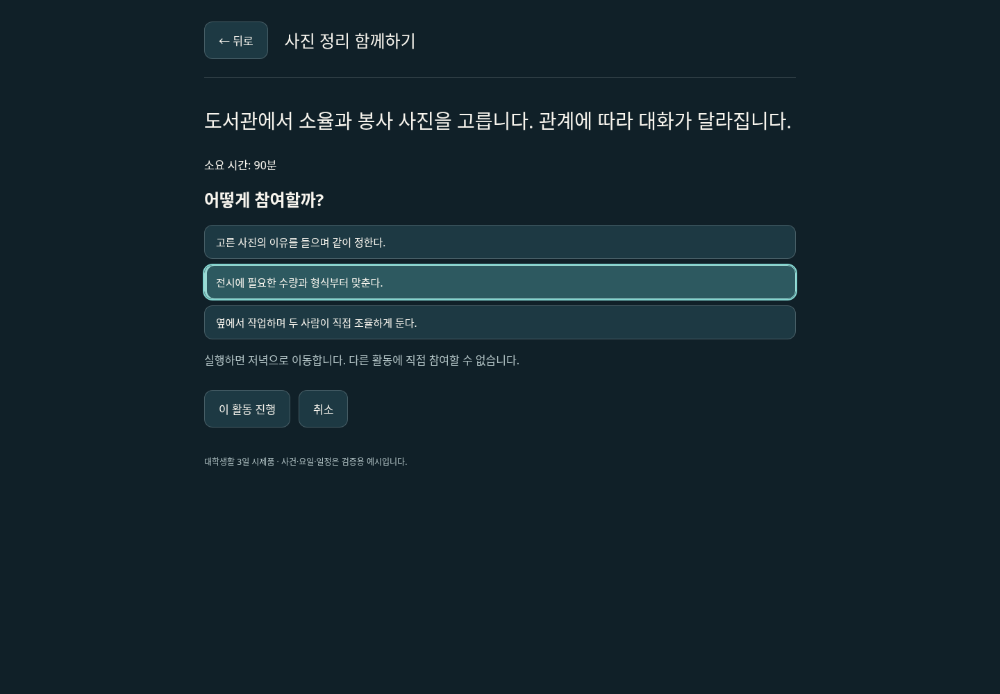
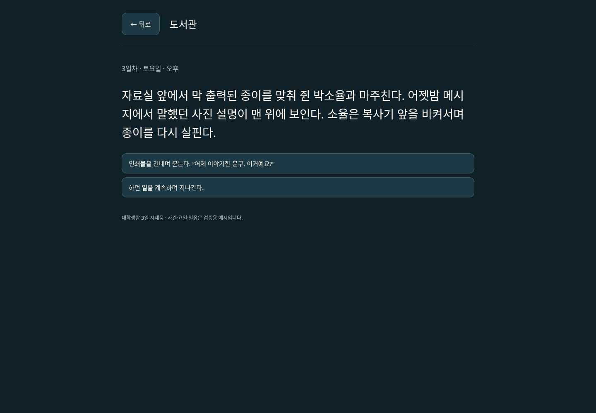

# 기본 UI 방향성 시안

상태: 화면 전환 중심으로 수정한 기획. 실제 Unity 실행 화면이나 구현 완료를 뜻하지 않는다.

## 핵심 규칙

한 번에 하나의 주요 화면만 표시한다. 탐색 위에 대화·일정·활동 카드·휴대폰을 동시에 겹쳐 놓지 않는다.
버튼이나 상호작용을 선택하면 해당 기능의 전용 화면으로 바뀐다. 뒤로 가면 이전 위치와 선택 상태로 복귀한다.

## 화면과 이동

| 현재 화면 | 입력 | 다음 화면 |
| --- | --- | --- |
| 캠퍼스 탐색 | 사람과 대화 | 대화 전용 화면 |
| 캠퍼스 탐색 | 장소 입장 | 해당 장소 화면 |
| 장소 화면 | 활동 선택 | 활동 상세·선택 화면 |
| 탐색·장소 화면 | 휴대폰 버튼 | 휴대폰 홈 화면 |
| 휴대폰 홈 | 일정·메시지·지도·일지 | 선택한 항목의 전용 화면 |
| 탐색·장소 화면 | 메뉴 버튼 | 상태·저장·불러오기·설정 메뉴 |
| 대화·활동 | 종료 또는 완료 | 결과를 반영하고 기존 장소로 복귀 |
| 저녁 캠퍼스·장소·활동 결과 | 하루 마무리 | 당일 활동 확인 후 다음 날 캠퍼스로 이동 |
| 3일차 저녁 | 3일의 기록 보기 | 플레이어의 활동 기록 확인. 추가 날짜는 없음 |

- 탐색: 작은 시간 표시, 휴대폰·메뉴 버튼, 장소 입장 안내만 표시한다. 현재 시제품은 캠퍼스 배경과 정면의 김태이 초상화를 사용한다. 실제 3D 공간 이동은 미구현이다.
- 대화: 배경과 2D 초상화, 이름, 대사, 선택지만 보여준다. 탐색 HUD와 휴대폰은 숨긴다.
- 대화 중 태이가 선택한 실제 대사를 상대의 답변 위에 표시한다. 상대가 되물으면 곧바로 그 질문에 대한 선택지를 보여주고, 매번 별도의 '이어가기' 버튼을 요구하지 않는다.
- 진행 중인 주제를 유지하며 '다른 이야기로 넘어가기'로 주제 선택에 돌아갈 수 있다. 대화 마치기는 장소 화면으로 복귀한다.
- 인물 구도: 등을 보이는 주인공 배경을 기본 화면에서 사용하지 않는다. 대화에서는 현재 발화하는 인물이 정면으로 보이며, 다인 대화는 발화 순서에 맞춰 인물을 전환한다.
- 행동 선택: 지금 가능한 활동과 시간 비용을 보여준다. 활동을 고르면 상세 화면에서 약속 충돌 등 알려진 결과를 확인하고 실행한다.
- 휴대폰: 아이콘을 선택해 일정·메시지·지도·일지로 이동한다. 화면을 겹쳐 띄우지 않는다.
- 상태: 체력과 피로 등의 상세 수치는 상태 화면에서 확인한다. 재난 중 즉각적인 위험은 최소한의 경고로 전달한다.
- 알림: 휴대폰 버튼의 작은 미확인 표시만 사용한다. 메시지 본문이나 다른 장소의 장면을 탐색 중 자동으로 띄우지 않는다.

현재 시제품은 날짜·요일·시간대를 상단에 표시하며 학생회관·도서관·카페로 장소를 전환한다. 각 장소는 생활 묘사와 이동 동선으로 표현하며 실제 해당 시간에 있는 인물의 장면만 발생한다.
휴대폰 일정에서 다음 날 약속과 취소 버튼을 확인한다. 충돌하는 활동의 상세 화면에는 관련 인물과 약속을 명시한다.

장소 화면에 인물 카드나 '누구와 대화하기' 버튼을 배치하지 않는다. 장소에 도착하면 진행 중인 상황을 보여주고, 그 상황에서 할 행동을 선택한다.
같은 봉사단 인물의 이름은 처음부터 알 수 있지만 선택지는 '영수증을 건넨다', '빈자리를 물어본다', '하던 일을 계속한다'처럼 표현한다.
인물과 관련 없는 이동 선택은 게시판·공용 테이블·창가·휴게공간 등 공간을 기준으로 표시한다. 같은 동선이라도 날짜·시간·인물 일정·이전 선택에 따라 만남이 달라진다.
대화가 끝나면 인물 선택 목록으로 돌아가지 않고 주변 공간으로 돌아간다. 약속 없이 만난 사람이 계속 플레이어를 기다리는 구도를 반복하지 않는다.

메뉴 화면 전환·뒤로 가기는 시간을 소모하지 않는다. 1일차의 장소 이동·내부 탐색·대화 마무리는 여러 행동을 묶어 시간을 진행하며, 2~3일차는 기존 활동 단위를 유지한다.
일정 기반 초기 시제품에서는 메뉴를 보는 동안 세계 시간을 정지한다. 실시간 탐색 도입 시 재검토한다.
활동 취소 시 결과를 적용하지 않는다. 완료된 활동의 시간·물자·관계 결과는 한 번만 반영한다.

## 정보 경계

지도는 알고 있는 장소만, 메시지는 실제 받은 내용만 보여준다. 타인의 모든 위치나 숨은 관계 수치는 공개하지 않는다.
UI를 전환해도 다른 인물의 일정과 사건을 계산하는 세계 상태는 유지한다. 화면을 열어야만 해당 장소의 사건이 진행되는 구조로 만들지 않는다.

## 미술 방향

크림색·짙은 남색 바탕에 청록색을 강조색으로 사용한다. 색과 함께 텍스트·아이콘으로 의미를 전달한다.
일상과 재난에서 기본 조작 위치를 유지하고 배경·조명·경고 우선순위로 분위기를 바꾼다.
캐릭터 초상화와 3D 외형의 주요 특징을 맞춘다. 시안의 시간·건물·외형은 참고용이며 확정 설정을 대체하지 않는다.

김태이의 헤어는 기존 히피펌 설정에서 수정한다. 일본 애니메이션 남자 주인공 같은 검은색 레이어드 헤어로, 강한 곱슬 대신 자연스러운 모발 흐름과 가벼운 볼륨, 층진 머리끝을 사용한다. 최신 탐색 시안에 이 방향을 반영했다. 정면 앞머리의 정확한 형태는 추후 캐릭터 시트에서 결정한다. 차여경의 복슬복슬한 히피펌 설정은 유지한다.

## 이전 시안

assets/campus-ui-concept.png는 최초 비교용 이미지로만 보존한다. 여러 장면을 함께 배치한 구성은 현재 UI 방향에서 사용하지 않는다.
이전 이미지의 강민준·서연대학교·한서연의 사회복지학과 표기는 생성 오류다. 김태이·백석대학교·치위생과가 확정 설정이며 한서연의 학년은 미정이다.

## 구현 시 확인

- 한 번에 하나의 주요 화면만 활성화되는가.
- 뒤로 가기 후 탐색 위치와 이전 메뉴 선택 상태가 복구되는가.
- 메뉴 탐색과 취소로 시간이 흐르거나 활동 보상이 발생하지 않는가.
- 시간 비용과 알려진 약속 충돌이 실행 전에 전달되는가.
- 본 적 없는 사건 정보가 노출되지 않는가.
- 키보드와 마우스로 같은 화면 이동이 가능하고 글자 크기를 조절할 수 있는가.

prototype/ 웹 시제품에서 전용 화면 전환, 활동 취소, 휴대폰 복귀, 세이브 슬롯 흐름을 구현하고 Chromium으로 검증했다. 정적 배경을 사용하는 기능 검증 단계이며 실제 3D 탐색·Unity UI 구현은 아직이다.
현재는 김태이·한서연·차여경·박소율의 정면 2D 초상화도 적용했다. 초상화는 외형 방향을 확인하는 초안으로, 표정별 차분과 최종 캐릭터 시트는 미완성이다. Unity UI 구현과 실제 3D 이동은 여전히 미구현이다.

## 이벤트에 따른 화면 반응

활동 상세 화면에서 상황에 맞는 참여 방식을 고른다. 선택된 항목은 테두리와 상태로 표시하며, 어떤 숨은 관계 수치가 오를지는 미리 숫자로 안내하지 않는다.
메시지·장소에서 이미 알게 된 내용만 지문에 반영한다. 조건부 부탁이 와도 별도의 인물 선택 카드나 대기 목록을 추가하지 않는다.
사건 분류명이나 내부 조건식은 개발 구조이며 실제 플레이 화면의 메뉴 이름으로 노출하지 않는다.

### 정보·획득 피드백

행동으로 새 정보를 알게 되면 화면 상단의 독립된 줄에 `◇ 새 정보`를 청록색으로 표시한다. 실제 소지 수량이 늘어난 아이템은 `▣ 아이템 획득`과 금색, 획득 수량으로 구분한다. 색상 외에도 기호와 문구를 함께 사용하며, 자동으로 사라지지 않고 확인 버튼으로 닫는다. 장면의 버튼을 가리는 오버레이는 사용하지 않는다.
알림의 `정보 · 소지품 확인` 또는 휴대폰의 `알게 된 정보 · 소지품`에서 정보 목록과 소지품을 확인한다. 정보에는 확인 날짜·장소·선택한 행동을 함께 기록한다. 본문에서 이미 알고 있는 정보의 정확한 명칭이 등장하면 청록색으로 강조한다. 재관찰이나 저장 불러오기로 신규 획득 알림을 반복하지 않는다.
현재 학생회관의 공용 우산 대여가 첫 실제 아이템 지급 사례다. 보관 위치 발견은 정보이며 아이템 소유로 처리하지 않는다. 실제 대여 시 금색 획득 알림과 소지품 수량을 갱신하고, 반납 시 제거한다.

1일차에는 상단에 시각을 함께 표시한다. 짧은 이동·탐색·대화 버튼에는 개별 소요 분을 표시하지 않는다. 여러 행동 뒤 약 30분이 한 번에 흐르며, 대화 중에는 시간을 넘기지 않는다. 다음 활동을 마치면 시간 구간이 바뀔 즈음 설명을 표시하고, 진행 후에는 새 시각과 경과 시간을 별도 줄에 안내한다. 메뉴와 반복 확인은 집계하지 않는다. 16:00 준비 시각에도 캠퍼스와 각 장소에서 오후 활동 선택을 열 수 있다. 1일차 활동 상세에는 16:00 시작과 일찍 선택할 경우 대기한다는 안내를 표시한다.

### 동아리와 약속

캠퍼스의 `동아리 살펴보기`와 휴대폰의 `동아리`에서 공개 안내와 가입 상태를 확인한다. 가입 버튼은 소속을 바꾸고, 실제 참석은 별도 제안으로 안내한다. 새 게임에는 가입한 동아리와 미리 아는 부원 이름이 없다.
일정 화면은 응답 전 제안과 참석 예정·처리 결과를 함께 보여준다. 누가 제안했는지, 날짜·시간대·장소 또는 활동, 겹칠 수 있는 일정, 수락·거절·사전 취소 버튼을 제공한다. NPC가 먼저 보낸 제안은 메시지와 화면 상단의 바로가기에서 확인한다. 제안과 수락된 약속을 같은 상태로 표시하지 않는다.
개인 약속도 인물 선택 메뉴를 생성하지 않는다. 실제 장소에서 자기 일을 하는 인물과 마주쳤을 때 오늘 약속을 기억하는 문장과 인사 선택지로 이어진다. 장소 입장만으로 약속을 지켰다고 처리하지 않는다.

### 전해 들은 이야기 표시

실제 만남에서 상대가 다른 사람에게 들은 내용을 꺼내면 기존 대화와 구분되는 `전해 들은 이야기` 문단을 보여준다. 인물은 전달자를 직접 언급하고, 확신할 수 없는 사정은 물어본다. 숨겨진 NPC 정보 교환을 알림으로 미리 공개하지 않는다. 태이가 그 이야기를 들은 시점에 정보 목록과 일지에 전달 경위를 남긴다. 일정에서는 NPC가 미수락 제안을 거둔 경우 `상대가 제안 보류`로 표시하고, 수락된 약속의 취소와 구분한다.

### 날씨와 예보

화면 상단의 작은 버튼에 날씨 기호·이름·기온을 함께 표시한다. 눌러 현재 장면을 대체하는 예보 화면을 열고, 뒤로 가면 진행 중이던 만남이나 대화로 돌아온다. 휴대폰에서도 같은 예보를 열 수 있다. 새 오버레이를 겹치지 않는다.
예보 화면에서 다음 날씨와 우산 준비를 확인한다. 학생회관에서는 대여·반납 버튼을 제공하며 실제 아이템 획득은 기존 금색 알림으로 보여준다. 활동 카드와 상세에는 우천 대체·시간 변화·강한 비의 제한을 실행 전에 안내한다. 날씨 때문에 취소된 약속은 개인 불이행과 구분한다.
캠퍼스는 기존 배경 위 밝기·정적인 빗줄기 표현을 사용한다. 현재 실제 3D 날씨 렌더링은 아니다. [강한 비 예시의 모바일 화면](assets/weather-ui-preview.png)은 개발용 비교 모드에서 캡처했다.
