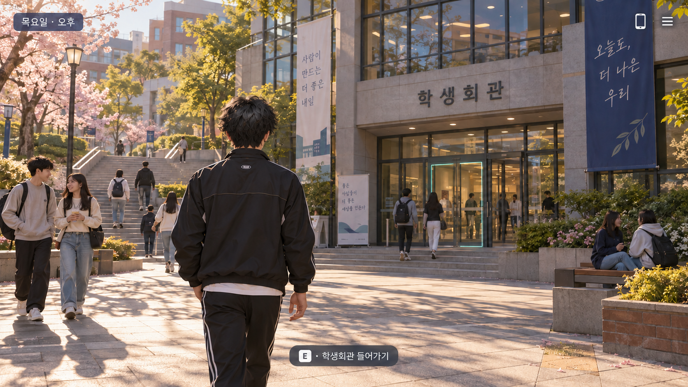

# 기본 UI 방향성 시안

상태: 화면 전환 중심으로 수정한 기획. 실제 Unity 실행 화면이나 구현 완료를 뜻하지 않는다.

## 핵심 규칙

한 번에 하나의 주요 화면만 표시한다. 탐색 위에 대화·일정·활동 카드·휴대폰을 동시에 겹쳐 놓지 않는다.
버튼이나 상호작용을 선택하면 해당 기능의 전용 화면으로 바뀐다. 뒤로 가면 이전 위치와 선택 상태로 복귀한다.

## 화면과 이동

| 현재 화면 | 입력 | 다음 화면 |
| --- | --- | --- |
| 캠퍼스 탐색 | 사람과 대화 | 대화 전용 화면 |
| 캠퍼스 탐색 | 장소 입장 | 해당 장소 화면 |
| 장소 화면 | 활동 선택 | 활동 상세·선택 화면 |
| 탐색·장소 화면 | 휴대폰 버튼 | 휴대폰 홈 화면 |
| 휴대폰 홈 | 일정·메시지·지도·일지 | 선택한 항목의 전용 화면 |
| 탐색·장소 화면 | 메뉴 버튼 | 상태·저장·불러오기·설정 메뉴 |
| 대화·활동 | 종료 또는 완료 | 결과를 반영하고 기존 장소로 복귀 |

- 탐색: 화면 대부분을 3D 공간에 사용한다. 작은 시간 표시, 휴대폰·메뉴 버튼, 가까운 대상의 상호작용 안내만 표시한다.
- 대화: 배경과 2D 초상화, 이름, 대사, 선택지만 보여준다. 탐색 HUD와 휴대폰은 숨긴다.
- 행동 선택: 지금 가능한 활동과 시간 비용을 보여준다. 활동을 고르면 상세 화면에서 약속 충돌 등 알려진 결과를 확인하고 실행한다.
- 휴대폰: 아이콘을 선택해 일정·메시지·지도·일지로 이동한다. 화면을 겹쳐 띄우지 않는다.
- 상태: 체력과 피로 등의 상세 수치는 상태 화면에서 확인한다. 재난 중 즉각적인 위험은 최소한의 경고로 전달한다.
- 알림: 휴대폰 버튼의 작은 미확인 표시만 사용한다. 메시지 본문이나 다른 장소의 장면을 탐색 중 자동으로 띄우지 않는다.

화면 이동·뒤로 가기는 시간을 소모하지 않는다. 실제 활동 실행에서만 해당 시간이 진행된다.
일정 기반 초기 시제품에서는 메뉴를 보는 동안 세계 시간을 정지한다. 실시간 탐색 도입 시 재검토한다.
활동 취소 시 결과를 적용하지 않는다. 완료된 활동의 시간·물자·관계 결과는 한 번만 반영한다.

## 정보 경계

지도는 알고 있는 장소만, 메시지는 실제 받은 내용만 보여준다. 타인의 모든 위치나 숨은 관계 수치는 공개하지 않는다.
UI를 전환해도 다른 인물의 일정과 사건을 계산하는 세계 상태는 유지한다. 화면을 열어야만 해당 장소의 사건이 진행되는 구조로 만들지 않는다.

## 미술 방향

크림색·짙은 남색 바탕에 청록색을 강조색으로 사용한다. 색과 함께 텍스트·아이콘으로 의미를 전달한다.
일상과 재난에서 기본 조작 위치를 유지하고 배경·조명·경고 우선순위로 분위기를 바꾼다.
캐릭터 초상화와 3D 외형의 주요 특징을 맞춘다. 시안의 시간·건물·외형은 참고용이며 확정 설정을 대체하지 않는다.

김태이의 헤어는 기존 히피펌 설정에서 수정한다. 일본 애니메이션 남자 주인공 같은 검은색 레이어드 헤어로, 강한 곱슬 대신 자연스러운 모발 흐름과 가벼운 볼륨, 층진 머리끝을 사용한다. 최신 탐색 시안에 이 방향을 반영했다. 정면 앞머리의 정확한 형태는 추후 캐릭터 시트에서 결정한다. 차여경의 복슬복슬한 히피펌 설정은 유지한다.

## 이전 시안

assets/campus-ui-concept.png는 최초 비교용 이미지로만 보존한다. 여러 장면을 함께 배치한 구성은 현재 UI 방향에서 사용하지 않는다.
이전 이미지의 강민준·서연대학교·한서연의 사회복지학과 표기는 생성 오류다. 김태이·백석대학교·치위생과가 확정 설정이며 한서연의 학년은 미정이다.

## 구현 시 확인

- 한 번에 하나의 주요 화면만 활성화되는가.
- 뒤로 가기 후 탐색 위치와 이전 메뉴 선택 상태가 복구되는가.
- 메뉴 탐색과 취소로 시간이 흐르거나 활동 보상이 발생하지 않는가.
- 시간 비용과 알려진 약속 충돌이 실행 전에 전달되는가.
- 본 적 없는 사건 정보가 노출되지 않는가.
- 키보드와 마우스로 같은 화면 이동이 가능하고 글자 크기를 조절할 수 있는가.

prototype/ 웹 시제품에서 전용 화면 전환, 활동 취소, 휴대폰 복귀, 세이브 슬롯 흐름을 구현하고 Chromium으로 검증했다. 정적 배경을 사용하는 기능 검증 단계이며 실제 3D 탐색·2D 캐릭터 초상화·Unity UI 구현은 아직이다.
