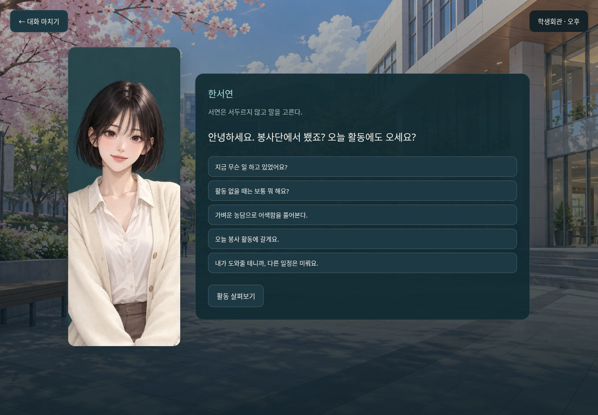
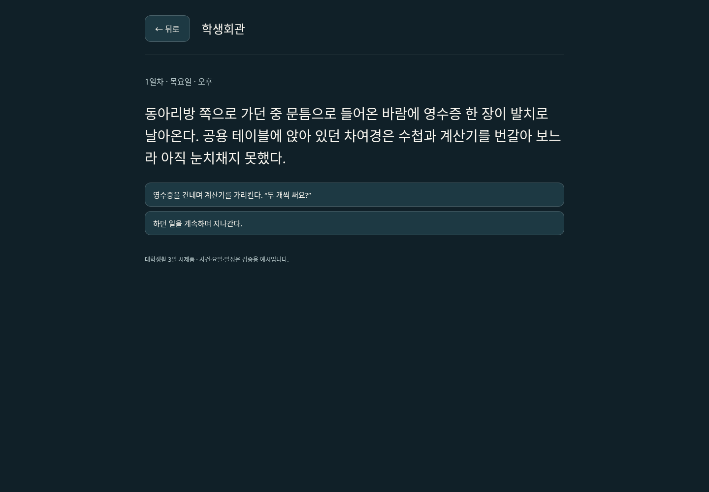
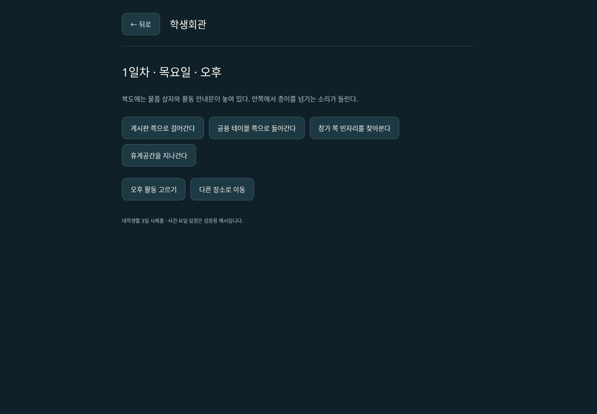
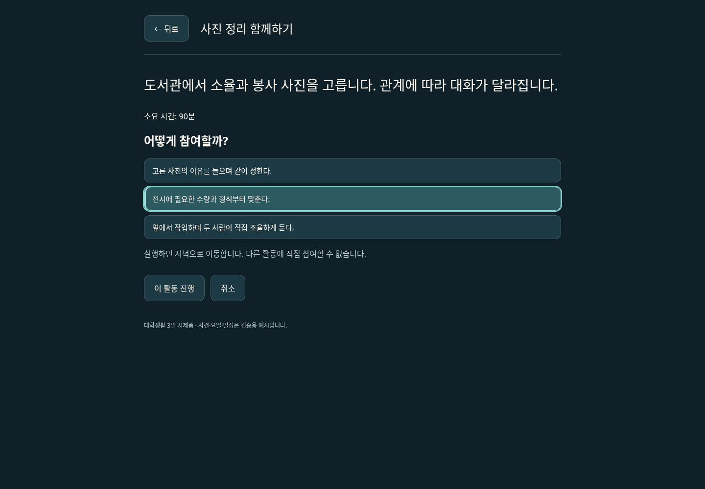
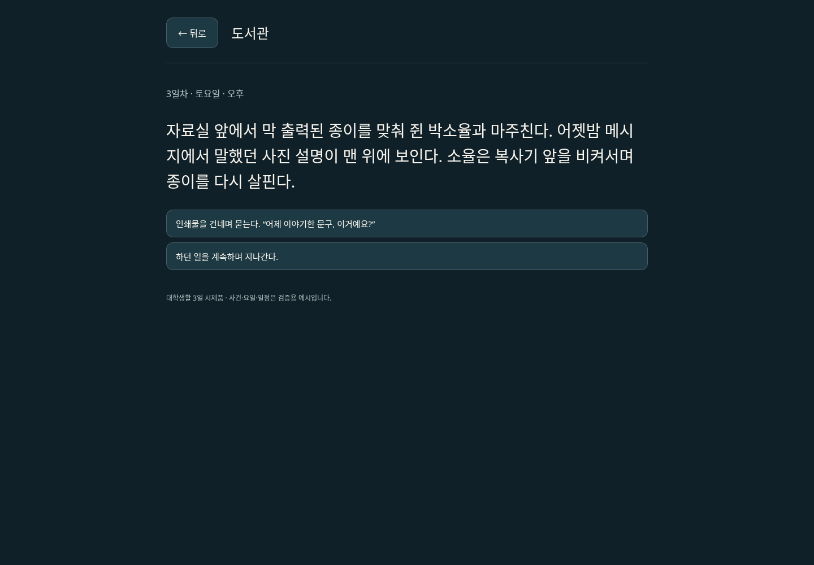

# 기본 UI 방향성 시안

상태: 화면 전환 중심으로 수정한 기획. 실제 Unity 실행 화면이나 구현 완료를 뜻하지 않는다.

## 현재 확정 그림체 기준 · 2026-11-10

사용자가 이번 대화에 첨부한 남녀 캐릭터 참고 이미지 11장의 공통 시각 언어를 향후 인물 원화·표정·전신·이벤트 일러스트의 기준으로 사용한다. 이 기준은 앞선 여성 감염체의 사실적인 회화 질감 실험보다 우선한다. 모델 가중치를 재학습했다는 뜻은 아니며, 기존 이미지 전체를 이미 교체한 것도 아니다. 첨부 원본은 현재 저장소에 복사되어 있지 않으므로 아래 분석을 지속 가능한 제작 기준으로 보관한다.

- **선화:** 가늘고 선명한 윤곽선에 부분적인 굵기 차이를 준다. 머리카락과 눈·속눈썹은 섬세하게, 옷 주름은 방향과 구조가 읽히게 그린다.
- **얼굴:** 앳된 성인 대학생 인상, 부드러운 볼과 턱의 연결, 절제된 코 묘사, 작고 자연스러운 입술. 눈은 표현력이 있으면서 캐릭터별 눈매·눈꺼풀·눈썹·눈 사이 간격을 유지한다. 같은 얼굴을 머리만 바꿔 반복하지 않는다.
- **채색:** 검정·회색·아이보리와 차분한 저채도 색을 중심으로 한다. 피부는 중성 아이보리 톤으로, 감정에 따른 분홍 기운은 아주 약하게 국소적으로 조절한다. 화사한 고명도·홍조가 전체를 지배하지 않게 하고 배경은 차분한 회색 중간톤으로 맞춘다. 머리카락은 큰 덩어리와 결을 나누고 좁은 띠 모양의 하이라이트를 사용한다.
- **명암과 입체:** 구조가 읽히는 명확한 그림자 면에 필요한 곳만 부드러운 전이를 더한다. 얼굴의 강한 조각 같은 음영, 피부 전체의 번들거림, 반복되는 미세 얼룩·소용돌이 재질은 피한다. 옷감과 머리의 명암은 재질에 맞게 구분한다. 최신 사용자 요청에 따라 창가의 부드러운 방향광과 앞머리 아래·턱 아래·목·쇄골·손가락·옷 주름의 접촉 그림자를 보강해 조금 더 현실적인 입체감을 준다. 전체 화면을 일괄 어둡게 만들지 않고 밝은 면과 그림자 면의 국소적인 차이로 표현한다.
- **비율:** 전신은 자연스러운 성인 비율로 맞춘다. 두상·귀·손 크기를 몸과 함께 확인하고 캐릭터별 키와 골격·체형 차이를 보존한다. SD 전투 스프라이트와 모에화 컷신은 기존의 별도 비율을 유지하되 색과 헤어 실루엣으로 연결한다.
- **개성 보존:** 참고 이미지의 단발·검은 머리·점·피어싱·흡연·의상을 모든 캐릭터에게 부여하지 않는다. 김태이의 속쌍꺼풀·오른쪽 작은 링 피어싱 등 확정 설정과 각 인물의 기존 외형이 우선한다. 표정과 시선은 성격·감정·상태에 맞춘다.
- **감염체 예외:** 같은 선화와 채색 체계 안에서 눈의 안광과 생기·혈색을 낮춘다. 흐린 시선과 무너진 자세로 감염을 표현하며, 참고 이미지의 반짝이는 눈과 홍조를 그대로 적용하지 않는다. 최근 수정한 여성 감염체의 슬림한 체형 기준을 유지한다.

제작 시에는 해당 캐릭터의 승인된 최신 원화와 이번 스타일 참고 이미지를 함께 사용한다. 참고 이미지를 사용할 수 없는 후속 세션에서는 문서만으로 정확한 일치를 보장하지 말고, 원본 확보 필요 여부를 명시한다. 스타일 변경은 이후 제작부터 적용하고 기존 원화의 일괄 교체는 별도 작업으로 진행한다.

## 핵심 규칙

한 번에 하나의 주요 화면만 표시한다. 탐색 위에 대화·일정·활동 카드·휴대폰을 동시에 겹쳐 놓지 않는다.
버튼이나 상호작용을 선택하면 해당 기능의 전용 화면으로 바뀐다. 뒤로 가면 이전 위치와 선택 상태로 복귀한다.

## 화면과 이동

| 현재 화면 | 입력 | 다음 화면 |
| --- | --- | --- |
| 캠퍼스 탐색 | 사람과 대화 | 대화 전용 화면 |
| 캠퍼스 탐색 | 장소 입장 | 해당 장소 화면 |
| 장소 화면 | 활동 선택 | 활동 상세·선택 화면 |
| 탐색·장소 화면 | 휴대폰 버튼 | 휴대폰 홈 화면 |
| 휴대폰 홈 | 일정·메시지·지도·일지 | 선택한 항목의 전용 화면 |
| 탐색·장소 화면 | 메뉴 버튼 | 상태·저장·불러오기·설정 메뉴 |
| 대화·활동 | 종료 또는 완료 | 결과를 반영하고 기존 장소로 복귀 |
| 저녁 캠퍼스·장소·활동 결과 | 하루 마무리 | 당일 활동 확인 후 다음 날 캠퍼스로 이동 |
| 3일차 저녁 | 3일의 기록 보기 | 플레이어의 활동 기록 확인. 추가 날짜는 없음 |

- 탐색: 작은 시간 표시, 휴대폰·메뉴 버튼, 장소 입장 안내만 표시한다. 현재 시제품은 캠퍼스 배경과 정면의 김태이 초상화를 사용한다. 실제 3D 공간 이동은 미구현이다.
- 대화: 배경과 2D 초상화, 이름, 대사, 선택지만 보여준다. 탐색 HUD와 휴대폰은 숨긴다.
- 대화 중 태이가 선택한 실제 대사를 상대의 답변 위에 표시한다. 상대가 되물으면 곧바로 그 질문에 대한 선택지를 보여주고, 매번 별도의 '이어가기' 버튼을 요구하지 않는다.
- 진행 중인 주제를 유지하며 '다른 이야기로 넘어가기'로 주제 선택에 돌아갈 수 있다. 대화 마치기는 장소 화면으로 복귀한다.
- 인물 구도: 등을 보이는 주인공 배경을 기본 화면에서 사용하지 않는다. 대화에서는 현재 발화하는 인물이 정면으로 보이며, 다인 대화는 발화 순서에 맞춰 인물을 전환한다.
- 행동 선택: 지금 가능한 활동과 시간 비용을 보여준다. 활동을 고르면 상세 화면에서 약속 충돌 등 알려진 결과를 확인하고 실행한다.
- 휴대폰: 아이콘을 선택해 일정·메시지·지도·일지로 이동한다. 화면을 겹쳐 띄우지 않는다.
- 상태: 체력과 피로 등의 상세 수치는 상태 화면에서 확인한다. 재난 중 즉각적인 위험은 최소한의 경고로 전달한다.
- 알림: 휴대폰 버튼의 작은 미확인 표시만 사용한다. 메시지 본문이나 다른 장소의 장면을 탐색 중 자동으로 띄우지 않는다.

현재 시제품은 날짜·요일·시간대를 상단에 표시하며 자유관·도서관·카페로 장소를 전환한다. 각 장소는 생활 묘사와 이동 동선으로 표현하며 실제 해당 시간에 있는 인물의 장면만 발생한다.
휴대폰 일정에서 다음 날 약속과 취소 버튼을 확인한다. 충돌하는 활동의 상세 화면에는 관련 인물과 약속을 명시한다.

장소 화면에 인물 카드나 '누구와 대화하기' 버튼을 배치하지 않는다. 장소에 도착하면 진행 중인 상황을 보여주고, 그 상황에서 할 행동을 선택한다.
같은 봉사단 인물의 이름은 처음부터 알 수 있지만 선택지는 '영수증을 건넨다', '빈자리를 물어본다', '하던 일을 계속한다'처럼 표현한다.
인물과 관련 없는 이동 선택은 게시판·공용 테이블·창가·휴게공간 등 공간을 기준으로 표시한다. 같은 동선이라도 날짜·시간·인물 일정·이전 선택에 따라 만남이 달라진다.
대화가 끝나면 인물 선택 목록으로 돌아가지 않고 주변 공간으로 돌아간다. 약속 없이 만난 사람이 계속 플레이어를 기다리는 구도를 반복하지 않는다.

메뉴 화면 전환·뒤로 가기는 시간을 소모하지 않는다. 모든 날짜에 장소 이동·내부 탐색·짧은 현장 행동·대화 마무리는 여러 행동을 묶어 시간을 진행한다.
일정 기반 초기 시제품에서는 메뉴를 보는 동안 세계 시간을 정지한다. 실시간 탐색 도입 시 재검토한다.
활동 취소 시 결과를 적용하지 않는다. 완료된 활동의 시간·물자·관계 결과는 한 번만 반영한다.

## 정보 경계

지도는 알고 있는 장소만, 메시지는 실제 받은 내용만 보여준다. 타인의 모든 위치나 숨은 관계 수치는 공개하지 않는다.
UI를 전환해도 다른 인물의 일정과 사건을 계산하는 세계 상태는 유지한다. 화면을 열어야만 해당 장소의 사건이 진행되는 구조로 만들지 않는다.

## 미술 방향

크림색·짙은 남색 바탕에 청록색을 강조색으로 사용한다. 색과 함께 텍스트·아이콘으로 의미를 전달한다.
일상과 재난에서 기본 조작 위치를 유지하고 배경·조명·경고 우선순위로 분위기를 바꾼다.
캐릭터 초상화와 3D 외형의 주요 특징을 맞춘다. 시안의 시간·건물·외형은 참고용이며 확정 설정을 대체하지 않는다.

김태이의 헤어는 기존 히피펌 설정에서 수정한다. 일본 애니메이션 남자 주인공 같은 검은색 레이어드 헤어로, 강한 곱슬 대신 자연스러운 모발 흐름과 가벼운 볼륨, 층진 머리끝을 사용한다. 최신 탐색 시안에 이 방향을 반영했다. 앞머리는 이마를 덮어 내리는 덮머리로 표현하며, 이마를 드러내는 가르마나 치켜 올린 앞머리는 지양한다. 기본 일러스트의 트랙탑은 지퍼를 잠그고 깃을 낮게 눕힌다. 김태이의 얼굴은 진하고 강한 인상보다 예쁘장하고 섬세한 미남으로 잡는다. 얼굴 윤곽·눈매·눈썹의 강한 음영과 각을 줄이고 부드러운 인상을 유지한다. 차여경은 어깨 안팎의 중단발에 큰 S자 웨이브 위주의 느슨한 히피펌을 적용한다. 윗부분과 앞머리는 더 차분하게 두고, 길게 늘어지는 머리·촘촘한 잔컬·부풀린 볼륨을 줄인다. Unity의 투명 인물 아틀라스는 이 방향을 세 가지 표정 모두에 반영한다.

## 이전 시안

assets/campus-ui-concept.png는 최초 비교용 이미지로만 보존한다. 여러 장면을 함께 배치한 구성은 현재 UI 방향에서 사용하지 않는다.
이전 이미지의 강민준·서연대학교·한서연의 사회복지학과 표기는 생성 오류다. 김태이·백석대학교·치위생과가 확정 설정이며 한서연의 학년은 미정이다.

## 구현 시 확인

- 한 번에 하나의 주요 화면만 활성화되는가.
- 뒤로 가기 후 탐색 위치와 이전 메뉴 선택 상태가 복구되는가.
- 메뉴 탐색과 취소로 시간이 흐르거나 활동 보상이 발생하지 않는가.
- 시간 비용과 알려진 약속 충돌이 실행 전에 전달되는가.
- 본 적 없는 사건 정보가 노출되지 않는가.
- 키보드와 마우스로 같은 화면 이동이 가능하고 글자 크기를 조절할 수 있는가.

prototype/ 웹 시제품에서 전용 화면 전환, 활동 취소, 휴대폰 복귀, 세이브 슬롯 흐름을 구현하고 Chromium으로 검증했다. 정적 배경을 사용하는 기능 검증 단계이며 실제 3D 탐색·Unity UI 구현은 아직이다.
현재는 김태이·한서연·차여경·박소율의 정면 2D 초상화도 적용했다. 초상화는 외형 방향을 확인하는 초안으로, 표정별 차분과 최종 캐릭터 시트는 미완성이다. Unity UI 구현과 실제 3D 이동은 여전히 미구현이다.

## 이벤트에 따른 화면 반응

활동 상세 화면에서 상황에 맞는 참여 방식을 고른다. 선택된 항목은 테두리와 상태로 표시하며, 어떤 숨은 관계 수치가 오를지는 미리 숫자로 안내하지 않는다.
메시지·장소에서 이미 알게 된 내용만 지문에 반영한다. 조건부 부탁이 와도 별도의 인물 선택 카드나 대기 목록을 추가하지 않는다.
사건 분류명이나 내부 조건식은 개발 구조이며 실제 플레이 화면의 메뉴 이름으로 노출하지 않는다.

### 정보·획득 피드백

행동으로 새 정보를 알게 되면 화면 상단의 독립된 줄에 `◇ 새 정보`를 청록색으로 표시한다. 실제 소지 수량이 늘어난 아이템은 `▣ 아이템 획득`과 금색, 획득 수량으로 구분한다. 색상 외에도 기호와 문구를 함께 사용하며, 자동으로 사라지지 않고 확인 버튼으로 닫는다. 장면의 버튼을 가리는 오버레이는 사용하지 않는다.
알림의 `정보 · 소지품 확인` 또는 휴대폰의 `알게 된 정보 · 소지품`에서 정보 목록과 소지품을 확인한다. 정보에는 확인 날짜·장소·선택한 행동을 함께 기록한다. 본문에서 이미 알고 있는 정보의 정확한 명칭이 등장하면 청록색으로 강조한다. 재관찰이나 저장 불러오기로 신규 획득 알림을 반복하지 않는다.
현재 자유관의 공용 우산 대여가 첫 실제 아이템 지급 사례다. 보관 위치 발견은 정보이며 아이템 소유로 처리하지 않는다. 실제 대여 시 금색 획득 알림과 소지품 수량을 갱신하고, 반납 시 제거한다.

모든 날짜에 상단 시각을 표시한다. 짧은 이동·탐색·대화는 여러 행동을 묶어 시간이 흐르고 대화 도중에는 넘기지 않는다. 긴 활동 상세에는 현재 시각 기준 소요 시간과 종료 예상 시각을 표시한다. 16:00 대기나 한 활동 뒤 자동 귀가는 없으며, 저녁에도 가능한 자유행동을 이어간다. 귀가는 확인 화면에서 직접 결정한다.

### 동아리와 약속

휴대폰 학내 커뮤니티에서 모집글을 읽고, 이후 `읽어둔 동아리 안내`에서 공개 안내와 가입 상태를 다시 확인한다. 가입 버튼은 소속을 바꾸고, 실제 참석은 별도 제안으로 안내한다. 새 게임에는 가입한 동아리와 미리 아는 부원 이름이 없다.
일정 화면은 응답 전 제안과 참석 예정·처리 결과를 함께 보여준다. 누가 제안했는지, 날짜·시간대·장소 또는 활동, 겹칠 수 있는 일정, 수락·거절·사전 취소 버튼을 제공한다. NPC가 먼저 보낸 제안은 메시지와 화면 상단의 바로가기에서 확인한다. 제안과 수락된 약속을 같은 상태로 표시하지 않는다.
개인 약속도 인물 선택 메뉴를 생성하지 않는다. 실제 장소에서 자기 일을 하는 인물과 마주쳤을 때 오늘 약속을 기억하는 문장과 인사 선택지로 이어진다. 장소 입장만으로 약속을 지켰다고 처리하지 않는다.

### 전해 들은 이야기 표시

실제 만남에서 상대가 다른 사람에게 들은 내용을 꺼내면 기존 대화와 구분되는 `전해 들은 이야기` 문단을 보여준다. 인물은 전달자를 직접 언급하고, 확신할 수 없는 사정은 물어본다. 숨겨진 NPC 정보 교환을 알림으로 미리 공개하지 않는다. 태이가 그 이야기를 들은 시점에 정보 목록과 일지에 전달 경위를 남긴다. 일정에서는 NPC가 미수락 제안을 거둔 경우 `상대가 제안 보류`로 표시하고, 수락된 약속의 취소와 구분한다.

### 날씨와 예보

화면 상단의 작은 버튼에 날씨 기호·이름·기온을 함께 표시한다. 눌러 현재 장면을 대체하는 예보 화면을 열고, 뒤로 가면 진행 중이던 만남이나 대화로 돌아온다. 휴대폰에서도 같은 예보를 열 수 있다. 새 오버레이를 겹치지 않는다.
예보 화면에서 다음 날씨와 우산 준비를 확인한다. 자유관에서는 대여·반납 버튼을 제공하며 실제 아이템 획득은 기존 금색 알림으로 보여준다. 활동 카드와 상세에는 우천 대체·시간 변화·강한 비의 제한을 실행 전에 안내한다. 날씨 때문에 취소된 약속은 개인 불이행과 구분한다.
캠퍼스는 기존 배경 위 밝기·정적인 빗줄기 표현을 사용한다. 현재 실제 3D 날씨 렌더링은 아니다. [강한 비 예시의 모바일 화면](assets/weather-ui-preview.png)은 개발용 비교 모드에서 캡처했다.

### 일상 속 작은 변화

3일차 장소의 기존 이동 선택에 뒤편 출입문·도서관 로비 안내·창밖 정류장을 추가한다. 해당 공간을 살펴본 뒤 별도 전체 화면에서 더 확인하거나 돌아갈 수 있다. 새 인물 대기 목록이나 중첩된 이벤트 창을 만들지 않는다. 보이는 내용은 새 정보 알림으로, 추가 확인 결과는 안내와 일지로 남긴다.
접한 일이 생기면 휴대폰에 `확인한 일`을 표시한다. 직접 목격·안내 확인·전해 들음을 구분하고 출처와 내용을 함께 보여준다. 감염 확정 표시나 위험도 수치, 전지적인 사건 목록은 제공하지 않는다. 기존 일상 활동과 `교내 안내 확인`을 같은 활동 화면에서 비교하며, 다른 활동을 택해 놓칠 약속은 기존 방식으로 경고한다.
[출입문 앞에서 안내를 확인하는 모바일 화면](assets/campus-warning-preview.png)은 실제 시제품 캡처다.

### NPC의 판단과 동행

기존 대화에서 `주변에서 접한 일 이야기하기`를 누르면 태이가 실제로 아는 내용만 출처와 함께 고를 수 있다. 전달한 뒤에는 동행을 물어보거나 남은 대화로 돌아간다. 동행에 대한 답변 다음에는 일정 확인·활동 선택·대화 복귀를 제공하고, 앞서 하던 사진·길 안내 질문의 선택지를 바로 붙이지 않는다.
개인의 판단 점수를 노출하는 패널 대신 실제 장소에서 볼 수 있는 연락·정리 모습과 NPC가 보낸 연락으로 변화를 표현한다. 대화 중 이동 계획이 바뀌더라도 현재 교환을 마친 뒤 장소를 옮긴다. 동행 제안은 기존 일정 화면에서 응답하고, 실제 활동 결과에 함께한 인물을 표시한다.
[동행을 수락한 뒤의 모바일 대화 화면](assets/risk-decision-preview.png)은 실제 시제품 캡처다.

### 장면에서 생겨나는 행동

첫 화면은 오전 등교와 임박한 수업·장소를 우선 보여준다. 공강에는 자유관·도서관·카페 등으로 가는 동선을 제공한다. 커뮤니티 알림을 이야기 선택지로 강제하지 않는다. 실제 장소에서 만난 사람과 보거나 들은 요소가 후속 선택의 근거다.
행동은 현재 장소·날짜·이미 읽거나 본 정보·교류·약속에 따라 달라진다. 동아리 안내는 커뮤니티의 해당 모집글을 읽은 뒤 열리고, 준비를 도울지 살펴보면 바로 해당 일의 설명·소요 시간·약속 충돌로 이어진다. 취소는 공통 분류 화면이 아니라 직전 상황으로 돌아간다. 읽어둔 기록과 일정은 휴대폰에서 보조적으로 확인한다.
[공강 중 자유롭게 장소를 고르는 모바일 화면](assets/scene-flow-preview.png)은 실제 시제품 캡처다. 장소 안에서는 상황과 교류에 따라 후속 선택이 생긴다.

### 휴대폰의 학내 커뮤니티

휴대폰 홈에서 학내 커뮤니티를 누르면 캠퍼스톡을 휴대폰 안의 한 화면으로 연다. 전체·자유·모집·공지 탭, 글 목록, 작성자 구분, 본문, 익명 댓글과 글쓴이 답글, 공감을 제공한다. 모집글은 해당 동아리 안내와 현장 방문으로 연결한다. 커뮤니티 안에서는 행동 시간 설명과 다른 약속 제안 띠를 숨겨 읽는 화면에 집중한다.
새 글이 생겨도 목록을 밀어 올리지 않고 도착 알림으로 갱신한다. 본문을 읽는 동안에는 새 댓글 도착을 확인하게 하고 본문은 유지한다. 익명 글에는 신원·내용 미확인임을 표시하고, 실제 공지와 운영진 모집글은 출처를 구분한다. 확인되지 않은 이야기를 확정된 사건처럼 강조하지 않는다.
[가상 학생들의 글과 댓글이 쌓인 모바일 화면](assets/community-feed-preview.png)은 실제 시제품 캡처다. 외부 AI나 실제 에타 계정에 연결하지 않는 게임 내부 커뮤니티다.

### 자유행동과 실제 약속

일정에는 실제로 받은 제안·수락한 약속·처리 결과와 완료한 활동만 표시한다. 합주나 음악 작업을 개인 시간표에 자동 배치하지 않는다. 커뮤니티는 휴대폰에서 직접 열며, 탐색 장면에서 커뮤니티 열람을 다음 할 일로 제시하지 않는다. 기존에 수락한 약속은 자유행동 중에도 유지되며, 다른 일을 한 번 했다는 이유로 즉시 불이행 처리하지 않는다.

### 도서관의 생활 행동

도서관 안에 독서·코딩 공부·로비 휴식 선택을 추가한다. 결과는 같은 장소의 본문 안내로 보여주고 별도 중첩 창을 열지 않는다. 실제 확인한 서가·노트북 좌석·로비 벤치 위치는 기존 정보 강조와 휴대폰 정보 목록에 연결한다. 현재 시각과 장소 분위기, 현장 동선, 기존 긴 활동과 이동 선택은 유지한다. 짧은 행동으로 일정이나 약속을 자동 등록하지 않는다.

[독서를 이어간 도서관 모바일 화면](assets/library-life-preview.png)은 실제 실행 화면이다.

### 학교 건물과 층별 공간 안내

주요 건물은 본부동·예술동·음악관·체육관·외식관·창조관·은혜관·자유관·조형관·백석홀의 10곳으로 표시한다. 휴대폰 지도에서 주요 건물 목록과 창조관 내부 도서관·대학가 카페·명칭 미정인 기숙사 방문 공간을 구분한다. 화면의 현재 위치와 직접 알아둔 정보는 유지한다.

각 건물의 `건물 안의 다른 공간으로 간다`를 누르면 해당 건물의 내부 안내 화면으로 전환한다. 층수가 확정된 시설만 `4층 구석 · 대형 합주실`처럼 표시하고, 나머지는 시설명만 보여준다. 예술동 7층에는 강의실과 연습실이 함께 있으며 두 용도를 지우거나 하나로 합치지 않는다. 공간을 선택하면 장소 화면에 그 공간의 관찰 내용을 보여준다. 지도와 안내를 읽는 것만으로 내부 발견 기록을 미리 지급하지 않는다.

창조관 도서관은 기존 도서관 화면으로 이어진다. 외식관 안 카페와 대학가 카페를 같은 위치로 취급하지 않는다. 사용자에게 설정용 ID를 노출하지 않는다. 은행·편의점은 이번 단계에서 위치 확인만 가능하며 실제 거래 메뉴처럼 표시하지 않는다.

[예술동의 층별 공간 안내](assets/campus-layout-preview.png) · [교내 건물과 생활 공간 안내](assets/campus-buildings-preview.png)는 실제 모바일 실행 화면이다. 건물별 새 배경 일러스트는 이번 단계에 추가하지 않는다.

### 시간표·수업·공강

새 게임은 오전 09:00 등교에서 시작한다. 임박한 수업이 있으면 기존 배경·정면 초상화·장면 패널 안에서 과목·시각·건물을 안내하고 수업 장소 이동을 우선한다. 건물 화면의 수업 안내에서 올바른 내부 공간으로 이동한 뒤 입실을 선택한다. 수업은 과목별 전용 화면에서 참여 방식을 고르며, 마친 뒤 실제 종료 시각과 수업 결과를 표시한다. 시간표와 수업 창을 다른 화면 위에 겹쳐 띄우지 않는다.

휴대폰에 `시간표 · 출석`을 추가한다. 플레이어의 3일 수업·시간·장소와 예정·출석·지각·일부 참석·결석·이전 저장 기록 없음 상태를 보여준다. 다른 인물의 시간표와 위치를 명단으로 노출하지 않는다. 개인·동아리 약속 화면은 기존 기능을 유지하며 수업 표와 구분한다. 시간표를 확인하는 것만으로 출석 처리하지 않는다.

장소에는 다음 수업 안내를 두고, 공강이면 자유행동을 이어간다. 긴 활동이 수업과 겹치면 과목·시각과 지각·결석 가능성을 상세 화면에 표시하고 실행 버튼에도 충돌을 드러낸다. 일찍 귀가하는 확인 화면도 남은 수업이 결석 처리됨을 안내한다. 하루 마무리에는 실제 수업 출석을 포함한다. 오전은 시각에 맞춰 오전으로 표시한다.

[오전 등교 화면](assets/school-arrival-preview.png) · [보컬 앙상블 수업 참여](assets/classroom-preview.png)는 실제 시제품 실행 화면이다.

### 미연시 방식의 문장·선택 진행과 상단 메뉴

현재 진행 화면은 배경과 정면 인물을 크게 유지하고 하단의 단일 대화창을 사용한다. 종전의 긴 본문·학교 안내·여러 행동 목록을 한 번에 세로로 나열하는 화면을 대체한다. 장소·수업·활동 상세·결과·만남·실제 대화·건물 내부 안내·하루 정리를 이 흐름으로 연결한다. 메뉴·휴대폰은 전용 화면으로 전환하며 여러 창을 겹쳐 열지 않는다.

설명과 대사는 약 180자 이내의 읽기 단위로 나눈다. 문장을 자르거나 생략하지 않으며 끝까지 읽은 뒤 선택 단계로 넘어간다. `다음`, 문장 터치, 스페이스를 지원한다. 선택지가 나온 뒤에는 문장을 다시 눌러도 임의로 답을 고르지 않는다. 실제 대화에서는 내 선택 대사 → 관찰 가능한 반응 → 상대의 답변을 구분해 표시한다. 인물 이름은 기존 인지 규칙을 따른다.

선택은 한 번에 최대 3개 버튼으로 보여준다. 선택이 많을 때는 실제 행동 두 개와 다른 선택을 보는 버튼 하나를 표시하며, 페이지 순서를 작게 안내한다. 모든 기존 선택은 뒤의 묶음에서 다시 찾을 수 있고 넘기는 동작은 행동·시간·관계 보상에 집계하지 않는다. 대화의 주제를 바꾸거나 약속을 물을 때는 `조금 다른 이야기를 꺼낸다` 다음 단계로 묶고, 다시 원래 답변 선택으로 돌아올 수 있다. 활동의 참여 방식도 별도 선택 단계 뒤 실행 여부를 확인한다.

우측 상단에는 휴대폰과 메뉴 버튼을 둔다. 메뉴의 기능 탭에는 이동·시간표·약속·지도·정보·메시지·일지·날씨를, 저장·설정 탭에는 저장·불러오기와 비교 예시를 둔다. 수업이 임박했을 때의 실제 입실·수업 장소 이동은 이야기 선택에도 유지한다. 일반 장소 간 이동과 기록 메뉴를 장면 답변에 모두 섞어 나열하지 않는다. 새로운 약속 제안은 메뉴 표시에 작게 알린다.

새 정보는 작은 획득 표시와 정보 보기로 안내하며 목록을 대화창에 전부 펼치지 않는다. 실제로 경과한 시간은 다음 이야기 문장으로 알리고 현재 시각과 날씨도 상단 장면 정보에 유지한다. 메뉴·휴대폰·커뮤니티·모집 안내를 거쳐 돌아와도 원래 문장과 선택 단계가 유지된다. 이 화면 커서는 현재 실행 중에 유지하며 저장 파일의 세계 상태와 구분한다.

밝은 대화창과 짙은 글씨를 사용하고, 정보는 짙은 청록·아이템은 짙은 황갈색으로 구분한다. 모바일에서는 인물 얼굴과 하단 대화창이 함께 보이도록 배치하고 대화창만 필요할 때 내부 스크롤한다. PC도 같은 화면 구성을 사용한다. 건물마다 새로운 내부 일러스트를 추가한 것은 아니다.

[대화 화면](assets/vn-dialogue-preview.png) · [상단 메뉴](assets/vn-menu-preview.png) · [수업 화면](assets/classroom-preview.png) · [PC 화면](assets/readability-desktop-preview.png)은 실제 실행 화면이다. 모바일 390×844·PC 1440×1000, 웹 모듈·단독 HTML에서 이미지 실제 로딩, 본문 대비 4.5:1 이상, 단계별 문장·답변, 선택 수 제한, 메뉴·중첩된 모집 안내 왕복, 이름 인지, 가로 넘침과 수업 3일·출석·저장·결석을 검증한다. 이전 페이지 나열 구조를 직접 탐색하던 테스트 대신 `vn_browser_smoke.py`와 갱신한 `timetable_browser_smoke.py`를 현재 UI 검증 진입점으로 사용한다.

### 커뮤니티 모집글에서 실제 작업으로

봉사·음악·축구 모집글에 공개 활동 상세 선택을 둔다. 동아리 가입 안내와 구분하고, 상세에서 날짜·장소·총 소요 시간·참여 가능 여부를 읽은 뒤 현장으로 간다. 상세를 읽기만 했는데 이미 현장 인물과 만난 것처럼 서술하지 않는다. 불참·미가입도 가능하다.

현장에서는 기존 미연시 대화창과 3개 이하의 선택을 유지한다. 작업을 고르면 내 행동과 현장 반응이 차례로 나오고 다음 단계로 이어진다. 상단에 활동 이름과 1/3~3/3 진행을 표시한다. 현장 인물은 실제 소개 전에는 이름을 숨긴다. 진행을 잠시 멈추는 선택과 메뉴의 이어 하기에서 단계가 보존되며 이동·시간표 등 기능 버튼을 매번 본문에 나열하지 않는다.

마지막 단계 뒤에는 실제로 한 일의 결과와 참여 시간을 보여준다. 가입 안내를 읽거나 현장을 떠나는 선택은 별도다. [봉사 물품 준비 진행 화면](assets/community-activity-preview.png)은 실제 실행 화면이다. `community_activities_browser_smoke.py`는 모집글에서 시작하는 세 활동, 중단·저장·재개와 우천 대체를 현재 대화 UI에서 검증한다.

대화 재방문은 인물 선택 메뉴가 아닌 현장 조우를 유지한다. 완료한 대화의 후속 조건이 생기면 이전과 다른 행동 중인 인물을 마주치고, 앞선 이야기의 결과를 묻는 말로 이어진다. 선택은 실제 말투의 문장으로 표시하며 기존 한 문장씩 읽기·세 개 이하 선택지 UI를 유지한다. 현재 세 인물별 두 차례 후속을 제공하며 준비된 내용이 없으면 같은 사건을 재시작하지 않는다.

NPC의 피로·부담·대화 여유는 숫자 게이지나 속마음 설명 대신 시계 확인, 대답 간격, 작업을 놓지 못하는 손동작과 직접 발언으로 표현한다. 수업 직전에는 짧은 인사와 다음으로 미루기가 중심이 되고, 편안할 때만 원래 주제로 이어가는 선택을 제공한다. 상황 확인과 원래 대화는 한 화면의 미연시 흐름으로 이어지며 별도의 상태 팝업을 띄우지 않는다. 거절 뒤의 재촉은 관계와 현재 기분에 영향을 남긴다.

일반 플레이의 평상시 일대일 대화는 생성한 발언과 그에 맞는 두 후속 발언, 대화 마치기 선택으로 표시한다. 같은 상황의 새 대화에서도 발언은 달라질 수 있지만 읽는 도중·메뉴 왕복·저장 복원 중에는 바뀌지 않는다. 기존 미연시의 문장별 읽기와 세 개 이하 선택지를 유지하고 생성 과정이나 난수 값은 플레이 화면에 노출하지 않는다.

자체 모델은 게임 서버가 준비되면 자동 사용하며 플레이어용 AI 설정·모델 다운로드 화면을 추가하지 않는다. 새 발화를 기다릴 때만 ‘잠시 말을 고르고 있다…’와 ‘기다리지 않고 이어가기’를 표시한다. 대기 중에는 시간 진행·중복 답변·키보드 넘기기를 막고, 실패하면 기존 발화를 보여주어 계속 플레이할 수 있게 한다.

호실 안내는 층 선택 → 해당 층 호실 선택 → 방 앞 장면 전환 순서로 제공한다. 시간표·도착 안내·장면 위치에 401호 같은 정확한 주소를 표시한다. 건물 진입에서 학과 구성 설명을 반복하지 않는다. 휴대폰의 동아리 안내는 신청서를 여는 기능이며 원격 즉시 가입 버튼을 없앴다. 현장 면접과 결과 연락 뒤 가입 의사를 확인한다. ‘알게 된 사람들’은 배운 이름·전공·마지막 목격만 보여주고 미대면 인물의 프로필이나 현재 위치를 공개하지 않는다.

### 메뉴와 휴대폰의 탐색성 개선

메뉴는 ‘지금 할 일·학교생활·내 기록’으로 묶고 이동과 휴대폰을 큰 바로가기로 배치한다. PC에서는 현재 인물·위치·시각을 왼쪽 요약에, 기능을 오른쪽에 놓는다. 모바일에서는 요약을 짧은 가로 카드로 바꾸고 기능을 두 열로 배치한다. 아이콘과 기능명, 짧은 용도 설명을 함께 사용하고 색만으로 기능을 구분하지 않는다. 상단 미연시 메뉴에도 휴대폰/메뉴 아이콘을 추가했다.

휴대폰은 독립된 홈 화면으로 바꾸고 현재 게임 시각·요일·현재 위치, 다음/진행 중 수업과 실제 호실, 날씨 위젯, 3열 앱 아이콘을 제공한다. 캠퍼스 앱과 개인 기록 앱을 구분한다. 메시지는 실제 미열람 메시지 수, 일정은 응답 전 제안 수만 배지로 표시한다. 메시지를 읽으면 배지가 사라진다. 허구의 신호·배터리 수치나 플레이어가 모르는 인물 정보는 추가하지 않는다. 학과 소개·AI 설정 같은 구현 설명을 새 홈 화면에 넣지 않는다.

저장 탭은 슬롯별 게임 날짜·시각·장소를 미리 보여주고 빈 슬롯 불러오기는 비활성화한다. 관계·날씨의 개발용 비교 설정은 접힌 영역에 두어 일반 저장 동선과 구분한다. 메뉴·휴대폰 상단에 중복되던 공통 날씨 막대는 숨기고 각 화면의 위젯/기능으로 접근한다. 메뉴·휴대폰을 열고 닫는 행위나 앱 사이 이동은 게임 시간을 진행하지 않는다. 기존 대화 문장과 선택지 커서는 왕복 후 유지한다.

검증: 기존 자동 테스트 220개 통과. 웹 모듈·단독 HTML의 320/390/1440px 화면에서 가로 넘침, 앱 접근, 빈 슬롯·저장 정보·불러오기, 미열람 배지와 읽기 후 제거, 대화 복귀를 브라우저로 확인했다. 별도 단위 테스트로 스타일 구현을 복제하지 않고 실제 화면 검증을 사용한다. 실행 화면은 `docs/assets/phone-home-ui.png`, `docs/assets/menu-dashboard-ui.png`에 저장한다.

### 비 오는 점심 동행 장면

건물 출입구의 우연한 마주침에서 바로 기존 미연시 화면으로 이어진다. 이름을 모르면 외형 설명을 유지하고, 실제 자기소개 후에만 이름표를 바꾼다. 동행 제안·길 고르기·걷는 동안의 행동·자리 찾기·헤어짐이 같은 흐름 안에서 이어진다. 대화는 플레이어 발언/행동 → 상대 반응 → 이동이나 식사가 진행된 묘사 순으로 읽는다. 걸어 도착하면 장면 위치가 외식관 1층 101호로 바뀌며 강제로 다른 메뉴를 띄우지 않는다. 대화와 선택은 기존 세 개 이하 선택지 규칙을 따른다. 메뉴·휴대폰 왕복과 저장 복원으로 현재 문장이 바뀌지 않고 메뉴에서 진행 중인 장면으로 돌아올 수 있다. 실행 예시는 `docs/assets/rain-lunch-preview.png`에 저장한다.

### 합주 활동 장면

기존 초상화 대신 합주실·마이크·악기·함께 연주하는 세 사람을 같은 미연시 화면에 배치하는 원본 SVG 2D 시제품을 추가했다. 태이는 파트 선택에 따라 마이크/베이스/기타를 들고, 준비·파트 연습·호흡 맞추기·공연·마무리 상태를 표시한다. 공연에는 작은 자세 움직임을 적용하고 동작 줄이기 설정을 따른다. 메뉴 오버레이를 추가하지 않으며 이전 미연시 읽기와 선택지 흐름을 유지한다. 3D 모델이나 최종 캐릭터 일러스트는 아니고 연출 구도 검토용이다. 음원 재생도 아직 없다. 실행 장면은 `docs/assets/music-activity-preview.png`에 저장한다.

검증: 전체 JS 테스트 233개 통과. `python3 prototype/music_scene_browser_smoke.py`로 웹/다운로드 HTML에서 수업 → 휴대폰 모집글 → 실제 합주 → 저장/불러오기 → 공연, 파트·단계 그림 전환과 시간, 모바일 가로 넘침을 확인했다. 기존 세 공개 활동 브라우저 회귀 검증도 수행한다.

### 농구·조리·운반 활동 화면

공통 미연시 화면 안에서 준비/활동/마무리/완료에 맞춰 코트와 골대·공, 앞치마와 조리대·냄비, 운반 상자·통로 장애물·보관대를 표시한다. 태이의 슛/패스/운반 자세와 도구 위치가 실제 선택에 따라 바뀐다. 농구 장면에는 실제 공격 횟수와 득점, 선택 직전 문장에는 관찰한 수비와 남은 여력을 표시한다. 한 번에 기존 규칙의 최대 세 선택지를 유지하고 읽기·메뉴 동작으로 활동 결과를 바꾸지 않는다. 조리의 수증기 움직임은 동작 줄이기 설정을 따른다. 모바일에서는 전체 코트가 보이도록 장면 비율을 보존한다.

캠퍼스톡에 ‘체험’ 탭을 추가하고 동아리 모집과 구분한다. 체험 게시물의 진행자 명칭을 표시하며 없는 동아리 가입 안내 버튼을 만들지 않는다. 정확한 활동 호실에서는 상황형 참여 선택지가 나타나 휴대폰을 읽지 않아도 현장 안내를 듣고 시작할 수 있다. 읽지 않은 게시글을 읽음 처리하지 않으며 돌아가기 동선도 현장에 연결한다.

검증: JS 전체 240개 통과. 웹 모듈과 단독 HTML에서 실제 수업→체험글→농구(공격 중 저장/불러오기)→조리→직접 호실에 들어가 운반에 참여하는 흐름을 Chromium으로 검증했다. 활동 시간·부분 저장·완료·가로 넘침·미열람 게시글 지식 경계를 확인했고 기존 세 공개 활동 브라우저 회귀 검증도 통과했다. 예시는 `docs/assets/basketball-activity-preview.png`, `docs/assets/cooking-activity-preview.png`, `docs/assets/carry-activity-preview.png`에 저장한다.

### 활동 중 짧은 직접 조작

액티비티의 행동 선택 후 기존 하단 이야기 패널이 가벼운 미니게임 패널로 바뀐다. 장면과 상단 메뉴는 유지하며 모달을 겹치지 않는다. 제목·입력 횟수·짧은 조작 안내·목표 구간·이동 표시·큰 조작 버튼·즉시 피드백을 제공한다. 시작과 조작은 Space/클릭/터치를 함께 지원한다. 목표는 색 외에도 테두리와 ‘목표’ 문구로 구분한다. 매 프레임 보조기기에 위치를 읽어주지 않고 입력 후 정확도만 상태 안내로 읽는다. 타이밍 없이 진행하는 버튼도 제공한다.

미니게임 중 Space가 이야기 넘기기로 동시에 처리되지 않는다. 길게 누르거나 빠르게 중복 클릭해도 연속 입력으로 완료되지 않는다. 메뉴 버튼에 키보드 포커스가 있으면 기본 버튼 조작을 유지한다. 결과는 확인 버튼으로 명시적으로 넘긴 뒤 기존 대화·활동 화면으로 돌아간다. 모바일에서는 큰 조작 버튼을 한 줄로 배치하고 작은 화면은 패널 내부에서 스크롤한다.

검증: 전체 JS 테스트 247개 통과. `python3 prototype/activity_minigame_browser_smoke.py`에서 웹/단독 HTML의 실제 Space·마우스·터치, 키 유지 중 반복 억제, 확인 전 무보상, 메뉴 중 정지, 1회 입력 후 저장/불러오기, 정확도에 따른 결과와 소요 시간을 확인했다. 기존 액티비티 브라우저 검증은 보조 진행 경로도 확인하도록 갱신했다. 일반 미연시 화면 브라우저 회귀 검증도 수행한다. 미리보기는 `docs/assets/activity-minigame-preview.png`, `docs/assets/activity-minigame-mobile.png`다.

### 캐릭터 일러스트·표정·자세 개선

`docs/assets/activity-character-scenes.png`는 태이의 농구/조리/운반 3열 활동 CG이고, `docs/assets/character-expressions.png`는 태이·서연·여경·소율 순서의 4열 × 미소/걱정/진지함 3행 아틀라스다. 원래 얼굴과 의상을 참조해 생성했다. 활동 화면은 단순 벡터 인물 대신 중앙 CG와 같은 이미지의 흐린 주변 배경으로 구성하며 모바일에서는 얼굴을 상단 위치 안내 아래에 배치한다. 그림을 다른 비율로 늘리지 않고 중앙 인물 비율을 유지한다. 기존 기본 초상화도 남겨 중립 장면과 새 연기 이미지를 구분한다.

대사 줄이 바뀔 때 현재 문장과 상태에 맞는 표정·자세를 적용하고 메뉴 왕복으로 재추첨하지 않는다. 이름을 모르면 기존 외형 이름표를 유지한다. 입력 미니게임에는 각 입력 점수 칸과 정확도별 짧은 소리를 붙이고 음소거 상태를 브라우저에 보존한다. 소리는 직접 입력할 때만 재생하며 외부 파일이나 음성 API는 사용하지 않는다. 운동장과 야외 코트는 별도 야외 배경을 사용한다.

검증: JS 250개 통과. `freedom_art_browser_smoke.py`로 웹/단독 HTML의 오전 야외 탐색·수업 중 자유행동·CG 표시, 실제 감정 상태 3종에 따른 대화 초상화와 메뉴 왕복 유지 여부를 확인한다. 미니게임 키보드/클릭/터치와 일반 미연시 화면도 기존 브라우저 검증을 수행한다.

### 전체 인터페이스 정리

`prototype/interface.css`에 공통 색상·테두리·여백·타이포 규칙을 모았다. 밝은 종이 바탕, 짙은 청록의 주요 동작, 옅은 녹색/금색 보조 강조를 이야기·메뉴·휴대폰·커뮤니티·이동·기록·저장·미니게임에 적용한다. 서버용 페이지와 다운로드 HTML은 동일한 스타일을 사용하고 단독 HTML에는 새 CSS까지 인라인으로 포함한다.

이야기 화면은 위치/호실/시간/날씨를 작은 HUD로 묶고 중복 건물 표기를 없앴다. 대사에 현재 문장/전체 문장의 실제 읽기 진행 표시를 제공하고 선택지에는 번호·간격·보조 선택 스타일을 적용한다. 캐릭터 이미지 가장자리와 종이 패널을 부드럽게 연결하고 중요한 이름·대사·주요 버튼의 대비를 유지한다. 모바일에서는 위치 안내와 상단 메뉴가 겹치지 않게 배치한다. 메뉴·휴대폰은 기존 기능/읽지 않은 알림/저장 동선을 유지하면서 색과 모서리·아이콘·헤더 규칙을 통일했다. 커뮤니티는 글 단위 카드, 기록과 시간표는 목록 카드로 구분한다.

캠퍼스 이동은 단순 건물 버튼 목록을 검색 가능한 장소 카드로 바꿨다. 전체/야외/강의·연습/생활·모임 분류, 장소/공간 검색, 현재 위치, 실제 결과 개수, 결과 없음 안내를 제공한다. 모바일 두 열·PC 세 열로 표시한다. 분류와 검색은 화면 상태만 바꾸며 게임 시간·발견 정보·인물 위치를 변경하지 않는다. 검색어 입력 중 포커스는 유지하고 휴대폰 왕복 후 조건도 유지한다. 장소명과 공용 공간의 기본 안내만 보여주고 NPC의 실시간 위치나 아직 배우지 않은 개인정보는 표시하지 않는다.

검증: 기존 JS 250개 통과. `interface_browser_smoke.py`는 웹/단독 HTML의 320/390/1440px에서 검색/분류/결과 없음·검색 포커스·휴대폰 왕복·시간 유지·HUD 간격·실제 열 개수를 확인한다. 단독 HTML을 웹으로 제공해 검증하고 CSS가 인라인임을 별도로 검사한다. 관리 브라우저는 file:// 접근을 금지하므로 이번 환경에서 파일 직접 열기 검증은 하지 못했다. 기존 미연시·메뉴/휴대폰·저장/알림·Space/마우스/터치 미니게임 브라우저 검증도 통과했다. 미리보기는 `docs/assets/interface-story-mobile.png`, `interface-menu-preview.png`, `interface-phone-preview.png`, `interface-travel-preview.png`다.

### 주문 행동과 우연한 상황의 연결

카페의 ‘주문대 쪽으로 간다’는 같은 미연시 화면에서 메뉴 → 온도 → 주문 확인 → 준비된 음료 수령 → 마시기/이동으로 이어진다. 선택 전에는 가격, 결제 전에는 실제 지출과 준비 대기를 안내한다. 수령 후에만 기존 획득 안내로 음료를 표시한다. 주문·활동·사건은 각각의 현재 문장과 소수의 선택지로 읽으며, 별도 고정 인물 대화 메뉴나 자동 합석을 추가하지 않는다.

일상 활동을 마쳤을 때 우연한 일이 생기면 진행한 활동과 눈앞의 사건을 이어 읽고 대응을 고른다. 메뉴/휴대폰 읽기는 결과를 바꾸지 않고 저장 후 메뉴 카드로 같은 사건에 돌아올 수 있다. 다른 행동을 택하고 떠나도 진행은 가능하다. 예시 화면은 `docs/assets/cafe-order-preview.png`, `docs/assets/everyday-event-preview.png`에 저장한다.

검증: JS 전체 256개 통과. 새 카페/일상 브라우저 검증은 웹/단독 HTML의 주문·지불·저장/복원·수령·소비, 우연한 일의 대응과 저장 복귀, 다음 활동의 묘사 변화, 초면의 거리감을 확인한다. 일반 미연시·공개 체험·Space/클릭/터치 미니게임 회귀 검증도 통과했다.

### 카페 기준 장면으로 미술 방향 재정리

카페 주문 장면을 완성도 기준 화면으로 다시 제작했다. `docs/assets/cafe-order-cinematic.png`는 기존 태이 얼굴과 운동복을 참조한 단일 와이드 CG다. 카운터·직원·창가·실내 조명·주인공을 같은 시점과 빛으로 구성하고, 주문 전 커피를 들고 있지 않게 했다. 주문 화면에서는 야외 캠퍼스 배경과 별도 초상화를 제거하고 이 CG 한 장을 원본 비율로 표시한다. PC는 공간 전체를, 모바일은 주인공·카운터가 남는 높이와 위치를 사용한다. 직원은 이름 미정의 배경 인물이다. 이 CG는 주문 이벤트의 정지 키아트이며 결제/수령 단계별 애니메이션이나 날씨별 신규 그림은 아직 없다.

공통 미연시 대사창은 종이 카드와 두꺼운 테두리 대신 어두운 반투명 패널·얇은 선·작은 이름표로 바꿨다. 선택지는 큰 둥근 버튼 대신 줄 간격과 얇은 구분선으로 정리하고 포커스 테두리와 실제 터치 영역은 유지했다. 상단 위치/메뉴도 작은 각진 표기로 통일했다. 미니게임은 PC에서 작은 하단 패널로, 모바일에서는 조작 버튼 크기를 유지한 간결한 패널로 구성한다. 기존 활동 CG의 주변을 늘려 흐리게 채우던 배경을 없애고 단색 여백을 사용한다. 메뉴·기록의 과도한 곡률과 그림자도 줄인다. 기존 모든 이벤트 일러스트를 새로 그린 상태는 아니며 카페를 먼저 기준 장면으로 반영했다.

검증: `cinematic_cafe_browser_smoke.py`로 웹/단독 HTML, 390px 모바일/1440px PC의 실제 CG 로딩·별도 초상화 미중복·선택지·주문/수령·가로 넘침을 확인했다. 기존 대화 대비/진행·Space/클릭/터치 미니게임·메뉴/휴대폰/저장 브라우저 검증도 통과했다. 실행 예시는 `docs/assets/cinematic-cafe-mobile.png`, `docs/assets/cinematic-cafe-desktop.png`다.

### 다인물 봉사 준비의 장면 흐름

현재 준비실에 있는 사람과 실제 들은 시간 제약을 단계별 설명에 표시한다. 이름을 모르면 외형 이름표로, 직접 소개를 나눈 뒤에만 이름으로 표시한다. 늦게 오는 사람은 다음 실제 교류 때 소개하고 먼저 간 사람을 계속 대화 초상화로 띄우지 않는다. ‘가능한 시간과 역할 듣기/도움 범위 다시 나누기/직접 마무리’ 선택을 기존 수량 대조/운반/인수인계와 함께 제공하며 한 화면 최대 선택지 규칙을 유지한다. 현장 참여와 커뮤니티 공개 체험이 같은 장면으로 이어진다.

대화 화면의 추가 행동에서 실제 참가자에게 ‘지난 봉사 준비가 어떻게 됐는지’ 물어볼 수 있다. 이름을 아직 모르거나 실제 참가하지 않은 사람에게는 이 행동을 만들지 않는다. 보고 후에는 출처와 범위를 저장하고 같은 보고를 반복 보상하지 않는다. 이번 변경은 사건 구조와 기존 캐릭터 초상화 연결이며 별도 단체 이벤트 CG를 새로 제작한 것은 아니다.

검증: 전체 JS 266개 통과. 참가/중도 이탈/늦은 합류, 같은 조의 공동 책임과 단독 부담, 고호감도의 도움 거절, 비참여 세계 진행과 관계 변화, 타 일정 우선, 저장·읽기 무재추첨, 중도 이탈의 부분 기억, 참가자의 제한된 보고, 늦은 참여의 실제 시간을 검증했다. `supply_story_browser_smoke.py`는 웹/단독 HTML에서 정상 게임 세계의 실제 현장 진입·세 인물의 단계별 통성명·역할 결정 저장/재개·인수인계와 비참여 일지의 정보 경계를 확인한다. 기존 공개 활동과 미연시 화면의 브라우저 검증도 통과했다. 예시는 `docs/assets/supply-group-preview.png`다.

### 다음 날 연락과 짧은 협력/휴식 장면

지난 봉사 경험이 있는 동료가 직접 보내는 인게임 메시지와 제안 카드를 기존 휴대폰·일정 화면에 연결했다. 수락하지 않은 제안은 참석 예정으로 표시하지 않는다. 실제 약속 장소에서는 만나기로 한 동료와 짧게 함께하는 상황 선택지가 나타나고, 직접 대화 중에도 함께했던 일을 바탕으로 시간을 제안할 수 있다. 현재 기분과 일정에 따라 거절할 수 있다.

‘이어지는 시간’ 장면은 휴식/정리 메모/협력 방식 조율 중 해당 반응으로 진행하며, 두 행동(각 10분)과 작은 마무리로 구성한다. 등장 인물은 실제 현재의 동료 한 사람이고 그의 기존 초상화와 상황별 자세를 사용한다. 별도 이벤트 CG를 새로 생성한 작업은 아니다. 중간 저장 후 메뉴 복귀 카드로 실제 상대가 있는 자리에서 이어갈 수 있다. 장소를 떠났거나 시간 여유가 없으면 상대를 다시 생성하거나 억지로 붙잡지 않는다. 친구끼리 함께 있는 관찰 장면은 보이는 행동만 묘사하고 아직 모르는 이름이나 비공개 사정을 설명하지 않는다.

검증: JS 279개 통과. 실제 경험에 따른 제안/미제안, 수락과 이행 분리, 업무 신뢰와 긴장·휴식의 다른 결과, 큰 긴장의 부분 회복, 고호감도의 일정 거절, 비참여 시 NPC끼리의 동선·시간·정보 경계, 약속 불이행의 일회 반영과 사후 회복, 부분 저장/재개/중복 방지, 자체 모델의 당사자별 문맥, 동료 시간과 플레이어 시간의 중복 방지, 기존 저장 초기화를 확인했다. `supply_aftermath_browser_smoke.py`로 웹/단독 HTML에서 실제 다음 날 시작→메시지→수락→수업→약속 장소→중간 저장/불러오기→20분 이행까지 확인했다. 기존 봉사 사건과 미연시 화면 회귀 검증도 통과했다. 예시는 `docs/assets/supply-aftermath-preview.png`다.

### 확정 그림체와 소율 단발 반영

사용자가 제공한 애니메이션 장면처럼 섬세한 선과 낮은 채도와 부드럽게 겹친 명암 채색, 차분한 색감으로 인물을 통일한다. Unity 기본 인물 아틀라스의 네 인물·세 표정을 이 방향으로 다시 제작했다. 소율은 검은 단발이며 서연보다 날렵한 실루엣을 쓴다. 태이의 덮머리·잠근 트랙탑·눕힌 깃, 여경의 느슨한 중단발 웨이브는 유지한다. 기존 배경과 이벤트 CG 전체를 다시 그린 작업은 아니며, 이후 제작·교체할 이미지에도 같은 미술 방향을 적용한다.

추가 색감 보정: 쨍한 원색과 평면적인 색면을 줄이고 피부·머리카락·옷 주름에 부드러운 명암과 절제된 하이라이트를 넣는다. 선명한 애니메이션 선화는 유지하며 과한 광택을 피하되, 위·옆에서 들어오는 빛과 얼굴 옆면·턱 아래·머리 안쪽·옷 주름의 깊은 그림자를 분명히 나눠 부피감을 강조한다. 이 보정은 현재 인물 아틀라스 전체에 적용했다.

### 인물 얼굴의 개성 분리

태이는 가로로 긴 섬세한 눈매와 갸름한 얼굴, 서연은 작고 짧은 아기고양이상, 여경은 둥근 눈과 볼이 있는 얼굴, 소율은 긴 타원형 얼굴과 가늘고 차가운 눈매로 구분한다. 눈썹·코·입 비율도 다르게 제작하고, 각 인물의 세 표정에서 동일한 구조를 유지한다. 공통 선화·낮은 채도·입체적인 명암은 유지한다. 상세 기준은 `world-simulation.md`의 인물별 얼굴 구분 기준을 따른다.

인물 비율 보정: 네 인물의 세 표정 모두에서 머리와 머리카락 전체 크기를 어깨·상체에 비해 줄여 성인 체형으로 조정했다. 목을 과하게 늘리거나 얼굴만 작게 만드는 방식은 피하고, 기존 얼굴 개성과 헤어·의상·명암을 유지한다. 전신 등신 수치는 이 상반신 아틀라스만으로 검증하지 않는다.

### 전신 자산

`FullBodyLineup.png`는 투명 배경 전신 라인업이다. 기존 4열×3행 `StandSprites.png`와 프레임 구성이 다르므로 대화용 아틀라스에 덮어쓰지 않는다. 현재 대화 화면은 기존 표정 아틀라스를 유지하고, 전신 이미지는 Unity Resources에 별도 자산으로 포함한다. 향후 실제 전신 화면에 사용할 때에는 개별 인물 분리와 화면별 배치를 적용한다.

### 생존 상태창

메뉴의 ‘내 상태’는 스태미나(녹색), 배고픔(황토색), 목마름(청색), 공포감(보라색) 카드와 0–100 막대를 사용한다. 색뿐 아니라 이름·수치·상승/해소 원인을 함께 읽게 한다. 스태미나만 높을수록 좋다는 방향 차이를 본문에 안내하고, 현재 가장 필요한 돌봄을 짧은 문장으로 보여준다. 대화창 선택지를 추가로 채우지 않고 기존 메뉴 안에서 확인한다. 정수기 이용은 해당 장소의 메뉴 행동으로 제공한다. 현재 정적 UI 참고 PNG는 상태창의 Unity 실행 캡처가 아니다.

### 웹판 태이 전용 초상화

`taei-web-expressions.png`의 가로 3칸을 태이의 중립/편안함·생각 중·진지함에 연결한다. 인물 ID 기반 CSS로 기본 초상화와 표정 초상화를 함께 교체하고 다른 캐릭터 이미지에는 적용하지 않는다. 각 칸의 1:2 비율을 보존하며 투명 배경으로 캠퍼스 위에 배치한다. 다운로드 HTML에도 이미지를 포함해 별도 이미지 파일 없이 열 수 있게 한다. 기존 카페·활동 CG의 태이 외형은 이전 시안으로 남는다.

검증: 웹판과 단독 HTML의 PC·모바일 미연시 브라우저 검증을 통과했다. `docs/assets/taei-web-preview.png`는 웹판 실제 화면 캡처다.

태이 세 표정의 추가 확정: 도드라지는 겉쌍꺼풀 대신 속쌍꺼풀, 해부학적 오른쪽 귀에만 귓불 링 2개와 상부 링 1개를 표시한다. 정면에서 화면 왼쪽이며 포즈가 바뀌어도 좌우를 뒤집지 않는다.

태이 귀·장신구 비율 보정: 세 표정 모두 귀의 크기와 돌출을 줄이고, 오른쪽 귀의 링 3개를 작고 얇은 밀착형으로 다듬는다. 귀를 드러내기 위한 과한 헤어 변경이나 큰 매달림 장식은 피한다.

태이 귀 원근 보정: 귀의 안쪽 면이 얼굴 회전과 무관하게 정면을 향하지 않도록 세 자세의 방향을 다시 맞춘다. 귀는 두상에 붙은 얇은 옆면과 테두리로 표현하고, 먼 쪽 귀와 윗부분은 머리·옆머리에 가려질 수 있다. 피어싱 세 개는 오른쪽 귀의 고정 설정이지만 모든 각도에서 전부 보이도록 귀를 벌리지는 않는다.

### 앳된 웹 인물 초상화 통합

현재 웹 기본·표정 초상화는 `youthful-web-portraits.png`의 4열×3행을 사용한다. 태이 전용 CSS를 네 인물 공통 프레임으로 바꾸고 열 번호·표정 행으로 선택한다. 각 칸의 1:2 비율과 투명 배경을 보존한다. 깊은 볼 패임과 각진 턱끝을 줄이되 인물별 눈매와 얼굴 개성·성인 비율을 유지한다. 기존 태이 단독 시트는 과거 시안으로 남긴다. 다운로드 HTML에도 현재 활성 이미지를 포함한다.

검증: 웹판·단독 HTML의 PC·모바일 미연시 진행 검사와 네 인물×세 표정의 활성 아틀라스·칸 비율 검사를 통과했다. `taei-web-preview.png`도 현재 웹 화면으로 갱신했다.

### 정이서 이름·외형 미리보기 연결

메뉴 → 캐릭터 일러스트에 정이서의 이름과 정면·측면·후면 이미지 전환을 추가했다. 외형 검토 화면이며 알게 된 사람 목록과 분리한다. 설정·일정·대화·관계·이벤트는 연결하지 않는다. 창을 읽거나 방향을 바꿔도 게임 상태를 변경하지 않으며 커뮤니티 갱신도 멈춘다. 웹/단독 HTML의 PC·모바일에서 세 이미지 로딩, 방향 전환, 복귀와 전후 저장 상태 일치를 확인했다. 실제 웹 화면 캡처는 `docs/assets/iseo-web-gallery-preview.png`다.

### 이서 대화 미리보기

일러스트 메뉴의 대화 버튼으로 독립 시안에 진입한다. 캠퍼스 배경 위에 가로 3칸 표정 아틀라스를 1:2 비율로 표시하고 하단에 이름·현재 대사·최대 세 선택지를 배치한다. 여러 문장은 다음/Space로 읽고, 장난·안심·경계 분기에 표정과 말이 함께 바뀐다. 이 화면과 메뉴 사이 이동·읽기는 실제 게임 상태를 바꾸지 않는다. 실제 게임 세계의 이서 NPC 등장 구현과는 구분한다.

### 소지금과 상점 화면

메뉴에 소지금·구매 내역을 추가하고 잔액과 거래 내역, 구매한 식음료의 사용 버튼을 보여준다. 실제 매장에서 메뉴를 열면 영업시간·잔액·상품별 가격과 재고를 확인하고, 선택 후 결제/취소로 이어진다. 이용 메뉴에는 실제 소요 시간을 안내한다. 화면을 읽는 것만으로 결제하거나 시간을 소모하지 않는다. 구매·소비·결과 오류 메시지는 기존 메뉴 UI 안에서 읽는다. 대학가 밥집과 술집은 이동 메뉴와 주변 동선에서 찾을 수 있다.

### 복학생 수강 계획 화면

복학 도입 뒤 수강신청 화면을 연다. 필수 7과목 13학점은 신청 완료로 고정하고, 빈 시간에 추가 가능한 교양만 카드로 표시한다. 주간 시간표에서 필수는 금색, 선택 교양은 초록색으로 구분하며 추가·빼기에 즉시 반응한다. 상단에는 총 학점과 선택 교양 수, 하단에는 학교생활 시작 버튼을 둔다. 최대 18학점과 수업 간 이동 시간을 지키며, 선택 과목과 겹치거나 변경 시점이 지난 교양은 추가 목록에서 제외한다. 모바일에서는 시간표와 과목 카드를 세로로 배치하고 시간표 안에서만 가로 스크롤한다. 교양을 추가하지 않고 필수 수업만으로 시작할 수도 있다.

### 14일 학교생활 UI

수강 계획은 월~금 주간 표로 제시하고 실제 시간표는 14일 날짜별로 표시한다. 주말은 수업 없는 자유시간으로 안내한다. 메뉴의 2주 달력은 매일 제목·수업 수·선택 일상의 장소와 완료 표시를 제공하며 오늘의 장소로 바로 이동할 수 있다. 실제 장소에서 일상 시작 버튼을 누르면 두 단계 선택과 정리로 이어지고 완료 내용은 하루 기록에 남는다. 3일차의 종료 버튼을 없애고 14일차까지 다음 날로 진행한다.

### 자연스러운 복학 도입

시작 화면은 캠퍼스 배경과 태이 초상화, 하단 이야기 패널로 구성한다. ‘다시, 캠퍼스로’ 제목 아래 네 문장을 순서대로 읽고 작은 진행 표시로 현재 위치를 확인한다. 마지막 버튼은 추상적인 ‘다음’ 대신 ‘휴대폰에서 수강 계획을 확인한다’로 표시해 다음 행동을 예고한다. 수강 계획 표는 이 버튼 이후에만 보여준다. 읽기에는 게임 시간이 들지 않고 키보드 Space와 버튼 클릭을 지원한다.

### 캠퍼스 배경 정밀화

공통 캠퍼스 배경의 창틀·유리 반사·계단·보도 포장·가지와 나무 그림자를 세밀하게 보강했다. 기존 미연시 초상화와 이야기 패널 배치는 유지하며 웹과 다운로드 HTML 모두 같은 배경을 사용한다. 개별 실내 배경과 이벤트 CG 전체를 교체한 것은 아니다.

### 학교생활 행동 힌트

캠퍼스와 주변 탐색 화면 아래에 아이보리 카드로 ‘문득 떠오른 생각’을 표시한다. 짧은 제안·추천 장소·두 버튼(주변 살펴보기 / 지금은 넘어간다)만 제공한다. 대화나 미니게임 중에는 표시하지 않는다. 모바일에서 버튼을 가로로 나란히 놓고 카드가 대화 패널을 가리지 않도록 문서 흐름 안에 배치한다. 게임 내 시간과 직접 확인한 안내를 기준으로 가끔 표시하며 필수 진행처럼 강조하지 않는다.

### 휴대폰·메뉴 색상과 탐색 개선

휴대폰과 유틸리티 화면을 밝은 청회색 바탕·흰 카드·남색 주요 버튼으로 정돈했다. 휴대폰 상단에는 현재 시각·위치와 다음 수업을 유지하고, 캠퍼스톡과 메시지를 설명이 있는 독립 카드로 먼저 배치한다. 나머지 앱은 학교생활 / 내 기록과 일정으로 구분한다. 새 연락은 개수 배지, 새 약속 제안은 일정으로 연결되는 별도 버튼으로 표시한다. 연락은 민트, 시간표·약속은 보라, 소지품·소지금은 금색 아이콘으로 구분하되 텍스트 이름을 항상 함께 제공한다.

일반 메뉴는 이동·휴대폰을 우선 강조하고 ‘학교생활 메뉴 / 저장·불러오기’ 탭으로 용도를 명시한다. 키보드 포커스 테두리와 모바일 버튼 크기를 유지한다. 게임 시간·관계·소지금·저장 동작은 바꾸지 않았다. 웹/단독 HTML의 320·390·1440px에서 휴대폰 진입, 커뮤니티 열기, 뒤로 복귀, 메뉴·저장 탭 전환과 가로 넘침·JS 오류 없음을 확인했다. 실제 화면은 `docs/assets/phone-ui-preview.png`, `docs/assets/menu-ui-preview.png`다.

### 직관성 종합 점검과 복귀 동선

직관성의 기준은 화면을 본 즉시 기능과 누른 뒤의 행동을 알아볼 수 있는 것이다. 주요 기록 화면에는 한 줄 용도 안내를 제공하고, 돌아가기 버튼에는 휴대폰·학교생활 메뉴 등 실제 목적지 이름을 표시한다. 메뉴에서 연 기록 화면은 메뉴로 돌아오며 읽던 대화 위치를 보존한다. 이동은 ‘장소 이동’, 건물 내부 탐색은 ‘층·호실 안내 보기’, 선택지의 다음 쪽은 ‘다른 행동 보기 · 현재/전체’로 구분한다.

시간표는 오늘을 맨 위에 펼치고 나머지 날짜를 접어 과거 기록과 앞으로의 수업을 구분한다. 주말에는 휴강 안내를 제공한다. 일지는 최근 기록부터 표시한다. 시작 도입에도 저장·불러오기 버튼을 두어 기존 저장 파일을 여는 데 새 도입·수강신청을 반복하지 않도록 했다. 모바일 시작 제목과 저장 메뉴 버튼이 겹치지 않도록 배치했다.

검증 범위: JS 317개 통과. 웹/단독 HTML의 320·390·1440px에서 8일차 주요 유틸리티 12개(이동·시간표·달력·약속·지도·날씨·소지금·정보·인물·메시지·일지·일러스트)의 화면 경계·제목·복귀·검색을 검사했다. 도입과 수강신청·수업 출석, 대화 중 메뉴 왕복 시 읽기 위치 보존, 매장 구매·소비·저장, 6·8·14일차 활동, 카페 주문·수령, 층·호실·동아리 신청·현장 면접, 미니게임 Space/마우스/터치·누름 반복 방지·저장 후 재개를 회귀 확인했다. 모든 관계·랜덤 사건 조합이나 모든 기종을 완전히 검증했다는 의미는 아니다. 오늘 시간표 화면은 `docs/assets/timetable-navigation-preview.png`다.

### 클릭형 캠퍼스 지도와 탐색 행동 카드

장소 이동과 휴대폰의 지도는 같은 클릭형 캠퍼스 배치도를 사용한다. 18개 목적지를 건물·야외 공간·정문 밖 대학가로 배치하고, 현재 위치·시설 요약·이동 표시를 함께 제공한다. 검색과 장소 분류를 지도에 적용하며 키보드로 건물을 선택할 수 있다. 좁은 화면에서는 지도 영역만 좌우로 스크롤한다. 실제 측량 지도가 아닌 게임용 배치도임을 표시한다. 건물을 누르면 기존 도착·우연한 만남·관찰 처리를 그대로 실행한다.

캠퍼스·주변 탐색의 목적지별 산문 선택지는 ‘지도에서 다른 장소 고르기’ 하나로 통합한다. 상단에도 지도·이동 버튼을 두어 현재 읽기 단계에 관계없이 다른 장소를 찾을 수 있다. 기존 수업 장소로 바로 가기와 건물 내 층·호실 탐색은 유지한다. 탐색 선택지는 페이지를 넘기는 대신 수업 / 이동·탐색 / 활동 / 기타의 전체 행동 카드를 표시한다. 각 카드에 안내 확인·참여 결정·즉시 실행 등의 차이를 설명한다. 같은 행동/대상이 중복되면 한 번만 표시한다. 짧은 대화 응답은 기존 미연시 진행 방식을 유지한다. 새로운 사건 내용을 임의로 늘린 것이 아니라 기존 행동을 직접 찾고 선택하기 쉽게 재구성했다.

검증: JS 319개 통과. 웹/단독 HTML의 320·390·1440px에서 18개 목적지의 배치 중복, 검색·현재 위치 표시, 실제 목적지 이동, 휴대폰 지도 연결과 탐색 전체 카드 표시를 확인했다. 메뉴 12개 복귀 검사와 기존 도입·수강신청·수업·대화/메뉴 왕복, 지도에서 매장 이동 후 구매·소비·저장도 확인했다. 실제 화면은 `docs/assets/campus-map-preview.png`, `docs/assets/exploration-choices-preview.png`다.

### RPG 탑뷰 미니맵

건물 카드형 배치를 탑뷰 지형도로 교체했다. SVG로 길·포장·잔디·나무·중앙광장과 분수·정문·차도·방향 표시를 그리고, 각 목적지에 건물 지붕 형태를 배치한다. 운동장은 트랙·축구장, 야외 코트는 코트 라인으로 구분한다. 지도에 이름표를 붙이고 현재 위치를 강조한다. 캠퍼스에 있을 때는 중앙광장에 위치 표식을 제공한다. 그림 속 건물 자체가 키보드·클릭 이동 버튼이며 기존 검색·분류·18개 목적지 이동 동작은 유지한다. 실제 캠퍼스의 정확한 지형 재현은 아니다. 웹/단독 HTML의 320·390·1440px에서 표시·검색·현재 위치·실제 이동을 확인했다.

### 미니맵 건물 규모와 지형 세분화

동일한 직사각형 지붕 반복을 없애고 건물별 매스를 구분했다. 본부동은 가장 큰 중앙·양 날개 구성, 백석홀은 넓은 대강당, 창조관은 중정형, 조형관은 꺾인 복합동, 예술동은 긴 고층동·부속 무대동, 음악관은 작은 연습동, 체육관은 곡면 대형 지붕·부속동으로 표현한다. 기숙사는 길쭉한 두 동, 외식관은 저층 대형 홀, 도서관은 채광 지붕, 자유관은 소형 L자 구성이다. 지붕·벽·창·입구와 그림자를 나누고 목적지별 면적·가로세로 비율을 개별 지정했다. 이 외형 구성은 게임 미술 제안이며 실제 건물 도면의 재현으로 확정하지 않는다.

지형에는 경사와 등고 표현·옹벽·계단·곡선 산책로·밀집 식재·벤치·화단·작은 주차 구획을 더했다. 기존 이름표·현재 위치·검색·18개 목적지 클릭은 유지한다. 웹/단독 HTML의 320·390·1440px에서 실제 이동과 검색·위치 표시·문서 넘침 및 JS 오류 없음을 확인했다. 대표 화면 `docs/assets/campus-map-preview.png`를 갱신했다.

### 입체 조감도와 연결된 지역 지도

기존 벡터 건물 미니어처를 질감·층고·유리·벽면과 지형의 깊이가 보이는 조감도 배경으로 교체했다. `regional-map-atlas.png`의 2×2 영역을 북캠퍼스 / 예술 구역 / 체육·생활 구역 / 정문 밖 대학가 네 장에 연결한다. 배경은 고정 조감도 이미지이며 실시간 3D 카메라는 아니다. 목적지 핀과 이름표·현재 위치는 배경과 별도 인터랙션이다. 지도 가장자리에는 연결된 옆 지역의 이름과 방향 화살표를 배치한다. 화살표는 지도 열람만 바꾸고 캐릭터 위치·시간·돈은 바꾸지 않는다. 이름표를 누를 때 기존 이동·조우가 실행된다.

내 위치 지도 버튼은 플레이어가 있는 구역으로 돌아온다. 검색은 다른 지역의 목적지를 찾으면 그 지역 지도도 함께 연다. 네 장의 기존 지역을 연결한 구현이며 미구현 지역을 이동 가능한 것처럼 표시하지 않는다. 이후 지역은 `mapRegions`의 연결과 목적지 좌표를 추가하는 방식으로 확장한다. 실제 백석대학교 지형·건물 도면을 보증하는 지도가 아니다.

검증: JS 320개 통과. 웹과 다운로드 HTML의 320·390·1440px에서 네 지역 배경 로딩, 지역별 목적지 수, 화살표 전환, 내 위치 지도 복귀, 다른 지역 검색, 실제 이동과 현재 위치 표시를 확인했다. 지도에서 매장 이동 후 구매·소비·저장도 통과했다. 대표 화면은 `campus-map-preview.png`, `arts-map-preview.png`, `athletics-map-preview.png`, `town-map-preview.png`다.

### 캠퍼스 주변 4개 지역 지도

`surroundings-map-atlas.png`는 자취촌 / 서쪽 주택가 / 하천 산책로 / 정류장 생활권의 2×2 조감도다. 각 지역에는 3개 실제 이동 목적지를 배치한다. 기존 4개 지도에서 화살표로 이어지고 검색·내 위치 복귀를 함께 지원한다. 새 장소의 이야기 화면도 해당 지역 배경을 사용한다. 정보 확인은 10분, 휴식·걷기는 15분으로 행동 카드에 표시하며 결과는 직접 획득한 정보와 일지에 반영한다. 외부에서만 살펴볼 수 있는 시설과 미지원 버스 탑승은 본문에 명시한다. 대표 화면은 `surroundings-housing-preview.png`, `surroundings-residential-preview.png`, `surroundings-riverside-preview.png`, `surroundings-transit-preview.png`다.

### 지도 이벤트 표식과 장소별 도착 배경

지도 목적지에 현재 참여할 이벤트가 있으면 금색 `!`를 표시한다. 표식만 눌러 이벤트를 자동 실행하지 않고, 기존 목적지 이동 뒤 현장의 이벤트 선택지로 이어진다. 접근성 이름에는 참여 가능한 이벤트 수를 포함한다. 완료·지나감·시간·날짜·날씨·귀가 상태를 반영해 지도 렌더 시 갱신한다. 알지 못하는 NPC 위치·이름을 표식으로 공개하지 않는다. 공개 활동은 직접 읽거나 현장에서 들은 안내가 있을 때만 표시하며, 도착한 건물에는 해당 참여 안내 버튼도 제공한다. 일상 활동과 주변 단발 사건도 연결한다.

30개 목적지에 각각 지상 시점의 대표 배경 칸을 지정했다. `campus-place-backgrounds.png`(3×3), `life-place-backgrounds.png`(3×3), `surroundings-place-backgrounds.png`(3×4)를 사용한다. 같은 지역 안의 공원·세탁소·골목도 서로 다른 배경이며 도서관·학식당·체육관·상점은 해당 환경을 보여준다. 모든 층·호실의 개별 실내를 재현한 것은 아니다. 캐릭터·장면 정보·대화·활동 연출은 배경 위의 별도 레이어로 유지하고, 기존 카페 주문 CG는 해당 장면에서 계속 사용한다. 웹과 다운로드 HTML에 같은 이미지를 포함한다.

실제 화면은 `map-event-marker-preview.png`, `pocket-park-background-preview.png`, `library-background-preview.png`다.

회귀 검증: 기존 미연시 대화·수업·메뉴 왕복, 미니게임 키보드/마우스/터치·저장 재개를 웹과 다운로드 HTML에서 확인했다. 읽어둔 공개 활동의 지도 표식에서 도착 후 참여 안내로 이어지는 경로도 확인했다.

### 장소 배경 위 대화 인물 배치

기존 네 인물의 투명 초상화 아틀라스를 새 장소 배경 위에 대화 참가자 레이어로 배치했다. 태이와 상대의 1대1 대화는 두 인물, 서연·소율의 다인 대화는 태이를 포함한 세 인물을 표시한다. 등장 인물은 실제 대화 참가자만 선택하며, 이름표는 기존에 알게 된 표시 이름을 사용한다. 익명 주변 사건에 기존 주요 인물의 얼굴을 임의로 배정하지 않는다.

읽는 문장에 표시 이름과 별도로 화자 ID를 보존해 이름을 모를 때도 인물을 구분한다. 말하는 인물의 이름표·말하는 중 표시를 강조하고 듣는 인물은 밝기·채도를 낮춘다. 표정은 해당 인물의 기분과 현재 대사를 사용하며 듣는 인물 모두에게 같은 대사 표정을 강요하지 않는다. 서술 문장에는 화자 강조를 비운다. 기존 점심시간·함께한 시간의 화자 태그도 반영한다.

대화창 최대 높이를 제한하고, 두 명/세 명 배치와 모바일 크기를 분리해 얼굴이 대화창에 가리지 않도록 했다. 캐릭터 레이어는 배경 위·대화창 아래에 고정하며 가로세로 비율과 귀·장신구 방향을 유지한다. 선택지·키보드·읽기 위치·게임 시간에 영향을 주지 않는 연출이다. 대표 화면은 `dialogue-cast-390-preview.png`, `dialogue-cast-1440-preview.png`, `group-cast-390-preview.png`, `group-cast-1440-preview.png`다.

기존 대화·수업·메뉴 왕복과 미니게임 키보드/마우스/터치·중간 저장 재개도 두 빌드에서 회귀 확인했다.

### 다섯 캐릭터 개인 이벤트 UI

지도 `!`와 현장 행동 카드에 가능한 개인 이벤트를 연결했다. 시작하면 장소 배경과 실제 이벤트 상대 일러스트, 태이를 함께 표시한다. 태이 혼자 작업하는 이벤트는 한 인물만 보여준다. 기존 기분·대사에 따른 표정과 화자 강조를 사용한다. 정이서는 기존 3표정 아틀라스로 연결하며, 초면에는 외형 설명·통성명 후에는 이름표가 바뀐다. 갤러리 안내도 실제 첫 이벤트에 참여할 수 있다는 내용으로 갱신했다.

시간·단계는 장면 제목과 선택 안내에 표시해 대사처럼 읽히지 않도록 했다. 중단은 상단 ‘나중에 이어하기’로 제공하고 선택지는 최대 세 개를 유지한다. 메뉴에는 시작한 미완료 이야기만 이어가기 카드로 표시하며 모르는 인물의 이벤트 목록을 미리 공개하지 않는다. 완료 기록은 일지·정보 기록에 남고 지도 표식은 제거한다. 대표 화면은 `personal-event-taei-preview.png`, `personal-event-yeogyeong-preview.png`, `personal-event-seoyeon-preview.png`, `personal-event-soyul-preview.png`, `personal-event-iseo-preview.png`다.

회귀 검증: 기존 두 명·세 명 대화 일러스트와 주변 단발 이벤트의 지도 표식·완료 처리도 웹/다운로드 HTML에서 통과했다. 다섯 개인 이벤트는 PC·모바일에서 각각 중간 저장/불러오기와 30분 완료를 확인했다.

### 여러 편의 개인 이야기와 기록 화면

인물별 3편·총 15편을 지원한다. 현장 개인 이벤트 버튼과 지도 표식은 인물 ID와 별도의 이야기 ID를 사용해 정확한 후속편을 연다. 상단 인물·배경은 실제 이야기의 참가자를 유지한다. 승부 장면의 행동 묘사와 인물이 말하는 문장은 분리한다. 선택지와 중단 버튼, 단계별 시간 표시는 기존 형식을 따른다.

메뉴 → 개인 이야기 기록에서 직접 시작한 장면의 제목·차수·진행 상태·결과를 확인한다. 모르는 인물의 후속편 전체를 미리 목록으로 공개하지 않는다. 중단된 이야기는 현재 실제로 이어갈 수 있을 때만 재개 버튼을 제공한다. 새 대표 화면은 `personal-followup-인물-2.png`, `personal-followup-인물-3.png` 형식으로 갱신한다.

### 남자 캐릭터 외형 초안: 윤도겸(가칭)

사용자 요청으로 짧은 머리·건장한 체격의 남자 대학생 전신 시안을 만들었다. `dogyeom-fullbody-concept.png`에 짧은 짙은 갈색 머리, 넓고 두꺼운 어깨·상체, 부드러운 강아지상 얼굴, 짙은 초록색 바시티 재킷·흰 티셔츠·워싱 데님·농구화·백팩을 표현한다. 기존 남주와 눈매·얼굴 골격·머리 실루엣을 구분한다. 짧은 머리와 건장한 체격은 사용자 요청이며, 이름·상세 외모·옷차림은 수정 가능한 제안이다. 실제 NPC·일정·관계·개인 이벤트에는 아직 연결하지 않은 외형 검토 시안이다.

도겸 전신 비율 보정: 사용자 지적에 따라 작게 보이던 머리 전체를 키우고 긴 목·몸통·다리의 비례를 줄였다. 현실적인 약 7~7.5등신을 목표로 목과 어깨의 연결을 맞추며 건장한 체격·짧은 머리·복장·얼굴 정체성은 유지한다. 같은 검토용 이미지 파일을 갱신했다.

도겸 헤어·인상 후속 보정: 사용자 요청으로 직전 크롭컷보다 머리를 길게 하고, 앞머리가 이마에 자연스럽게 내려오는 짙은 갈색 레이어드 스타일로 수정했다. 눈썹의 진한 밀도·눈매 윤곽·코와 턱의 강한 음영을 줄여 21살 대학생다운 부드럽고 앳된 인상으로 다듬었다. 직전에 보정한 머리-몸 비율과 건장한 체격·의상은 유지하며 같은 검토용 파일을 갱신했다.

### 대화 중 감정 표현

- 실제 대화 일러스트가 연결된 김태이·한서연·차여경·박소율은 기존 편안함/걱정/진지함에 쑥스러움·놀람·즐거움 포즈를 추가한다. 추가 시트는 `assets/cast-emotions.png`이며 기존 네 인물의 열 순서와 프레이밍을 유지한다.
- 정이서는 전용 3포즈 시트를 유지한다. 감정 분류는 공유하지만 없는 포즈를 있다고 표시하지 않는다.
- 문장마다 화자와 청자를 구분하고 청자는 들은 말에 반응한다. 갈등이 큰 관계에서 칭찬을 들으면 자동으로 수줍어하지 않는다. 명시적 감정 지시가 있으면 우선하고, 그 외에는 대사 문맥→현재 기분 순서로 적용한다.
- 화면을 열거나 이전 문장을 다시 읽는 동작은 관계·시간·난수·세이브 상태를 바꾸지 않는다. 감정 연출은 아직 문맥 규칙 기반이며 자유로운 의미 추론 모델이 아니다.
- 전신 시안만 있거나 설정만 정해진 인물은 아직 대화용 감정 시트가 없다. 윤도겸은 후속 적용 요청으로 대화 캐스트와 개인 이벤트에 연결했다.
- 검수: 모델 테스트 345개 통과, 웹/다운로드 두 빌드에서 320·390·1440px 대화 캐스트 표시, 이미지 로딩, 화자 구분, 초면 이름 숨김 및 메뉴 복귀 확인.

### 윤도겸 대화용 일러스트 적용

`dogyeom-dialogue-expressions.png`는 3열×2행으로 차분함·걱정·진지함 / 쑥스러움·놀람·웃음의 여섯 포즈다. 기존 전신 시안의 초록색 재킷·백팩·부드러운 청년 인상을 유지한다. 실제 대화의 화자와 청자 반응에 전용 시트를 사용하고, 다른 캐릭터의 열을 빌려 쓰지 않는다. 웹과 다운로드 HTML 모두 전용 시트와 공통 추가 감정 시트를 포함한다.

도겸 적용 검수: 모델 테스트 348개 통과(3편 해금/완료·초면 정보·늦은 통성명·중단·저장 호환 포함). 웹과 다운로드 HTML의 390/1440px 브라우저에서 첫 만남 지도 표시·6개 표정 위치와 이미지 로딩·이름 해금·중간 저장/불러오기·30분 완료를 확인했다.

### 이벤트용 SD 컷신

- `assets/chibi-event-cutscenes.png`는 2열×3행의 정사각형 이벤트 CG다. 태이 작곡 / 여경과 간식 / 서연과 가위바위보 / 소율의 사진 / 이서와 균형 놀이 / 도겸에게 농구공 돌려주기 순서다. 평소 성인 대학생의 외형과 복장을 유지한 귀여운 SD 표현이며, 기본 대화 일러스트를 대체하지 않는다.
- 해당 행동을 선택한 뒤 반응 대사를 읽을 때 장면 위에 나타나고, 이전 문장·다른 화면으로 돌아가면 사라진다. 영상 재생이나 새로운 보상 판정이 아닌 정지 CG 연출이다. 클릭·스페이스 및 기존 메뉴를 그대로 사용하고 동작 줄이기 설정에서는 등장 애니메이션을 생략한다.
- `event-cutscenes.js`는 이미 저장된 선택·장소·승부 결과만 읽는다. 태이는 음악 공간에서 리듬 녹음, 여경은 휴게 공간에서 간식 장난, 서연은 주먹을 내고 실제 비긴 경우, 소율은 도서관에서 허락받은 사진 보기, 이서는 운동장에서 균형 놀이, 도겸은 야외 코트에서 공 건네기일 때만 표시한다. 사진을 보지 않은 선택, 다른 가위바위보 결과, 비 오는 날 체육관 장면 등에 어긋나는 그림을 띄우지 않는다.
- 컷신은 난수·관계·시간·세이브 상태를 수정하지 않는다. 다운로드 HTML에도 이미지를 포함한다. 아직 전체 이벤트용 컷신이나 해금 앨범은 없고 위 여섯 장면부터 적용한다.

검수: 전체 모델 테스트 350개 통과. 6개 컷신 각각을 웹/다운로드 빌드, 모바일 390px/PC 1440px에서 실제 대화 화면으로 확인했다. 시트 위치·이미지 디코딩·이전 문장 복귀·일반 대화 캐스트 전환·가로 넘침·대화창과 그림의 겹침을 검사했다. 화면 검수는 기존 저장 형식의 장면 fixture로 재현하며 실제 선택의 적합성은 별도 도메인 테스트로 검사한다. `chibi-*-preview.png`는 이 재현 화면이다.

### 격자형 생존 전투 화면

학교생활 메뉴의 **좀비 전투 · 시제품**에서 시작한다. 별도 검토 장면임을 소개에서 안내하고 동료를 고른다. 예술동을 위에서 내려다보는 전용 배경 `assets/combat-arts-battlefield.png`와 3×3 투명 스프라이트 시트 `assets/combat-tactical-sprites.png`를 사용한다. 시트에는 태이·서연·여경 / 소율·이서·도겸 / 일반 학생·좀비 2종을 넣었다.

- 메인 보드: 12×8칸, 상하좌우 이동, 실제 장애물과 출구. 파란 칸은 이동 가능, 옅은 붉은 칸은 현재 적의 근접 위험, 금색 칸은 출구다. 붉은 표시가 적의 모든 이동 후 공격 범위를 보장하는 안전 판정은 아니다. 적은 턴에 최대 2칸 이동 후 인접 공격한다.
- 직접 조작: 인물 또는 인물 카드를 선택하고 목적지 칸을 클릭한다. 공격/밀치기 모드에서는 인접한 적을 직접 누른다. 경로와 이동 비용을 미리 보여주고, 이동 후 좌표·행동력·상태를 즉시 갱신한다. 고정된 대화 선택지로 전투를 넘기지 않는다.
- 시각 연출: 이동 경로를 따라 스프라이트를 이동하고, 짧은 걷기 흔들림·공격 돌진·타격 표시·제압 자세를 보여준다. 적 턴도 순서대로 이동/공격한다. 연출 중 버튼 입력을 막아 턴이나 자원이 중복 소비되지 않게 한다. 동작 줄이기 설정에서는 결과를 즉시 표시한다.
- PC: 보드를 넓게 두고 우측에 인물·행동 패널을 둔다. 모바일: 칸의 터치 크기를 유지하고 보드를 좌우/상하로 이동해서 본다. 아래 조작 패널을 고정해 인물 선택과 행동 버튼을 계속 사용할 수 있게 한다. **선택 인물 위치** 버튼으로 시점을 찾는다.
- 기록: 최근 3줄만 보드 아래에 보여주고 자세한 상태/기록은 접는다. 결과 텍스트를 넘기는 별도 단계는 없다. 스태미나/공포/부상과 행동력은 전투 중 표시하며 배고픔/목마름은 상세 상태에서 확인한다.
- 저장 호환: 이전 4구역 버전 1 저장은 기존 화면으로 이어가고, 새 시작은 격자 전투를 사용한다. 기존 대화/학교생활 일러스트와 구분한다.
- 다운로드: CSS 이미지마다 큰 데이터를 반복하지 않고 파일별로 한 번 내장해 메모리 URL로 연결한다. 외부 이미지 서버 없이 작동하며 CSS 사용자 변수의 큰 데이터 URL 제한을 피한다. 비동기 연출 함수도 단일 HTML에 포함한다.

검수 화면은 `combat-grid-start-*-preview.png`, `combat-grid-fight-*-preview.png`에 보관한다. 이전 `combat-planning-*`/`combat-escape-*` 그림은 버전 1의 기록이다.

최종 검수: 모델 테스트 369개 통과. 웹/다운로드 HTML의 320·390·1440px에서 96칸 보드, 실제 배경·투명 스프라이트 로딩, 경로 표시, 지정 대상 공격, 행동력 소모, 중간 저장/불러오기, 방화문 개방과 7턴 탈출, 연출 중 중복 입력 차단, 학교생활 데이터 보존을 확인했다. 별도로 동작 줄이기를 해제한 이동 연출과 기존 2~3인 대화 화면의 배경/초상화/초면 이름 숨김을 회귀 확인했다. 다운로드 HTML은 로컬 서버에서 검수했으며, 실제 파일 더블클릭 경로는 이 환경의 브라우저 정책 때문에 확인하지 못했다. 열린 문과 탈출 화면은 `combat-grid-escape-preview.png`에 보관한다.

### 전투 픽셀 아트 보정

전투 배경과 3×3 인물/좀비 시트를 도트 스타일로 다시 제작해 기존 `combat-arts-battlefield.png`와 `combat-tactical-sprites.png`를 갱신했다. 인물별 머리·의상·시트 위치와 전투 보드의 배치는 유지한다. 배경은 바닥 타일 이음선을 강조하고, 실제 12×8 이동 칸의 테두리도 더 선명하게 표시한다.

배경/스프라이트에 `image-rendering: pixelated`를 적용하고 걷기는 회전 없이 작은 단계형 상하 움직임으로 표시한다. 쓰러진 자세는 90도 회전을 사용한다. 일반 대화 일러스트와 이벤트 CG의 그림체는 이번 변경 대상에 포함하지 않는다. 웹과 내장 이미지 방식의 다운로드 HTML에 동일한 그림을 사용한다.

도트 적용 검수: 웹과 다운로드 HTML의 320·390·1440px 화면에서 새 이미지 로딩, 96칸 경로 표시, 공격 대상 선택, 중간 저장/불러오기, 7턴 탈출과 연출 중 중복 입력 차단을 확인했다. 전투 화면 캡처도 새 도트 이미지로 갱신했다.

### 전투 임무 선택과 진행 표시

전투 시작 화면에 동반 탈출·적 제압·대상 보호의 선택 카드를 둔다. 각 카드에서 목적과 실패 조건을 읽고 선택한 뒤 동료와 함께 시작한다. 전투 상단 제목·목표·진행도·완료 문구와 메뉴의 이어가기 이름도 실제 임무에 맞춘다. 제압은 제압 수/추가 적 접근, 보호는 생존 턴/대상 부상을 표시한다. 비탈출 임무에서는 출구 안내와 문 열기 버튼을 숨긴다.

보호 대상은 보라색 선택 발판과 **보호 대상** 이름표를 붙인 별도 인물이다. 아군 행동력 카드를 추가하지 않고, 누르면 이동 불가와 인접 방어 방법을 알려준다. 기존 도트 배경과 일반 학생 스프라이트를 활용한다.

임무 검수: 전체 모델 테스트 375개 통과. 웹/다운로드의 모바일·PC에서 임무 선택, 보호 대상 표시/방어와 4턴 성공, 보호 상태의 중간 저장·불러오기, 출구로 가지 않는 제압 성공을 확인했다. 기존 동반 탈출도 320·390·1440px에서 7턴 완료와 이동/타격 연출·저장 호환을 회귀 확인했다. 보호/제압 화면은 `combat-mission-*-preview.png`에 보관한다.

### 선택 목표와 전리품 UI

전투 패널에 **서브미션 · 선택 목표**를 접이식으로 표시하고, 조건/보너스/현재 진행을 읽을 수 있게 한다. 공통 물자 상자는 보드에 픽셀 상자와 `! 물자` 이름표로 표시한다. **상자 위치 보기**는 카메라만 이동하고, 회수는 인접한 인물의 행동력 1을 사용한다. 회수 후 같은 상자에서 반복 획득할 수 없다.

성공 화면에서 기본/추가 보상을 합산한 획득 목록과 **전리품 보관함**을 보여준다. 실패 화면은 임시 회수 물자를 확보하지 못했다고 안내한다. 새 전투 선택 화면에서도 보관함을 볼 수 있고, 도구 메뉴에서 보유한 생수·붕대를 사용한다. 부품은 보관용이며 제작이 아직 없다는 설명을 붙인다. 일반 학교생활 소지품과는 별도의 전투 시제품 보관함이다.

서브미션 검수: 전체 모델 테스트 383개 통과. 실제 보호 임무에서 물자 상자까지 이동·회수·중간 저장 후 방어를 이어가 세 서브미션을 달성하고, 보상이 한 번만 정산되는 흐름을 웹/다운로드·모바일/PC에서 확인했다. 다음 임무로 보관함을 이어가 붕대/생수를 소비하는 동작도 확인했다. 기존 제압/보호/탈출의 승리 조건과 320·390·1440px 격자 플레이를 회귀 확인했다. `combat-sidequests-*-preview.png`와 `combat-loot-result-*-preview.png`에 화면을 보관한다.

### 도주·거점 운영 화면

메뉴의 **생존 흐름 · 거점**에서 도주 1일차부터 별도로 시작한다. 상단에 사태 날짜·단계·오늘 행동 여력·주변 위협·식량/물/붕대/부품을 표시한다. **생활·원정 / 거점·시설 / 인원·역할 / 생존 기록** 탭으로 나눠 한 번에 필요한 조작을 보여준다.

거점 탐색은 캠퍼스 지도에서 건물과 층을 골라 방별로 이동·내부 확인하도록 한다. 미확인 공간의 실제 상태는 숨기고, 빈 방의 정착과 점령된 방의 제압/다른 방 탐색을 구분한다. 거점 배치는 전용 실내 배경과 설치한 시설 그림으로 보여주며, 설치 비용·효과·수용 인원·남은 공간을 확인할 수 있다. 전공을 역할 제한으로 사용하지 않고, 시설과 피로에 따라 작업 가능 여부를 안내한다.

원정 중에는 진행 중인 작전으로 돌아가기 또는 실패로 중단하기를 보여준다. 끝난 전투는 결과 반영·복귀를 눌러 실제 창고와 인원 상태를 갱신한다. 전투 상단도 작전의 목적과 후보지 이름을 표시하며, 체험판 전리품과 거점 물자의 소유를 구분한다.

예술동 강의실·도서관 세미나실·본부동 지하의 전용 실내 배경을 사용한다. 바리케이드·침상·응급처치 공간·정비 작업대를 설치하면 해당 시설 그림이 배경 위 지정 위치에 나타난다. 생활·원정 요약과 거점·시설 탭 모두 같은 저장 상태를 표시하며, 시설 그림을 누르면 비용 소비 없이 기능을 확인한다. 기존 저장 파일의 시설 목록도 그대로 반영한다. 자유 배치·철거 기능은 아직 없다. `shelter-built-room-preview.png`와 `shelter-*-preview.png`에 실제 검수 화면을 보관한다.

시설 그림 검수: 전체 모델 테스트 398개 통과. 웹/다운로드 HTML의 390·1440px에서 세 실내 배경, 빈 방에서 시설 설치, 네 시설 그림 로딩, 공간 제한, 확인 시 비용 미소비, 저장·불러오기와 가로 넘침을 검사했다.

거점 흐름 검수: 전체 모델 테스트 396개 통과. 웹/다운로드의 390·1440px에서 실제 격자 규칙으로 판정한 도주 2회와 확보 전투 종료 fixture를 이어, 사태 3일차 후보지 정찰·내부 제압 결과 반영·거점 지정·시설 설치·감시 배정·중간 저장/불러오기를 화면에서 확인했다. 원정 중 휴대 물자 예약과 거점 행동 차단, 복귀 후 중복 정산 방지·기존 체험 전투 복원·학교생활 상태 보존을 검사했다. 기존 서브미션 보상과 320·390·1440px 격자 플레이도 회귀 확인했다. 직접 파일 더블클릭 실행은 검수 브라우저의 관리자 정책으로 차단되어 다운로드 HTML을 로컬 서버로 검수했다.

### 건물 용도에 맞춘 공통 실내 배경

건물 외관과 별도로 18종의 공통 실내 배경을 제작했다. `academic-interiors-specialist.png`와 `academic-interiors-common.png`의 각 3×3 시트를 사용한다. 음악 강의실은 방음벽·건반·보면대, 합주실은 드럼·앰프·믹서, 개인 연습실은 피아노·마이크를 갖춘다. 패션 작업실은 마네킹·재봉틀·패턴 작업대, 간호 실습실은 실습 침대·인체 모형, 미술 작업실은 이젤·석고상, 치위생 실습실은 치과 유닛체어로 구별한다. 체육관과 체력단련실도 별도 그림을 사용한다.

일반 강의실·인문 세미나실·과학 실험실·컴퓨터 실습실·동아리실·조리 실습실·채플홀·생활관 공용 로비·도서관을 함께 준비했다. 예술동과 체육관의 합주실/연습실은 같은 용도의 배경을 공유하며, 창조관은 선택한 호실의 패션·간호·미술 용도에 따라 바뀐다. 패션 강의실은 작업실 계열 공통 그림을 사용한다. 본부동·은혜관의 일반 강의실과 조형관의 이론 강의실은 일반 배경을 사용하며, 조형관에는 게임용 5층 501호 치위생 실습실을 추가했다. 매점·은행·식당·복도를 일반 강의실로 잘못 표시하지 않는다.

선택한 호실이 없으면 기존 외관을 유지한다. 도서관·백석홀·생활관은 공개 이용 공간 배경을 사용한다. 문 앞 안내 장면의 배경은 공간 참고 일러스트이며 내부 진입·허가·인물 정보 획득을 뜻하지 않는다. 생활관 방이나 제한된 시설에 들어가는 기능은 추가하지 않는다. 인문관·자연과학관·정보공학관의 그림과 선택 규칙은 준비했으나 해당 새 건물의 지도 목적지와 호실은 아직 구현 전이다. 야간 별도 원화는 아직 없으며 현재는 공통 주간 원화를 사용한다.

검수: 전체 모델 테스트 399개 통과. 웹과 다운로드 HTML의 390·1440px에서 15종의 연결된 실내 배경 선택·이미지 로딩·가로 넘침·스크립트 오류를 확인했다. 예술동과 창조관의 실제 화면은 `interior-arts-preview.png`, `interior-creative-preview.png`에 보관한다.

### 공통 실내 그림체와 맞춘 거점 배경

기존 거점 방/시설 시트를 부드러운 명암의 애니메이션 배경화 스타일로 갱신했다. 예술동 401호는 방음 패널·오선 보드·건반·보면대, 도서관 세미나실은 책장·자료, 본부동 지하 B102는 콘크리트·배관·분전함·비상등을 남긴 공간이다. 바닥을 비워 설치한 시설만 별도 그림으로 추가한다. 바리케이드·침상·응급처치 공간·정비 작업대도 같은 스타일로 갱신하며 시설 종류·비용·효과·설치 위치와 기존 저장 형식은 유지한다. 픽셀 확대 보간은 거점 그림에서 해제하고 전투 도트 그래픽은 유지한다.

배경 시트의 네 번째 그림은 예술동의 해 질 녘 참고 원화이며 현재 날짜/시간에 따라 전환되는 기능은 없다. 이 단계에서는 기존 세 거점 후보에 적용했으며, 이후 탐색 확장에서는 새 방들도 구조 유형에 따라 이 세 원화를 공유한다.

새 원화 적용 후 웹/다운로드 HTML의 390·1440px에서 세 거점 배경, 네 시설의 투명 그림 로딩과 배치, 빈 방→설치 변화, 공간 제한, 비용 없는 시설 확인, 저장·불러오기, 가로 넘침과 스크립트 오류를 다시 검수했다. `shelter-built-room-preview.png` 등 거점 미리보기도 새 원화로 갱신했다.

### 편의점·매점·식당 공통 실내 배경

`commerce-interiors.png`는 2열×3행의 공통 배경이다. 순서대로 편의점(냉장 진열대·식품 선반·전자레인지), 작은 교내 매점(간식·문구·빵·카운터), 학식당(배식대·쟁반·긴 식탁), 대학가 밥집(주방 배식구·목재 식탁·수저통), 카페(커피 머신·디저트 진열대·원형 테이블), 술집(목재 부스·카운터·야간 창문)을 구분한다. 기존 학교 실내와 같은 부드러운 명암의 배경화 스타일이다.

대학가 편의점·동네 마트는 편의점 그림을 공유한다. 본부동·은혜관·조형관의 편의점 호실도 같은 그림을 쓰며, 외식관 103호는 작은 매점 그림을 사용한다. 외식관/본부동 식당은 학식당, 외식관 카페는 카페 그림으로 연결한다. 외식관에 도착한 것만으로 식당에 들어간 배경을 표시하지 않고 호실 선택을 따른다. 조리실습실은 기존 조리 실습 배경을 유지한다.

매장 메뉴·상품 선택·결제 화면에도 동일한 매장 실내 그림을 삽입해 구매 장소가 보이게 한다. 카페의 별도 주문 장면과 인물 그림은 유지한다. 새 그림은 판매 상품·가격·영업 시간·재고·배식 규칙·저장 형식을 바꾸지 않는다. 낮/밤을 자동 전환하는 원화는 아니며 술집은 저녁 분위기의 공통 그림이다.

검수: 전체 모델 테스트 400개 통과. 웹/다운로드 HTML의 390·1440px에서 여섯 배경과 교내 편의점의 연결, 이미지 로딩·가로 넘침·스크립트 오류를 확인했다. 실제 편의점 상품 선택·결제 후 매장 그림 유지와 잔액·재고 갱신도 검사했다. `commerce-market-preview.png`, `commerce-restaurant-preview.png`, `commerce-purchase-preview.png`에 검수 화면을 보관한다.

### 선택이 이어지는 생존·전투 피드백

거점 생활 화면에는 실내 그림 아래 **오늘 여기서** 상황을 한 장 제시한다. 선택은 두 개와 관여하지 않기로 제한하며 각 버튼에 비용과 즉시/다음 날 효과를 나눠 표시한다. 부족한 비용의 선택은 비활성화한다. 기존 생활/원정 버튼은 계속 이용할 수 있다. 하루를 넘기기 전에는 실제 규칙으로 계산한 물자 전후 수치·위협·문 상태·배급 부족과 종료 위험을 표시하며, 지난밤 기록은 접어서 필요한 때 읽는다.

전투의 **소리로 유인**은 도구 접기 안에 숨기지 않고 바로 표시한다. 선택하면 던질 수 있는 바닥이 청록색으로 바뀌고, 효과 위치에는 남은 적 턴을 표시한다. 이동 칸의 파랑·근접 위험의 빨강·적 예상 이동의 주황 점선을 구분한다. 예측 설명은 접을 수 있고 실제 적 턴 처리와 같은 계산을 사용한다. 직접 공격만 반복하지 않고 우회·보호·탈출에 유인을 섞을 수 있다.

학교생활은 카페·식당·매장·연습 공간의 짧은 변수를 늘리고 일부 과거 선택이 다른 날 같은 장소에서 후속 장면으로 이어지게 했다. 기존 미연시의 순차 대사 표시와 저장 방식은 유지한다. 이번에는 새 주요 캐릭터나 자유 생성 대화 서버를 추가하지 않는다.

검수: 전체 모델 테스트 412개 통과. 웹/다운로드 HTML의 390·1440px에서 거점 선택의 비용·지연 보상·밤 예상 수치와 실제 결과 일치·중간 저장 복원, 유인 타일 선택·적의 실제 이동·병 소모·예측 조회의 순수성·학교 후속 장면을 확인했다. 기존 320·390·1440px 7턴 탈출·공격·문 열기·이동 연출 잠금과 도주 2회→후보지 확보→시설·역할·물자 예약 흐름을 회귀 검수했다. `gameplay-camp-choice-preview.png`, `gameplay-night-preview.png`, `gameplay-tactics-*-preview.png`에 새 화면을 보관하고 기존 전투/거점 검수 이미지도 갱신했다.

### 무작위 공간을 찾는 거점 지도

**거점·시설** 탭의 정착 전 화면을 고정 후보 카드 대신 지도→건물→층→방으로 바꿨다. 건물에는 확인한 공간 수만 표시하고, 방은 **내부 미확인 / 감염체 점령 / 감염체 없음 / 재확인 필요**로 구분한다. 내부 확인 전에는 상태 수치를 노출하지 않는다. 확인 후에는 문 상태·복도 노출·수용 인원·시설 칸·문 손상까지 반영한 현재 예상 방어를 비교한다.

지도 선택과 실제 이동의 비용을 명확히 구별한다. 미확인 방에는 **이동해서 내부 확인 · 여력 1**, 빈 방에는 **이곳을 거점으로 · 부품 / 여력**, 점령된 방에는 **감염체 제압 · 전투 / 여력 1**을 표시한다. 점령되어도 다른 건물과 층을 계속 살펴볼 수 있다. 좁은 화면은 지도 영역 안에서 좌우로 움직이며 페이지 전체가 가로로 넘치지 않게 한다. 기존 저장 거점 화면은 그대로 시설 그림과 설치 상태를 사용한다.

탐색 검수: 전체 모델 테스트 421개 통과. 웹/다운로드 HTML의 390·1440px에서 동일한 예술동 401호의 빈 방/감염체 3마리 상태, 건물 8개·층 선택·확인 전 정보 숨김·경로 조회 비용 없음·내부 확인 여력 소비·중간 저장/복원·빈 방의 전투 없는 정착·3마리 확보 전투·중단 후 잔여 상태 유지를 확인했다. 기존 도주 2회→점령 공간 확보→시설·역할·물자 정산도 회귀 검수했다. `exploration-0-preview.png`와 `exploration-3-preview.png`, `exploration-room-*-preview.png`에 같은 방의 서로 다른 플레이 화면을 보관한다.

### 가방·물자와 골라 담는 파밍

생존 탭에 **가방·물자**를 추가하고 모든 일반 생존 화면에 가방 열기 단축 버튼을 둔다. 장착 가방 그림·수납 칸·물품 무게를 두 개의 계기와 숫자로 표시한다. 물품에는 그림·이름·수량·개당 무게·묶음 크기·실제 효과를 붙인다. 4종 가방과 10종 물품 그림은 투명 4×4 시트 `survival-inventory-atlas.png`를 사용한다. 칸 부족과 최대 무게 초과의 비활성 문구를 구별한다.

수색하면 **발견 · 아직 소지품이 아니에요** 영역으로 이동한다. 가방 발견은 별도 강조 카드로 표시하고 현재 가방과 비교해 교체한다. 기존 가방은 발견 목록에 남는다. 물품은 **1개 챙기기**, 가방 안에서는 **사용 / 1개 보관 / 1개 버리기**, 보관함에서는 **1개 담기**로 구별한다. 기본 보급품 준비와 가방 물건 모두 보관도 지원한다. 수색 중에는 보관함 이용을 비활성화하고 수색 종료 버튼에서 남은 물자를 포기한다고 알린다. 치료 대상이나 보수 대상이 없는 사용 버튼도 이유와 함께 비활성화한다.

원정 화면의 가방 패널은 발견 목록이 있을 때 펼쳐져 용량과 선택 획득을 보여준다. 상자를 연 것과 물품을 실제 챙긴 일을 구별한다. 성공 보상에도 **확보 물자 골라 담기**를 표시하고, 복귀 버튼에는 남은 물자를 두고 간다고 안내한다. 캠프에서 완료한 작전의 결과만 보고 있을 때도 **복귀 전 발견 물자 확인**으로 전투 가방에 돌아갈 수 있다. 음식과 구급 파우치는 전투 행동 버튼으로 사용한다. 새로운 가방 규칙이 없는 독립 전투 체험은 기존 보관함 UI를 유지한다.

검수: 전체 모델 테스트 434개 통과. 웹/다운로드 HTML의 390·1440px에서 독립적인 칸/무게 제한·그림 로딩·가방 발견과 실제 교체·수색 중 보관함 차단·음식 소비·저장 복원·준비한 물품만 출발·전투 상자 선택 획득·음식 행동력 소비·철수 후 소지품 유지·성공 보너스 일부만 챙기기·복귀 후 보관을 확인했다. 기존 도주 2회→공간 확보→시설/역할 흐름과 가방 없는 독립 전투의 서브미션·보상 정산도 회귀 검수했다. `pack-find-preview.png`, `pack-capacity-preview.png`, `pack-loot-*-preview.png`, `pack-combat-preview.png`에 실제 화면을 보관한다.

### 몸 상태·상처 관리와 거점 창고

생활·원정 화면에 태이와 첫 동행의 포만감·수분 계기를 표시한다. 인원·역할에서는 전원을 볼 수 있다. 높을수록 좋은 수치로 통일하고 피로·부담, 예상 원정 스태미나·회복 상한·공포를 함께 읽는다. 부족·심각한 상처는 색과 문구로 안내하고 실제 물품을 소비하는 인원별 먹기/물/치료 버튼을 제공한다. 치료에는 여력 1이 필요하다고 표시한다.

상처는 부상 수·치료 여부·방치한 밤·악화 위험을 보여준다. 장기 수분/영양 고갈도 지속 기간을 표시한다. 밤 예상 결과에는 내일의 포만감·수분·상처·위험을 추가해 물자 정산과 몸 상태의 결과를 미리 비교할 수 있다. 전투 상태 표기도 포만감·수분 방향으로 맞추고 실제 회복 상한을 표시한다.

거점 확보 뒤 **거점 창고**를 별도 탭으로 연다. 가방 요약→창고→가방 내용 순서로 보관량과 이동 버튼을 보여주며, 화면 순서와 키보드 탐색 순서를 일치시킨다. 창고의 **1개 담기**와 **여기서 사용**을 구별하고 한 번에 모두 보관하기도 제공한다. 사용 대상이나 필요한 여력이 없으면 이유와 함께 비활성화한다. 수색 중에는 보관/현장 사용을 막고 발견 목록을 마친 뒤 이용하게 한다.

검수: 전체 모델 테스트 449개 통과. 웹/다운로드 HTML의 390·1440px에서 포만감·수분 저하와 인원별 소비·상처 관리·야간 악화 예측/실제 진행·창고 보관/인출/현장 사용·원정의 실제 허기/수분 연결·중간 저장 복원·이전 저장의 비소급 기본값을 확인했다. 기존 도주→거점 확보·시설/역할 흐름과 가방·선택 파밍·전투 물자/귀환 흐름도 회귀 검수했다. 창고 화면은 320·390px 가로 넘침도 확인했다. `survival-health-*-preview.png`, `survival-wound-preview.png`, `survival-warehouse-preview.png`, `survival-storage-*-preview.png`에 실제 화면을 보관한다.

### 기본 감염체 전신 원화

`zombie-basic-wanderer.png`는 첫 일반 감염체/배회형의 대표 전신 시안이다. 기존 대학생 캐릭터와 어울리는 입체적인 명암과 낮은 채도를 사용하고, 평범한 성인의 비율·일상복·흐린 초점·처진 어깨·발을 끄는 자세로 구별한다. 특정 주요 캐릭터의 감염 모습이 아니다. 투명 배경의 설정 검토용 원화로 저장했으며 기존 도트 전투 그림과 화면 배치를 교체하지 않는다.

여성 배회형 전신 시안 `zombie-basic-wanderer-female.png`를 추가했다. 남성형과 명암·채도를 맞추고 머리 길이·얼굴 윤곽·아이보리 나시·검정 데님 스커트·자세로 외형을 구별한다. 이름 없는 성인 대학생의 외형 변주이며 주요 인물의 감염 모습이나 새 전투 유형이 아니다. 설정 검토용 투명 PNG로 저장했다.

기본 감염체 남녀 원화의 손상 표현을 함께 강화했다. 같은 얼굴·체형·포즈·그림체를 유지하며, 어깨/소매/밑단/무릎의 찢긴 옷과 실밥·피부 상처·멍·핏자국을 추가했다. 사용자 지정 R18 제작 방향을 반영한 원화 수정이며 실제 등급 인증을 뜻하지 않는다. 동일한 두 PNG 파일을 갱신하고 투명 배경과 전신 구도를 유지했다.

여성형의 최신 의상은 스퀘어넥 리브 나시와 허벅지 중간 길이의 검정 데님 스커트다. 가디건과 긴 바지를 제거하고 성인 체형의 볼륨을 조정했다. 이후 사용자 요청에 따라 나시 밑단·옆선의 찢김과 데님 포켓·자락의 마모·실밥을 늘렸다. 얼굴·자세·전신 구도는 유지하며 최신 피부 표현은 가벼운 긁힘과 멍이다. 같은 여성 PNG를 갱신했다.

여성 배회형의 질감 방향을 수정했다. 사용자는 지나치게 매끈하고 촘촘한 재질 표현과, 그 대안으로 제시한 강한 셀 명암/애니메이션 표현 모두를 원하지 않았다. 최신 원화는 현실적인 얼굴·관절·체중감과 부드러운 명암을 갖춘 반실사 방향으로 갱신했다. 굵은 검은 외곽선과 평면적인 셀 음영은 줄이고, 선택적인 경계와 절제된 회화적 질감을 사용한다. 의상·체형·포즈는 최신 디자인을 이어간다. 이는 원화의 표현 방향에 관한 기록이며 실제 수작업 제작을 주장하지 않는다. 남성 원화와 게임 데이터는 이번 수정 대상이 아니다.

여성 배회형의 얼굴은 한국인 성인 대학생 이미지로 다듬었다. 부드러운 얼굴 윤곽과 자연스러운 코, 은은한 속쌍꺼풀을 사용하고 눈 주변·콧대·턱의 강한 명암을 낮춘다. 의상과 체형, 전신 포즈는 유지한다. 특정 인종 전체의 얼굴을 정형화하기 위한 기준이 아닌 해당 캐릭터의 개별 디자인이다.

여성 배회형은 안광을 제거하고 흐릿한 눈동자와 초점이 풀린 시선으로 수정했다. 팔·허리·골반·허벅지의 과한 볼륨을 낮춰 슬림한 전신 실루엣으로 갱신했다. 사용자가 언급한 예전 에덴챗 시뮬레이션 원화는 현재 저장소에서 찾지 못했으므로 해당 원화와의 스타일 일치를 확정하지 않는다. 이번 변경도 원화에 한정한다.

### 김태이 새 그림체 시험 원화 · 2026-11-11

[김태이 시험 원화](assets/taei-style-trial.png)를 제작했다. 사용자 첨부 남녀 참고 이미지의 선화·저채도 채색·명암을 바탕으로 덮은 흑발과 섬세한 얼굴, 작은 오른쪽 귀의 링 피어싱, 깃을 눕힌 검정 트랙탑을 표현한 상반신 시안이다. 사용자 검토 전의 시험 원화이며 기존 게임 초상화와 표정 시트는 교체하지 않았다.

### 여성 주요 인물 새 그림체 시험 원화 · 2026-11-11

김태이 시험 원화의 선화·저채도 채색·선택적인 명암을 공유하는 상반신 시안을 네 명 추가했다. 기존 인물 시트는 외형 참고로 사용했다. 사용자 검토 전 원화이며 게임의 기존 초상화와 표정 시트는 아직 교체하지 않는다.

- [차여경](assets/yeogyeong-style-trial.png): 둥근 눈매와 느슨한 갈색 웨이브, 연녹색 가디건, 손을 흔드는 밝은 표정.
- [한서연](assets/seoyeon-style-trial.png): 작은 골격과 부드러운 고양이상, 단정한 검정 단발, 아이보리 가디건과 차분한 미소.
- [박소율](assets/soyul-style-trial.png): 길쭉한 눈매와 시원한 인상, 옆가르마 단발, 어두운 셔츠와 소매를 만지는 수줍은 자세.
- [정이서](assets/iseo-style-trial.png): 검정 단발 아래 밝은 애시블론드, 흰 크롭 후드집업, 운동 가방과 활발한 웃음.

세부 설정 검수 시 생성 과정에서 추가된 점·귀걸이 등은 확정 외형으로 간주하지 않는다. 후속 색감 수정에서 이서의 작은 귀걸이와 소율의 눈 아래 점을 제거하도록 정리했다.

### 공통 색감 보정 · 2026-11-11

사용자는 첫 시안들의 채도와 밝기가 과하다고 피드백했다. 김태이·차여경·한서연·박소율·정이서의 기존 시험 원화 파일을 모두 낮은 채도의 중성 색감으로 갱신했다. 피부와 입술·홍조의 분홍 기운, 갈색 머리와 옷의 색 강도를 낮추고 복도 배경의 밝기를 내려 차분한 회색 톤으로 맞췄다. 얼굴·포즈·선화와 명암 구조는 유지하는 방향이다. 이후 원화 제작에도 이 색감 기준을 우선 적용한다. 게임 초상화 교체는 포함하지 않는다.

### 공통 입체감 보강 · 2026-11-11

김태이·차여경·한서연·박소율·정이서의 기존 시험 원화 다섯 장을 갱신했다. 저채도 중성 팔레트와 인물별 얼굴·헤어·표정·포즈를 이어가면서 화면 왼쪽 위 창가 방향의 부드러운 빛, 앞머리의 그림자, 얼굴·턱 아래·목·쇄골·손의 음영과 옷 주름의 깊이를 보강했다. 사용자가 요청한 소폭의 현실감 증가는 명암으로 표현하며, 사진 같은 피부 재질이나 나이 든 각진 얼굴을 새로운 기준으로 삼지 않는다. 기존 게임 초상화와 표정 시트의 교체는 포함하지 않는다.

### 새 그림체 상호작용 장면 시안 · 2026-11-11

최신 김태이·여성 네 인물 원화를 참고해 저채도 색감과 방향광·명암을 공유하는 가로형 이벤트 CG 세 장을 만들었다. 정면 초상화 나열보다 인물 간 시선·손동작·활동 소품으로 상호작용을 보여준다. 모두 1536×1024 원화 시안이며 실제 이벤트 발생 조건이나 게임 화면의 교체를 구현한 것은 아니다. 장면 속 동행이나 친밀도는 고정된 초기 관계로 확정하지 않는다.

| 장면 | 인물과 상호작용 | 연결 가능한 이벤트 방향 (제안) | 원화 |
| --- | --- | --- | --- |
| 카페의 공강 시간 | 태이·서연·여경이 노트를 함께 보고 서연의 설명에 여경이 웃는다. | 서로 알게 된 뒤 자연스럽게 합석하거나 함께 과제·동아리 준비를 하는 분기. | [카페 장면](assets/cast-scene-cafe.png) |
| 합주실의 짧은 휴식 | 기타를 치는 태이와 휴대폰으로 연습을 녹음하며 듣는 소율. | 연습을 들려줄 정도의 교류 이후 감상·긴장·장난 등 관계에 따라 대화가 달라지는 분기. 소율의 전공이나 연주 능력을 추가로 확정하지 않는다. | [합주실 장면](assets/cast-scene-rehearsal.png) |
| 운동 뒤 물 한 모금 | 이서가 태이에게 물을 건네고 여경은 휴대폰으로 시간을 확인한다. | 운동·기록 측정 활동 뒤의 휴식과 가벼운 티키타카. 참가자는 현재 동행·일정에 따라 결정할 대상이다. | [운동장 장면](assets/cast-scene-track.png) |

친밀도와 참여 인원이 맞는 상황에서 활용할 장면 제안이다. 초면에 해당 CG를 무조건 노출하거나 모르는 인물의 이름·관계를 자동 공개하는 규칙으로 사용하지 않는다. 그림 속 소품의 생성 글자나 악기의 세부 묘사는 게임의 실제 읽을 정보·기능으로 취급하지 않는다.

### 기본 표정·행동 차분과 SD 컷신 · 2026-11-11

최신 그림체로 주요 인물 여섯 명의 표정·행동 시트와 SD 장면을 추가했다. 아래는 원화 자산이며 실제 대사 상태에 따른 자동 전환은 아직 연결하지 않았다. 기존 게임의 초상화·표정 시트도 교체하지 않았다. 시트는 3열×2행으로, 왼쪽 위부터 기본/경청·기쁨·당황·걱정·진지함·인물 고유 동작의 순서다. 각각 얼굴뿐 아니라 고개·어깨·손의 동작이 달라진다.

| 인물 | 동작과 성격 표현 | 원화 |
| --- | --- | --- |
| 김태이 | 잔잔한 경청, 웃음, 뒷목을 만지는 당황, 턱에 손을 대는 고민, 팔짱과 차분한 설명 | [시트](assets/taei-acting-sheet.png) |
| 차여경 | 노트 안기, 입가를 가리며 웃기, 두 손을 드는 당황, 노트를 쥐는 걱정, 손가락을 들어 설명하기와 인사 | [시트](assets/yeogyeong-acting-sheet.png) |
| 한서연 | 손을 모아 경청, 부드러운 웃음, 옷깃을 만지며 시선 피하기, 볼에 손을 대는 걱정, 손바닥으로 설명하기 | [시트](assets/seoyeon-acting-sheet.png) |
| 박소율 | 차분한 기본 인상, 눈매가 풀리는 웃음, 소매를 만지는 수줍음, 손을 모으는 걱정, 진지한 팔짱과 작은 인사 | [시트](assets/soyul-acting-sheet.png) |
| 정이서 | 운동 가방 잡기, 주먹을 작게 쥐며 웃기, 후드 끈 만지기, 앞으로 기울여 걱정하기, 결심과 활발한 설명 | [시트](assets/iseo-acting-sheet.png) |
| 윤도겸 | 편한 자세, 크게 웃기, 뒷목 만지기, 몸을 기울여 듣기, 손바닥을 들어 제지하기와 엄지 인사 | [시트](assets/dogyeom-acting-sheet.png) |

도겸은 기존 갈색 짧은 머리·건장한 체격·녹색 재킷 외형을 새 선화/명암 체계로 옮겼다. 표정은 대사의 감정·상대·관계·현재 상태에 맞춰 고를 제작 자산이며, 같은 호감도에서 언제나 같은 얼굴을 강제하는 규칙으로 사용하지 않는다.

SD는 성인 캐릭터를 약 2.7등신으로 단순화해 헤어·의상·색을 유지한다. [SD 캠퍼스 상호작용 모음](assets/sd-campus-interactions.png)은 2열×2행으로, 태이와 여경의 엉킨 이어폰 풀기 / 소율의 작은 실수와 서연의 컵 잡기 / 이서의 달리기 승리와 태이의 반응 / 다섯 명의 책 상자 옮기기다. [태이·도겸 물품 운반](assets/sd-taei-dogyeom-supplies.png)은 도겸의 낙천적인 엄지와 태이의 당황이 대비되는 별도 SD 장면이다. 관계와 동행 조건이 맞을 때 활용할 장면 제안이며 초기 친분을 확정하지 않는다.

시트 원화에는 배경처럼 보이는 음영과 가장자리 여백 차이가 있으므로, 게임에 배경 없는 스프라이트로 적용하기 전 각 칸 분리·알파 가장자리·동일 배율과 기준점 검수가 필요하다. 원화 생성만으로 이러한 런타임 처리가 끝났다고 간주하지 않는다.

### 상황별 조합형 SD 컷신 구현 · 2026-11-11

완성형 단체 CG가 동행이나 친분을 고정하는 문제를 줄이기 위해 실제 실행되는 SD 표시를 조합형으로 교체했다. [모듈형 SD 시트](assets/sd-modular-cast.png)는 6열×3행이다. 열 순서는 태이·여경·서연·소율·이서·도겸, 행은 기본·편안함·경계다. 런타임은 해당 칸의 캐릭터만 개별 레이어로 배치한다. 앞서 만든 고정 그룹 CG와 SD는 원화 참고로 보관하며 이 조합형 컷신의 대체 이미지로 자동 사용하지 않는다.

- 개인 이벤트에서는 유효한 진행 기록의 태이와 해당 상호작용 상대만 나온다. 만료·완료·장소 이동 뒤에는 표시하지 않는다. 혼자 하는 음악 장면은 태이만 나온다.
- 일반 대화와 그룹 대화에서는 화면의 실제 참여자 중 현재 시간표·위치상 같은 장소에 있는 인물만 쓴다. 단순히 친하거나 같은 동아리라는 이유로 다른 장소의 인물을 추가하지 않는다. 현재 대화 캐스트 화면의 최대 세 명 범위를 따른다.
- 초면 이름은 기존 정보 해금 규칙의 외형 설명으로 표시한다. 미소개 상태에서는 기본 반응을 사용하며 웃는 대사만으로 친밀한 사이로 취급하지 않는다.
- 편안한 반응은 소개와 현재 친밀도·신뢰도 조건을 함께 확인한다. 참여자 사이 어느 방향으로든 긴장도가 높으면 경계 표정과 더 벌어진 배치를 우선한다. 이는 상황 표현 기준이며 적대 세력 가입이나 배신 여부를 새로 확정하는 판정이 아니다.
- 표시 함수는 저장 상태·친밀도·동료 목록·시간·난수를 바꾸지 않는다. 재표시나 이전 문장을 눌러도 만남이나 합류를 다시 추첨하지 않는다. 만남 자체의 변동은 기존 세계 시뮬레이션이 결정한다.

현재 구현은 기존 위치 배경 위에 독립 SD 인물과 반응을 구성하는 방식이다. 컵·기타·상자 같은 소품의 손 맞춤과 세밀한 접촉 동작은 아직 범용 조합 대상이 아니다. 그러한 행동은 상황별로 호환 가능한 추가 포즈·소품 레이어를 제작하는 후속 범위다. 기존 완성 CG의 얼굴을 임의로 바꾼 기능이나 생존 동료 합류 시스템 전체의 구현으로 해석하지 않는다.

검증: 전체 Node 테스트 452개 통과. 웹 및 다운로드 HTML에서 모바일 390px / 데스크톱 1440px, 개인 이벤트 6종의 실제 참여 인물·익명 이름·갈등 반응·이미지 로딩·이전/다음 문장·대사창 간격을 브라우저로 확인했다. 다운로드 HTML과 ZIP도 재생성했다.

### 박람회 고3 학생 원화 · 2026-11-11

[지후](assets/fair-jihoo-concept.png)·[나은](assets/fair-naeun-concept.png)·[도현](assets/fair-dohyun-concept.png)의 1024×1536 개별 원화를 추가했다. 공통 스타일은 최신 김태이 시안의 저채도 색감·선화·명암을 참고하되 각자의 얼굴과 교복·소품을 새로 구성했다. 박람회 부스가 있는 복도를 배경으로 하며, 아직 표정 차분·SD·실제 NPC 만남에는 연결하지 않았다.

## 박람회 캐스트·표정·도트 적용 · 2026-11-11

현재 웹 게임과 다운로드 HTML에 여섯 방문 학생의 기본 프로필·대화 그림·표정·독립 SD를 연결했다. 기존 여섯 주요 캐릭터도 조합형 SD 표시를 픽셀 스타일로 교체했다. 학생별 이미지의 CSS 우선순위와 스프라이트 칸 위치도 실제 브라우저로 검수한다.

| 자산 | 구성 / 실행 연결 |
| --- | --- |
| `fair-jihoo-concept.png`, `fair-naeun-concept.png`, `fair-dohyun-concept.png` | 첫 세 학생의 기본 프로필. 만난 얼굴만 인물 기록에 표시 |
| `fair-dayeon-concept.png`, `fair-chaerin-concept.png`, `fair-junseo-concept.png` | 추가 세 학생의 독립 기본 프로필. 여학생 H핏 치마 수정본 |
| `fair-jihoo-acting.png`, `fair-naeun-acting.png`, `fair-dohyun-acting.png` | 인물별 3열×2행, 기본·기쁨·당황·걱정·진지함·활동 동작 |
| `fair-extra-acting.png` | 3열×3행. 열=다연·채린·준서, 행=기본·기쁨·경계/걱정 |
| `fair-pixel-cast.png`, `fair-extra-pixel-cast.png` | 각3열×3행. 지후·나은·도현 / 다연·채린·준서. 행=기본·기쁨·경계 |
| `sd-pixel-main-cast.png` | 6열×3행. 태이·여경·서연·소율·이서·도겸, 행=기본·기쁨·경계. 기존 조합형 SD를 대체 |
| `fair-pixel-cutscenes.png` | 2열×2행. 충전기·안내문·식판·갈림길 장면. 첫3개 단독 장면은 실제로 차분하게 도움 활동을 마친 기록에서 표시. 단체 장면은 고정 동행으로 노출하지 않음 |
| `sd-pixel-campus-cutscenes.png` | 기타·간식 정리·운동 후 휴식·사진 전시의4개 도트 스토리보드. 현재 플레이와 인물이 일치하지 않는 고정 그림을 자동 노출하지 않으며, 실제 진행에서는 조합형 SD를 사용 |

미성년 학생은 나이에 맞는 교복·일상 활동으로 묘사하며 기존 대학생의 의상·체형·연애 연출을 복제하지 않는다. 세 교복 여학생의 하의는 H핏 치마를 기준으로 한다. 나은의 도트 장면은 양쪽 안내문을 잡는 두 팔·두 손으로 수정했다. 이미지 원본은 모두 생성 도구를 통해 제작·수정했으며 생성된 그림이 실제 손그림이나 저해상도 게임 스프라이트의 수작업 제작임을 주장하지 않는다.

검증: 전체 Node 테스트457개 통과. 웹 원본과 자체 포함 다운로드 HTML(HTTP 제공)을 모바일390px·PC1440px에서 검수해 여섯 학생의 실제 이벤트 진입, 정확한 초상화 파일·표정 칸, 소개 후 기록, 경계 반응, 도트 시트, 활동 기록 CG와 화면 넘침을 확인했다. 기존 여섯 인물의 조합형 SD 브라우저 검사도 통과했다. 로컬 `file:` URL은 클라우드 Chromium의 관리자 정책으로 차단되어 해당 경로 검수는 제외한다. 패키징은 원본 PNG를 수정하지 않고 더 작은 무손실 WebP를 HTML 내부에 사용하며, 새 자산10개는 디코딩한 RGBA 픽셀이 동일함을 비교했다. 최종 HTML은 약78MiB, ZIP은 약58MiB다.

## 확정 인물 전체 도트 SD 컷신 모음 · 2026-11-12

사용자의 '모든 캐릭터 여러 컷신 생성' 요청에 따라 확정 인물표의 **17명 × 일상·활동·긴장 각1장면 = 51장면**을 제작했다. 박람회에 한정하지 않고 편의점·카페·도서관·체육 시설·교실·복도·정류장·거점처럼 활용할 수 있는 장소를 사용한다. 단독 장면 중심으로 제작했으므로 다른 인물과의 친분·고정 동행·합류·생존을 확정하지 않는다. 소품과 자세는 가능 상황의 시각화이며 해당 기술이나 전공 역할을 캐릭터의 필수 능력으로 추가하지 않는다.

[인물별 갤러리](cutscene-gallery.html)에는 이름 검색과 일상/활동/긴장 필터가 있다. GitHub 파일 뷰어는 HTML을 실행하지 않으므로 [갤러리 ZIP](../demo/cutscene-gallery.zip)을 압축 해제하고 `cutscene-gallery.html`을 브라우저로 연다. `assets` 폴더를 함께 둔다. [장면 목록 JSON](assets/cutscene-catalog.json)은 각 장면의 인물·종류·시트·칸 위치를 기록한다.

| 인물 | 일상 | 활동 | 긴장 | 원화 시트 |
| --- | --- | --- | --- | --- |
| 김태이 | 자취방에서 요리 | 짧은 기타 연습 | 조용히 주변 살피기 | [원본](assets/everyday-core-a.png) |
| 차여경 | 간식 고르기 | 상자에 물품 정리 | 물 재고 확인 | [원본](assets/everyday-core-a.png) |
| 한서연 | 처마 아래 비 피하기 | 도서관 책 반납 | 문 너머 소리 듣기 | [원본](assets/everyday-core-a.png) |
| 박소율 | 카페에서 잠깐 쉬기 | 사진 한 장 전시 | 출입문에서 거리 두기 | [원본](assets/everyday-core-b.png) |
| 정이서 | 운동 뒤 휴식 | 물 상자 운반 | 손전등으로 살피기 | [원본](assets/everyday-core-b.png) |
| 윤도겸 | 학식당에서 식사 | 농구 슛 연습 | 문을 지탱하기 | [원본](assets/everyday-core-b.png) |
| 서지후 | 편의점 간식 고르기 | 충전 케이블 정리 | 어두운 휴게실의 휴대폰 | [원본](assets/everyday-students-a.png) |
| 이나은 | 도서관에서 독서 | 물병 분류하기 | 잠긴 문 앞에서 기다리기 | [원본](assets/everyday-students-a.png) |
| 권도현 | 벤치에서 운동화 끈 묶기 | 접이식 의자 운반 | 복도에서 연락 기다리기 | [원본](assets/everyday-students-a.png) |
| 강다연 | 벤치에서 사진 확인 | 카메라 렌즈 닦기 | 커튼을 조심스럽게 닫기 | [원본](assets/everyday-students-b.png) |
| 오채린 | 정류장에서 가방 정리 | 종이지도로 길 찾기 | 탁자 옆에서 숨죽이기 | [원본](assets/everyday-students-b.png) |
| 신준서 | 가격표 비교하기 | 물품 목록 적기 | 비어가는 선반 살피기 | [원본](assets/everyday-students-b.png) |
| 윤서하 (외형 시안) | 카페에서 책 읽기 | 밴드로 가볍게 운동 | 계단실 확인 | [원본](assets/everyday-additional-a.png) |
| 박도윤 (외형 시안) | 편의점 근무 중 간식 | 농구 연습 | 창고 문 확인 | [원본](assets/everyday-additional-a.png) |
| 최나경 (외형 시안) | 베이커리에서 빵 고르기 | 포장 봉투 정리 | 남은 식량 확인 | [원본](assets/everyday-additional-a.png) |
| 문해린 (외형 시안) | 도서관에서 노트북 사용 | 키보드 연결 살피기 | 작은 라디오 확인 | [원본](assets/everyday-additional-b.png) |
| 오수빈 (외형 시안) | 정류장에서 안내문 보기 | 클라이밍 전 신발 정리 | 계단 모퉁이 살피기 | [원본](assets/everyday-additional-b.png) |

윤서하·박도윤·최나경·문해린·오수빈의 기존 외형 원화와 세부 외형 기록은 현재 저장소에 없어, 다섯 명의 이번 디자인은 **검토 시안**으로 표시한다. 이름·나이·소속 등 기존 확정 사항은 유지하며 새 헤어·의상·얼굴을 확정 설정으로 덮어쓰지 않는다. 윤서하의 이번 시안은 성별을 새로 확정하지 않는 중성적인 외형 방향이다. 기존 원화가 있는12명은 해당 인물의 헤어·옷·색을 이어간다. 교복 여학생의 치마는 H핏으로 유지하고 나은의 새 독서·물품 정리·경계 장면은 모두 두 손만 사용한다.

저장 파일은 `everyday-core-a/b.png`, `everyday-students-a/b.png`, `everyday-additional-a/b.png`의6개 시트다. 첫5개는3열×3행, 마지막은2열×3행이다. **열=인물, 행=일상·활동·긴장**이며 갤러리는 CSS로 각 칸을 표시한다. 원본 이미지 픽셀을 스크립트로 자르거나 재그리지 않았다.

현재 변경은 원화·장면 목록·검토용 갤러리와 다운로드 모음이다. 51개 장면의 실제 게임 자동 재생 조건은 아직 연결하지 않았으며 기존 게임 배포본과 구분한다. 특히 아직 런타임에 등록되지 않은 다섯 인물을 컷신 제작만으로 새로운 NPC·동료로 추가하지 않는다. 향후 연결 시 실제 행동·위치·상태가 맞는 장면만 사용하고, 그림을 보여주기 위해 관계나 동행을 생성하지 않는다.

검증:51개 고유 장면ID·17명 각3종·원본 시트6장의 이미지 로딩, 이름 검색과 종류별 필터, 모바일390px/PC1440px의 화면 넘침, ZIP 내 HTML과 원본 이미지 포함을 확인했다. 각 시트의 인물·행동·손과 소품은 화면으로 검토했고 나은의 치마 형태를 추가 수정했다. 이미지 생성 모델의 실제 재학습을 수행한 것은 아니다.

## 상태 · 기본 능력 화면 · 2026-11-12

메뉴/휴대폰의 **상태 · 기본 능력**에서 다섯 능력을 카드로 확인한다. 현재 음식·수분·공포·부상은 기존 생존 상태창과 구분하며, 능력 이름·현재 수치/개인 성장 한계·막대를 함께 표시한다. 모바일은3열, 넓은 화면은5열로 읽는다. 접을 수 있는 설명에는 각 능력의 의미와 성인 신체능력 평균을 표시한다.

김태이와 직접 소개받은 인물만 표시해 모르는 이름·능력을 미리 공개하지 않는다. 희귀도는 출현 후보임을 설명하고 기본 주인공의 항상 등장 예외를 명시한다. 기존 저장은 새 게임부터 적용되는 제안 능력임을 별도로 안내한다. 생존 멤버의 능력이 저장된 경우 기존 건강 카드에도 함께 표시한다.

새 체계의 전술 화면은 인물별 실제 이동 칸수·타격/밀기 소모 비용을 버튼과 안내에 반영한다. 검수는 소스 웹과 다운로드 HTML의 HTTP 로딩에서390px/1440px 화면, 미소개 인물 숨김, 다섯 능력, 화면 넘침과 실제 전투 비용을 확인한다. file:// 프로토콜 검수와는 구분한다.

성장·공포 UI 갱신: 힘·민첩의 전체 상한20, 체력·인내·정신력50과 개인 한계의 차이를 접이식 설명에 명시한다. 생존 건강 카드에 안정·동요·패닉·무단이탈·동행 종료 및 공포 누적을 표시한다. 활동 불가 인원의 역할 적용은 비활성화하고 거점 부재자에게 배급·치료를 적용하지 않는다. 전술 인물 카드에서 부재 동료는 '동행하지 않음'으로 표시한다. 밤 예측은 공포 돌발행동의 물자 손실을 포함하지 않는다는 안내를 추가했다.
