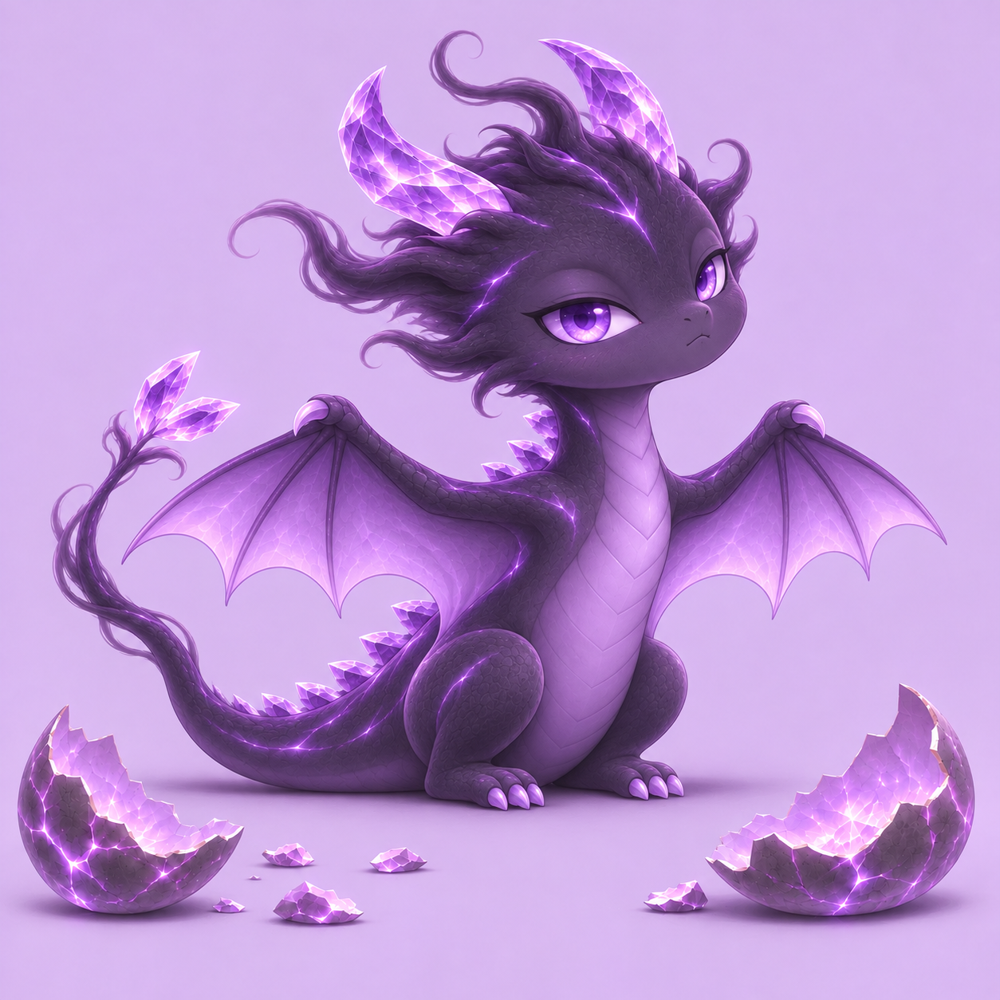
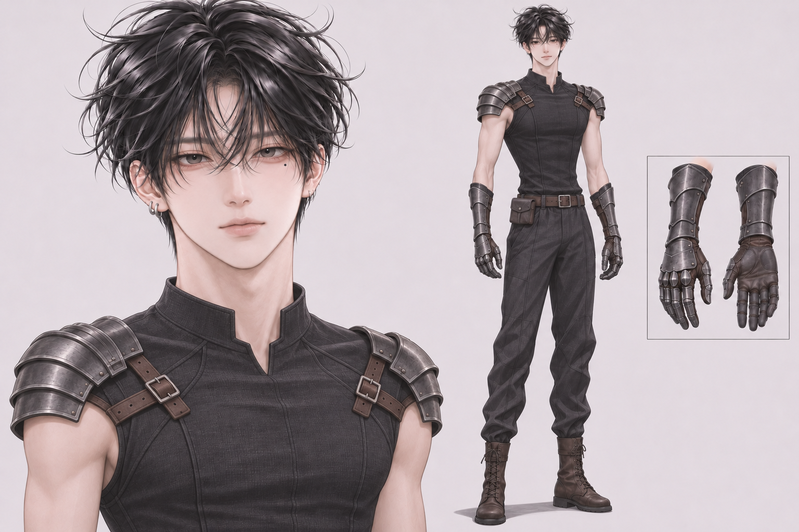
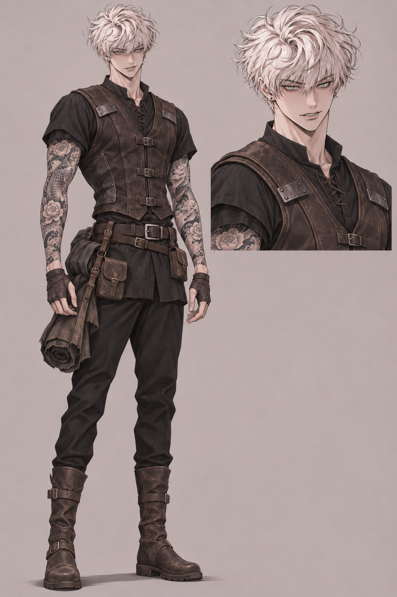
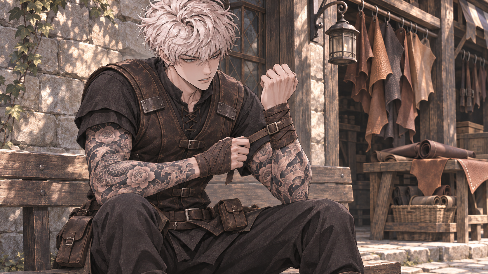
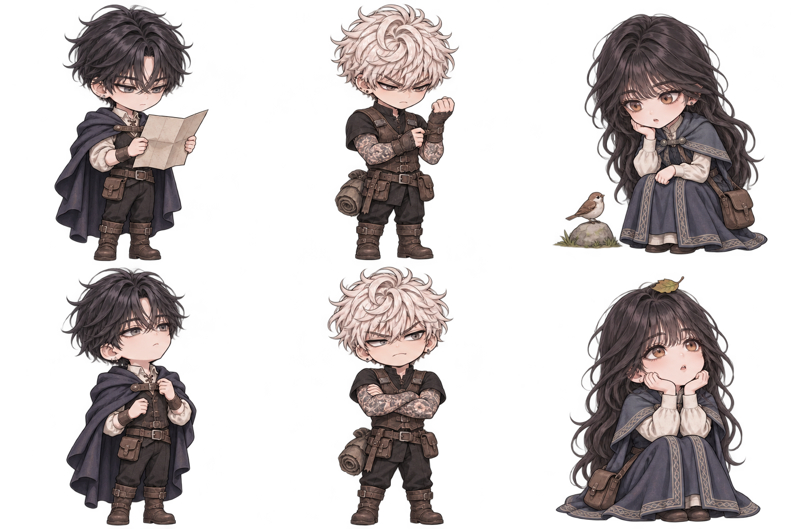
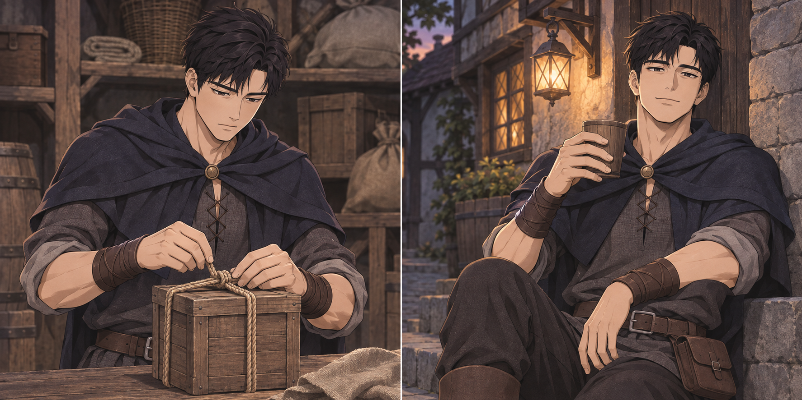

# 판타지 인터랙티브 웹툰 — 세계관·시스템 설정집

최종 정리: 2026-11-17 (한국 시간)

## 문서 관리와 프로젝트 범위

- 이 폴더는 같은 저장소의 캠퍼스·좀비 생존 게임과 별개의 게임이다.
- 같은 이름의 인물이 있어도 두 게임의 인물·세계관·사건·능력치·저장 데이터를 연결하지 않는다.
- 현재는 세계관과 인터랙티브 이야기 경험의 기획 단계다. 초기 개발은 실시간 웹툰·AI 채팅 같은 형식을 우선하고, 게임으로 천천히 발전시킨다. 이 문서는 구현 완료를 뜻하지 않는다.
- 사용자 확정 사항과 조력자가 작성한 설정 초안·미정 사항을 구분한다. 이후 같은 주제의 설정은 이 문서를 갱신하며 불필요한 사본을 만들지 않는다.
- 사용자는 관련 설정을 조력자가 자율적으로 선택·확장해 묶음 초안을 만들도록 승인했다. 사소한 선택마다 먼저 승인을 요청하지 않는다. 먼저 어울리는 안으로 작성·저장하고 내용을 사용자에게 보여주며, 사용자가 수정·삭제·추가하면 기존 문서를 갱신한다.
- 조력자 작성 초안은 검토 가능한 기본안이며 사용자가 직접 확정한 사실로 출처를 바꾸지 않는다. 세계관 규칙 설계와 실제 스토리 전개 설계는 구분한다.
- 사용자는 기존 좀비 게임 GitHub 저장소에 별도 구역으로 이 게임의 설정을 저장하도록 지시했다.
- 최종 게임 제목과 고유 특성 이름은 아직 정해지지 않았다.

## 1. 장르와 이야기 방식 — 확정

- 판타지 세계를 배경으로 하는 실시간 웹툰·AI 채팅 같은 경험을 먼저 개발한다.
- 장기적으로 몬스터를 잡으며 성장하는 게임으로 점진적으로 발전시킨다. 액션 RPG는 최초 장르 구상이며 당장의 구현 범위로 고정하지 않는다.
- 무기를 사용하고 마법이 존재하는 세계다.
- 마법은 마나를 소모해서 사용한다. 마나의 보유량·소모량은 아직 미정이다.
- 마나를 전부 소모하면 탈진하며, 심한 경우 몸에 마나가 흐르는 회로가 타버려 생명이 위독해질 수 있다. 기존 ‘마나 중독’ 개념은 이 회로 손상 설정으로 대체한다.
- 몸에는 마나가 흐르는 회로가 존재하며, 해당 위험은 그 회로가 타버리는 손상이다. ‘마나 회로 손상’은 설명용 표기이며 별도의 정식 병명은 아직 정하지 않았다.
- 손상된 회로는 휴식으로도 어느 정도 회복될 수 있다. 그 사람의 신체력과 정신력에 따라 회복 속도가 다르다.
- 어느 정도 경험을 쌓고 레벨과 스탯이 뒷받침되는 마법사는 손상된 마나 회로를 다시 연결해 치료할 수 있다. 치료 조건은 경험·레벨·스탯을 함께 고려하며 고정된 클래스 등급으로 정하지 않는다.
- 초보자는 이 회로 손상으로 인해 많이 죽는다.
- 회로가 타는 정확한 발생 조건·손상 정도별 회복 범위·회복 기간·치료에 필요한 경험·레벨·스탯의 구체적인 기준·치료 비용은 아직 미정이다.
- 이전 조력자가 제안한 마나 중독의 단계별 증상·전용 안정제는 채택된 설정이 아니다. 마나 회복 포션의 회로 치료 효과도 아직 확정하지 않는다.
- 마나는 자연적으로 회복되며 휴식을 취할 때 회복 속도가 빨라진다.
- 별도의 마나 회복 포션이 존재한다. 자연 회복 속도·휴식 가속 정도·포션의 회복량과 작용 시간은 아직 미정이다.
- 무기를 사용하는 사람도 마나로 신체나 무기를 강화할 수 있다. 마나는 마법 외의 전투에도 사용된다.
- 신체·무기 강화의 구체적인 효과·습득 조건·소모량·지속 시간은 아직 미정이다.
- 웹툰 같은 스토리텔링이 필요하다.
- 지구인이 모종의 사건으로 이세계에 전송되는 이야기로 시작한다.
- 지구인들도 이세계에 넘어오자마자 무기·마법 등 전투 재능이 깨어난다.
- 상태창이 존재한다.
- 상태창은 기본적으로 본인만 볼 수 있으며, 본인이 허락하면 타인에게도 보여줄 수 있다.
- 상태창의 항목별 선택 공개, 공유 대상·시간·철회 방식은 아직 미정이다.
- 각 개인에게는 그 사람의 고유능력인 ‘특성’이 있다. 전투형·보조형 등 여러 특성이 존재한다.
- 일반적인 무기·마법 재능과 개인의 고유 특성은 구분한다.
- 한 사람이 여러 분야의 재능을 동시에 가질 수 있다. 재능의 개수 상한·희소성·조합별 차이는 아직 미정이다.
- 같은 분야의 재능이라도 사람마다 기본적인 사용 감각과 학습·습득 속도에 주는 이점의 정도가 다르다.
- 재능의 강약과 개인차는 상태창에 등급이나 수치로 표시되지 않는다. 직접 배우고 사용해 보면서 감각과 습득 속도의 차이를 알게 된다.
- 재능의 강약이 성장 상한이나 실전 승패를 확정하지는 않는다. 재능 분야의 이름 자체가 상태창에 표시되는지는 아직 미정이다.
- 재능은 처음부터 해당 분야의 기본적인 사용 감각을 제공한다.
- 재능은 이후 학습과 숙련 속도에도 이점을 준다. 초기 사용 감각과 학습·성장 이점이 모두 적용된다.
- 재능이 없는 분야도 배울 수 있다. 재능이 있는 경우보다 습득 속도가 느리지만, 재능의 부재 때문에 도달 가능한 경지나 성장 한계가 정해지지는 않는다.
- 이는 노력만 하면 누구나 같은 시간에 같은 성취를 얻는다는 뜻은 아니다. 개인의 성격·센스·적응력과 실전 판단의 중요성은 유지한다.
- 이는 완성된 고급 기술·실전 경험·전투 센스를 즉시 얻는다는 뜻은 아니다. 구체적인 이점의 크기와 성장 방식은 아직 미정이다.
- 무기·마법의 재능과 실전 전투 센스도 별개다. 재능만으로 전투의 승패나 생존이 보장되지 않는다.
- 무기의 종류는 다양하며 재능도 여러 가지 존재한다. 검술은 전체 재능 체계를 대표하거나 한정하는 분류가 아니라 하나의 예시다.
- 사용자 예시: 검술에 재능이 있어도 전투 센스가 부족하면 변칙적인 상대에게 대응하지 못해 죽을 수 있다. 재능과 실전 대응 능력이 별개라는 원칙은 검술에만 한정하지 않는다.
- 구체적인 무기 목록과 무기별 재능 분류는 아직 미정이다.
- 이를 검술 재능의 무용함이나 전투 센스만으로 모든 격차를 극복할 수 있다는 규칙으로 확대하지 않는다. 구체적인 전투 판정과 수치화 방식은 미정이다.

## 2. 주인공 김태이 — 확정

| 항목 | 설정 |
|---|---|
| 이름 | 김태이 |
| 출신 | 지구 |
| 나이 | 18살 |
| 학년 | 고등학교 2학년 |
| 전송 상황 | 학교에 등교하기 위해 지하철을 타다가 이세계로 전송됨 |
| 고유 특성 | 동반자 ‘제로’와 함께하는 능력. 특성 자체의 정식 이름은 미정 |

- 이번에는 태이 외에도 여러 지구인이 함께 전송된다. 구체적인 인원, 지하철 승객 중 누가 포함되는지, 같은 장소에 도착하는지는 미정이다.
- 전송 사건의 원인과 도착 장소는 미정이다.
- 태이의 성격·주력 무기·마법 적성과 초기 스탯 수치는 미정이다. 외형은 아래 사용자 참고 기준을 따른다.

### 김태이 외형 — 사용자 지정 기준과 제작 시안

- 최신 체형 기준은 **마르지만 탄탄한 몸**이다. 초기 운동형 참고의 근육감을 유지하되 어깨·몸통·팔의 부피를 줄이고 가늘고 단단한 체형으로 수정한다.
- 얼굴의 옆모습은 사용자가 다시 첨부한 첫 번째 사진(검은 머리·트랙 재킷 옆얼굴)의 코·입·턱선 인상을 기준으로 한다.
- 최신 얼굴 기준은 사용자가 추가한 미소년 참고 3장이다. 기존 시안의 진하고 남성적인 인상을 줄이고, 섬세하고 예쁜 얼굴·부드러운 턱선·절제된 눈썹과 음영을 우선한다. 옆모습의 코·턱선도 이 기준과 일관되게 다듬는다.
- 태이 본인 기준 **오른쪽 귓볼에 작은 링 피어싱 두 개**, **왼쪽 눈 밑에 작은 점 하나**가 있다. 정면에서는 화면 왼쪽 귀의 링 두 개와 화면 오른쪽 눈 밑 점으로 보인다. 좌우 반전으로 바꾸지 않는다.
- [첫 전신·얼굴 디자인 시안](assets/taei-initial-design.png)을 보존했다. 흰 셔츠·넥타이·교복 바지·가방은 제작자가 제안한 임시 복장이다. 그림에 등장한다고 최종 복장으로 확정하지 않는다.
- [정면·측면 얼굴 수정 시안](assets/taei-front-profile-design.png)은 사용자의 후속 참고 방향을 반영했다. 검은 트랙 재킷과 흰 이너는 임시 복장이며 최종 채택 여부는 아직 미정이다.
- 생성 시안은 검토용 2D 일러스트다. 실제 3D 모델·리깅·캐릭터 이벤트가 제작됐다는 뜻은 아니다.

- 최신 사용자 지정 복장은 **검정 반팔 머슬핏 티셔츠를 교복 셔츠 안에 입고, 그 위에 아디다스 져지를 겹쳐 입는 구성**이다. 기존 임시 복장보다 우선한다.
- [섬세한 얼굴·겹쳐 입은 복장 수정 시안](assets/taei-pretty-school-tracksuit.png)을 추가했다. 흰 셔츠를 열어 이너가 보이게 한 착용법, 검정 져지 색상과 짙은 바지는 제작 해석이며 사용자의 후속 수정에 따른다.
- 피어싱과 점의 위치는 유지한다. 최신 사용자 요청에 따라 체형도 마르지만 탄탄한 방향으로 수정한다.
- 이전 시안은 제작 이력으로 보존한다. 최신 생성본 자체의 최종 채택은 아직 미정이다.

- 최신 얼굴 수정 기준: **자연스러운 크기의 속쌍꺼풀 눈, 연한 눈썹, 중성적이고 예쁜 얼굴**. 진한 눈썹·뚜렷한 높은 쌍꺼풀·강한 남성적 윤곽을 피한다.
- [마르고 탄탄한 체형·중성적 얼굴 수정 원본](assets/taei-lean-androgynous-design.png)을 보존한다. 기존 3겹 복장과 오른쪽 귓볼 링 2개·왼쪽 눈 밑 점은 유지한다. 생성 시안 자체의 최종 채택은 아직 미정이다.

- 최신 추가 수정: 마르고 탄탄한 체형은 유지하되 어깨는 이전 시안보다 넓힌다. 속쌍꺼풀이라고 눈을 작거나 반쯤 감긴 모습으로 그리지 않는다.
- 아디다스 겉옷은 **바람막이 재질**로 표현한다. 교복 셔츠의 단추는 잠그고, **바람막이 지퍼는 윗가슴 정도까지 적당히 잠가 목 부분이 열리는 상태**가 기본이다. 검정 머슬핏 반팔은 가장 안쪽에 유지한다.
- [큰 속쌍 눈·어깨·잠근 바람막이 수정 원본](assets/taei-closed-windbreaker-design.png)을 보존한다. 피어싱과 점 위치는 그대로 유지하며 이전 시안은 제작 이력으로 남긴다.

- 최신 눈 수정: 이전 시안보다 눈을 살짝 줄이고 과도한 또렷함을 완화한다. 속쌍꺼풀과 중성적인 인상은 유지한다.
- [자연스러운 눈·지퍼 높이 수정 원본](assets/taei-relaxed-eyes-windbreaker.png)을 저장했다. 목 끝까지 지퍼를 올린 이전 착용보다 이번 적당히 잠근 착용이 우선한다.

## 3. 동반자 제로 — 확정

### 정체와 연결 방식

- 이름은 ‘제로’.
- 용과 같은 형태의 동반자다.
- 태이의 개인 고유 특성으로 존재하는 특수한 케이스다.
- 진짜 정체는 신수보다 상위의 격인 ‘신격 존재’다.
- 존재의 격이 높다는 것과 초반부터 강한 능력을 발휘한다는 것은 별개다.
- 제로가 정수 슬롯을 차지하는지에 대한 명시적 규칙은 아직 정해지지 않았다. 특성이라는 예외성을 이유로 슬롯 면제를 임의 확정하지 않는다.

### 역할과 성장

- 주변 상황을 파악하고 확률 계산, 변수 분석, 상황 대처를 돕는 AI 같은 조력자 역할.
- 처음에는 알에서 막 부화한 상태라 크게 도움이 되지 않는다.
- 주인공이 성장할수록 제로도 함께 성장하고 점차 도움이 된다.
- 구체적인 성장 단계, 단계별 해금 능력, 전투 참여 방식과 말하기 능력은 미정이다.
- 세계관 속 AI 같은 역할이 확정된 것이며, 실제 게임에 외부 AI 서비스를 연결한다는 결정은 아직 없다.

### 채택된 1차 형태

- 대화에서 생성한 캐릭터 이미지를 사용자가 제로의 ‘1차’ 모습으로 채택했다.
- 그림자와 수정 같은 광석이 결합된 귀여운 아기 용.
- 채택 이미지의 외형 기록: 검보라색의 부드러운 그림자 몸, 연기처럼 피어오르는 윤곽, 보랏빛 수정 뿔과 등·꼬리의 수정, 커다란 보라색 눈, 짧은 팔다리, 작은 날개와 말린 꼬리. 주위에 부화한 알껍데기가 있다.
- 이는 1차 외형 기준이다. 후속 성장 외형은 미정이다.
- 최초 채택 이미지 자체의 원본은 확보하지 못했으나, 같은 디자인을 기준으로 재생성한 아래 시안의 PNG 원본은 GitHub에 저장했다.
- 후속 사용자 요청: 날개는 앞다리에 붙어 있는 구조이며, 더 새침한 표정과 얄쌍한 인상을 지향한다. 이는 외형 방향이며 제로의 실제 성격이나 성별을 확정한 것은 아니다.
- [앞다리 날개 연결 시안](assets/zero-stage1-wingarms.png): 앞다리와 날개막이 연결된 형태를 반영한 재생성본.
- [새침하고 얄쌍한 후속 시안](assets/zero-stage1-sleek.png): 앞다리 날개 구조를 유지하면서 좁은 얼굴·가느다란 몸선·새침한 표정을 적용했다. 사용자가 너무 가늘고 여성스러우며 여섯 다리로 읽힌다고 지적하여 이 시안은 채택하지 않음.

- 추가 수정 요청: 과도하게 가늘거나 여성스러운 인상을 피하고, 앞다리 겸 날개 2개와 뒷다리 2개로 총 네 사지 구조를 명확히 한다.
- [네 사지 구조 수정 시안](assets/zero-stage1-four-limbs.png): 배와 다리의 볼륨을 되살리고 속눈썹을 줄였으며, 별도의 앞발을 제거했다. 최종 채택 여부는 아직 미정.

## 4. 동반자형 특성 — 확정

- 태이처럼 동반자가 있는 특성은 다른 인간에게도 많이 존재한다.
- 동반자를 갖는 것 자체가 태이만의 유일한 현상은 아니다.
- 동반자의 힘을 받아 인간 자신이 전투하는 형태도 있다.
- 사용자 예시: 호랑이형 몬스터 동반자를 가진 인간이 호랑이 발톱 같은 힘을 받아 싸운다.
- 제로의 특수성은 신격 존재라는 정체와 태이의 특성으로 연결된 사례에 있다.
- 다른 동반자형 특성의 정수 슬롯 사용 여부와 능력 전달의 세부 규칙은 미정이다.

## 5. 인간종과 레벨·스탯 — 확정

### 인간종의 범위 — 확정

- ‘인간종’은 인간 한 종족만을 뜻하는 말이 아니라 여러 종족을 포함하는 상위 분류다.
- 기본 구성 종족은 **인간·엘프·드워프·수인**이다. 이것만으로 전체 종족 목록이 닫힌 것은 아니다.
- 아래 인간종의 공통 성장 규칙은 이 네 종족에 적용된다.
- 각 종족의 외형·수명·문화·선천적 적성·초기 능력치·수인의 세부 계통은 아직 미정이다. 일반적인 판타지 관습을 확정 설정으로 자동 추가하지 않는다.
- 지구 출신 인간과 이세계 토착 인간의 세부 차이, 다른 종족의 특성 각성 시점과 방식은 아직 미정이다.

### 수인의 위치와 사회적 대우 — 확정

- 수인은 인간족과 몬스터의 중간 단계에 있는 존재다.
- 앞서 기본 인간종에 포함한 분류는 유지한다. 중간 단계라는 설정이 수인을 몬스터로만 분류한다는 뜻은 아니다.
- 수인은 차별받으며, 노예로 팔리는 경우도 있다.
- 이 설정만으로 모든 수인이 노예이거나 모든 종족·국가·개인이 수인을 동일하게 대한다고 확정하지 않는다.
- 수인의 기원·번식·몬스터와의 구체적 관계, 지역별 법적 지위, 노예 거래의 주체·범위와 해방 제도는 아직 미정이다.

### 노예 제도와 계약 — 확정

- 이 세계관에서 노예 제도 자체는 불법이 아니다.
- 제도가 합법인 것과 별개로, 불법으로 유통되는 사례도 존재한다.
- 보통 주인과의 계약이 파기되기 전까지 주인이 노예의 의식주를 보장해야 한다.
- 노예는 역할에 따라 여러 종류가 있다. 사용자 확정 예시는 전투 노예·가사 노예·짐꾼 노예이며, 이 세 가지로 전체 종류를 한정하지 않는다.
- 노예에 대한 사회적 인식은 좋지 않다.
- 노예의 자유권을 일정 범위에서 보장하는 설정이다. 다만 구체적으로 어떤 권리가 보장되는지는 미정이며, 도주와 주인 살해 시도는 아래 각인 규칙에 의해 금지된다.
- 몸에 새긴 각인이 존재한다. 주인에게서 도망가려는 시도 또는 주인을 죽이려는 시도를 하면 각인을 통해 노예가 죽는다.
- 사용자는 이 강제력 때문에 배신이 불가능하다고 정했다. 이를 자발적인 충성·신뢰나 감정적 동의와 동일하게 취급하지 않는다.
- 노예가 되는 경위, 계약 체결의 자발성, 계약의 기간·양도·파기 조건, 의식주 의무 위반 시의 제재는 아직 미정이다.
- 각인의 발동 판정(의도·행동의 경계), 명령 불복종 등 다른 행위의 포함 여부, 각인 부여·해제 방식과 예외는 아직 미정이다. 확정되지 않은 우회·무효화 수단을 추가하지 않는다.
- 어떤 유통이 불법인지와 이를 판단·단속하는 기관도 아직 미정이다.
- 수인이 노예로 팔리는 사례는 확정되어 있으나, 노예 제도를 수인만의 제도로 한정하거나 다른 모든 종족에도 적용된다고 임의 확정하지 않는다.

### 공통 성장 규칙 — 확정

- 인간종에게는 레벨 상한과 스탯 상한이 없다.
- 레벨이 오를 때마다 스탯 포인트 3을 받는다.
- 시작 정수 슬롯은 1칸이다.
- 10레벨 올라갈 때마다 정수 슬롯이 1칸씩 늘어난다.

슬롯 해금 경계에 관해서는 대화에서 다음 표로 정리했으나, 사용자가 ‘10레벨마다’의 정확한 경계를 별도로 확정하지는 않았다.

| 대화에서 제시된 슬롯 표 — 해석안 | 슬롯 |
|---|---:|
| 1~9레벨 | 1 |
| 10~19레벨 | 2 |
| 20~29레벨 | 3 |
| 이후 | 10레벨 단위로 +1 |

- 시작 레벨에서 열 번 레벨업한 시점인지, 레벨 10·20·30 도달 시점인지 구현 전에 확정할 것.
- 초기 능력치 값, 포인트 배분 방식, 경험치 곡선은 미정이다.

### 기본 스탯 — 확정

- 기본 스탯은 **체력·마나·힘·지능·민첩·방어력·마법저항력**의 일곱 가지다.
- 힘을 물리 공격력의 스탯으로, 지능을 마법 공격력의 스탯으로 둔다. 물리 공격력·마법 공격력을 별도로 포인트를 배분하는 기본 스탯으로 중복 추가하지 않는다.
- 마법저항력을 별도 기본 스탯으로 추가한다.
- 각 스탯의 상세 효과와 환산식, 장비·스킬·정수와의 계산 방식은 아직 미정이다.
- 지능 스탯이 성격·눈치·실전 판단을 대신한다고 취급하지 않는다. 재능과 전투 센스가 별개라는 원칙도 유지한다.
- 앞서 마나 회로 회복에 영향을 준다고 정한 신체력·정신력은 새 기본 스탯으로 자동 추가하지 않는다. 일곱 기본 스탯과의 구체적인 관계·표현 방식은 미정이다.

## 6. 정수 — 확정

- 몬스터를 잡으면 극히 드문 확률로 나온다.
- 정수를 섭취하면 해당 몬스터의 스킬 또는 특징 중 하나를 무작위로 얻는다.
- 스탯도 상승한다.
- 정수는 제한된 정수 슬롯을 사용하므로 신중하게 선택해서 먹어야 한다.
- 나온 뒤 30분 이내에 섭취하지 않으면 자연으로 사라진다.
- 구체적인 드롭 확률, 스탯 증가량, 무작위 능력 후보와 확률은 미정이다.
- 섭취 전 결과를 확인할 수 있는지, 정수 제거·교체·반환이 가능한지, 중복 능력을 얻는지 미정이다.
- ‘30분’을 현실 시간과 게임 내 시간 중 어느 것으로 구현할지, 일시정지·저장 중에는 어떻게 처리할지 미정이다.

## 7. 영혼석과 에고 장비 — 확정

- 영혼석도 몬스터를 잡으면 극히 드문 확률로 나온다.
- 마석 같은 물질이며 정수와 달리 시간이 지나도 사라지지 않는다.
- 영혼석으로 장비를 만들면 그 몬스터의 영혼이 깃든 에고 장비를 만들 수 있다.
- 정수와 영혼석은 서로 다른 획득물이다.
- 두 획득물의 동시 드롭 가능 여부, 제작 조건·비용, 장비 능력·성격·대화·성장·슬롯 규칙은 미정이다.

## 8. 영혼령 — 확정

- 인간종에게 우호적인 몬스터는 스스로 정수가 되기를 선택할 수 있다.
- 이 경우 작아진 영혼 같은 모습으로 바뀌어 주변을 떠도는 ‘영혼령’ 상태가 된다.
- 영혼령은 정수처럼 활용할 수도 있다.
- 일반 드롭 정수와 달리 자발적 선택으로 형성된다는 점이 확정되어 있다.
- 영혼령의 정수 슬롯 사용, 30분 소멸 규칙 적용, 의식·자아 유지, 활용·흡수 방식과 이후 상태는 미정이다.

## 9. 몬스터 성급과 신수 — 확정

### 몬스터 성급

- 몬스터에는 1성부터 10성까지 성급이 붙는다.
- 그보다 상위의 격으로 ‘신수’가 존재한다.
- 각 성급의 전투력·진화 조건과 인간 레벨의 대응 관계는 미정이다.

### 신수의 힘과 생활

- 인간종이 거의 범접할 수 없는 힘을 가진 존재다.
- 자기 은신처에서 조용히 살아간다.

### 신수가 되는 두 경로

1. 태어날 때부터 신수로 타고나는 경우.
2. 몬스터가 계속 살아남고 진화하면서 수명을 늘린 끝에 신수가 되는 경우.

### 신수의 계승과 인간에게 맡김

- 신수는 자기 새끼를 낳거나 본인이 다시 환생하여 신수의 자리를 유지한다.
- 가끔 자신이 선택한 인간종에게 자신을 맡기거나 자기 후손을 맡긴다.
- 인간에게 맡겨진 이러한 신수도 정수 슬롯을 차지한다.
- ‘신수의 자리’의 수·계승 조건, 환생 기억과 힘의 유지, 인간과의 관계·해제 방식은 미정이다.
- 제로는 일반 신수 위탁과 다른 고유 특성의 특수 사례이므로 같은 규칙을 자동 적용하지 않는다.

## 10. 개념 구분 요약

| 개념 | 확정된 핵심 | 미정 사항 예 |
|---|---|---|
| 전투 재능 | 지구인이 전송 직후 각성하는 무기·마법 등의 적성 | 구체적인 재능 분류 |
| 고유 특성 | 각 개인의 고유능력. 전투형·보조형·동반자 사례 존재 | 정식 분류와 슬롯 관계 |
| 정수 | 극희귀 드롭, 섭취 시 무작위 스킬/특징 하나와 스탯 상승, 30분 후 소멸 | 교체와 증가 수치 |
| 영혼석 | 극희귀 드롭, 소멸하지 않으며 몬스터 영혼이 깃든 에고 장비 제작 | 제작·에고 상세 규칙 |
| 영혼령 | 우호 몬스터가 자발적으로 작아진 영혼이 됨, 정수처럼 활용 | 소멸·슬롯·의식 규칙 |
| 신수 위탁 | 신수 자신이나 후손을 선택한 인간에게 맡김, 정수 슬롯 사용 | 계약·해제 상세 |
| 제로 | 태이의 특성으로 함께하는 신수 이상의 신격 존재 | 슬롯·정체 공개·성장 상세 |

## 11. 제안 기록 — 확정 설정이 아님

아래 항목은 조력자의 제안이며 사용자 확정 사항으로 취급하지 않는다.

- 게임 제목 ‘루멘: 잊힌 숲’, 숲 시작 지점과 초기 보스 구성.
- 특성 이름 ‘가능성의 동반자’, ‘만상의 연산자’, ‘미래의 나침반’, ‘미지의 관측자’, ‘미완의 동반자’. 펫 이름만 ‘제로’로 확정되었다.
- 지하철 안내 방송이 늘어지고 창문 반사가 사라지는 구체적인 전송 연출.
- 제로의 부화·유년·성장·성숙 단계 구분과 단계별 능력.
- 제로의 ‘현재 정면전 승률 18%’ 등의 예시 대사와 수치.
- 동반자 특성을 신체 발현·협공·감각 공유·분석 보조로 구분하는 체계와 복수 방식 사용.
- 에고 장비가 주인을 시험하거나 성격에 따라 반응하는 구체적 예시.
- ‘신수’를 ‘11성’으로 부르지 않는 별도 표기 방안.

## 12. 다음에 확정할 항목

- 최종 제목, 태이의 고유 특성 정식 이름.
- 전송 원인과 도착 장소, 다른 전송자 범위.
- 태이의 외모·성격·무기·마법과 초기 상태창.
- 정수 슬롯의 정확한 레벨 경계와 제거·교체 규칙.
- 제로·다른 동반자형 특성·영혼령의 슬롯 규칙.
- 정수의 확률·스탯 증가·능력 추첨 규칙과 시간 처리.
- 제로의 성장 조건·기억·자아·정체 공개와 후속 모습.
- 영혼석 제작과 에고 장비의 상세 규칙.
- 몬스터 도감·지역·초반 이야기와 전투 진행.

## 13. 다섯 대륙과 연합 황제 — 확정

- 세계에는 동·서·남·북의 네 대륙과 중앙 대륙을 합쳐 총 다섯 대륙이 존재한다.
- 각 대륙은 매우 거대하며 여러 도시가 존재한다. 중앙 역시 거대한 대륙이다.
- 중앙을 네 대륙 사이의 다리나 협곡 연결 지대로 두었던 기존 구상은 중앙 대륙 설정으로 대체한다.
- 중앙 대륙에는 다섯 대륙의 연합 황제가 존재한다.
- 연합 황제의 이름·종족·권한·선출 또는 세습 방식, 연합의 정식 국호, 황도와 각 대륙 통치자의 관계는 아직 미정이다.
- 대륙 사이의 이동 방식, 바다·육지의 세부 배치와 거리·이동 시간은 아직 미정이다.
- 다섯 대륙의 정식 이름·국가·도시명과 태이의 도착 대륙은 아직 미정이다. 아래 동서남북 대륙 이름과 특징은 기존 후보로 유지한다.

### 북부의 몬스터 웨이브와 요새도시 — 확정

- 북부 대륙에는 몬스터들이 주기적으로 웨이브처럼 몰려온다.
- 북부 최상단(최북단)에 있는 도시는 ‘요새도시’라고 불린다.
- 웨이브의 원인·구체적인 주기·규모·진입 방향·몬스터 성급, 도시의 정식 이름·방어 시설·통치와 주둔 세력은 미정이다.
- ‘북부’라는 위치만으로 대륙 전체의 한랭 기후를 확정하지 않는다.

### 네 대륙 명칭·특징 후보 — 제안, 미확정

| 위치 | 이름 후보 | 특징 제안 |
|---|---|---|
| 북부 | 노르가르 | 주기적인 몬스터 웨이브와 최북단 요새도시는 확정. 방어전·성벽 보수·보급을 중심으로 돌아가는 도시 문화는 제안 |
| 동부 | 에르디아 | 거대한 숲과 고대 유적, 마법 연구가 발달한 도시들 |
| 서부 | 카르덴 | 광산·산맥·공방 도시가 발달하고 영혼석을 이용한 에고 장비 제작의 중심지 역할 |
| 남부 | 세르바 | 항구·상업 도시와 대상단 교역로가 발달한 대륙 |

- 북부 요새도시의 정식 이름 후보는 ‘카르베른’이며, 아직 확정되지 않았다.
- 위 문화·산업은 대륙별 주요 특징 제안이며 특정 종족의 독점 거주지나 직업 제한을 뜻하지 않는다.

## 14. 전송자의 역사와 처우 — 확정

- 과거에도 지구인이 드물게 이세계로 전송된 전례가 있다. 태이가 최초 전송자는 아니다.
- 이번에는 태이를 포함한 여러 지구인이 함께 전송된다.
- 전송자는 좋은 특성을 타고나는 경우가 대다수다. 모든 전송자가 반드시 우수한 특성을 가진다고 단정하지 않는다.
- 전송자라는 정체가 알려지면 노예로 팔리거나, 위험한 존재로 여겨져 사형당하는 경우가 대다수다.
- 위협의 배경에는 전송자의 우수한 특성이 있다. 다만 노예화·사형을 명령하는 구체적 세력과 법적 근거는 아직 정해지지 않았다.
- 이러한 처우가 다섯 대륙 전체의 동일한 법이나 황제의 직접 명령이라고 임의 확정하지 않는다.
- 지구와 이세계는 환경과 문화가 다르며, 사람들이 가진 지식에도 차이가 있다.
- 전송자는 행동·말투와 지식의 차이에서 전송자라는 티가 난다. 낯선 환경에 대한 반응과 현지 문화에 익숙하지 않은 모습이 일상에서 드러나는 단서가 된다.
- 따라서 눈치와 적응력이 좋은 사람이 유리하다. 주변의 반응과 관습을 파악하고 새로운 환경에 적응하는 개인의 역량이 생존에 중요하다.
- 좋은 특성을 가졌다고 무조건 강해지는 것은 아니다. 특성의 우수함과 실제 강함·생존 능력은 동일하지 않다.
- 개인의 성격·센스·적응력이 생존에 중요하다. 눈치와 적응력은 정체를 숨기는 데만 필요한 것이 아니라 전반적인 생존에도 영향을 준다.
- 좋은 특성을 얻는 것만으로 안전이 보장되지 않는다. 기본 AI 어시스트가 생존 팁을 제공하지 않는다는 규칙도 유지한다.
- 이 설정만으로 ‘눈치’·‘적응력’을 별도 수치 스탯으로 만들거나 태이가 처음부터 해당 능력이 뛰어나다고 확정하지 않는다.
- 이를 외형만으로 즉시 확정하거나 모든 현지인이 무조건 알아본다는 뜻으로 확대하지 않는다. 의심과 확정의 구체적 기준은 미정이다.
- 별도의 특수 감정 수단은 확정된 설정이 아니다.
- 정체 은폐와 적응의 구체적인 방법, 과거 전송자들의 인물·조직·행적, 보호 세력의 존재는 미정이다.

### 전송자 공통 AI 어시스트 — 확정

- 전송자들에게는 기본적으로 상태창에 AI 어시스트가 제공된다.
- AI 어시스트는 번역 기능을 제공하고 기본적인 지식을 조금 도와주는 편의 기능에 한정된다.
- ‘전송자라는 사실을 비밀로 해야 한다’ 같은 생존 팁은 제공하지 않는다.
- 상황에 따른 생존 판단·위험 회피 조언을 기본 지식 안내에 포함시키지 않는다. 등장인물이 위험을 배우는 과정이나 스스로 판단하는 과정을 이 기능으로 대체하지 않는다.
- 태이의 고유 동반자 제로가 성장하며 제공하는 상황 분석·확률 계산·변수 대응과 공통 편의 어시스트의 역할을 혼동하지 않는다.
- AI 어시스트의 안내는 머릿속에 말을 거는 것처럼 전달된다. 구체적인 음색과 사용자가 응답하는 방식은 아직 미정이다.
- 이 보조가 이세계의 환경·문화·지식에 완전히 익숙해진다는 뜻은 아니다. 행동·말투·지식 차이로 전송자라는 티가 난다는 기존 설정을 유지한다.
- 공통 상태창 어시스트와 태이의 고유 특성인 제로는 구분한다. 제로는 별도의 용 형태 동반자로, 태이와 함께 성장하며 상황 분석·확률 계산·변수 대응을 돕는다.
- 번역이 적용되는 말·문자의 범위, 정확도, 기본 지식의 구체적인 범위와 제공 방식은 아직 미정이다.
- 어시스트의 자아·성격·성장 여부와 제로와의 연동 여부는 아직 미정이다.
- 상태창 공개 허락이 AI 어시스트의 머릿속 안내까지 타인에게 공유한다는 뜻으로 확대하지 않는다. 해당 안내의 공유 여부는 아직 미정이다.
- 세계관 속 AI 어시스트 설정이며 실제 외부 AI 서비스 연동을 확정한 것은 아니다.

## 15. 개발 순서와 초기 경험

### 사용자 확정 방향

- 지금 당장 완성된 게임으로 개발하기보다 웹툰이나 AI 채팅처럼 실시간 웹툰 느낌으로 먼저 개발한다.
- 이후 천천히 게임으로 발전시킨다.
- 기존 정수·영혼석·특성·성장 규칙은 세계관 설정으로 유지한다. 모든 규칙을 처음부터 게임 기능으로 구현한다는 뜻은 아니다.
- 사용자 요청으로 실제 AI 챗 형태의 대화 코드를 제작한다. 현실 사람이 할 법한 자연스러운 대화를 지향하고 오글거리는 대사를 피한다.
- 추가 API 결제 없이 개인 PC에서 이용할 수 있도록, ChatGPT로 로그인한 공식 Codex CLI를 기본 연결 경로로 사용한다. 현재 ChatGPT 대화창을 조작하는 방식은 아니다. 계정의 Codex 이용 가능 여부와 구독 사용 한도가 적용된다.
- 유료 API 연결은 명시적으로 선택할 때만 사용하며 구독 연결 실패 시 자동 전환하지 않는다.
- 기본 화면은 배경과 인물 일러스트가 표시되는 미연시 형식이다. 여기에 사용자가 직접 입력할 채팅창을 둔다.
- 사용자가 입력한 채팅을 AI가 해석하고 인물의 답변과 상황을 이어가며 스토리가 진행된다. 자유 채팅이 기본 진행 수단이다.
- 평소에는 미리 준비한 배경·인물·상황 일러스트를 사용한다. 중요한 순간에는 새 컷신·일러스트를 즉석 생성하는 방식을 목표로 한다.
- 이미지 생성 모델·연결 방법·구현은 아직 미정이며, Codex 구독 대화 연결이 이미지 생성까지 제공한다는 뜻은 아니다.

### 초기 경험 구성 제안 — 미확정

- 장면 일러스트와 컷 연출, 대사·서술을 중심으로 이야기를 보여준다.
- 사용자의 자유 채팅을 중심으로 인물의 반응과 다음 상황을 이어가는 방향은 확정되었다. 선택지 보조 여부, 구체적인 장면 전환 판정과 사건 분기는 아직 미정이다.
- 상태창과 획득 능력은 이야기 진행과 연결하고, 전투 조작·경제·제작 등의 게임 기능은 후속 단계에서 확장한다.
- 첫 검토 구간은 태이의 등굣길 지하철과 전송 도입부를 후보로 삼는다. 구체적인 컷·사건·분기는 아직 확정하지 않는다.

## 16. 대화 코드 시제품 — 구현 현황

- [실행·모델 연결 안내](chat/README.md): Python 서버와 자유 입력 웹 UI를 `fantasy-rpg/chat`에 분리했다.
- 인물의 관찰 사실·현재 동기·해당 대화 기록을 바탕으로 짧고 자연스러운 한국어를 생성하도록 모델 지침을 구성했다. 갑작스러운 친밀감, 과장된 운명론, 장황한 설정 설명을 줄인다.
- 지하철·전송 직후의 임시 연습 장면 2개다. 임시 인물의 행동과 동기는 시제품 조건이며 최종 정사로 확정하지 않는다.
- 모델은 대사와 짧은 행동만 생성한다. 태이의 선택, 게임 상태, 전송 진행, 제로의 각성을 자동 확정하지 않는다.
- Codex 구독 연결을 기본으로 추가했다. 설치·ChatGPT 로그인 확인, 일회성 읽기 전용 실행, 시간 제한, 한도 오류 안내와 로컬 전용 구동을 구현했다. [구독 연결 설계](chat/DESIGN.md)를 참고한다.
- 기존 OpenAI API·Ollama·자체 호환 서버 경로와 SQLite 저장·복원·중복 방지·기록 다운로드를 유지한다. 유료 API는 자동으로 사용하지 않는다.
- 시험용 HTTP 모델과 CLI 자식 프로세스를 포함한 자동 테스트 23개와 JavaScript 문법 검사를 통과했다. 사용자 PC의 실제 구독 추론·Windows 구동·한국어 대사 품질·브라우저 화면은 아직 검증하지 못했다.
- 사용자용 기본 AI 어시스트와 제로의 역할에 관한 세계관 규칙은 그대로 유지한다. 이야기 생성 모델을 세계관 속 어시스트의 능력으로 취급하지 않는다.

## 17. 미연시 화면과 자유 채팅 진행 — 확정 방향

- 화면의 기본 구성은 장소 배경, 인물 일러스트, 대사·상황 표시, 사용자 채팅 입력창이다.
- 사용자는 태이의 말과 행동을 채팅으로 입력한다. AI가 이를 보고 답변하면서 스토리를 진행하는 경험을 만든다.
- 기존 2개 연습 장면의 대화 시제품은 출발점이다. 미연시 화면, 실제 장면 전환, 일러스트 선택과 즉석 생성은 아직 구현 완료되지 않았다.
- 평상시는 미리 만든 그림을 사용하고 중요한 순간에는 새 그림을 생성한다는 혼합 연출 방향을 유지한다.

### 구현을 위한 제안 — 아직 미확정

- AI 응답을 인물 대사·상황 서술·표정/자세·배경/장면 변경 제안으로 나누어 프로그램이 처리한다.
- 기존 세계관과 현재 인물의 지식, 실제 가능한 행동을 확인한 뒤 장면 변화를 적용한다. 사용자가 바라는 결과를 입력했다고 바로 성공한 사실로 취급하지 않는다.
- 이미지 생성 중에는 기존 그림과 대사로 이어가며, 생성 결과를 해당 사건에 연결하고 재사용할 수 있게 저장한다.
- 인물의 외형 유지·장면 기억·행동 결과의 일관성을 우선한다.

## 18. 모험가 랭크와 승급 — 확정

- 모험가 랭크는 낮은 순서부터 **F → E → D → C → B → A → S → SSS → EX**로 나뉜다. 사용자 지정 목록을 따르며 SS 등의 단계를 임의로 추가하지 않는다.
- 랭크에는 강함뿐 아니라 의뢰 해결을 통해 쌓은 공적도 중요하게 작용한다. 순수한 전투력만을 나타내는 등급은 아니다.
- 의뢰를 받아 해결하면 공적치를 받는다.
- 공적치가 일정 이상 쌓이면 승급하는 구조이며, 승급시험이 존재한다.
- 승급시험은 시험관과 일대일로 전투하는 일기토 방식이다.
- 랭크별 필요 공적치·의뢰별 지급량, 시험의 합격 기준(승리 필수 여부 등), 모든 승급에 동일한 시험을 적용하는지, 시험관 선정·재응시 규칙은 아직 미정이다.
- 랭크·레벨·기본 스탯·몬스터 성급을 동일한 수치 체계로 취급하지 않는다. 모험가 랭크의 최상위 표기가 인간종의 레벨·스탯 성장 상한을 뜻하지 않는다.
- 길드는 각 대륙의 공공기관이다.
- 민간인이나 대륙 당국이 위험도를 판단해 길드에 의뢰할 수 있고, 모험가들은 접수된 의뢰를 받아 행동한다.
- 길드의 세부 운영과 의뢰·승급 체계는 아래 초안에서 확장하며, 사용자 확정 규칙과 구분한다.

## 19. 모험가 제도 확장 — 조력자 작성 초안

사용자가 설정 확장을 위임한 뒤 작성한 기본안이다. 개별 선택의 사전 승인 없이 먼저 구성했으며, 사용자 검토에 따라 수정·삭제·추가한다. 18절의 사용자 확정 규칙을 유지하고 그 미정 부분을 아래 초안으로 구체화한다.

### 모험가 길드와 등록

- 사용자 확정: 길드는 각 대륙의 공공기관이며, 민간인과 대륙 당국이 위험도를 판단하여 의뢰를 접수하고 모험가가 이를 수주해 활동한다.
- 운영 초안: 각 대륙의 공공 길드가 도시별 창구를 두고, 대륙 간에는 등록증·랭크·공적 기록을 상호 인정한다. 이를 하나의 민간 조직이 다섯 대륙을 소유하는 형태로 취급하지 않는다.
- 기본 등록은 F랭크부터 시작한다. 등록증은 신원과 활동 자격을 확인하는 수단이며 개인의 상태창이나 고유 특성을 자동으로 공개하지 않는다.
- 운영 초안: 길드는 공공 의뢰 창구로서 접수·위험도 검토·보수 예치·실적 확인·승급시험·분쟁 조정을 맡는다. 민간 의뢰주의 최초 위험 판단과 길드의 접수 검토는 구분한다.
- 길드가 전송자를 무조건 보호하는 안전지대라는 규칙은 두지 않는다. 지역 권력과 담당자에 따라 처우가 달라질 수 있으며 기존 전송자 위험 설정을 유지한다.

### 공적치와 승급

- 의뢰 완료 시 위험도·기여도·목표 달성 정도에 따라 공적치를 기록한다. 돈으로 공적치를 직접 구매할 수 없다.
- 공적치는 활동 실적의 누적 기록이다. 승급시험에 응시할 자격을 만들며 시험에 합격해야 실제 랭크가 오른다. 승급 때 누적 공적을 소모하지 않는다.
- 쉬운 의뢰만 반복해서 높은 랭크의 실무를 검증하지 못하는 일이 없도록 승급하려는 단계에 맞는 의뢰 실적도 심사한다.
- 랭크별 구체적 공적 수치는 아직 정하지 않는다. 개인 랭크에 고정 레벨·스탯 상한을 대응시키지 않는다.

### 승급시험의 판단 기준

- 시험관과 일기토를 치르지만 시험관을 반드시 이겨야 하는 것은 아니다.
- 무기·마법 운용, 상대에 대한 대응, 자원 관리, 위험 판단을 평가해 해당 랭크의 의뢰를 맡길 수 있는지 판단한다.
- 승리해도 시험 규칙 위반이나 무모한 행동이 심하면 불합격할 수 있다. 패배하거나 적절한 시점에 항복해도 충분한 역량을 보이면 합격할 수 있다.
- 시험관은 응시자의 수준을 확인할 수 있도록 공격 강도와 전술을 조절한다. 단순한 힘겨루기로만 끝내지 않는다.
- 마나 회로가 탈 정도로 억지로 버티는 행동은 가산점이 아니다. 중상을 막기 위한 중단 규칙과 회복 담당 인원을 둔다.
- 불합격 사유는 기록하며, 보완과 준비를 거쳐 재응시할 수 있다. 상위 랭크도 일기토 원칙은 유지한다.

### 의뢰 종류와 수주 제한

- 의뢰에는 토벌·호위·수색·구조·채집·운송·조사 등이 있다. 살상 능력만으로 모험가의 가치를 정하지 않는다.
- 의뢰 등급은 몬스터 성급 하나가 아니라 지형·이동 거리·목표·정보 불확실성까지 포함해 책정한다.
- 개인은 보통 자신의 랭크 이하 의뢰를 맡는다. 상위 의뢰는 실적 검토나 적합한 파티 편성 등 별도의 승인을 받아 참여할 수 있다.
- 의뢰 정보가 현장과 다르다면 증거를 확보해 귀환·보고할 수 있다. 생존 가능한 철수와 단순한 무책임을 구분한다.

### 파티와 보상

- 개인 랭크는 파티에 들어갔다고 자동으로 올라가지 않는다. 참여한 의뢰에서 실제 맡은 역할과 기여를 기록한다.
- 출발 전에 보수·정수·영혼석·기타 전리품의 배분 조건을 정한다.
- 정수의 30분 소멸 규칙 때문에 현장에서 정할 수 있도록 우선권과 불필요한 정수의 처리 방식을 미리 협의한다.
- 우호 몬스터가 자발적으로 변한 영혼령과 자신이나 후손을 맡기는 신수는 일반 처치 전리품과 똑같이 강제 배분하지 않는다. 선택 의사를 고려한다.
- 보조·치료·정찰·운반 등의 실질적 기여도 인정한다. 다만 각 역할 수행만으로 승급시험을 면제하지 않는다.

### 실패·부정과 기록

- 의뢰 실패 자체로 곧바로 랭크를 박탈하지 않는다. 과정·보고의 정직성·피해와 반복 여부를 검토한다.
- 허위 완료 보고, 타인의 공적 도용, 고의적인 동료 유기는 제재 대상이다.
- 의뢰주가 고의로 위험 정보를 숨긴 경우에도 책임을 묻고 보수·배상 분쟁을 조정한다.

### 상위 랭크의 의미

- F·E는 초보와 초기 실적 축적, D·C는 독립적인 현장 실무, B·A는 고위험 의뢰와 팀 지휘를 맡길 수 있는 신뢰를 뜻한다.
- S·SSS·EX는 여러 지역에 영향을 주는 규모의 공적과 검증된 역량을 가진 단계다. 별도 SS 단계는 추가하지 않는다.
- 이 구분은 고정 전투력 표가 아니다. 낮은 랭크의 강자와, 특정 전문 분야에 뛰어난 높은 랭크의 모험가가 모두 존재할 수 있다.

### 공공기관 길드의 의뢰 운영 — 확정 사항을 토대로 한 추가 초안

- 민간 의뢰는 개인·마을·상인 등이 생활과 생업에 필요한 일을 요청하는 형태이며, 공공 의뢰는 대륙 당국이 치안·교통·재해 대응 등 공동의 필요를 위해 발주한다.
- 의뢰주는 알고 있는 상황과 예상 위험을 제시한다. 길드 창구는 이 정보와 기존 기록을 검토해 수주 가능한 형태로 공시한다. 정확히 파악되지 않은 위험은 추정·미확인으로 표시한다.
- 민간 의뢰는 원칙적으로 의뢰주가, 공공 의뢰는 발주 당국이 보수를 부담한다. 공적치는 별도의 실적 심사로 기록한다.
- 접수 정보와 현장이 다르면 모험가는 정정 보고를 할 수 있다. 길드는 위험 등급과 보수 조건을 재검토하고 필요하면 후속 의뢰를 발주한다.
- 모험가는 공공기관의 상시 직원으로 자동 편입되는 것이 아니라, 의뢰를 수주해 수행하는 활동자로 둔다. 비상 동원 제도의 존재와 조건은 아직 확정하지 않는다.

## 20. 같은 학교 남학생 — 백도겸

### 사용자 지정 설정

- 김태이와 같은 학교의 남학생이며 지하철 전송에 함께 휘말린 인물이다.
- 김태이가 잘생긴 것으로 유명하다면, 이 학생은 잘생겼지만 성격이 나쁘고 거칠며 학교의 유명한 문제아·양아치로 알려져 있다.
- 외모는 사용자가 첨부한 백발 남성 일러스트의 얼굴과 머리 인상을 참고한다.
- 머리는 백금발로 염색했다.
- 양팔 모두 어깨부터 손목까지 이어지는 긴팔 형태의 이레즈미 문신이 있다.
- 첨부 참고 이미지의 자세·노출·문구·몸 피어싱은 사용자 확정 요소로 추가하지 않는다.

### 조력자 작성 인물 초안

- 사용자 확정 이름은 **백도겸**이다. 나이·학년·키는 아직 확정하지 않는다.
- 외형은 태이보다 날카롭고 도발적인 눈매와 거친 인상이다. 마른 운동형 골격에 자연스러운 어깨 폭을 둔다.
- 흰 반팔 교복 셔츠와 검정 이너, 짙은 교복 바지, 어깨에 걸친 교복 재킷으로 첫 시안을 구성했다. 복장·귀의 작은 스터드는 제작 제안이며 사용자 검토에 따른다.
- 문신의 잉어·용·파도·모란 도안과 흑회색 배색은 첫 이미지의 디자인 제안이다. 양팔 전체 이레즈미라는 핵심 조건을 우선한다.
- 성격 초안: 말투가 직설적이고 시비조이며, 자기 뜻대로 되지 않으면 공격적으로 반응한다. 친하지 않은 상대를 쉽게 존중하지 않고, 통제받거나 공개적으로 무시당하는 상황에 민감하다.
- 사용자 확정: 잠재력이 매우 높으며 전투 센스·정신력·담력이 모두 뛰어나다. 고유 특성은 **반동**이다. 구체적인 무기·마법 재능과 스탯 수치·전투 경력은 아직 미정이다.
- 성격이 나쁘고 거칠다는 이유로 전투 판단도 나쁘거나 쉽게 겁먹는 인물로 단순화하지 않는다. 좋은 정신력·담력이 공감 능력이나 선한 성품을 뜻하지는 않는다.
- 사용자 확정: 태이와 친분은 거의 없으며 서로의 존재만 알던 사이다. 가까운 친구나 이미 충돌했던 사이로 추가하지 않는다. 이후 동료·적 여부나 라이벌·개심·희생 서사는 아직 정하지 않는다.

- 위 이미지는 검토용 2D 캐릭터 원화다. 실제 게임 이벤트·컷신·SD·3D 모델의 구현 완료를 뜻하지 않는다.

### 백도겸 고유 특성 — 반동(확정)

- 몸이나 무기로 받아낸 충격의 일부를 잠시 저장했다가 자신의 타격에 실어 방출한다.
- 받는 피해가 사라지는 능력은 아니며, 무리한 축적은 몸에 부담을 준다.
- 흘려받기·방어·방출 시점의 판단이 중요하다. 뛰어난 전투 센스와 담력으로 이를 활용할 잠재력이 높다.
- 구체적인 축적 비율·보존 시간·소모 자원·성장 방식은 아직 미정이다.
- 이레즈미 문신이 능력의 원인이라고 확정하지 않는다.
- 이전 후보 철피·사각보행은 미채택이며 백도겸의 보유 능력이 아니다.

### 능력 활용 방향 — 조력자 작성 초안

- 공격적으로 거리를 좁히지만, 상대의 힘을 무조건 정면으로 받기보다 흘려받아 충격을 모으고 반격의 타이밍을 잡는 방향이 어울린다.
- 위기와 통증 속에서도 판단을 유지하는 강점이 있으며, 담력이 좋다는 것을 무조건 무모하게 행동한다는 뜻으로 쓰지 않는다.
- 현재 역량·성장 과정·승패를 잠재력만으로 미리 확정하지 않는다.

## 21. 같은 학교 여학생 — 윤서하(가칭)

### 사용자 지정 설정

- 태이와 같은 학교의 여학생이다. 이름 ‘윤서하’는 조력자 추천 가칭이며 아직 확정되지 않았다.
- 사용자가 다시 첨부한 원본 일러스트의 얼굴을 최대한 가깝게 참고하며, 머리색은 검정으로 바꾼다. 눈매·눈 간격·코·입술·갸름한 얼굴 비율을 우선하고 밝은 웃음과 둥근 볼살로 바꾸지 않는다.
- 얼굴은 몽환적이고 매력적인 분위기이며 늘상 무표정으로 차가워 보인다.
- 실제 성격은 엉뚱한 매력이 있고 딴생각을 많이 하는 백치미 캐릭터다. 차가운 외모가 계산적이거나 냉혹한 속내를 뜻하지 않는다.
- 한국식 교복 셔츠와 치마만 입고 마이(교복 재킷)는 입지 않는다. 몸에 맞게 줄인 사이즈이며 치마는 이전 시안보다 길이와 폭을 줄인 짧은 무주름 H라인이다. 이 조건은 이전 재킷·주름치마·큰 사이즈 제안보다 우선한다.
- 참고 이미지의 코 반창고·장신구·노출 복장·자세는 별도 확정 요소가 아니다.

### 성격 구체화 — 조력자 작성 초안

- 무표정으로 상대를 바라보지만 머릿속으로는 전혀 다른 것을 생각하고 있을 때가 많다. 의도적인 밀고 당기기보다 반응이 한 박자 늦거나 엉뚱한 질문을 하는 쪽이다.
- 표정과 말투는 차분한데 생각의 방향이 독특하고 가끔 뜻밖에 솔직한 말을 한다. 일부러 귀여운 척하거나 과장된 바보 연기를 하는 인물로 쓰지 않는다.
- 대화 중 놓친 말은 다시 묻고, 관심 있는 부분에는 예상 밖으로 집중할 수 있다. 산만함을 모든 상황의 무능이나 낮은 지능 스탯으로 단정하지 않는다.
- 겉모습 때문에 도도해 보일 수 있지만, 이전 초안의 대화 주도·계산적인 여유·의도적으로 속내 감추기는 핵심 성격에서 제외한다.
- 말투 예시: “응? 미안. 다른 생각 했어.” / “너 화났어? 아까부터 눈썹이 똑같길래.” / “나 듣고 있었어. 마지막 부분은 못 들었는데.”
- 연애 관계·재능·고유 특성·태이와 백도겸과의 구체적 관계·나이·학년·키는 미정이다.

### 외형 시안과 제작 이력

- [최초 시안](assets/seoha-initial-design.png)은 웃는 얼굴·볼살·복장 방향을 수정한 이력이다.
- [두 번째 시안](assets/seoha-dreamy-korean-uniform.png)은 큰 재킷과 주름치마를 추가 수정한 이력으로 보존한다.
- [몸에 맞는 교복·H라인 치마 수정 원본](assets/seoha-fitted-hline-design.png)을 저장했다.
- 최신 복장은 흰 교복 셔츠와 짙은 H라인 치마만으로 수정했다. 재킷·카디건을 제거했으며, 넥타이도 최신 시안에서는 제외했다. 몸에 맞는 크기와 짧은 무주름 H핏이라는 사용자 조건을 우선한다.
- [셔츠·슬림 H라인 치마 최신 수정 원본](assets/seoha-shirt-hline-design.png)을 보존한다.
- 최신 생성 시안의 최종 채택은 아직 미정이며 실제 3D·SD·컷신·이벤트 구현 완료를 뜻하지 않는다.

- 최신 실사 참고 3장은 교복의 형태·재단·핏 참고로만 사용한다. 사진 속 실존 인물의 얼굴이나 신원을 캐릭터 설정으로 가져오지 않는다.
- 최신 교복 시안은 허리선에 맞는 반팔 셔츠, 짧고 폭이 좁은 무주름 H라인 치마이며 재킷은 없다. 셔츠의 검정 파이핑과 검정 넥타이는 제작자가 선택한 세부안이다.
- [한국식 반팔 교복 수정 원본](assets/seoha-korean-summer-uniform.png)을 보존한다. 기존 얼굴·머리·무표정과 엉뚱한 성격 기준은 유지한다.

- 사용자 추가 요청에 따라 치마 밑단을 더 올린 [길이 조정 원본](assets/seoha-summer-skirt-length.png)을 저장했다. 반팔 셔츠·H라인·무표정 얼굴과 나머지 외형 기준은 유지한다.

### 윤서하 가칭 추가 외형 시안

- 사용자가 동의한 수정 방향은 지나치게 마른 인상을 줄이고 어깨·팔·다리에 자연스러운 볼륨을 더하는 건강하고 균형 잡힌 체형이다.
- [균형 잡힌 체형 수정 원본](assets/seoha-balanced-build.png)과 [측면 얼굴·서 있는 옆모습 원본](assets/seoha-side-design.png)을 보존했다.
- 옆모습은 같은 얼굴·머리·교복을 기준으로 한 시안이며, 그림마다 미세한 차이가 생길 수 있으므로 최종 비율 기준으로 자동 확정하지 않는다. 새로 보이는 양말 등은 제작 해석이다.
- 기존 무표정·엉뚱함·딴생각 많은 성격과 이름 가칭 상태는 유지한다.

- 사용자 동의에 따라 팔다리를 날씬하게 다듬고 자세와 옷의 재단으로 균형을 조정한 [측면 수정 시안](assets/seoha-slim-tailored-side.png)을 추가했다. 얼굴·머리·복장과 옷 길이는 기존 기준을 따른다.

## 22. 이세계 복장 시안과 미술 방향

### 사용자 지정 세계 배경

- 이세계는 중세시대·기사 시대를 모티브로 한 일반적인 판타지 세계이며 성직자도 존재한다.
- 기존 인간 캐릭터들의 교복 외에 이세계에서 입는 복장을 제작한다.
- 실제 종교·신앙 체계, 성직자의 권한과 능력, 시대 기술의 구체적인 범위는 아직 정하지 않는다.

### 세 인물의 이세계 복장 — 조력자 제작 초안

- 얼굴·머리·인물별 특징을 기존 원화를 기준으로 유지하고 옷을 바꾼 검토용 시안이다. 복장이 직업·전투 방식·보유 장비의 능력·특정 사건의 획득 사실을 확정하지 않는다.
- **김태이**: 아이보리 리넨 튜닉, 짙은 조끼, 남색 후드 여행 망토, 가죽 벨트·작은 주머니·손목 보호구, 짙은 바지와 가죽 부츠. 가볍고 실용적인 여행자 방향이다.
- **백도겸**: 짧은 소매의 검정 튜닉과 짙은 가죽 조끼형 방어구, 소규모 철제 보강, 손 보호대·벨트·주머니·부츠. 양팔 이레즈미가 보이도록 하고 백금발과 거친 인상을 유지한다.
- **윤서하(가칭)**: 아이보리 긴소매 이너 드레스 위 짙은 청회색 로브형 여행복, 은은한 가장자리 자수, 짧은 어깨 망토·가죽 벨트·가방·부츠. 차분한 무표정과 검정 긴 웨이브 머리를 유지한다. 성직자나 마법사로 확정한 것은 아니다.
- 세 시안은 과도한 왕실 장식이나 현대식 지퍼·운동복 로고보다 천·가죽·절제된 금속의 재질을 우선한다.
- 최종 채택과 추가 수정은 사용자 검토에 따른다. 교복 원화도 전송 전 복장 자료로 계속 보존한다.

## 23. 이세계 표정·개별 이벤트·컷신 제작 묶음

### 사용자 지정 제작 원칙

- 캐릭터별 이벤트는 모두 별개로 만든다. 세 사람이 나중에 함께 다닐 수도, 그렇지 않을 수도 있으므로 고정 동행·파티·합류를 전제하지 않는다.
- 기존 세 인물 표정 18종에 차여경 표정 6종을 추가해 총 24종이다.
- 이벤트는 비정사 제작 초안이며 본편 줄거리·실제 아이템 획득·도시 이름·능력·인물 관계를 확정하지 않는다.

### 현재 사용하는 개별 자산

- **태이**: 혼자 지도와 이정표를 확인하는 컷신, 지도 확인·망토 정리 SD 2종.
- **백도겸**: 혼자 손목 보호대를 점검하는 컷신, 보호대 조절·팔짱 SD 2종.
- **여학생(가칭 윤서하)**: 혼자 우물가의 새를 보는 컷신, 새 관찰·딴생각 SD 2종.
- 각 컷신에는 해당 인물만 등장한다. 개별 SD 시트도 한 칸당 한 인물만 포함한다.
- 이전 공동 컷신·공동 SD 원본은 제작 이력으로 보존하지만 현재 미리보기에서는 표시하지 않는다.

### 실행 가능한 개별 이벤트

- [미리보기 안내](story-kit/README.md)의 세 이벤트는 각각 해당 인물 한 명의 존재와 장소만 확인한다. 다른 주인공의 대사·표정·동행을 요구하지 않는다.
- 선택 분기·중단·자동 저장·재개·완료 중복 방지를 유지한다. 연습 시간은 완료 시에만 합산한다.
- 저장은 v2 개별 이벤트용 키로 분리했다. 이전 공동 이벤트 저장은 덮어쓰거나 강제 변환하지 않는다.
- 차여경 이벤트를 포함해 자동 검사 8개, 선택 경로 10개의 완료·노드별 복원·조건·단독 발화 검사를 통과했다. 실제 브라우저·모바일 표시 검증과 AI 챗 통합은 아직 하지 않았다.
- 여학생의 이름은 화면에서 여전히 ‘같은 학교 여학생’으로 표시한다.

- 기존 표정 원본: [태이](assets/taei-expressions.png), [도겸](assets/dogyeom-expressions.png), [여학생](assets/seoha-expressions.png).

## 24. 같은 반 친구 — 차여경

### 사용자 확정 설정

- 이름은 **차여경**이다.
- 김태이와 같은 반인 여학생이며 태이와 조금 친한 친구다.
- 사용자가 명시적으로 요청하여 기존 좀비 게임의 차여경 디자인을 재사용하고, 이 작품에 맞게 교복을 입힌다.
- 외형 재사용의 예외이며 좀비 게임의 나이·대학 전공·과거 사건·관계·진행 기록을 이 작품으로 가져오는 것은 아니다.

### 외형과 교복 시안

- 원본 자료: [좀비 게임 표정 원화](../docs/assets/yeogyeong-acting-sheet.png), [그림체 시안](../docs/assets/yeogyeong-style-trial.png).
- 기존 얼굴 인상과 밝은 갈색의 어깨 안팎 중단발·느슨한 S자 웨이브·가벼운 앞머리를 기준으로 삼았다.
- 흰 반팔 셔츠·짙은 넥타이·H라인 교복 치마·가방·노트로 새 시안을 제작했다. 단추·파이핑·색상·소품 등 세부 구성은 검토용 제작 해석이다.
- 현재 교복 원화의 최종 채택은 사용자 검토에 따른다. 고유 특성·정확한 나이·키는 아직 미정이다. 성격·진로·치유 재능과 이세계 복장 초안은 아래 최신 추가 사항을 따른다.
- 다른 캐릭터와의 공동 파티나 동행은 확정하지 않는다.

### 차여경 표정·컷신·개별 상호작용 — 제작 초안

- [표정 6종](assets/yeogyeong-expressions.png), [교실 컷신](assets/event-yeogyeong-classroom.png), [복도 컷신](assets/event-yeogyeong-corridor.png), [SD 상황 6종](assets/sd-yeogyeong.png)을 추가했다.
- 교실에서 공책의 빈칸을 확인하는 이벤트와 복도에서 필통 지퍼를 살피는 이벤트를 각각 두 선택지로 구성했다. 태이와 조금 친한 같은 반 친구라는 관계를 활용하되 연애나 이세계 동행은 부여하지 않는다.
- 화면에는 여경만 등장하며, 이 두 이벤트만 태이를 화면 밖 대화 상대로 명시한다. 장소·대화 상대 조건과 표정·SD 전환, 중단·저장·복원·완료 표시를 연결했다.
- 전송 전 일상의 비정사 검토용 초안이며 본편의 장면 순서나 성격·고유 특성 확정이 아니다. 교복 디자인을 유지했고 이세계 복장은 별도 미정이다.
- 미리보기 전체는 5이벤트·10선택 경로이며 자동 검사 8개를 통과했다. 브라우저 표시·AI 챗 통합은 아직 검증하지 않았다.

### 차여경 성격·진로·재능 — 사용자 확정

- 올바르게 행동하려는 성격이며 차분하고 겁이 많고 귀여운 면이 있다.
- 지구에서부터 사람을 돕는 것을 좋아했고, 간호학과 진학을 목표로 입시를 준비하고 있었다. 간호사 자격이나 전문 의료 지식을 이미 갖춘 것으로 확대하지 않는다.
- 치유 마법, 즉 힐러에 재능이 있다. 특정 종교의 성직자이거나 숙련된 치유사라는 의미는 아니다.
- 고유 특성은 아직 미정이다. 정보 감지형 후보 ‘맥박’은 사용자가 관찰력과의 차이가 애매하다고 지적하여 채택하지 않았다.

### 고유 특성 재추천 — 미확정 후보

- **유예(추천)**: 접촉 중인 한 사람의 기존 부상이 악화되는 것을 잠시 멈추어 치료할 시간을 번다. 상처를 회복시키는 효과는 아니며 접촉·지속 마나가 필요하다. 초반의 적용 부상·시간은 제한적이고 성장에 따라 확장한다. 부활이나 마나 회로 손상 대가 제거로 쓰지 않는다. 구체 수치·적용 범위는 미정이다.
- **잔향**: 직접 시전한 치유가 끝난 뒤 같은 대상에게 약한 치유가 한 차례 더 발생한다.
- **분담**: 상대의 부상 일부를 자신에게 옮긴다.
- 위 후보는 제안이며 보유 특성으로 이벤트에 적용하지 않았다.

### 이세계 여행복과 개별 컷신 — 조력자 제작 초안

- 아이보리 리넨 긴소매, 연두색 튜닉, 짙은 녹색 짧은 망토, 갈색 바지와 부츠, 벨트 주머니와 가죽 가방. 기존 얼굴·밝은 갈색 웨이브 중단발을 유지한다. 종교 표식·확정 무기·직업 문양은 넣지 않았다.
- [이세계 복장](assets/yeogyeong-fantasy-outfit.png), [이세계 표정 6종](assets/yeogyeong-fantasy-expressions.png), [치유 연습 컷신](assets/event-yeogyeong-healing.png), [성문 컷신](assets/event-yeogyeong-gate.png), [이세계 SD 6종](assets/sd-yeogyeong-fantasy.png).
- 치유 마법의 작은 빛을 조심스럽게 유지하는 연습과, 성문 울타리의 소리에 놀랐다가 새를 확인하는 두 개별 이벤트다. 각 두 선택지이며 다른 인물의 동행을 요구하지 않는다.
- 치유 연습의 빛·소품은 미술 해석이며 고유 특성 효과·특정 치유 주문·치료 성공·의료 숙련도를 확정하지 않는다. 본편의 사건 순서도 미정이다.
- 새 이벤트에서는 이세계 표정과 SD를 표시하고 기존 교복 이벤트는 교복 자료를 유지한다. 중단·저장·복원·완료 처리를 연결했다.
- 전체 7이벤트·14선택 경로, 자동 검사 9개 통과. 이전 v2 저장 복원도 검사했다. 실제 브라우저 표시와 AI 챗 통합은 아직 검증하지 않았다.

## 25. 최신 특성 확정과 일러스트 제작 시점

- 사용자 승인으로 윤서하 이름과 고유 특성 **경계**를 채택한다. 허공에 손으로 그은 짧은 선을 가로지르는 대상의 움직임을 한 차례 끊는다. 초반에는 손이 닿는 거리에 선 하나이며 발동 후 사라진다. 감당할 수 없는 힘과 속도에는 깨지고, 성장하면 길이·유지 시간·개수가 늘어난다. 세부 수치와 전투 센스는 미정이다. 앞선 이름 가칭 표기는 이 승인 이후 확정 이름으로 갱신한다.
- 사용자 승인으로 차여경 고유 특성 **유예**를 채택한다. 대상 부위의 마나 흐름을 붙잡아 부상 상태를 잠시 고정한다. 이는 일반적인 마나 정지의 공통 효과가 아니라 이 특성만의 작용이다.
- 접촉·마나·집중을 유지해야 하며 초반에는 한 부위만 가능하다. 고정 부위는 움직임과 마나 운용이 제한된다. 치료·시간 역행·부활은 아니며 해제 후 현재 상태에서 악화가 재개된다. 멈춘 시간만큼 피해가 누적되지는 않는다. 성장하면 부분 해제와 치유를 정교하게 병행한다.
- 기존 제안 ‘맥박’·‘잔향’·‘분담’은 미채택이다. 마나 회로 손상 대가를 지우는 효과도 아니다. 앞선 ‘고유 특성 미정’ 표기보다 위 승인 사항이 우선한다.
- 앞으로 **사용자가 일러스트 제작을 요청할 때만** 기본 원화·컷신·SD·이벤트 묶음을 만든다. 설정 논의만으로 자동 생성하지 않는다.

## 26. 정우진 — 새 전송자 제작 시안

- 사용자가 다음 캐릭터의 일러스트 제작을 요청하여 앞선 제안(정우진·29세 남성·물류회사 현장 직원)을 시각화했다. 이름·나이·직업·세부 성격은 조력자 제안에 대한 검토용 시안으로 구분한다.
- 짧은 검정 머리, 조금 처진 눈매, 다부진 체형, 지친 듯하지만 편안한 인상. 현대 복장은 남색 작업 재킷·회색 티셔츠·검정 작업 바지·운동화다.
- 이세계 복장 초안은 짙은 회색 튜닉·남색 짧은 망토·가죽 손목 보호구·벨트 주머니·짙은 바지·갈색 부츠다. 특정 직업·능력·장비 획득을 확정하지 않는다.
- 말수가 적고 현실적이며 익숙한 일을 점검할 때 침착한 방향이다. 학생을 돌보는 부담과 낯선 세계에서 경험을 과신하는 허점은 성격 제안이다.
- 기존 인물과 초면인 제안이며 고정 동행·파티를 만들지 않는다. **고유 특성은 미정**이고 앞선 ‘고정’은 채택하지 않았다.
- [기본 현대·이세계 디자인](assets/woojin-design.png), [이세계 표정 6종](assets/woojin-expressions.png), [개별 컷신 2종](assets/woojin-cutscenes.png), [SD 상황 6종](assets/sd-woojin.png).
- 두 컷신은 창고의 매듭 점검과 여관 앞 휴식이다. 같은 이세계 복장을 유지하고 한 장면당 우진만 등장한다.
- 두 검토용 이벤트에 각 두 선택지·장소/인물 조건·표정/SD 전환·시간·중단·저장·복원·완료를 연결했다. 컷신 시트의 왼쪽과 오른쪽을 각각 표시하며 원본 파일은 자르지 않았다.
- 전체 9이벤트·18선택 경로, 자동 검사 10개 통과. PNG 로딩과 표정/SD의 알파 채널을 확인했다. 실제 브라우저 표시와 AI 통합은 아직 검증하지 않았다.

## 27. 브라우저 게임 기본 틀 · 2026-11-17

- 사용자의 요청으로 [game](game/README.md)에 배경·대사·선택지·자유 입력을 갖춘 비주얼 노벨 체험 화면을 구현했다.
- 기존 개별 이벤트 9개·18선택 경로를 연결했다. 장면 선택은 제작용 탐색이며 본편 사건 순서·파티 합류를 확정하지 않는다.
- 상태창·인물 제작실·대화 기록·SD 표시·읽기 설정·브라우저 자동 저장·수동 슬롯 3개·JSON 내보내기/가져오기를 제공한다.
- 장면 중단과 전환은 진행 중인 연습 시간을 폐기하고 완료 기록을 중복 적용하지 않는다. 기존 좀비 게임·story-kit 저장과 키를 분리했다.
- 자유 입력은 인사·걱정/휴식·주변 확인에 대한 작성형 체험 반응이다. 미지원 입력에는 AI 미연결 안내를 표시한다. 실제 AI 모델·ChatGPT 구독·즉석 이미지 생성 연결은 아직 없다.
- 상태창 숫자는 화면 시험용 임시 값이다. 전투·레벨 상승·정수 획득과 타이머·장비 경제는 아직 미구현이다. 인물 제작실은 플레이어가 알고 있는 인물 정보가 아니다.
- Sites로 소유자 전용 배포를 진행했다. 같은 원본의 실행 소스는 기존 저장소에도 저장한다.
- 자동 검사 5개로 전체 분기·저장 복원·장면 중단·가져오기 검증·체험 응답 구분을 확인하고 JS 문법 검사를 통과했다. 관리형 브라우저 도구가 없어 실제 브라우저 화면·모바일·키보드 조작은 미검증이다.

- 실행 링크: https://fantasy-story-taei.xodl0310.chatgpt.site

## 28. 게임 자유 입력과 로컬 AI 연결 · 2026-11-17

- 사용자의 AI 연결 요청으로 game 화면의 자유 입력을 기존 개인용 Codex 구독 연결기에 연결했다. API 키·유료 API로 자동 전환하지 않는다.
- 개인 PC에서 Python 서버를 실행하고 ChatGPT로 로그인한 공식 Codex CLI를 이용한다. 로컬 주소는 http://127.0.0.1:8092 이며 기존 채팅 시제품의 8090 포트와 별개다.
- 배포된 Sites 링크는 사용자 PC의 구독 로그인에 접근하지 못하므로 체험 모드를 유지한다. 설정에 AI 연결 확인·구독 사용 조건·로컬 실행 안내를 추가했다.
- 모델은 인물과 현재 장면, 같은 장면의 성공한 AI 대화만 받는다. 대사/짧은 동작만 반환하고 스탯·시간·아이템·장소·이벤트 완료는 변경하지 않는다.
- 성공한 대화는 로컬 SQLite와 세션 쿠키로 이어진다. 중복 요청 번호를 재사용하고 실패 시 입력을 유지한다. 장면별 40회, 한 번에 요청 하나, AI 기억 초기화를 지원한다. 기존 저장 파일은 화면/이벤트 상태만 옮기며 AI 서버 기억은 옮기지 않는다.
- 프런트 검사 7개·백엔드 검사 5개가 통과했다. 실제 Codex 로그인 상태는 확인됐지만 제작 환경의 Codex 상태 저장 경로가 읽기 전용이어서 실제 모델 답변 성공은 확인하지 못했다. 사용자 PC에서 설치·로그인·실행 검증이 필요하다. 브라우저 QA도 미검증이다.
- 실행 안내: [game/README.md](game/README.md). 별도 모델 연결이 없는 배포 링크를 실제 구독 AI 서버가 켜진 것으로 표현하지 않는다.

## 29. 브라우저 내 AI 실행으로 변경 · 2026-11-17

- 사용자 최신 지시: 웹게임으로 만들며 Python 실행기와 Codex를 필수 조건으로 두지 않는다. 추가 결제 없이 브라우저에서 AI를 실행하는 방식을 선택했다.
- 앞선 28절의 로컬 Python/Codex 연결은 과거 제작 이력이다. **현재 game 실행 경로는 HTTPS 웹페이지 + WebLLM/WebGPU**이며 Python·Codex·API 키·구독 로그인이 필요하지 않다. 기존 별도 chat 시제품은 이력으로 유지한다.
- WebLLM 0.2.88과 Qwen 2.5 Instruct 1.5B(기본)/0.5B(경량)를 사용한다. GPU의 shader-f16 지원에 따라 f16/f32 빌드를 선택한다.
- 첫 실행에는 외부 저장소에서 모델과 실행 파일을 다운로드한다. 이후 브라우저 캐시를 재사용하지만 기기·캐시·브라우저 정책에 따라 다시 다운로드할 수 있다. 완전한 오프라인 실행을 보장하지 않는다.
- 설정과 상단 AI 시작 버튼에서 기기 지원 확인·모델 선택·다운로드 진행·준비 취소를 제공한다. 답변 생성 중단과 실패 시 입력 보존도 지원한다.
- 대화 생성은 기기 내에서 수행하며 게임 코드가 대화 내용을 모델 API에 보내지 않는다. API 과금과 별개로 모델 다운로드의 네트워크 데이터는 사용한다.
- 기억은 브라우저 저장소의 장면별 AI 기록으로 관리한다. 문맥 한도(최대 12회 또는 본문 합계 약 1,800자)에 이르면 기록 내보내기와 기억 초기화를 안내한다. 화면/게임 JSON 저장에는 AI 기억과 모델 캐시가 포함되지 않는다.
- 상태창·시간·아이템·이벤트 완료는 작성형 게임 엔진이 처리하고 AI는 현 인물의 대사와 자기 동작을 생성한다. 작은 모델의 환각·한국어 품질·지시 준수는 별도 개선 과제다.
- 자동 검사 12개, JS 문법, SDK 모델 ID, 모델 설정·WASM URL과 CORS 응답을 확인했다. 실제 WebGPU 추론·한국어 품질·브라우저 화면과 모바일 조작은 이 환경에서 검증하지 못했다.
- 실행 링크: https://fantasy-story-taei.xodl0310.chatgpt.site

## 30. Electron 앱으로 확장 · 2026-11-17

- 사용자 요청으로 FMAX처럼 PC에 실행하는 앱 방식을 채택했다. 기존 웹게임 화면을 재사용하고 JavaScript/Electron 메인 프로세스에서 공식 Codex CLI를 호출한다. Python은 필요하지 않다.
- 소스는 [desktop](desktop/README.md)에 분리했다. 기존 배포 웹게임과 브라우저 AI 버전은 유지하며 웹사이트에서 PC 구독을 직접 호출하는 것으로 표현하지 않는다.
- Windows x64 실행본에 Electron 45.3.3과 공식 Codex 0.169.0 네이티브 배포본을 동봉했다. 폴더 전체를 압축 해제한 뒤 FantasyStory.exe를 실행한다.
- 앱의 ChatGPT 연결에서 공식 브라우저 인증 또는 기기 코드 인증을 진행한다. 앱은 비밀번호·API 키를 받지 않고 인증 파일을 읽거나 복사하지 않는다. 구독의 Codex 사용 한도가 적용되며 유료 API로 자동 전환하지 않는다.
- 렌더러 Node 통합을 끄고 context isolation·sandbox·제한된 preload IPC를 적용했다. 실행 파일 선택은 네이티브 대화상자에서만 하고 프롬프트는 shell:false 자식 프로세스의 stdin으로 전달한다.
- 인물·현 장면·같은 장면의 성공한 대화만 전달한다. AI는 대사/짧은 행동만 생성하며 세계 상태를 직접 변경하지 않는다.
- 기존 9개 이벤트/18선택 경로·컷신·SD·상태창·저장/불러오기를 재사용했다. AI 기억은 앱 사용자 데이터에 저장하며 게임 JSON 저장과 구분한다. 중복 요청·취소·실패 입력 보존을 지원한다.
- 자동 검사 14개를 통과했다. 실제 Linux Electron 창에서 시험용 CLI를 사용해 로그인 IPC·Node 비노출·채팅·저장 후 복원을 검사했다. 공식 Electron ZIP SHA256과 Windows x64 PE 파일 형식을 확인했다.
- 실제 Windows 구동, 신규 계정의 공식 인증과 실제 모델 답변, 코드서명은 아직 검증/완료하지 않았다. 시험용 CLI 결과를 실제 ChatGPT 응답 성공으로 표현하지 않는다.
