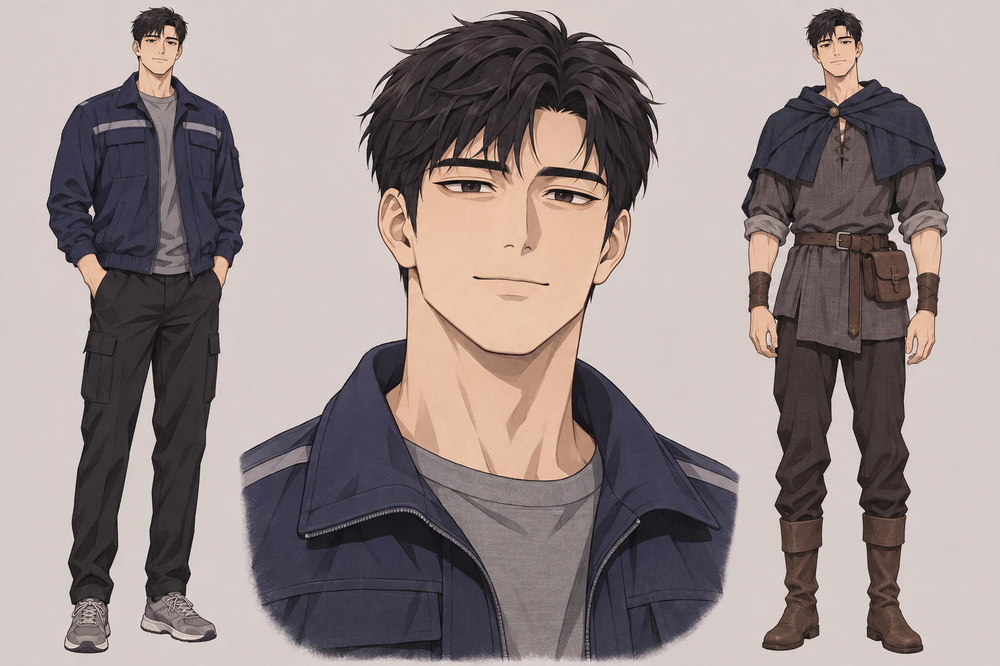
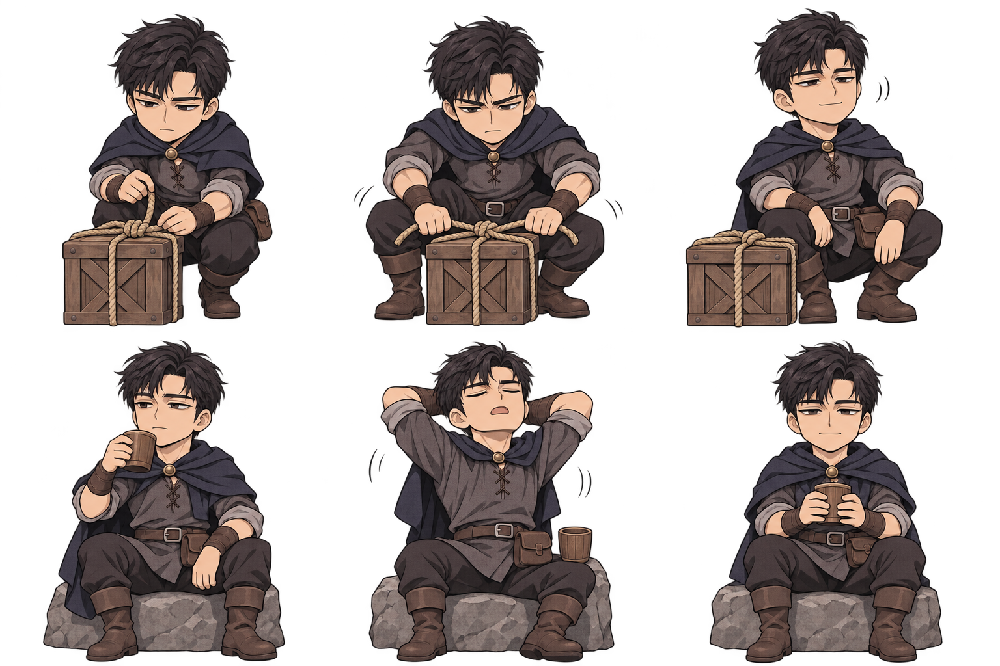

# 판타지 인터랙티브 웹툰 — 세계관·시스템 설정집

최종 정리: 2026-11-18 (한국 시간)

## 문서 관리와 프로젝트 범위

- 이 폴더는 같은 저장소의 캠퍼스·좀비 생존 게임과 별개의 게임이다.
- 같은 이름의 인물이 있어도 두 게임의 인물·세계관·사건·능력치·저장 데이터를 연결하지 않는다.
- 현재는 세계관과 인터랙티브 이야기 경험의 기획 단계다. 초기 개발은 실시간 웹툰·AI 채팅 같은 형식을 우선하고, 게임으로 천천히 발전시킨다. 이 문서는 구현 완료를 뜻하지 않는다.
- 사용자 확정 사항과 조력자가 작성한 설정 초안·미정 사항을 구분한다. 이후 같은 주제의 설정은 이 문서를 갱신하며 불필요한 사본을 만들지 않는다.
- 사용자는 관련 설정을 조력자가 자율적으로 선택·확장해 묶음 초안을 만들도록 승인했다. 사소한 선택마다 먼저 승인을 요청하지 않는다. 먼저 어울리는 안으로 작성·저장하고 내용을 사용자에게 보여주며, 사용자가 수정·삭제·추가하면 기존 문서를 갱신한다.
- 조력자 작성 초안은 검토 가능한 기본안이며 사용자가 직접 확정한 사실로 출처를 바꾸지 않는다. 세계관 규칙 설계와 실제 스토리 전개 설계는 구분한다.
- 사용자는 기존 좀비 게임 GitHub 저장소에 별도 구역으로 이 게임의 설정을 저장하도록 지시했다.
- 최종 게임 제목과 고유 특성 이름은 아직 정해지지 않았다.

## 1. 장르와 이야기 방식 — 확정

- 판타지 세계를 배경으로 하는 실시간 웹툰·AI 채팅 같은 경험을 먼저 개발한다.
- 장기적으로 몬스터를 잡으며 성장하는 게임으로 점진적으로 발전시킨다. 액션 RPG는 최초 장르 구상이며 당장의 구현 범위로 고정하지 않는다.
- 무기를 사용하고 마법이 존재하는 세계다.
- 마법은 마나를 소모해서 사용한다. 마나의 보유량·소모량은 아직 미정이다.
- 마나를 전부 소모하면 탈진하며, 심한 경우 몸에 마나가 흐르는 회로가 타버려 생명이 위독해질 수 있다. 기존 ‘마나 중독’ 개념은 이 회로 손상 설정으로 대체한다.
- 몸에는 마나가 흐르는 회로가 존재하며, 해당 위험은 그 회로가 타버리는 손상이다. ‘마나 회로 손상’은 설명용 표기이며 별도의 정식 병명은 아직 정하지 않았다.
- 손상된 회로는 휴식으로도 어느 정도 회복될 수 있다. 그 사람의 신체력과 정신력에 따라 회복 속도가 다르다.
- 어느 정도 경험을 쌓고 레벨과 스탯이 뒷받침되는 마법사는 손상된 마나 회로를 다시 연결해 치료할 수 있다. 치료 조건은 경험·레벨·스탯을 함께 고려하며 고정된 클래스 등급으로 정하지 않는다.
- 초보자는 이 회로 손상으로 인해 많이 죽는다.
- 회로가 타는 정확한 발생 조건·손상 정도별 회복 범위·회복 기간·치료에 필요한 경험·레벨·스탯의 구체적인 기준·치료 비용은 아직 미정이다.
- 이전 조력자가 제안한 마나 중독의 단계별 증상·전용 안정제는 채택된 설정이 아니다. 마나 회복 포션의 회로 치료 효과도 아직 확정하지 않는다.
- 마나는 자연적으로 회복되며 휴식을 취할 때 회복 속도가 빨라진다.
- 별도의 마나 회복 포션이 존재한다. 자연 회복 속도·휴식 가속 정도·포션의 회복량과 작용 시간은 아직 미정이다.
- 무기를 사용하는 사람도 마나로 신체나 무기를 강화할 수 있다. 마나는 마법 외의 전투에도 사용된다.
- 신체·무기 강화의 구체적인 효과·습득 조건·소모량·지속 시간은 아직 미정이다.
- 웹툰 같은 스토리텔링이 필요하다.
- 지구인이 모종의 사건으로 이세계에 전송되는 이야기로 시작한다.
- 지구인들도 이세계에 넘어오자마자 무기·마법 등 전투 재능이 깨어난다.
- 상태창이 존재한다.
- 상태창은 기본적으로 본인만 볼 수 있으며, 본인이 허락하면 타인에게도 보여줄 수 있다.
- 상태창의 항목별 선택 공개, 공유 대상·시간·철회 방식은 아직 미정이다.
- ‘특성’은 이세계 전이자(기존 문서의 전송자)에게만 발현하는 강력한 개인 고유능력이다. 현지 인간·엘프·드워프·수인에게는 특성이 없다. 전투형·보조형·동반자형 등이 존재한다.
- 일반적인 무기·마법 재능과 개인의 고유 특성은 구분한다.
- 한 사람이 여러 분야의 재능을 동시에 가질 수 있다. 재능의 개수 상한·희소성·조합별 차이는 아직 미정이다.
- 같은 분야의 재능이라도 사람마다 기본적인 사용 감각과 학습·습득 속도에 주는 이점의 정도가 다르다.
- 재능의 강약과 개인차는 상태창에 등급이나 수치로 표시되지 않는다. 직접 배우고 사용해 보면서 감각과 습득 속도의 차이를 알게 된다.
- 재능의 강약이 성장 상한이나 실전 승패를 확정하지는 않는다. 재능 분야의 이름 자체가 상태창에 표시되는지는 아직 미정이다.
- 재능은 처음부터 해당 분야의 기본적인 사용 감각을 제공한다.
- 재능은 이후 학습과 숙련 속도에도 이점을 준다. 초기 사용 감각과 학습·성장 이점이 모두 적용된다.
- 재능이 없는 분야도 배울 수 있다. 재능이 있는 경우보다 습득 속도가 느리지만, 재능의 부재 때문에 도달 가능한 경지나 성장 한계가 정해지지는 않는다.
- 이는 노력만 하면 누구나 같은 시간에 같은 성취를 얻는다는 뜻은 아니다. 개인의 성격·센스·적응력과 실전 판단의 중요성은 유지한다.
- 이는 완성된 고급 기술·실전 경험·전투 센스를 즉시 얻는다는 뜻은 아니다. 구체적인 이점의 크기와 성장 방식은 아직 미정이다.
- 무기·마법의 재능과 실전 전투 센스도 별개다. 재능만으로 전투의 승패나 생존이 보장되지 않는다.
- 무기의 종류는 다양하며 재능도 여러 가지 존재한다. 검술은 전체 재능 체계를 대표하거나 한정하는 분류가 아니라 하나의 예시다.
- 사용자 예시: 검술에 재능이 있어도 전투 센스가 부족하면 변칙적인 상대에게 대응하지 못해 죽을 수 있다. 재능과 실전 대응 능력이 별개라는 원칙은 검술에만 한정하지 않는다.
- 구체적인 무기 목록과 무기별 재능 분류는 아직 미정이다.
- 이를 검술 재능의 무용함이나 전투 센스만으로 모든 격차를 극복할 수 있다는 규칙으로 확대하지 않는다. 구체적인 전투 판정과 수치화 방식은 미정이다.

## 2. 주인공 김태이 — 확정

| 항목 | 설정 |
|---|---|
| 이름 | 김태이 |
| 출신 | 지구 |
| 나이 | 18살 |
| 학년 | 고등학교 2학년 |
| 전송 상황 | 학교에 등교하기 위해 지하철을 타다가 이세계로 전송됨 |
| 고유 특성 | 동반자 ‘제로’와 함께하는 능력. 특성 자체의 정식 이름은 미정 |

- 이번에는 태이 외에도 여러 지구인이 함께 전송된다. 구체적인 인원, 지하철 승객 중 누가 포함되는지, 같은 장소에 도착하는지는 미정이다.
- 전송 사건의 원인과 도착 장소는 미정이다.
- 태이의 성격·주력 무기·마법 적성과 초기 스탯 수치는 미정이다. 외형은 아래 사용자 참고 기준을 따른다.

### 김태이 외형 — 사용자 지정 기준과 제작 시안

- 최신 체형 기준은 **마르지만 탄탄한 몸**이다. 초기 운동형 참고의 근육감을 유지하되 어깨·몸통·팔의 부피를 줄이고 가늘고 단단한 체형으로 수정한다.
- 얼굴의 옆모습은 사용자가 다시 첨부한 첫 번째 사진(검은 머리·트랙 재킷 옆얼굴)의 코·입·턱선 인상을 기준으로 한다.
- 최신 얼굴 기준은 사용자가 추가한 미소년 참고 3장이다. 기존 시안의 진하고 남성적인 인상을 줄이고, 섬세하고 예쁜 얼굴·부드러운 턱선·절제된 눈썹과 음영을 우선한다. 옆모습의 코·턱선도 이 기준과 일관되게 다듬는다.
- 태이 본인 기준 **오른쪽 귓볼에 작은 링 피어싱 두 개**, **왼쪽 눈 밑에 작은 점 하나**가 있다. 정면에서는 화면 왼쪽 귀의 링 두 개와 화면 오른쪽 눈 밑 점으로 보인다. 좌우 반전으로 바꾸지 않는다.
- [첫 전신·얼굴 디자인 시안](assets/taei-initial-design.png)을 보존했다. 흰 셔츠·넥타이·교복 바지·가방은 제작자가 제안한 임시 복장이다. 그림에 등장한다고 최종 복장으로 확정하지 않는다.
- [정면·측면 얼굴 수정 시안](assets/taei-front-profile-design.png)은 사용자의 후속 참고 방향을 반영했다. 검은 트랙 재킷과 흰 이너는 임시 복장이며 최종 채택 여부는 아직 미정이다.
- 생성 시안은 검토용 2D 일러스트다. 실제 3D 모델·리깅·캐릭터 이벤트가 제작됐다는 뜻은 아니다.

- 최신 사용자 지정 복장은 **검정 반팔 머슬핏 티셔츠를 교복 셔츠 안에 입고, 그 위에 아디다스 져지를 겹쳐 입는 구성**이다. 기존 임시 복장보다 우선한다.
- [섬세한 얼굴·겹쳐 입은 복장 수정 시안](assets/taei-pretty-school-tracksuit.png)을 추가했다. 흰 셔츠를 열어 이너가 보이게 한 착용법, 검정 져지 색상과 짙은 바지는 제작 해석이며 사용자의 후속 수정에 따른다.
- 피어싱과 점의 위치는 유지한다. 최신 사용자 요청에 따라 체형도 마르지만 탄탄한 방향으로 수정한다.
- 이전 시안은 제작 이력으로 보존한다. 최신 생성본 자체의 최종 채택은 아직 미정이다.

- 최신 얼굴 수정 기준: **자연스러운 크기의 속쌍꺼풀 눈, 연한 눈썹, 중성적이고 예쁜 얼굴**. 진한 눈썹·뚜렷한 높은 쌍꺼풀·강한 남성적 윤곽을 피한다.
- [마르고 탄탄한 체형·중성적 얼굴 수정 원본](assets/taei-lean-androgynous-design.png)을 보존한다. 기존 3겹 복장과 오른쪽 귓볼 링 2개·왼쪽 눈 밑 점은 유지한다. 생성 시안 자체의 최종 채택은 아직 미정이다.

- 최신 추가 수정: 마르고 탄탄한 체형은 유지하되 어깨는 이전 시안보다 넓힌다. 속쌍꺼풀이라고 눈을 작거나 반쯤 감긴 모습으로 그리지 않는다.
- 아디다스 겉옷은 **바람막이 재질**로 표현한다. 교복 셔츠의 단추는 잠그고, **바람막이 지퍼는 윗가슴 정도까지 적당히 잠가 목 부분이 열리는 상태**가 기본이다. 검정 머슬핏 반팔은 가장 안쪽에 유지한다.
- [큰 속쌍 눈·어깨·잠근 바람막이 수정 원본](assets/taei-closed-windbreaker-design.png)을 보존한다. 피어싱과 점 위치는 그대로 유지하며 이전 시안은 제작 이력으로 남긴다.

- 최신 눈 수정: 이전 시안보다 눈을 살짝 줄이고 과도한 또렷함을 완화한다. 속쌍꺼풀과 중성적인 인상은 유지한다.
- [자연스러운 눈·지퍼 높이 수정 원본](assets/taei-relaxed-eyes-windbreaker.png)을 저장했다. 목 끝까지 지퍼를 올린 이전 착용보다 이번 적당히 잠근 착용이 우선한다.

## 3. 동반자 제로 — 확정

### 정체와 연결 방식

- 이름은 ‘제로’.
- 용과 같은 형태의 동반자다.
- 태이의 개인 고유 특성으로 존재하는 특수한 케이스다.
- 진짜 정체는 신수보다 상위의 격인 ‘신격 존재’다.
- 존재의 격이 높다는 것과 초반부터 강한 능력을 발휘한다는 것은 별개다.
- 제로는 태이의 특성이므로 정수 슬롯을 차지하지 않는다. 최신 전이자 특성의 슬롯 비소모 규칙을 적용한다. 신수 자신·후손을 정수로 위탁받는 일반적인 경우와 구별한다.

### 역할과 성장

- 주변 상황을 파악하고 확률 계산, 변수 분석, 상황 대처를 돕는 AI 같은 조력자 역할.
- 처음에는 알에서 막 부화한 상태라 크게 도움이 되지 않는다.
- 주인공이 성장할수록 제로도 함께 성장하고 점차 도움이 된다.
- 구체적인 성장 단계, 단계별 해금 능력, 전투 참여 방식과 말하기 능력은 미정이다.
- 세계관 속 AI 같은 역할이 확정된 것이며, 실제 게임에 외부 AI 서비스를 연결한다는 결정은 아직 없다.

### 채택된 1차 형태

- 대화에서 생성한 캐릭터 이미지를 사용자가 제로의 ‘1차’ 모습으로 채택했다.
- 그림자와 수정 같은 광석이 결합된 귀여운 아기 용.
- 채택 이미지의 외형 기록: 검보라색의 부드러운 그림자 몸, 연기처럼 피어오르는 윤곽, 보랏빛 수정 뿔과 등·꼬리의 수정, 커다란 보라색 눈, 짧은 팔다리, 작은 날개와 말린 꼬리. 주위에 부화한 알껍데기가 있다.
- 이는 1차 외형 기준이다. 후속 성장 외형은 미정이다.
- 최초 채택 이미지 자체의 원본은 확보하지 못했으나, 같은 디자인을 기준으로 재생성한 아래 시안의 PNG 원본은 GitHub에 저장했다.
- 후속 사용자 요청: 날개는 앞다리에 붙어 있는 구조이며, 더 새침한 표정과 얄쌍한 인상을 지향한다. 이는 외형 방향이며 제로의 실제 성격이나 성별을 확정한 것은 아니다.
- [앞다리 날개 연결 시안](assets/zero-stage1-wingarms.png): 앞다리와 날개막이 연결된 형태를 반영한 재생성본.
- [새침하고 얄쌍한 후속 시안](assets/zero-stage1-sleek.png): 앞다리 날개 구조를 유지하면서 좁은 얼굴·가느다란 몸선·새침한 표정을 적용했다. 사용자가 너무 가늘고 여성스러우며 여섯 다리로 읽힌다고 지적하여 이 시안은 채택하지 않음.

- 추가 수정 요청: 과도하게 가늘거나 여성스러운 인상을 피하고, 앞다리 겸 날개 2개와 뒷다리 2개로 총 네 사지 구조를 명확히 한다.
- [네 사지 구조 수정 시안](assets/zero-stage1-four-limbs.png): 배와 다리의 볼륨을 되살리고 속눈썹을 줄였으며, 별도의 앞발을 제거했다. 최종 채택 여부는 아직 미정.

## 4. 동반자형 특성 — 확정

- 태이처럼 동반자가 있는 특성은 다른 전이자에게도 많이 존재한다. 현지인이 특성을 가진다는 뜻은 아니다.
- 동반자를 갖는 것 자체가 태이만의 유일한 현상은 아니다.
- 동반자의 힘을 받아 인간 자신이 전투하는 형태도 있다.
- 사용자 예시: 호랑이형 몬스터 동반자를 가진 인간이 호랑이 발톱 같은 힘을 받아 싸운다.
- 제로의 특수성은 신격 존재라는 정체와 태이의 특성으로 연결된 사례에 있다.
- 동반자형 특성도 정수 슬롯을 차지하지 않는다. 능력 전달의 세부 규칙은 미정이다.

## 5. 인간종과 레벨·스탯 — 확정

### 인간종의 범위 — 확정

- ‘인간종’은 인간 한 종족만을 뜻하는 말이 아니라 여러 종족을 포함하는 상위 분류다.
- 기본 구성 종족은 **인간·엘프·드워프·수인**이다. 이것만으로 전체 종족 목록이 닫힌 것은 아니다.
- 아래 인간종의 공통 성장 규칙은 이 네 종족에 적용된다.
- 각 종족의 외형·수명·문화·선천적 적성·초기 능력치·수인의 세부 계통은 아직 미정이다. 일반적인 판타지 관습을 확정 설정으로 자동 추가하지 않는다.
- 특성은 전이자에게만 존재한다. 토착 인간·엘프·드워프·수인은 재능·수련·마법·정수·장비로 성장하며 특성을 각성하지 않는다. 그 밖의 지구 출신과 토착민의 세부 차이는 미정이다.

### 수인의 위치와 사회적 대우 — 확정

- 수인은 인간족과 몬스터의 중간 단계에 있는 존재다.
- 앞서 기본 인간종에 포함한 분류는 유지한다. 중간 단계라는 설정이 수인을 몬스터로만 분류한다는 뜻은 아니다.
- 수인은 차별받으며, 노예로 팔리는 경우도 있다.
- 이 설정만으로 모든 수인이 노예이거나 모든 종족·국가·개인이 수인을 동일하게 대한다고 확정하지 않는다.
- 수인의 기원·번식·몬스터와의 구체적 관계, 지역별 법적 지위, 노예 거래의 주체·범위와 해방 제도는 아직 미정이다.

### 노예 제도와 계약 — 확정

- 이 세계관에서 노예 제도 자체는 불법이 아니다.
- 제도가 합법인 것과 별개로, 불법으로 유통되는 사례도 존재한다.
- 보통 주인과의 계약이 파기되기 전까지 주인이 노예의 의식주를 보장해야 한다.
- 노예는 역할에 따라 여러 종류가 있다. 사용자 확정 예시는 전투 노예·가사 노예·짐꾼 노예이며, 이 세 가지로 전체 종류를 한정하지 않는다.
- 노예에 대한 사회적 인식은 좋지 않다.
- 노예의 자유권을 일정 범위에서 보장하는 설정이다. 다만 구체적으로 어떤 권리가 보장되는지는 미정이며, 도주와 주인 살해 시도는 아래 각인 규칙에 의해 금지된다.
- 몸에 새긴 각인이 존재한다. 주인에게서 도망가려는 시도 또는 주인을 죽이려는 시도를 하면 각인을 통해 노예가 죽는다.
- 사용자는 이 강제력 때문에 배신이 불가능하다고 정했다. 이를 자발적인 충성·신뢰나 감정적 동의와 동일하게 취급하지 않는다.
- 노예가 되는 경위, 계약 체결의 자발성, 계약의 기간·양도·파기 조건, 의식주 의무 위반 시의 제재는 아직 미정이다.
- 각인의 발동 판정(의도·행동의 경계), 명령 불복종 등 다른 행위의 포함 여부, 각인 부여·해제 방식과 예외는 아직 미정이다. 확정되지 않은 우회·무효화 수단을 추가하지 않는다.
- 어떤 유통이 불법인지와 이를 판단·단속하는 기관도 아직 미정이다.
- 수인이 노예로 팔리는 사례는 확정되어 있으나, 노예 제도를 수인만의 제도로 한정하거나 다른 모든 종족에도 적용된다고 임의 확정하지 않는다.

### 공통 성장 규칙 — 확정

- 인간종에게는 레벨 상한과 스탯 상한이 없다.
- 레벨이 오를 때마다 스탯 포인트 3을 받는다.
- 시작 정수 슬롯은 1칸이다.
- 10레벨 올라갈 때마다 정수 슬롯이 1칸씩 늘어난다.

슬롯 해금 경계에 관해서는 대화에서 다음 표로 정리했으나, 사용자가 ‘10레벨마다’의 정확한 경계를 별도로 확정하지는 않았다.

| 대화에서 제시된 슬롯 표 — 해석안 | 슬롯 |
|---|---:|
| 1~9레벨 | 1 |
| 10~19레벨 | 2 |
| 20~29레벨 | 3 |
| 이후 | 10레벨 단위로 +1 |

- 시작 레벨에서 열 번 레벨업한 시점인지, 레벨 10·20·30 도달 시점인지 구현 전에 확정할 것.
- 초기 능력치 값, 포인트 배분 방식, 경험치 곡선은 미정이다.

### 기본 스탯 — 확정

- 기본 스탯은 **체력·마나·힘·지능·민첩·방어력·마법저항력**의 일곱 가지다.
- 힘을 물리 공격력의 스탯으로, 지능을 마법 공격력의 스탯으로 둔다. 물리 공격력·마법 공격력을 별도로 포인트를 배분하는 기본 스탯으로 중복 추가하지 않는다.
- 마법저항력을 별도 기본 스탯으로 추가한다.
- 각 스탯의 상세 효과와 환산식, 장비·스킬·정수와의 계산 방식은 아직 미정이다.
- 지능 스탯이 성격·눈치·실전 판단을 대신한다고 취급하지 않는다. 재능과 전투 센스가 별개라는 원칙도 유지한다.
- 앞서 마나 회로 회복에 영향을 준다고 정한 신체력·정신력은 새 기본 스탯으로 자동 추가하지 않는다. 일곱 기본 스탯과의 구체적인 관계·표현 방식은 미정이다.

### 펜리 — 확정

- 여성 개 수인. 161cm, 52kg이며 나이는 미정이다. 검을 사용하는 슬레이어다.
- 장난기와 애교가 많지만 차별을 받으면 주눅들고 소심해진다.
- 붉은 머리와 금빛 눈, 개 귀와 꼬리를 유지한다. 하의는 짧은 치마다.
- 공통 전투 렌더러에서 대기·이동·검 공격·방어·회피·피격에 각각 두 프레임을 사용한다.

### 천아 — 외형·단검 선호 확정

- 이름은 천아. 이세계 현지인인 여성 뱀 수인이다. 19살, 키 167cm, 몸무게 46kg이다. 성격 세부·직업·태이와의 관계·과거는 미정이다.
- 은백색 긴 머리, 나른하고 가늘게 내려오는 보랏빛 눈, 작은 얼굴과 밝은 피부, 갈라진 뱀 혀를 유지한다. 별도 뱀 동반자는 두지 않는다. 사람형 다리 외에 꼬리·독·감각 능력은 임의 부여하지 않는다.
- 단검류를 주로 사용한다. 선호 무기이며 직업·전투 포지션·스킬·장비 소유를 자동 확정하지 않는다. 전이자 전용 고유 특성도 없다.
- 기본 복장: 흰 기술형 오버핏 재킷, 보라 안감과 연두 배색, 깊은 U넥의 흰 그래픽 나시, 검정 짧은 하의, 회색 스타킹, 검정·연두 운동화. 평소와 앉거나 넘어진 장면 모두 같은 흰 나시 한 겹이며 검은 티·검정 이너를 추가하지 않는다.
- 잠옷: 검정·흰색 프릴 상의, 흰 앞치마와 옆트임이 있는 타이트한 검정 일자 치마. 바지가 아니다. 스타킹은 발끝까지 덮고 구두는 신지 않는다. 기본 외형·얼굴을 유지하며 전신·초상화·SD를 연결한다. 잠옷으로 자동 변경하거나 수면 이벤트를 강제로 발생시키지 않는다.
- 대체 복장: 검정·연두 배색, 어깨가 열린 짧은 후드와 메시 및 불투명 안쪽 상의, 짧은 검정 하의와 망사 소재. 모자는 없다. 기본 의상에 대체 의상의 검정 이너를 섞지 않는다.
- 현실·지하철에 등장하지 않는다. 이름·나이 등은 실제로 알게 될 때 공개하고 파티에 자동 합류시키지 않는다. 앉은 그림은 상황 연출용이며 만남이나 고정 사건을 확정하지 않는다.
- 공통 캐릭터 등록부에 외형·SD·도트와 선호 무기를 연결한다. 전투 렌더러는 대기·이동·단검 공격·방어·회피·피격에 각각 두 프레임을 사용한다. 기존 도트는 보존한다.

### 파프니르 — 확정

- 20살 여성 수룡 수인. 키 154cm, 몸무게 53kg. 마법을 주로 쓰는 메이지다.
- 자기 종족의 강함을 알고 자부심·자기주장이 강한 말괄양이. 수인을 향한 차별에도 주눅들지 않는다.
- 푸른 앞머리와 밝은 금발 안쪽 긴 머리, 작은 뿔, 검정·금색 의상을 유지한다. 꼬리는 크기를 줄이고 자연스러운 비늘과 지느러미가 있는 유연한 수룡 꼬리로 수정했다. 금속·로봇 질감으로 되돌리지 않는다.
- 전용 속성·스킬·정수·과거·태이와의 관계는 미정. 전이자 전용 고유 특성 없음. 현실 등장·자동 파티 합류·이름 선공개를 하지 않는다.
- 수인족은 성장이 빨라 15살부터 성인으로 취급한다. 천아는 19살, 파프니르는 최신 변경대로 20살이다.
- 전신·시전·피격·SD를 공통 등록부에 연결한다. 전투 렌더러는 대기·이동·시전·방어·회피·피격에 각각 두 프레임을 사용한다. 테스트용 공통 마력탄 연출은 전용 스킬 습득 확정이 아니다.

### 장화 — 확정

- 인간족. 키 157cm, 몸무게 49kg.
- 마력으로 실을 만들어 공격한다. 마력실은 장화의 전투 방식이며, 기술명·사거리·효과·습득 경로는 미정이다.
- 평소에는 차분하고 칼같으며 시크하다. 당황하면 말을 더듬는다.
- 외형 레퍼런스는 붉은 단발과 머리 장식, 붉은 언더붑 상의, 검은색 짧은 하의, 붉은 안감의 검은 코트, 손과 손목의 장식, 검은 허벅지 높이 부츠다. 붉은 상의는 목을 감싸는 칼라에서 양쪽 앞판으로 이어지는 민소매 재단이다. 목 앞의 작은 검은 리본에서 가늘고 긴 두 가닥이 복부 위로 내려온다. 밑단은 중앙이 높고 양옆으로 내려가는 아치형이며, 붉은 밑단 아래 양쪽에 검은 꽃무늬 레이스 안쪽 옷이 각각 곡선으로 드러난다. 가슴 볼륨은 레퍼런스의 체형에 맞춘다. SD는 얼굴·머리 크기를 줄여 몸과 팔다리 비율을 살린다.
- 대체 의상은 앞을 연 짧은 검은 재킷, 상·하의가 분리된 검은 꽃무늬 레이스 의상, 허벅지까지 오는 스타킹과 연결 끈, 검은 장갑, 붉은 포인트가 있는 검은 구두를 조합한다. 서 있는 게임 일러스트에는 불투명한 안감을 사용한다. 이 의상의 착용 상황은 미정이다.
- 나이, 출신, 직업, 첫 만남과 태이와의 관계는 미정이다.

### 셀시 — 확정

- 개구리 수인. 키 168cm, 몸무게 50kg.
- 무감각하고 반응이 둔하며 귀찮음을 많이 느낀다. 외부 자극에도 무심한 표정과 느긋한 몸짓을 보인다.
- 외형 레퍼런스처럼 은회색 짧은 층단발에 비스듬히 흐르는 앞머리와 가는 분홍색 포인트를 둔다. 청록·흰색 상의와 레퍼런스의 짙은 하의 재단, 옆 스트랩을 유지한다. 하의는 엉덩이 곡선을 따라 밀착되는 핏으로 그린다. 후드·망토·머리 고글·장갑은 제거한다. 다리 장비는 기존 장비가 시작하던 허벅지 높이의 장식 없는 스타킹으로 교체한다.
- 나이, 직업, 능력, 무기, 첫 만남과 태이와의 관계는 미정이다.

### 레이첼 — 확정

- 엘프족 공주. 키 172cm, 몸무게 54kg. 귀족으로 고상하게 자랐다.
- 레이피어를 사용한다. 벌레를 무서워한다. 공포의 정도나 전투 판정 효과는 미정이다.
- 외형은 레퍼런스의 긴 금발과 땋은 머리, 초록 눈, 뾰족한 귀를 유지한다. 붉은 앞판, 금장 견장과 검은 사선 띠가 있는 흰 예복, 어두운 안감의 긴 코트 자락, 붉은 밴드의 흰 스타킹과 금장 부츠가 기본이다.
- 나이, 통치 가문·출신지, 첫 만남, 전용 기술은 미정이다. 참고 그림의 불꽃 연출은 능력 설정이 아니다.

### 스파이크 — 확정

- 인간과 엘프 혼혈. 키 195cm, 몸무게 91kg의 거구다.
- 거대한 도끼를 쓴다. 말과 행동이 시원시원하고 성격은 불같다.
- 헝클어진 갈색 머리와 어두운 판금 갑옷, 남색 바탕, 붉은 천과 망토, 큼직한 도끼를 외형의 기준으로 한다.
- 나이·출신지·첫 만남·전용 기술은 미정이다. 레퍼런스의 얼음과 번개는 확정된 능력이 아니다.

### 제이브 — 확정

- 인간족. 18살, 키 178cm, 몸무게 71kg.
- 유쾌하고 시원시원한 쾌남이다. 열린 표정과 거리낌 없는 몸짓을 보인다.
- 보라색 머리와 보라·은백색 판금, 짙은 바지와 갈라진 보라색 허리천을 기본 외형의 기준으로 삼는다.
- 출신지, 직업, 무기, 전용 기술과 첫 만남은 미정이다. 레퍼런스의 불꽃과 흰 생물은 외형 참고이며 능력이나 동행을 확정하는 설정은 아니다.

### 아킬라 — 확정

- 엘프족. 키 170cm, 몸무게 50kg. 거대한 방패와 대검을 사용한다.
- 과묵하지만 주변을 주의 깊게 살핀다. 위험할 때는 먼저 앞을 막아 서며, 맡은 약속을 무겁게 여긴다. 혼자 감당하려다 도움을 청하는 시점이 늦기도 한다.
- 은회색 단발, 금장 검은 갑옷과 붉은 목 리본, 갈라진 흰 허리천, 한쪽에만 있는 붉은 다리 갑옷을 기본 외형으로 삼는다. 검은 대형 방패에는 붉은 테두리가 있다.
- 나이·출신지·직업·전용 기술·첫 만남은 미정이다. 참고 이미지의 효과를 별도 능력으로 부여하지 않는다.

### 키리엘 — 확정

- 엘프족. 키 170cm, 몸무게 53kg. 활을 쓰는 원거리 딜러다.
- 관찰력이 좋고 건조한 농담을 건넨다. 멀리서 동료의 빈틈을 먼저 알아채지만, 급할수록 짧게 경고해 오해를 사기도 한다.
- 리본 없이 단순한 머리끈으로 높게 묶은 긴 짙은 갈색 머리와 흰색 위주의 비대칭 의상, 붉은 팔 장식과 금속 장식이 외형의 기준이다. 의상 리본을 빼고, 상의 앞면은 가슴선이 드러나는 낮은 네크라인으로 그린다. 상의와 하의가 연결되는 허리와 골반에는 몸에 밀착되는 재단을 둔다. 후면 전신에서는 묶은 머리를 한쪽으로 넘겨 비대칭 하의와 엉덩이 쪽 의상 실루엣이 보이게 한다.
- 나이·출신지·첫 만남·전용 기술은 미정이다. 참고 이미지의 별자리 효과나 사슬을 별도 능력이나 보조 무기로 등록하지 않는다.

### 팔라누스 — 확정

- 인간족. 키 170cm, 몸무게 54kg. 대검을 사용한다.
- 차분하고 위급할 때 판단이 빠르다. 상황이 정리되면 짧은 농담으로 긴장을 풀기도 한다. 남의 실수에는 관대하지만 자기 실수는 오래 곱씹는다.
- 짧은 검은 머리, 붉은 앞판과 검은 허리 부분을 가진 은백색·금장 갑옷, 붉은색과 검은색이 섞인 대검을 외형의 기준으로 한다. 눈가 장신구와 망토를 제거한다. 짧은 흰 허리천은 앞면에 두고, 뒤에는 늘어진 천 없이 짧은 하의의 실루엣이 보이게 한다. 앞면 흉갑 윗부분은 가슴선이 보이는 낮은 V자 재단이다. 하의 밑단은 골반 바깥쪽으로 가파르게 올라가는 짧은 사선 재단이다. 후면에서는 골반과 엉덩이의 볼륨, 밑단 아래로 드러나는 바깥쪽 피부가 보인다.
- 나이·출신지·직업·전용 기술·첫 만남은 미정이다. 레퍼런스의 푸른 효과를 별도 능력으로 부여하지 않는다.

### 로지 — 확정

- 인간족. 키 167cm, 몸무게 49kg. 검을 사용한다.
- 예의 바르고 낯선 사람부터 챙긴다. 부당한 일을 보면 말투는 부드러워도 물러서지 않는다. 사소한 농담을 문자 그대로 받아들이는 면이 있다.
- 은발, 금장 머리장식이 달린 남색 베일, 흰 어깨천, 금장 남색 상의와 붉은 허리띠, 흰색과 청회색 겹자락, 옅은 청은색 다리 갑옷이 외형의 기준이다.
- 나이·출신지·직업·전용 기술·첫 만남은 미정이다. 레퍼런스의 보랏빛 연출이나 배경 소품을 능력과 소속 설정으로 확정하지 않는다.

### 에이스 — 확정

- 인간족. 18살. 키 174cm, 몸무게 62kg. 검을 사용한다.
- 승부를 즐기며 상대의 실력을 솔직하게 인정한다. 겉으로는 패배를 담담하게 받아들이지만, 혼자 남으면 안 풀린 동작을 다시 연습한다.
- 하늘색 앞머리와 높게 묶은 긴 머리, 금빛 초승달 머리장식, 푸른 겹옷과 붉은 허리띠, 금무늬가 들어간 어두운 넓은 하의가 외형의 기준이다.
- 출신지·직업·전용 기술·첫 만남은 미정이다. 레퍼런스의 달빛과 허공의 검은 전용 기술을 확정하는 근거가 아니다.

### 에반 — 확정

- 인간족. 키 180cm, 몸무게 75kg. 검과 방패를 사용한다.
- 평소에는 진중하지만 가까운 사람에게는 장난기가 많다. 동료를 많이 잃은 경험 때문에 쉽게 정을 주지 않는다.
- 푸른 머리, 금장 은흑색 판금, 짙푸른 망토, 붉고 검은 검과 남색·금장 방패가 외형의 기준이다.
- 나이·출신지·직업·전용 기술, 잃은 동료들의 이름과 사건 경위, 첫 만남은 미정이다.

### 카린 — 확정

- 인간족 힐러. 키 165cm, 몸무게 45kg.
- 마음이 따뜻하며 다친 사람을 살필 때 먼저 안심시킨다.
- 보라색 머리와 붉은 장식, 흰 소매와 금장 붉은 의상, 붉은 겹자락, 흰 스타킹과 꽃잎 모양 장식이 달린 지팡이를 외형의 기준으로 삼는다.
- 나이·출신지·첫 만남·전용 치유 기술의 세부는 미정이다.

### 헤브니아 — 확정

- 엘프족. 키 170cm, 몸무게 50kg. 헬레니아의 친동생이며 장난기가 많다. 양손 대검을 사용한다.
- 전투복은 남보라색 흉갑과 허리 갑옷, 뒤로 내려오는 흰색·보라색 겹자락을 유지한다. 날개와 왕관 장식은 없다.

### 헬레니아 — 확정

- 엘프족. 키 171cm, 몸무게 52kg. 헤브니아의 친언니이며 진중하고 진지하다. 방패와 중검을 사용한다.
- 흰색·금색 갑주와 붉은 천을 전투복의 기준으로 삼는다. 뒤 망토와 허리 갑옷을 빼고, 몸에 맞는 매우 짧은 일체형 반바지로 뒤에서도 실루엣이 드러나게 한다. 날개와 왕관은 없다. 전투복과 일상복에 같은 체형을 적용하며, 첨부 레퍼런스의 가는 허리와 긴 다리 비율 및 허벅지의 자연스러운 볼륨을 따른다.

### 비스킷 — 확정

- 드워프족. 키 138cm, 몸무게 43kg. 유쾌하고 능청스럽다.
- 게임 초반에 막 대장장이가 된 상태로 시작하며, 이야기의 진행에 따라 대장장이로 성장한다.
- 은빛 머리, 검은 짧은 작업용 상의, 갈색 작업 바지, 공구 벨트와 대장장이 망치를 외형 기준으로 삼는다. 허리 주머니에는 액자를 달지 않는다.

### 윤설

- 사용자 확정: 인간족. 키 161cm, 몸무게 45kg. 긴 봉을 사용해 싸운다.
- 위임받아 정한 이름과 성격: 윤설. 느긋하고 말수가 적다. 겨룰 때는 상대의 발놀림을 유심히 살피고 먼저 거리를 잡는다.

### 태오 — 확정

- 엘프족. 키 187cm, 몸무게 74kg. 태도를 사용한다. 성격은 냉정하고 냉철하다.
- 긴 흑발, 검푸른 겹옷과 검은 갑주, 푸른 날의 태도를 외형 기준으로 삼는다.

### 트루드

- 올빼미 수인. 키 168cm, 몸무게 51kg. 호기심과 승부욕이 강하며, 평소엔 농담을 즐기고 낯선 소리에는 민감하게 반응한다.
- 주홍색 짧은 머리, 푸른 눈, 붉고 검은 날개, 비대칭 검은 전투복과 청백색 결정 날의 장병기를 외형 기준으로 삼는다.

### 에스파다

- 인간족. 키 164cm, 몸무게 44kg. 단검을 사용한다. 꽃과 왕관을 빼고, 흰색·연보라색 상의에 몸에 맞는 짧은 치마를 연결한다.
- 말수가 적고 관찰력이 좋다. 긴장한 동료에게 무심한 듯 농담을 건넨다.

### 레스티아

- 인간족. 키 165cm, 몸무게 47kg. 레이피어를 사용한다. 왕관은 제거한다.
- 예의 바르고 상대를 세심하게 살피지만, 승부가 걸리면 쉽게 물러서지 않는다.

### 리르

- 사용자 확정: 늑대 수인. 키 167cm, 몸무게 52kg. 늑대 귀와 꼬리는 유지하고 발은 사람 발 형태로 그린다. 망토와 손에 든 입마개는 제거한다.
- 위임받아 정한 성격: 사람들과 어울리기를 좋아하고 낯선 일행에게도 먼저 말을 건다. 사람마다 잘하는 일을 눈여겨보고, 함께 움직일 때는 말없이 뒤처진 사람의 속도에 맞춘다.
- 도움을 주는 데 익숙한 만큼 자기 몫을 남에게 맡기는 데 서툴다. 힘들 때도 장난처럼 넘기고, 걱정이 깊어지면 동료 몫까지 대신 결정하려 해 갈등을 빚는다. 자기가 선을 넘었다는 걸 알면 변명 대신 직접 사과하지만, 도움을 받은 뒤 고맙다고 말하는 데는 시간이 걸린다.
- 성장의 방향은 동료에게 자기 상태를 먼저 말하고 선택을 맡기는 법을 배우는 것이다. 구체적인 과거와 무기는 미정이다.

### 나단

- 인간족 성기사. 키 156cm, 몸무게 44kg. 자신의 키보다 큰 양손 대검을 들고 다니며 성직자와 교주를 호위한다.
- 천진하고 꾸밈이 없다. 의전 용어를 곧이곧대로 받아들여 엉뚱한 말을 하곤 하지만, 호위 중에는 위험을 빠르게 알아차린다.

## 6. 정수 — 확정

- 1성(사용자 표현의 1등급) 몬스터의 정수도 매우 귀해 사람들이 확보하려고 목숨을 건다. 낮은 성급 정수의 효과가 약하다는 기존 규칙과 희소성·가치는 구별한다.
- 몬스터를 잡으면 극히 드문 확률로 나온다.
- 정수를 섭취하면 해당 몬스터 종류에 정해진 고정 능력 하나를 얻는다.
- 스탯도 상승한다.
- 정수는 제한된 정수 슬롯을 사용하므로 신중하게 선택해서 먹어야 한다.
- 나온 뒤 30분 이내에 섭취하지 않으면 자연으로 사라진다.
- 구체적인 드롭 확률, 스탯 증가량, 종류별 고정 효과의 세부 수치은 미정이다.
- 섭취 전 결과를 확인할 수 있는지, 정수 제거·교체·반환이 가능한지, 중복 능력을 얻는지 미정이다.
- ‘30분’을 현실 시간과 게임 내 시간 중 어느 것으로 구현할지, 일시정지·저장 중에는 어떻게 처리할지 미정이다.

## 7. 영혼석과 에고 장비 — 확정

- 영혼석도 몬스터를 잡으면 극히 드문 확률로 나온다.
- 마석 같은 물질이며 정수와 달리 시간이 지나도 사라지지 않는다.
- 영혼석으로 장비를 만들면 그 몬스터의 영혼이 깃든 에고 장비를 만들 수 있다.
- 정수와 영혼석은 서로 다른 획득물이다.
- 두 획득물의 동시 드롭 가능 여부, 제작 조건·비용, 장비 능력·성격·대화·성장·슬롯 규칙은 미정이다.

## 8. 영혼령 — 확정

- 인간종에게 우호적인 몬스터는 스스로 정수가 되기를 선택할 수 있다.
- 이 경우 작아진 영혼 같은 모습으로 바뀌어 주변을 떠도는 ‘영혼령’ 상태가 된다.
- 영혼령은 정수처럼 활용할 수도 있다.
- 일반 드롭 정수와 달리 자발적 선택으로 형성된다는 점이 확정되어 있다.
- 영혼령의 정수 슬롯 사용, 30분 소멸 규칙 적용, 의식·자아 유지, 활용·흡수 방식과 이후 상태는 미정이다.

## 9. 몬스터 성급과 신수 — 확정

### 몬스터 성급

- 몬스터에는 1성부터 10성까지 성급이 붙는다.
- 그보다 상위의 격으로 ‘신수’가 존재한다.
- 각 성급의 전투력·진화 조건과 인간 레벨의 대응 관계는 미정이다.

### 신수의 힘과 생활

- 인간종이 거의 범접할 수 없는 힘을 가진 존재다.
- 자기 은신처에서 조용히 살아간다.

### 신수가 되는 두 경로

1. 태어날 때부터 신수로 타고나는 경우.
2. 몬스터가 계속 살아남고 진화하면서 수명을 늘린 끝에 신수가 되는 경우.

### 신수의 계승과 인간에게 맡김

- 신수는 자기 새끼를 낳거나 본인이 다시 환생하여 신수의 자리를 유지한다.
- 가끔 자신이 선택한 인간종에게 자신을 맡기거나 자기 후손을 맡긴다.
- 선택받는 대상은 플레이어로 고정하지 않는다. 동료·일반 캐릭터·현지 NPC도 선택받을 수 있으며 공통 선택·응답 절차를 사용한다. 플레이어 우선권이나 확정 동행은 없다.
- 인간에게 맡겨진 이러한 신수도 정수 슬롯을 차지한다.
- 신수는 처치 전리품으로 일반 정수를 드롭하지 않는다.
- 동행 방식은 새끼를 맡기거나, 본인이 정수 같은 영혼 형태로 펫처럼 따라다니는 방식이다. 정수 형태의 동행은 일반 정수 드롭·흡수와 구분한다.
- ‘신수의 자리’의 수·계승 조건, 환생 기억과 힘의 유지, 인간과의 관계·해제 방식은 미정이다.
- 제로는 일반 신수 위탁과 다른 고유 특성의 특수 사례이므로 같은 규칙을 자동 적용하지 않는다.

### 칼리스트라 — 이름·신수 분류 확정

- 이름은 칼리스트라다. 신수이며 일반 몬스터의 정수 드롭 규칙을 적용하지 않는다.
- 이명은 본명과 별개의 호칭이며 이름 자체를 포함하지 않는다. 「잿빛 왕관의 태양」은 사용자가 제시한 방향의 이명 후보로 기록한다.
- 동행 시 새끼 형태의 일러스트를 제작했으며, 외형안 제작만으로 새끼 위탁이나 특정 인물의 소유·동행을 확정하지 않는다.
- 사용자 첨부 레퍼런스의 불꽃빛 날개와 무장한 형상을 외형 방향의 참고로 사용한다. 세부 외형·크기·성격·능력은 아직 확정하지 않았다.
- 새끼를 맡길지 본인이 영혼 형태로 동행할지는 미정이다.
- 앞서 제안된 정수 드롭·「잔화」 능력은 취소했으며 확정 설정이 아니다.

### 벨카리온 — 용족 신수 설정안

- 사용자가 용족 신수의 설정 작성을 위임하여 작성한 설정안이다. 성체·새끼의 영체 같은 외형 방향을 반영한다. 수치·전투 계수·선택 조건·실제 동행은 확정하지 않는다.
- 이름은 벨카리온, 이명안은 「폭풍 너머의 영원」이다. 이명에 본명을 넣지 않는다.
- 분류는 용족 신수다. 몸 자체가 반투명한 영체성 생명이며 죽은 용의 유령이나 일반 영혼령이 아니다. 반투명한 외형과 인간에게 위탁되어 영혼 형태로 동행하는 절차는 별개다.
- 외형: 은백색 뿔, 푸른 빛의 비늘 윤곽, 몸 안을 흐르는 번개. 몸의 일부는 비쳐 보이고 윤곽이 나타났다 사라져 전체 형상을 파악하기 어렵다. 배경 구름으로 몸을 가린다는 뜻이 아니다.
- 생태: 구름 위로 솟은 산맥 깊은 곳의 은신처에서 조용히 지낸다. 정확한 대륙·지역·크기는 미정이며 지도에 고정 배치하지 않는다.
- 성격: 과묵하고 인내심이 길다. 인간의 지위나 명성보다 낯선 변화와 스스로 내린 선택에 관심을 가진다. 먼저 공격하기보다 관찰하고 경고한다. 위엄 있는 짧은 말투를 쓰며 인간의 짧은 시간 감각을 자주 잊는다.
- 권능안 「영체화」: 몸 일부를 희미하게 풀어 물리적 타격을 흘리고, 힘을 가할 부위는 실체에 가깝게 응집한다. 공격과 방어 모두 무조건 통과시키거나 모든 피해를 무효화하지 않으며 마나가 작용하는 장벽에는 별도 충돌이 필요하다.
- 권능안 「영뢰」: 영체 안에서 흐르는 푸른 번개를 응집해 방출한다. 단순한 자연 낙뢰와 달리 몸의 마나 흐름과 이어지지만 방어·저항을 무조건 무시하지 않는다.
- 권능안 「잔광의 궤적」: 움직인 자리에 남은 빛의 윤곽을 이용해 실제 위치를 읽기 어렵게 한다. 잔광은 별개 생명이나 독립적인 무한 분신이 아니다.
- 권능안 「폭풍의 숨결」: 영체성 마나와 기류를 함께 내보내 넓은 범위를 밀어내거나 방전 경로를 만든다.
- 큰 힘을 쓰려면 몸을 응집해야 해 윤곽과 공격 방향이 뚜렷해진다. 영체 상태라고 무한 공격력·완전 무적·무제한 장벽 통과를 얻지 않는다.
- 새끼는 실제 자식인 별개 개체이며 성체를 축소한 분신이 아니다. 영체 같은 몸·은백색 작은 뿔·푸른 번개를 이어받고, 호기심이 많아 반짝이는 물건을 살피며 꼬리를 쫓기도 한다. 놀라면 몸이 잠시 더 투명해진다. 성체의 권능을 그대로 전부 사용하지 않는다.
- 일반 정수를 드롭하지 않는다. 새끼를 맡기거나 본인이 영혼 형태로 동행할 수 있는 기존 신수 규칙을 유지한다. 실제 위탁 방식·새끼의 별도 이름·대상·시점은 미정이며 일반 신수 위탁은 정수 슬롯을 사용한다.
- 플레이어·동료·현지 NPC 모두 공통 선택 절차의 대상이다. 특정 인물에게 동행이 예정돼 있지 않고 고정 시험·이벤트를 강제하지 않는다.

## 10. 개념 구분 요약

| 개념 | 확정된 핵심 | 미정 사항 예 |
|---|---|---|
| 전투 재능 | 지구인이 전송 직후 각성하는 무기·마법 등의 적성 | 구체적인 재능 분류 |
| 고유 특성 | 전이자만의 강력한 고유능력. 전투형·보조형·동반자형, 정수 슬롯 비소모 | 세부 분류·수치·성장 방식 |
| 정수 | 극희귀 드롭, 섭취 시 종류별 고정 능력 하나와 스탯 상승, 30분 후 소멸 | 교체와 증가 수치 |
| 영혼석 | 극희귀 드롭, 소멸하지 않으며 몬스터 영혼이 깃든 에고 장비 제작 | 제작·에고 상세 규칙 |
| 영혼령 | 우호 몬스터가 자발적으로 작아진 영혼이 됨, 정수처럼 활용 | 소멸·슬롯·의식 규칙 |
| 신수 위탁 | 신수 자신이나 후손을 선택한 인간에게 맡김, 정수 슬롯 사용 | 계약·해제 상세 |
| 제로 | 태이의 특성으로 함께하는 신수 이상의 신격 존재. 정수 슬롯 비소모 | 정체 공개·성장 상세 |

## 11. 제안 기록 — 확정 설정이 아님

아래 항목은 조력자의 제안이며 사용자 확정 사항으로 취급하지 않는다.

- 게임 제목 ‘루멘: 잊힌 숲’, 숲 시작 지점과 초기 보스 구성.
- 특성 이름 ‘가능성의 동반자’, ‘만상의 연산자’, ‘미래의 나침반’, ‘미지의 관측자’, ‘미완의 동반자’. 펫 이름만 ‘제로’로 확정되었다.
- 지하철 안내 방송이 늘어지고 창문 반사가 사라지는 구체적인 전송 연출.
- 제로의 부화·유년·성장·성숙 단계 구분과 단계별 능력.
- 제로의 ‘현재 정면전 승률 18%’ 등의 예시 대사와 수치.
- 동반자 특성을 신체 발현·협공·감각 공유·분석 보조로 구분하는 체계와 복수 방식 사용.
- 에고 장비가 주인을 시험하거나 성격에 따라 반응하는 구체적 예시.
- ‘신수’를 ‘11성’으로 부르지 않는 별도 표기 방안.

## 12. 다음에 확정할 항목

- 최종 제목, 태이의 고유 특성 정식 이름.
- 전송 원인과 도착 장소, 다른 전송자 범위.
- 태이의 외모·성격·무기·마법과 초기 상태창.
- 정수 슬롯의 정확한 레벨 경계와 제거·교체 규칙.
- 영혼령의 슬롯 규칙과 동반자형 특성의 구체적인 능력 전달 방식. 특성 자체는 정수 슬롯 비소모로 확정했다.
- 정수의 확률·스탯 증가·고정 능력 규칙과 시간 처리.
- 제로의 성장 조건·기억·자아·정체 공개와 후속 모습.
- 영혼석 제작과 에고 장비의 상세 규칙.
- 몬스터 도감·지역·초반 이야기와 전투 진행.

## 13. 지상의 다섯 대륙과 연합 황제 — 확정

- 지상에는 동·서·남·북의 네 대륙과 중앙 대륙을 합쳐 다섯 대륙이 존재한다. 하늘의 제6대륙 아엘리온은 최신 65절을 따른다.
- 각 대륙은 매우 거대하며 여러 도시가 존재한다. 중앙 역시 거대한 대륙이다.
- 중앙을 네 대륙 사이의 다리나 협곡 연결 지대로 두었던 기존 구상은 중앙 대륙 설정으로 대체한다.
- 중앙 대륙에는 다섯 대륙의 연합 황제가 존재한다.
- 연합의 명칭은 ‘에르디아 연합’이다. 황제는 대륙 간 분쟁·대규모 몬스터 재해·교역로·공동 방위를 조정한다. 각 왕국은 왕이 내정을 다스리며 황제의 개입에는 한계가 있다. 황제의 이름·종족·선출 또는 세습 방식·황도 이름과 상세 권한은 미정이다.
- 대륙 사이의 이동 방식, 바다·육지의 세부 배치와 거리·이동 시간은 아직 미정이다.
- 대륙 이름은 북부 노르가르·동부 엘세리아·서부 카르덴·남부 세르바·중앙 아르켄시아로 정한다. 동서남북의 전반적인 기반 시설과 발전 수준은 비슷하며 중앙만 더 발전했다. 국가·도시명과 태이의 도착 대륙은 미정이다. 아래 표는 최신 대륙 설정을 따른다.

### 북부의 몬스터 웨이브와 요새도시 — 확정

- 북부 대륙에는 몬스터들이 주기적으로 웨이브처럼 몰려온다.
- 북부 최상단(최북단)에 있는 도시는 ‘요새도시’라고 불린다.
- 북부 군사 귀족의 발언권이 강하다. 최북단 요새도시는 왕실의 지원을 받으며 현지 지휘관·방위 가문에 실질적으로 의존한다. 웨이브의 원인·주기·규모·진입 방향·성급, 도시 정식 이름·시설·가문명·구체적 주둔 편제는 미정이다.
- ‘북부’라는 위치만으로 대륙 전체의 한랭 기후를 확정하지 않는다.

### 대륙 명칭·우세 분야 — 최신 채택

| 위치 | 이름 | 상대적으로 우세한 분야 |
|---|---|---|
| 북부 | 노르가르 | 요새 방위·군사 운용·재해 대응. 주기적인 몬스터 웨이브와 최북단 요새도시가 존재한다. |
| 동부 | 엘세리아 | 마나 연구·마법 교육·생태 연구. |
| 서부 | 카르덴 | 제련·정밀 가공·장비 제작. |
| 남부 | 세르바 | 교역·운송·금융. |
| 중앙 | 아르켄시아 | 행정·학술·의료·마나 기반 시설 등 전반적 발전 수준이 더 높고 연합 황제와 교황청이 있다. |

- 북부 요새도시의 정식 이름 후보는 ‘카르베른’이며, 아직 확정되지 않았다.
- 대륙별 우세 분야는 독점 산업·독점 시설이 아니다. 모든 대륙에 다양한 산업·군사·교육·연구·상업 기반이 있으며, 중앙이 모든 분야에서 최고인 것도 아니다.

## 14. 전송자의 역사와 처우 — 확정

- 과거에도 지구인이 드물게 이세계로 전송된 전례가 있다. 태이가 최초 전송자는 아니다.
- 이번에는 태이를 포함한 여러 지구인이 함께 전송된다.
- 전이자의 특성은 현지인이 얻기 어려운 최상급 정수에 비견되는 강력한 고유능력이다. 정수 슬롯도 소모하지 않는다. 다만 초반 발휘 수준·용도·성장 시점은 다르며 실제 전투력과 생존을 보장하지 않는다.
- 전송자라는 정체가 알려지면 노예로 팔리거나, 위험한 존재로 여겨져 사형당하는 경우가 대다수다.
- 위협의 배경에는 전송자의 우수한 특성이 있다. 다만 노예화·사형을 명령하는 구체적 세력과 법적 근거는 아직 정해지지 않았다.
- 이러한 처우가 다섯 대륙 전체의 동일한 법이나 황제의 직접 명령이라고 임의 확정하지 않는다.
- 지구와 이세계는 환경과 문화가 다르며, 사람들이 가진 지식에도 차이가 있다.
- 전송자는 행동·말투와 지식의 차이에서 전송자라는 티가 난다. 낯선 환경에 대한 반응과 현지 문화에 익숙하지 않은 모습이 일상에서 드러나는 단서가 된다.
- 따라서 눈치와 적응력이 좋은 사람이 유리하다. 주변의 반응과 관습을 파악하고 새로운 환경에 적응하는 개인의 역량이 생존에 중요하다.
- 좋은 특성을 가졌다고 무조건 강해지는 것은 아니다. 특성의 우수함과 실제 강함·생존 능력은 동일하지 않다.
- 개인의 성격·센스·적응력이 생존에 중요하다. 눈치와 적응력은 정체를 숨기는 데만 필요한 것이 아니라 전반적인 생존에도 영향을 준다.
- 좋은 특성을 얻는 것만으로 안전이 보장되지 않는다. 기본 AI 어시스트가 생존 팁을 제공하지 않는다는 규칙도 유지한다.
- 이 설정만으로 ‘눈치’·‘적응력’을 별도 수치 스탯으로 만들거나 태이가 처음부터 해당 능력이 뛰어나다고 확정하지 않는다.
- 이를 외형만으로 즉시 확정하거나 모든 현지인이 무조건 알아본다는 뜻으로 확대하지 않는다. 의심과 확정의 구체적 기준은 미정이다.
- 별도의 특수 감정 수단은 확정된 설정이 아니다.
- 정체 은폐·적응의 구체적 방법과 과거 전이자들의 인물·조직·행적은 미정이다. 성휘교단 안에는 전이자 보호·등록 감시·제거를 주장하는 입장 차이가 존재한다. 특정 보호 인물·조직명은 아직 정하지 않았다.

### 전송자 공통 AI 어시스트 — 확정

- 전송자들에게는 기본적으로 상태창에 AI 어시스트가 제공된다.
- AI 어시스트는 번역 기능을 제공하고 기본적인 지식을 조금 도와주는 편의 기능에 한정된다.
- ‘전송자라는 사실을 비밀로 해야 한다’ 같은 생존 팁은 제공하지 않는다.
- 상황에 따른 생존 판단·위험 회피 조언을 기본 지식 안내에 포함시키지 않는다. 등장인물이 위험을 배우는 과정이나 스스로 판단하는 과정을 이 기능으로 대체하지 않는다.
- 태이의 고유 동반자 제로가 성장하며 제공하는 상황 분석·확률 계산·변수 대응과 공통 편의 어시스트의 역할을 혼동하지 않는다.
- AI 어시스트의 안내는 머릿속에 말을 거는 것처럼 전달된다. 구체적인 음색과 사용자가 응답하는 방식은 아직 미정이다.
- 이 보조가 이세계의 환경·문화·지식에 완전히 익숙해진다는 뜻은 아니다. 행동·말투·지식 차이로 전송자라는 티가 난다는 기존 설정을 유지한다.
- 공통 상태창 어시스트와 태이의 고유 특성인 제로는 구분한다. 제로는 별도의 용 형태 동반자로, 태이와 함께 성장하며 상황 분석·확률 계산·변수 대응을 돕는다.
- 번역이 적용되는 말·문자의 범위, 정확도, 기본 지식의 구체적인 범위와 제공 방식은 아직 미정이다.
- 어시스트의 자아·성격·성장 여부와 제로와의 연동 여부는 아직 미정이다.
- 상태창 공개 허락이 AI 어시스트의 머릿속 안내까지 타인에게 공유한다는 뜻으로 확대하지 않는다. 해당 안내의 공유 여부는 아직 미정이다.
- 세계관 속 AI 어시스트 설정이며 실제 외부 AI 서비스 연동을 확정한 것은 아니다.

## 15. 개발 순서와 초기 경험

### 사용자 확정 방향

- 지금 당장 완성된 게임으로 개발하기보다 웹툰이나 AI 채팅처럼 실시간 웹툰 느낌으로 먼저 개발한다.
- 이후 천천히 게임으로 발전시킨다.
- 기존 정수·영혼석·특성·성장 규칙은 세계관 설정으로 유지한다. 모든 규칙을 처음부터 게임 기능으로 구현한다는 뜻은 아니다.
- 사용자 요청으로 실제 AI 챗 형태의 대화 코드를 제작한다. 현실 사람이 할 법한 자연스러운 대화를 지향하고 오글거리는 대사를 피한다.
- 추가 API 결제 없이 개인 PC에서 이용할 수 있도록, ChatGPT로 로그인한 공식 Codex CLI를 기본 연결 경로로 사용한다. 현재 ChatGPT 대화창을 조작하는 방식은 아니다. 계정의 Codex 이용 가능 여부와 구독 사용 한도가 적용된다.
- 유료 API 연결은 명시적으로 선택할 때만 사용하며 구독 연결 실패 시 자동 전환하지 않는다.
- 기본 화면은 배경과 인물 일러스트가 표시되는 미연시 형식이다. 여기에 사용자가 직접 입력할 채팅창을 둔다.
- 사용자가 입력한 채팅을 AI가 해석하고 인물의 답변과 상황을 이어가며 스토리가 진행된다. 자유 채팅이 기본 진행 수단이다.
- 평소에는 미리 준비한 배경·인물·상황 일러스트를 사용한다. 중요한 순간에는 새 컷신·일러스트를 즉석 생성하는 방식을 목표로 한다.
- 이미지 생성 모델·연결 방법·구현은 아직 미정이며, Codex 구독 대화 연결이 이미지 생성까지 제공한다는 뜻은 아니다.

### 초기 경험 구성 제안 — 미확정

- 장면 일러스트와 컷 연출, 대사·서술을 중심으로 이야기를 보여준다.
- 사용자의 자유 채팅을 중심으로 인물의 반응과 다음 상황을 이어가는 방향은 확정되었다. 선택지 보조 여부, 구체적인 장면 전환 판정과 사건 분기는 아직 미정이다.
- 상태창과 획득 능력은 이야기 진행과 연결하고, 전투 조작·경제·제작 등의 게임 기능은 후속 단계에서 확장한다.
- 첫 검토 구간은 태이의 등굣길 지하철과 전송 도입부를 후보로 삼는다. 구체적인 컷·사건·분기는 아직 확정하지 않는다.

## 16. 대화 코드 시제품 — 구현 현황

- [실행·모델 연결 안내](chat/README.md): Python 서버와 자유 입력 웹 UI를 `fantasy-rpg/chat`에 분리했다.
- 인물의 관찰 사실·현재 동기·해당 대화 기록을 바탕으로 짧고 자연스러운 한국어를 생성하도록 모델 지침을 구성했다. 갑작스러운 친밀감, 과장된 운명론, 장황한 설정 설명을 줄인다.
- 지하철·전송 직후의 임시 연습 장면 2개다. 임시 인물의 행동과 동기는 시제품 조건이며 최종 정사로 확정하지 않는다.
- 모델은 대사와 짧은 행동만 생성한다. 태이의 선택, 게임 상태, 전송 진행, 제로의 각성을 자동 확정하지 않는다.
- Codex 구독 연결을 기본으로 추가했다. 설치·ChatGPT 로그인 확인, 일회성 읽기 전용 실행, 시간 제한, 한도 오류 안내와 로컬 전용 구동을 구현했다. [구독 연결 설계](chat/DESIGN.md)를 참고한다.
- 기존 OpenAI API·Ollama·자체 호환 서버 경로와 SQLite 저장·복원·중복 방지·기록 다운로드를 유지한다. 유료 API는 자동으로 사용하지 않는다.
- 시험용 HTTP 모델과 CLI 자식 프로세스를 포함한 자동 테스트 23개와 JavaScript 문법 검사를 통과했다. 사용자 PC의 실제 구독 추론·Windows 구동·한국어 대사 품질·브라우저 화면은 아직 검증하지 못했다.
- 사용자용 기본 AI 어시스트와 제로의 역할에 관한 세계관 규칙은 그대로 유지한다. 이야기 생성 모델을 세계관 속 어시스트의 능력으로 취급하지 않는다.

## 17. 미연시 화면과 자유 채팅 진행 — 확정 방향

- 화면의 기본 구성은 장소 배경, 인물 일러스트, 대사·상황 표시, 사용자 채팅 입력창이다.
- 사용자는 태이의 말과 행동을 채팅으로 입력한다. AI가 이를 보고 답변하면서 스토리를 진행하는 경험을 만든다.
- 기존 2개 연습 장면의 대화 시제품은 출발점이다. 미연시 화면, 실제 장면 전환, 일러스트 선택과 즉석 생성은 아직 구현 완료되지 않았다.
- 평상시는 미리 만든 그림을 사용하고 중요한 순간에는 새 그림을 생성한다는 혼합 연출 방향을 유지한다.

### 구현을 위한 제안 — 아직 미확정

- AI 응답을 인물 대사·상황 서술·표정/자세·배경/장면 변경 제안으로 나누어 프로그램이 처리한다.
- 기존 세계관과 현재 인물의 지식, 실제 가능한 행동을 확인한 뒤 장면 변화를 적용한다. 사용자가 바라는 결과를 입력했다고 바로 성공한 사실로 취급하지 않는다.
- 이미지 생성 중에는 기존 그림과 대사로 이어가며, 생성 결과를 해당 사건에 연결하고 재사용할 수 있게 저장한다.
- 인물의 외형 유지·장면 기억·행동 결과의 일관성을 우선한다.

## 18. 모험가 랭크와 승급 — 확정

- 모험가 랭크는 낮은 순서부터 **F → E → D → C → B → A → S → SSS → EX**로 나뉜다. 사용자 지정 목록을 따르며 SS 등의 단계를 임의로 추가하지 않는다.
- 랭크에는 강함뿐 아니라 의뢰 해결을 통해 쌓은 공적도 중요하게 작용한다. 순수한 전투력만을 나타내는 등급은 아니다.
- 의뢰를 받아 해결하면 공적치를 받는다.
- 공적치가 일정 이상 쌓이면 승급하는 구조이며, 승급시험이 존재한다.
- 승급시험은 시험관과 일대일로 전투하는 일기토 방식이다.
- 랭크별 필요 공적치·의뢰별 지급량, 시험의 합격 기준(승리 필수 여부 등), 모든 승급에 동일한 시험을 적용하는지, 시험관 선정·재응시 규칙은 아직 미정이다.
- 랭크·레벨·기본 스탯·몬스터 성급을 동일한 수치 체계로 취급하지 않는다. 모험가 랭크의 최상위 표기가 인간종의 레벨·스탯 성장 상한을 뜻하지 않는다.
- 길드는 각 대륙의 공공기관이다.
- 민간인이나 대륙 당국이 위험도를 판단해 길드에 의뢰할 수 있고, 모험가들은 접수된 의뢰를 받아 행동한다.
- 길드의 세부 운영과 의뢰·승급 체계는 아래 초안에서 확장하며, 사용자 확정 규칙과 구분한다.

## 19. 모험가 제도 확장 — 조력자 작성 초안

사용자가 설정 확장을 위임한 뒤 작성한 기본안이다. 개별 선택의 사전 승인 없이 먼저 구성했으며, 사용자 검토에 따라 수정·삭제·추가한다. 18절의 사용자 확정 규칙을 유지하고 그 미정 부분을 아래 초안으로 구체화한다.

### 모험가 길드와 등록

- 사용자 확정: 길드는 각 대륙의 공공기관이며, 민간인과 대륙 당국이 위험도를 판단하여 의뢰를 접수하고 모험가가 이를 수주해 활동한다.
- 운영 초안: 각 대륙의 공공 길드가 도시별 창구를 두고, 대륙 간에는 등록증·랭크·공적 기록을 상호 인정한다. 이를 하나의 민간 조직이 다섯 대륙을 소유하는 형태로 취급하지 않는다.
- 기본 등록은 F랭크부터 시작한다. 등록증은 신원과 활동 자격을 확인하는 수단이며 개인의 상태창이나 고유 특성을 자동으로 공개하지 않는다.
- 운영 초안: 길드는 공공 의뢰 창구로서 접수·위험도 검토·보수 예치·실적 확인·승급시험·분쟁 조정을 맡는다. 민간 의뢰주의 최초 위험 판단과 길드의 접수 검토는 구분한다.
- 길드가 전송자를 무조건 보호하는 안전지대라는 규칙은 두지 않는다. 지역 권력과 담당자에 따라 처우가 달라질 수 있으며 기존 전송자 위험 설정을 유지한다.

### 공적치와 승급

- 의뢰 완료 시 위험도·기여도·목표 달성 정도에 따라 공적치를 기록한다. 돈으로 공적치를 직접 구매할 수 없다.
- 공적치는 활동 실적의 누적 기록이다. 승급시험에 응시할 자격을 만들며 시험에 합격해야 실제 랭크가 오른다. 승급 때 누적 공적을 소모하지 않는다.
- 쉬운 의뢰만 반복해서 높은 랭크의 실무를 검증하지 못하는 일이 없도록 승급하려는 단계에 맞는 의뢰 실적도 심사한다.
- 랭크별 구체적 공적 수치는 아직 정하지 않는다. 개인 랭크에 고정 레벨·스탯 상한을 대응시키지 않는다.

### 승급시험의 판단 기준

- 시험관과 일기토를 치르지만 시험관을 반드시 이겨야 하는 것은 아니다.
- 무기·마법 운용, 상대에 대한 대응, 자원 관리, 위험 판단을 평가해 해당 랭크의 의뢰를 맡길 수 있는지 판단한다.
- 승리해도 시험 규칙 위반이나 무모한 행동이 심하면 불합격할 수 있다. 패배하거나 적절한 시점에 항복해도 충분한 역량을 보이면 합격할 수 있다.
- 시험관은 응시자의 수준을 확인할 수 있도록 공격 강도와 전술을 조절한다. 단순한 힘겨루기로만 끝내지 않는다.
- 마나 회로가 탈 정도로 억지로 버티는 행동은 가산점이 아니다. 중상을 막기 위한 중단 규칙과 회복 담당 인원을 둔다.
- 불합격 사유는 기록하며, 보완과 준비를 거쳐 재응시할 수 있다. 상위 랭크도 일기토 원칙은 유지한다.

### 의뢰 종류와 수주 제한

- 의뢰에는 토벌·호위·수색·구조·채집·운송·조사 등이 있다. 살상 능력만으로 모험가의 가치를 정하지 않는다.
- 의뢰 등급은 몬스터 성급 하나가 아니라 지형·이동 거리·목표·정보 불확실성까지 포함해 책정한다.
- 개인은 보통 자신의 랭크 이하 의뢰를 맡는다. 상위 의뢰는 실적 검토나 적합한 파티 편성 등 별도의 승인을 받아 참여할 수 있다.
- 의뢰 정보가 현장과 다르다면 증거를 확보해 귀환·보고할 수 있다. 생존 가능한 철수와 단순한 무책임을 구분한다.

### 파티와 보상

- 개인 랭크는 파티에 들어갔다고 자동으로 올라가지 않는다. 참여한 의뢰에서 실제 맡은 역할과 기여를 기록한다.
- 출발 전에 보수·정수·영혼석·기타 전리품의 배분 조건을 정한다.
- 정수의 30분 소멸 규칙 때문에 현장에서 정할 수 있도록 우선권과 불필요한 정수의 처리 방식을 미리 협의한다.
- 우호 몬스터가 자발적으로 변한 영혼령과 자신이나 후손을 맡기는 신수는 일반 처치 전리품과 똑같이 강제 배분하지 않는다. 선택 의사를 고려한다.
- 보조·치료·정찰·운반 등의 실질적 기여도 인정한다. 다만 각 역할 수행만으로 승급시험을 면제하지 않는다.

### 실패·부정과 기록

- 의뢰 실패 자체로 곧바로 랭크를 박탈하지 않는다. 과정·보고의 정직성·피해와 반복 여부를 검토한다.
- 허위 완료 보고, 타인의 공적 도용, 고의적인 동료 유기는 제재 대상이다.
- 의뢰주가 고의로 위험 정보를 숨긴 경우에도 책임을 묻고 보수·배상 분쟁을 조정한다.

### 상위 랭크의 의미

- F·E는 초보와 초기 실적 축적, D·C는 독립적인 현장 실무, B·A는 고위험 의뢰와 팀 지휘를 맡길 수 있는 신뢰를 뜻한다.
- S·SSS·EX는 여러 지역에 영향을 주는 규모의 공적과 검증된 역량을 가진 단계다. 별도 SS 단계는 추가하지 않는다.
- 이 구분은 고정 전투력 표가 아니다. 낮은 랭크의 강자와, 특정 전문 분야에 뛰어난 높은 랭크의 모험가가 모두 존재할 수 있다.

### 공공기관 길드의 의뢰 운영 — 확정 사항을 토대로 한 추가 초안

- 민간 의뢰는 개인·마을·상인 등이 생활과 생업에 필요한 일을 요청하는 형태이며, 공공 의뢰는 대륙 당국이 치안·교통·재해 대응 등 공동의 필요를 위해 발주한다.
- 의뢰주는 알고 있는 상황과 예상 위험을 제시한다. 길드 창구는 이 정보와 기존 기록을 검토해 수주 가능한 형태로 공시한다. 정확히 파악되지 않은 위험은 추정·미확인으로 표시한다.
- 민간 의뢰는 원칙적으로 의뢰주가, 공공 의뢰는 발주 당국이 보수를 부담한다. 공적치는 별도의 실적 심사로 기록한다.
- 접수 정보와 현장이 다르면 모험가는 정정 보고를 할 수 있다. 길드는 위험 등급과 보수 조건을 재검토하고 필요하면 후속 의뢰를 발주한다.
- 모험가는 공공기관의 상시 직원으로 자동 편입되는 것이 아니라, 의뢰를 수주해 수행하는 활동자로 둔다. 비상 동원 제도의 존재와 조건은 아직 확정하지 않는다.

## 20. 같은 학교 남학생 — 백도겸

### 사용자 지정 설정

- 김태이와 같은 학교의 남학생이며 지하철 전송에 함께 휘말린 인물이다.
- 김태이가 잘생긴 것으로 유명하다면, 이 학생은 잘생겼지만 성격이 나쁘고 거칠며 학교의 유명한 문제아·양아치로 알려져 있다.
- 외모는 사용자가 첨부한 백발 남성 일러스트의 얼굴과 머리 인상을 참고한다.
- 머리는 백금발로 염색했다.
- 양팔 모두 어깨부터 손목까지 이어지는 긴팔 형태의 이레즈미 문신이 있다.
- 첨부 참고 이미지의 자세·노출·문구·몸 피어싱은 사용자 확정 요소로 추가하지 않는다.

### 조력자 작성 인물 초안

- 사용자 확정 이름은 **백도겸**이다. 나이·학년·키는 아직 확정하지 않는다.
- 외형은 태이보다 날카롭고 도발적인 눈매와 거친 인상이다. 마른 운동형 골격에 자연스러운 어깨 폭을 둔다.
- 흰 반팔 교복 셔츠와 검정 이너, 짙은 교복 바지, 어깨에 걸친 교복 재킷으로 첫 시안을 구성했다. 복장·귀의 작은 스터드는 제작 제안이며 사용자 검토에 따른다.
- 문신의 잉어·용·파도·모란 도안과 흑회색 배색은 첫 이미지의 디자인 제안이다. 양팔 전체 이레즈미라는 핵심 조건을 우선한다.
- 성격 초안: 말투가 직설적이고 시비조이며, 자기 뜻대로 되지 않으면 공격적으로 반응한다. 친하지 않은 상대를 쉽게 존중하지 않고, 통제받거나 공개적으로 무시당하는 상황에 민감하다.
- 사용자 확정: 잠재력이 매우 높으며 전투 센스·정신력·담력이 모두 뛰어나다. 고유 특성은 **반동**이다. 구체적인 무기·마법 재능과 스탯 수치·전투 경력은 아직 미정이다.
- 성격이 나쁘고 거칠다는 이유로 전투 판단도 나쁘거나 쉽게 겁먹는 인물로 단순화하지 않는다. 좋은 정신력·담력이 공감 능력이나 선한 성품을 뜻하지는 않는다.
- 사용자 확정: 태이와 친분은 거의 없으며 서로의 존재만 알던 사이다. 가까운 친구나 이미 충돌했던 사이로 추가하지 않는다. 이후 동료·적 여부나 라이벌·개심·희생 서사는 아직 정하지 않는다.

- 위 이미지는 검토용 2D 캐릭터 원화다. 실제 게임 이벤트·컷신·SD·3D 모델의 구현 완료를 뜻하지 않는다.

### 백도겸 고유 특성 — 반동(확정)

- 몸이나 무기로 받아낸 충격의 일부를 잠시 저장했다가 자신의 타격에 실어 방출한다.
- 받는 피해가 사라지는 능력은 아니며, 무리한 축적은 몸에 부담을 준다.
- 흘려받기·방어·방출 시점의 판단이 중요하다. 뛰어난 전투 센스와 담력으로 이를 활용할 잠재력이 높다.
- 구체적인 축적 비율·보존 시간·소모 자원·성장 방식은 아직 미정이다.
- 이레즈미 문신이 능력의 원인이라고 확정하지 않는다.
- 이전 후보 철피·사각보행은 미채택이며 백도겸의 보유 능력이 아니다.

### 능력 활용 방향 — 조력자 작성 초안

- 공격적으로 거리를 좁히지만, 상대의 힘을 무조건 정면으로 받기보다 흘려받아 충격을 모으고 반격의 타이밍을 잡는 방향이 어울린다.
- 위기와 통증 속에서도 판단을 유지하는 강점이 있으며, 담력이 좋다는 것을 무조건 무모하게 행동한다는 뜻으로 쓰지 않는다.
- 현재 역량·성장 과정·승패를 잠재력만으로 미리 확정하지 않는다.

## 21. 같은 학교 여학생 — 윤서하(가칭)

### 사용자 지정 설정

- 태이와 같은 학교의 여학생이다. 이름 ‘윤서하’는 조력자 추천 가칭이며 아직 확정되지 않았다.
- 사용자가 다시 첨부한 원본 일러스트의 얼굴을 최대한 가깝게 참고하며, 머리색은 검정으로 바꾼다. 눈매·눈 간격·코·입술·갸름한 얼굴 비율을 우선하고 밝은 웃음과 둥근 볼살로 바꾸지 않는다.
- 얼굴은 몽환적이고 매력적인 분위기이며 늘상 무표정으로 차가워 보인다.
- 실제 성격은 엉뚱한 매력이 있고 딴생각을 많이 하는 백치미 캐릭터다. 차가운 외모가 계산적이거나 냉혹한 속내를 뜻하지 않는다.
- 한국식 교복 셔츠와 치마만 입고 마이(교복 재킷)는 입지 않는다. 몸에 맞게 줄인 사이즈이며 치마는 이전 시안보다 길이와 폭을 줄인 짧은 무주름 H라인이다. 이 조건은 이전 재킷·주름치마·큰 사이즈 제안보다 우선한다.
- 참고 이미지의 코 반창고·장신구·노출 복장·자세는 별도 확정 요소가 아니다.

### 성격 구체화 — 조력자 작성 초안

- 무표정으로 상대를 바라보지만 머릿속으로는 전혀 다른 것을 생각하고 있을 때가 많다. 의도적인 밀고 당기기보다 반응이 한 박자 늦거나 엉뚱한 질문을 하는 쪽이다.
- 표정과 말투는 차분한데 생각의 방향이 독특하고 가끔 뜻밖에 솔직한 말을 한다. 일부러 귀여운 척하거나 과장된 바보 연기를 하는 인물로 쓰지 않는다.
- 대화 중 놓친 말은 다시 묻고, 관심 있는 부분에는 예상 밖으로 집중할 수 있다. 산만함을 모든 상황의 무능이나 낮은 지능 스탯으로 단정하지 않는다.
- 겉모습 때문에 도도해 보일 수 있지만, 이전 초안의 대화 주도·계산적인 여유·의도적으로 속내 감추기는 핵심 성격에서 제외한다.
- 말투 예시: “응? 미안. 다른 생각 했어.” / “너 화났어? 아까부터 눈썹이 똑같길래.” / “나 듣고 있었어. 마지막 부분은 못 들었는데.”
- 연애 관계·재능·고유 특성·태이와 백도겸과의 구체적 관계·나이·학년·키는 미정이다.

### 외형 시안과 제작 이력

- [최초 시안](assets/seoha-initial-design.png)은 웃는 얼굴·볼살·복장 방향을 수정한 이력이다.
- [두 번째 시안](assets/seoha-dreamy-korean-uniform.png)은 큰 재킷과 주름치마를 추가 수정한 이력으로 보존한다.
- [몸에 맞는 교복·H라인 치마 수정 원본](assets/seoha-fitted-hline-design.png)을 저장했다.
- 최신 복장은 흰 교복 셔츠와 짙은 H라인 치마만으로 수정했다. 재킷·카디건을 제거했으며, 넥타이도 최신 시안에서는 제외했다. 몸에 맞는 크기와 짧은 무주름 H핏이라는 사용자 조건을 우선한다.
- [셔츠·슬림 H라인 치마 최신 수정 원본](assets/seoha-shirt-hline-design.png)을 보존한다.
- 최신 생성 시안의 최종 채택은 아직 미정이며 실제 3D·SD·컷신·이벤트 구현 완료를 뜻하지 않는다.

- 최신 실사 참고 3장은 교복의 형태·재단·핏 참고로만 사용한다. 사진 속 실존 인물의 얼굴이나 신원을 캐릭터 설정으로 가져오지 않는다.
- 최신 교복 시안은 허리선에 맞는 반팔 셔츠, 짧고 폭이 좁은 무주름 H라인 치마이며 재킷은 없다. 셔츠의 검정 파이핑과 검정 넥타이는 제작자가 선택한 세부안이다.
- [한국식 반팔 교복 수정 원본](assets/seoha-korean-summer-uniform.png)을 보존한다. 기존 얼굴·머리·무표정과 엉뚱한 성격 기준은 유지한다.

- 사용자 추가 요청에 따라 치마 밑단을 더 올린 [길이 조정 원본](assets/seoha-summer-skirt-length.png)을 저장했다. 반팔 셔츠·H라인·무표정 얼굴과 나머지 외형 기준은 유지한다.

### 윤서하 가칭 추가 외형 시안

- 사용자가 동의한 수정 방향은 지나치게 마른 인상을 줄이고 어깨·팔·다리에 자연스러운 볼륨을 더하는 건강하고 균형 잡힌 체형이다.
- [균형 잡힌 체형 수정 원본](assets/seoha-balanced-build.png)과 [측면 얼굴·서 있는 옆모습 원본](assets/seoha-side-design.png)을 보존했다.
- 옆모습은 같은 얼굴·머리·교복을 기준으로 한 시안이며, 그림마다 미세한 차이가 생길 수 있으므로 최종 비율 기준으로 자동 확정하지 않는다. 새로 보이는 양말 등은 제작 해석이다.
- 기존 무표정·엉뚱함·딴생각 많은 성격과 이름 가칭 상태는 유지한다.

- 사용자 동의에 따라 팔다리를 날씬하게 다듬고 자세와 옷의 재단으로 균형을 조정한 [측면 수정 시안](assets/seoha-slim-tailored-side.png)을 추가했다. 얼굴·머리·복장과 옷 길이는 기존 기준을 따른다.

## 22. 이세계 복장 시안과 미술 방향

### 사용자 지정 세계 배경

- 이세계는 중세시대·기사 시대를 모티브로 한 일반적인 판타지 세계이며 성직자도 존재한다.
- 기존 인간 캐릭터들의 교복 외에 이세계에서 입는 복장을 제작한다.
- 실제 종교·신앙 체계, 성직자의 권한과 능력, 시대 기술의 구체적인 범위는 아직 정하지 않는다.

### 세 인물의 이세계 복장 — 조력자 제작 초안

- 얼굴·머리·인물별 특징을 기존 원화를 기준으로 유지하고 옷을 바꾼 검토용 시안이다. 복장이 직업·전투 방식·보유 장비의 능력·특정 사건의 획득 사실을 확정하지 않는다.
- **김태이 — 최신 사용자 지정**: 격투가 콘셉트로 수정한다. 어깨가 넓고 허리가 얇으며 탄탄하고 균형 잡힌 격투가 체형이다. 어깨 폭은 골격과 쇄골의 너비에서 나오며 팔과 삼각근을 과도하게 부풀리거나 근육선을 깊게 새기지 않는다. 마른 편이지만 허약하지 않고, 자연스러운 근육의 긴장감과 역삼각형 실루엣을 유지한다. 기존 넓은 어깨와 중성적이고 예쁜 얼굴·검정 머리·속쌍꺼풀·오른쪽 귓볼의 작은 링 피어싱 두 개·왼쪽 눈 밑 점을 유지한다.
- **김태이 복장 수정안 — 조력자 제안**: 몸에 맞는 먹색 민소매 전투 상의, 사용자가 추가 지정한 견갑과 건틀릿, 허리와 허벅지는 정돈되고 무릎 움직임에 여유가 있는 짙은 회색 바지, 발목을 잡아주는 가벼운 가죽 전투화, 최소한의 벨트 주머니. 어깨·팔꿈치·고관절의 움직임과 타격 동작을 우선한다. 이동할 때 걸칠 짧은 외투는 선택 요소이며 전투 중에는 벗거나 분리하는 방향이다. 색·재단·보호구와 세부 장비는 사용자 검토용이다.
- 태이의 이전 아이보리 튜닉·조끼·남색 여행 망토 원화는 구 디자인으로 보존한다. 격투가 방향과 체형 변경만 사용자 확정이며, 특정 유파·무술 경력·무기/너클·스킬·직업 시스템·현재 전투 숙련도는 이 수정으로 확정하지 않는다. 최신 격투가 원화·표정·컷신·SD는 아래 자료로 제작했다. 현재 앱의 현실 도입부 복장이나 이야기 순서를 이 자료로 바꾸지는 않는다.
- **백도겸**: 짧은 소매의 검정 튜닉과 짙은 가죽 조끼형 방어구, 소규모 철제 보강, 손 보호대·벨트·주머니·부츠. 양팔 이레즈미가 보이도록 하고 백금발과 거친 인상을 유지한다.
- **윤서하(가칭)**: 아이보리 긴소매 이너 드레스 위 짙은 청회색 로브형 여행복, 은은한 가장자리 자수, 짧은 어깨 망토·가죽 벨트·가방·부츠. 차분한 무표정과 검정 긴 웨이브 머리를 유지한다. 성직자나 마법사로 확정한 것은 아니다.
- 세 시안은 과도한 왕실 장식이나 현대식 지퍼·운동복 로고보다 천·가죽·절제된 금속의 재질을 우선한다.
- 최종 채택과 추가 수정은 사용자 검토에 따른다. 교복 원화도 전송 전 복장 자료로 계속 보존한다.

- [이전 여행자 복장 보존본](assets/taei-traveler-outfit-legacy.png).
- [격투가 표정 6종](assets/taei-fighter-expressions.png), [개별 컷신 2종](assets/taei-fighter-cutscenes.png), [SD 6종](assets/sd-taei-fighter.png).
- 견갑은 양어깨의 분절형 판금, 건틀릿은 양손의 관절형 판금으로 제작했다. 검정/짙은 회색·가죽 갈색과 장식이 적은 구성은 제작 제안이다.
- 컷신은 건틀릿 점검과 가드 자세 연습이며 태이만 등장한다. 이벤트 초안은 플레이어의 행동 선택과 상황 묘사로 구성하고 김태이를 AI 대화 상대로 만들지 않는다. 실제 이세계 진입·복장 획득 이후 연결할 자료이며 현재 현실 도입부에서 해금하지 않는다.

## 23. 이세계 표정·개별 이벤트·컷신 제작 묶음

### 사용자 지정 제작 원칙

- 캐릭터별 이벤트는 모두 별개로 만든다. 세 사람이 나중에 함께 다닐 수도, 그렇지 않을 수도 있으므로 고정 동행·파티·합류를 전제하지 않는다.
- 기존 세 인물 표정 18종에 차여경 표정 6종을 추가해 총 24종이다.
- 이벤트는 비정사 제작 초안이며 본편 줄거리·실제 아이템 획득·도시 이름·능력·인물 관계를 확정하지 않는다.

### 현재 사용하는 개별 자산

- **태이**: 혼자 지도와 이정표를 확인하는 컷신, 지도 확인·망토 정리 SD 2종.
- **백도겸**: 혼자 손목 보호대를 점검하는 컷신, 보호대 조절·팔짱 SD 2종.
- **여학생(가칭 윤서하)**: 혼자 우물가의 새를 보는 컷신, 새 관찰·딴생각 SD 2종.
- 각 컷신에는 해당 인물만 등장한다. 개별 SD 시트도 한 칸당 한 인물만 포함한다.
- 이전 공동 컷신·공동 SD 원본은 제작 이력으로 보존하지만 현재 미리보기에서는 표시하지 않는다.

### 실행 가능한 개별 이벤트

- [미리보기 안내](story-kit/README.md)의 세 이벤트는 각각 해당 인물 한 명의 존재와 장소만 확인한다. 다른 주인공의 대사·표정·동행을 요구하지 않는다.
- 선택 분기·중단·자동 저장·재개·완료 중복 방지를 유지한다. 연습 시간은 완료 시에만 합산한다.
- 저장은 v2 개별 이벤트용 키로 분리했다. 이전 공동 이벤트 저장은 덮어쓰거나 강제 변환하지 않는다.
- 차여경 이벤트를 포함해 자동 검사 8개, 선택 경로 10개의 완료·노드별 복원·조건·단독 발화 검사를 통과했다. 실제 브라우저·모바일 표시 검증과 AI 챗 통합은 아직 하지 않았다.
- 여학생의 이름은 화면에서 여전히 ‘같은 학교 여학생’으로 표시한다.

- 기존 표정 원본: [태이](assets/taei-expressions.png), [도겸](assets/dogyeom-expressions.png), [여학생](assets/seoha-expressions.png).

## 24. 같은 반 친구 — 차여경

### 사용자 확정 설정

- 이름은 **차여경**이다.
- 김태이와 같은 반인 여학생이며 태이와 조금 친한 친구다.
- 사용자가 명시적으로 요청하여 기존 좀비 게임의 차여경 디자인을 재사용하고, 이 작품에 맞게 교복을 입힌다.
- 외형 재사용의 예외이며 좀비 게임의 나이·대학 전공·과거 사건·관계·진행 기록을 이 작품으로 가져오는 것은 아니다.

### 외형과 교복 시안

- 원본 자료: [좀비 게임 표정 원화](../docs/assets/yeogyeong-acting-sheet.png), [그림체 시안](../docs/assets/yeogyeong-style-trial.png).
- 기존 얼굴 인상과 밝은 갈색의 어깨 안팎 중단발·느슨한 S자 웨이브·가벼운 앞머리를 기준으로 삼았다.
- 흰 반팔 셔츠·짙은 넥타이·H라인 교복 치마·가방·노트로 새 시안을 제작했다. 단추·파이핑·색상·소품 등 세부 구성은 검토용 제작 해석이다.
- 현재 교복 원화의 최종 채택은 사용자 검토에 따른다. 고유 특성·정확한 나이·키는 아직 미정이다. 성격·진로·치유 재능과 이세계 복장 초안은 아래 최신 추가 사항을 따른다.
- 다른 캐릭터와의 공동 파티나 동행은 확정하지 않는다.

### 차여경 표정·컷신·개별 상호작용 — 제작 초안

- [표정 6종](assets/yeogyeong-expressions.png), [교실 컷신](assets/event-yeogyeong-classroom.png), [복도 컷신](assets/event-yeogyeong-corridor.png), [SD 상황 6종](assets/sd-yeogyeong.png)을 추가했다.
- 교실에서 공책의 빈칸을 확인하는 이벤트와 복도에서 필통 지퍼를 살피는 이벤트를 각각 두 선택지로 구성했다. 태이와 조금 친한 같은 반 친구라는 관계를 활용하되 연애나 이세계 동행은 부여하지 않는다.
- 화면에는 여경만 등장하며, 이 두 이벤트만 태이를 화면 밖 대화 상대로 명시한다. 장소·대화 상대 조건과 표정·SD 전환, 중단·저장·복원·완료 표시를 연결했다.
- 전송 전 일상의 비정사 검토용 초안이며 본편의 장면 순서나 성격·고유 특성 확정이 아니다. 교복 디자인을 유지했고 이세계 복장은 별도 미정이다.
- 미리보기 전체는 5이벤트·10선택 경로이며 자동 검사 8개를 통과했다. 브라우저 표시·AI 챗 통합은 아직 검증하지 않았다.

### 차여경 성격·진로·재능 — 사용자 확정

- 올바르게 행동하려는 성격이며 차분하고 겁이 많고 귀여운 면이 있다.
- 지구에서부터 사람을 돕는 것을 좋아했고, 간호학과 진학을 목표로 입시를 준비하고 있었다. 간호사 자격이나 전문 의료 지식을 이미 갖춘 것으로 확대하지 않는다.
- 치유 마법, 즉 힐러에 재능이 있다. 특정 종교의 성직자이거나 숙련된 치유사라는 의미는 아니다.
- 고유 특성은 아직 미정이다. 정보 감지형 후보 ‘맥박’은 사용자가 관찰력과의 차이가 애매하다고 지적하여 채택하지 않았다.

### 고유 특성 재추천 — 미확정 후보

- **유예(추천)**: 접촉 중인 한 사람의 기존 부상이 악화되는 것을 잠시 멈추어 치료할 시간을 번다. 상처를 회복시키는 효과는 아니며 접촉·지속 마나가 필요하다. 초반의 적용 부상·시간은 제한적이고 성장에 따라 확장한다. 부활이나 마나 회로 손상 대가 제거로 쓰지 않는다. 구체 수치·적용 범위는 미정이다.
- **잔향**: 직접 시전한 치유가 끝난 뒤 같은 대상에게 약한 치유가 한 차례 더 발생한다.
- **분담**: 상대의 부상 일부를 자신에게 옮긴다.
- 위 후보는 제안이며 보유 특성으로 이벤트에 적용하지 않았다.

### 이세계 여행복과 개별 컷신 — 조력자 제작 초안

- 아이보리 리넨 긴소매, 연두색 튜닉, 짙은 녹색 짧은 망토, 갈색 바지와 부츠, 벨트 주머니와 가죽 가방. 기존 얼굴·밝은 갈색 웨이브 중단발을 유지한다. 종교 표식·확정 무기·직업 문양은 넣지 않았다.
- [이세계 복장](assets/yeogyeong-fantasy-outfit.png), [이세계 표정 6종](assets/yeogyeong-fantasy-expressions.png), [치유 연습 컷신](assets/event-yeogyeong-healing.png), [성문 컷신](assets/event-yeogyeong-gate.png), [이세계 SD 6종](assets/sd-yeogyeong-fantasy.png).
- 치유 마법의 작은 빛을 조심스럽게 유지하는 연습과, 성문 울타리의 소리에 놀랐다가 새를 확인하는 두 개별 이벤트다. 각 두 선택지이며 다른 인물의 동행을 요구하지 않는다.
- 치유 연습의 빛·소품은 미술 해석이며 고유 특성 효과·특정 치유 주문·치료 성공·의료 숙련도를 확정하지 않는다. 본편의 사건 순서도 미정이다.
- 새 이벤트에서는 이세계 표정과 SD를 표시하고 기존 교복 이벤트는 교복 자료를 유지한다. 중단·저장·복원·완료 처리를 연결했다.
- 전체 7이벤트·14선택 경로, 자동 검사 9개 통과. 이전 v2 저장 복원도 검사했다. 실제 브라우저 표시와 AI 챗 통합은 아직 검증하지 않았다.

## 25. 최신 특성 확정과 일러스트 제작 시점

- 사용자 승인으로 윤서하 이름과 고유 특성 **경계**를 채택한다. 허공에 손으로 그은 짧은 선을 가로지르는 대상의 움직임을 한 차례 끊는다. 초반에는 손이 닿는 거리에 선 하나이며 발동 후 사라진다. 감당할 수 없는 힘과 속도에는 깨지고, 성장하면 길이·유지 시간·개수가 늘어난다. 세부 수치와 전투 센스는 미정이다. 앞선 이름 가칭 표기는 이 승인 이후 확정 이름으로 갱신한다.
- 사용자 승인으로 차여경 고유 특성 **유예**를 채택한다. 대상 부위의 마나 흐름을 붙잡아 부상 상태를 잠시 고정한다. 이는 일반적인 마나 정지의 공통 효과가 아니라 이 특성만의 작용이다.
- 접촉·마나·집중을 유지해야 하며 초반에는 한 부위만 가능하다. 고정 부위는 움직임과 마나 운용이 제한된다. 치료·시간 역행·부활은 아니며 해제 후 현재 상태에서 악화가 재개된다. 멈춘 시간만큼 피해가 누적되지는 않는다. 성장하면 부분 해제와 치유를 정교하게 병행한다.
- 기존 제안 ‘맥박’·‘잔향’·‘분담’은 미채택이다. 마나 회로 손상 대가를 지우는 효과도 아니다. 앞선 ‘고유 특성 미정’ 표기보다 위 승인 사항이 우선한다.
- 앞으로 **사용자가 일러스트 제작을 요청할 때만** 기본 원화·컷신·SD·이벤트 묶음을 만든다. 설정 논의만으로 자동 생성하지 않는다.

## 26. 정우진 — 새 전송자 제작 시안

- 사용자가 다음 캐릭터의 일러스트 제작을 요청하여 앞선 제안(정우진·29세 남성·물류회사 현장 직원)을 시각화했다. 이름·나이·직업·세부 성격은 조력자 제안에 대한 검토용 시안으로 구분한다.
- 짧은 검정 머리, 조금 처진 눈매, 다부진 체형, 지친 듯하지만 편안한 인상. 현대 복장은 남색 작업 재킷·회색 티셔츠·검정 작업 바지·운동화다.
- 이세계 복장 초안은 짙은 회색 튜닉·남색 짧은 망토·가죽 손목 보호구·벨트 주머니·짙은 바지·갈색 부츠다. 특정 직업·능력·장비 획득을 확정하지 않는다.
- 말수가 적고 현실적이며 익숙한 일을 점검할 때 침착한 방향이다. 학생을 돌보는 부담과 낯선 세계에서 경험을 과신하는 허점은 성격 제안이다.
- 기존 인물과 초면인 제안이며 고정 동행·파티를 만들지 않는다. **고유 특성은 미정**이고 앞선 ‘고정’은 채택하지 않았다.
- [기본 현대·이세계 디자인](assets/woojin-design.png), [이세계 표정 6종](assets/woojin-expressions.png), [개별 컷신 2종](assets/woojin-cutscenes.png), [SD 상황 6종](assets/sd-woojin.png).
- 두 컷신은 창고의 매듭 점검과 여관 앞 휴식이다. 같은 이세계 복장을 유지하고 한 장면당 우진만 등장한다.
- 두 검토용 이벤트에 각 두 선택지·장소/인물 조건·표정/SD 전환·시간·중단·저장·복원·완료를 연결했다. 컷신 시트의 왼쪽과 오른쪽을 각각 표시하며 원본 파일은 자르지 않았다.
- 전체 9이벤트·18선택 경로, 자동 검사 10개 통과. PNG 로딩과 표정/SD의 알파 채널을 확인했다. 실제 브라우저 표시와 AI 통합은 아직 검증하지 않았다.

## 27. 브라우저 게임 기본 틀 · 2026-11-17

- 사용자의 요청으로 [game](game/README.md)에 배경·대사·선택지·자유 입력을 갖춘 비주얼 노벨 체험 화면을 구현했다.
- 기존 개별 이벤트 9개·18선택 경로를 연결했다. 장면 선택은 제작용 탐색이며 본편 사건 순서·파티 합류를 확정하지 않는다.
- 상태창·인물 제작실·대화 기록·SD 표시·읽기 설정·브라우저 자동 저장·수동 슬롯 3개·JSON 내보내기/가져오기를 제공한다.
- 장면 중단과 전환은 진행 중인 연습 시간을 폐기하고 완료 기록을 중복 적용하지 않는다. 기존 좀비 게임·story-kit 저장과 키를 분리했다.
- 자유 입력은 인사·걱정/휴식·주변 확인에 대한 작성형 체험 반응이다. 미지원 입력에는 AI 미연결 안내를 표시한다. 실제 AI 모델·ChatGPT 구독·즉석 이미지 생성 연결은 아직 없다.
- 상태창 숫자는 화면 시험용 임시 값이다. 전투·레벨 상승·정수 획득과 타이머·장비 경제는 아직 미구현이다. 인물 제작실은 플레이어가 알고 있는 인물 정보가 아니다.
- Sites로 소유자 전용 배포를 진행했다. 같은 원본의 실행 소스는 기존 저장소에도 저장한다.
- 자동 검사 5개로 전체 분기·저장 복원·장면 중단·가져오기 검증·체험 응답 구분을 확인하고 JS 문법 검사를 통과했다. 관리형 브라우저 도구가 없어 실제 브라우저 화면·모바일·키보드 조작은 미검증이다.

- 실행 링크: https://fantasy-story-taei.xodl0310.chatgpt.site

## 28. 게임 자유 입력과 로컬 AI 연결 · 2026-11-17

- 사용자의 AI 연결 요청으로 game 화면의 자유 입력을 기존 개인용 Codex 구독 연결기에 연결했다. API 키·유료 API로 자동 전환하지 않는다.
- 개인 PC에서 Python 서버를 실행하고 ChatGPT로 로그인한 공식 Codex CLI를 이용한다. 로컬 주소는 http://127.0.0.1:8092 이며 기존 채팅 시제품의 8090 포트와 별개다.
- 배포된 Sites 링크는 사용자 PC의 구독 로그인에 접근하지 못하므로 체험 모드를 유지한다. 설정에 AI 연결 확인·구독 사용 조건·로컬 실행 안내를 추가했다.
- 모델은 인물과 현재 장면, 같은 장면의 성공한 AI 대화만 받는다. 대사/짧은 동작만 반환하고 스탯·시간·아이템·장소·이벤트 완료는 변경하지 않는다.
- 성공한 대화는 로컬 SQLite와 세션 쿠키로 이어진다. 중복 요청 번호를 재사용하고 실패 시 입력을 유지한다. 장면별 40회, 한 번에 요청 하나, AI 기억 초기화를 지원한다. 기존 저장 파일은 화면/이벤트 상태만 옮기며 AI 서버 기억은 옮기지 않는다.
- 프런트 검사 7개·백엔드 검사 5개가 통과했다. 실제 Codex 로그인 상태는 확인됐지만 제작 환경의 Codex 상태 저장 경로가 읽기 전용이어서 실제 모델 답변 성공은 확인하지 못했다. 사용자 PC에서 설치·로그인·실행 검증이 필요하다. 브라우저 QA도 미검증이다.
- 실행 안내: [game/README.md](game/README.md). 별도 모델 연결이 없는 배포 링크를 실제 구독 AI 서버가 켜진 것으로 표현하지 않는다.

## 29. 브라우저 내 AI 실행으로 변경 · 2026-11-17

- 사용자 최신 지시: 웹게임으로 만들며 Python 실행기와 Codex를 필수 조건으로 두지 않는다. 추가 결제 없이 브라우저에서 AI를 실행하는 방식을 선택했다.
- 앞선 28절의 로컬 Python/Codex 연결은 과거 제작 이력이다. **현재 game 실행 경로는 HTTPS 웹페이지 + WebLLM/WebGPU**이며 Python·Codex·API 키·구독 로그인이 필요하지 않다. 기존 별도 chat 시제품은 이력으로 유지한다.
- WebLLM 0.2.88과 Qwen 2.5 Instruct 1.5B(기본)/0.5B(경량)를 사용한다. GPU의 shader-f16 지원에 따라 f16/f32 빌드를 선택한다.
- 첫 실행에는 외부 저장소에서 모델과 실행 파일을 다운로드한다. 이후 브라우저 캐시를 재사용하지만 기기·캐시·브라우저 정책에 따라 다시 다운로드할 수 있다. 완전한 오프라인 실행을 보장하지 않는다.
- 설정과 상단 AI 시작 버튼에서 기기 지원 확인·모델 선택·다운로드 진행·준비 취소를 제공한다. 답변 생성 중단과 실패 시 입력 보존도 지원한다.
- 대화 생성은 기기 내에서 수행하며 게임 코드가 대화 내용을 모델 API에 보내지 않는다. API 과금과 별개로 모델 다운로드의 네트워크 데이터는 사용한다.
- 기억은 브라우저 저장소의 장면별 AI 기록으로 관리한다. 문맥 한도(최대 12회 또는 본문 합계 약 1,800자)에 이르면 기록 내보내기와 기억 초기화를 안내한다. 화면/게임 JSON 저장에는 AI 기억과 모델 캐시가 포함되지 않는다.
- 상태창·시간·아이템·이벤트 완료는 작성형 게임 엔진이 처리하고 AI는 현 인물의 대사와 자기 동작을 생성한다. 작은 모델의 환각·한국어 품질·지시 준수는 별도 개선 과제다.
- 자동 검사 12개, JS 문법, SDK 모델 ID, 모델 설정·WASM URL과 CORS 응답을 확인했다. 실제 WebGPU 추론·한국어 품질·브라우저 화면과 모바일 조작은 이 환경에서 검증하지 못했다.
- 실행 링크: https://fantasy-story-taei.xodl0310.chatgpt.site

## 30. Electron 앱으로 확장 · 2026-11-17

- 사용자 요청으로 FMAX처럼 PC에 실행하는 앱 방식을 채택했다. 기존 웹게임 화면을 재사용하고 JavaScript/Electron 메인 프로세스에서 공식 Codex CLI를 호출한다. Python은 필요하지 않다.
- 소스는 [desktop](desktop/README.md)에 분리했다. 기존 배포 웹게임과 브라우저 AI 버전은 유지하며 웹사이트에서 PC 구독을 직접 호출하는 것으로 표현하지 않는다.
- Windows x64 실행본에 Electron 45.3.3과 공식 Codex 0.169.0 네이티브 배포본을 동봉했다. 폴더 전체를 압축 해제한 뒤 FantasyStory.exe를 실행한다.
- 앱의 ChatGPT 연결에서 공식 브라우저 인증 또는 기기 코드 인증을 진행한다. 앱은 비밀번호·API 키를 받지 않고 인증 파일을 읽거나 복사하지 않는다. 구독의 Codex 사용 한도가 적용되며 유료 API로 자동 전환하지 않는다.
- 렌더러 Node 통합을 끄고 context isolation·sandbox·제한된 preload IPC를 적용했다. 실행 파일 선택은 네이티브 대화상자에서만 하고 프롬프트는 shell:false 자식 프로세스의 stdin으로 전달한다.
- 인물·현 장면·같은 장면의 성공한 대화만 전달한다. AI는 대사/짧은 행동만 생성하며 세계 상태를 직접 변경하지 않는다.
- 기존 9개 이벤트/18선택 경로·컷신·SD·상태창·저장/불러오기를 재사용했다. AI 기억은 앱 사용자 데이터에 저장하며 게임 JSON 저장과 구분한다. 중복 요청·취소·실패 입력 보존을 지원한다.
- 자동 검사 14개를 통과했다. 실제 Linux Electron 창에서 시험용 CLI를 사용해 로그인 IPC·Node 비노출·채팅·저장 후 복원을 검사했다. 공식 Electron ZIP SHA256과 Windows x64 PE 파일 형식을 확인했다.
- 실제 Windows 구동, 신규 계정의 공식 인증과 실제 모델 답변, 코드서명은 아직 검증/완료하지 않았다. 시험용 CLI 결과를 실제 ChatGPT 응답 성공으로 표현하지 않는다.

## 31. 플레이어 역할·현실 도입부·정보 해금 수정

- 사용자 지정: 김태이는 플레이어이며 김태이와 대화하는 구조로 만들지 않는다. AI는 현재 장면의 다른 인물만 연기하며 플레이어 대사·행동·생각을 대신 정하지 않는다.
- 시작은 이세계가 아니라 대한민국 현실의 등굣길 지하철이다. 구현 초안은 같은 칸의 인사·입시/방과 후 일상 대화·조명의 짧은 깜빡임이라는 현실 도입부 3장면이다. 구체 대화와 조명 연출은 조력자 제작 초안이며 전송 원인을 확정하지 않는다.
- 실제 전송은 아직 진행하지 않고, 현실 단계에서 판타지 수치·정수·제로 등 미래 정보를 표시하거나 NPC에 알려주지 않는다. 신규 일러스트 요청이 없어 중립 배경과 기존 교복 초상을 사용했다.
- 사용자 지정: 파티/동행 정보에는 현재 함께 다니는 인물만 간단한 기본 정보로 표시한다. 잠깐 대화하거나 존재를 안다는 이유로 파티에 추가하지 않는다.
- 함께 이동하는 선택을 하면 동행 기록을 만들며, 나이를 모르면 추측하지 않는다. 성격·특성·과거 설정은 정보창에 미리 나열하지 않는다.
- 사용자 요청으로 별도의 캐릭터 도감을 추가했다. 전체 항목은 두되 모르는 인물은 이름도 잠근다. 자신과 기존에 알고 있는 여경·도겸의 기본 정보만 초기에 표시하는 것은 제작 해석이다. 발견/소개와 나이 확인 기록에 따라 정보가 열리고, 도감 등록은 동행과 별개다.
- 새 현실 스토리는 별도 저장 키와 장면 ID를 사용한다. 기존 체험판 저장·로그인·AI 기록은 삭제하거나 강제 변환하지 않는다.

## 32. 패치 업데이트 방식

- 사용자 요청에 따라 기존 앱 폴더를 선택해 적용하는 Windows 패치 실행기를 추가한다. 버전 0.2.0 패치는 app.asar만 교체하며 Electron·Codex·인증·앱 사용자 데이터는 교체하지 않는다.
- SHA256·버전 검사, 기존 파일 백업, 교체 실패 시 복원을 지원한다. 게임을 저장하고 종료한 뒤 패치 ZIP을 압축 해제하여 FantasyStoryPatch.exe를 실행한다.
- 다운로드한 패치를 직접 실행하는 방식부터 제공한다. 서버 버전 확인/자동 다운로드/자동 설치는 아직 구현하지 않았고 공개 또는 인증된 배포 피드와 코드서명은 후속 범위다.
- 로컬 Node 검사 17개와 실제 Electron 창의 현실 시작·플레이어/NPC 구분·동행/도감 잠금·저장 복원을 시험용 CLI로 검사했다. Windows CI에서 패치 컴파일과 업데이트·백업/버전·저장 보존·체크섬 거부·복원·다운그레이드 거부를 검사하도록 구성했다.

## 33. 한유이

### 사용자 확정 설정
- 20세, 158cm. 작은 키에 비율이 좋은 성인 대학생이다.
- 김태이가 다니는 고등학교를 졸업했고 인근 대학교에 진학했다. 학교에서도 예쁜 것으로 유명했다.
- 태이가 입학했을 때 유이는 3학년이었다. 잘생겨 눈에 띈 신입생 태이의 얼굴과 이름만 알고 있었고 직접 친분은 없었다. 호감은 미정이다.
- 검은 단발과 앞머리, 큰 회색 눈, 작은 코와 턱, 도톰한 입술의 몽환적인 얼굴. 성인 체형과 균형을 유지한다.
- 일상복: 열어 입은 검은 크롭 가죽 재킷, 몸에 맞는 연회색 깊은 둥근 목선 나시, 검은 쇼츠와 검정 스타킹, 검정 부츠, 작은 가방.
- 이세계 복장: 검정 목 버클, 회색 어깨 요크, 드러난 어깨와 긴 소매, 회흑색 몸통 의상, 검정 쇼츠·허벅지 스타킹·부츠. 로브나 망토로 대체하지 않는다.
- 구체 성격과 특성은 미정이다. 앞서 제안한 성격 및 특성은 확정 사실이 아니다.

### 게임 연결 · v0.2.1
- 현실 지하철에서 학교 일상 대화 후 유이가 태이를 알아보는 개별 이벤트를 구현했다. 전송을 자동으로 발생시키지 않는다.
- 이름과 나이는 자기소개 이벤트 완료 후 도감에 해금한다. 함께 가자는 선택을 한 경우에만 동행에 등록한다.
- 선택 소요 시간, 중단, 저장·복원, 완료를 지원한다. 기존 v0.2.0 저장은 유지하며 이미 완료한 현실 도입부에서도 미완료 유이 이벤트를 장면 목록에서 선택할 수 있다.
- [표정 6종](desktop/ui/assets/yui-expressions.png), [SD 6종](desktop/ui/assets/sd-yui.png), [현실·이세계 컷신](desktop/ui/assets/yui-cutscenes.png).
- 표정과 SD는 3열 2행 투명 배경. SD 윗줄은 일상복, 아랫줄은 이세계복이다. 컷신은 2열로 왼쪽 현실·오른쪽 이세계이며 이세계 컷은 후속 이야기용 준비 자료로 현재 현실 진행에는 노출하지 않는다.
- 과거 college-commuter 파일은 이전 디자인 기록으로 보존하며 현재 게임은 yui 파일을 사용한다.

## 34. 확정 설정 보완 및 백도겸의 소꿉친구 디자인

### 사용자 확정 사항
- 김태이·백도겸·윤서하·차여경은 모두 18살, 고등학교 2학년이다.
- 한유이의 특성은 잔향이다. 강한 몬스터가 죽은 현장 등에 남은 흔적으로 과거에 무엇이 일어났는지 탐지하는 방향으로 발전한다. 이전 유이 항목의 특성 미정 표기를 대체한다. 재현의 구체 한계·단계는 제안이며 확정되지 않았다.
- 백도겸은 양팔과 다리에 이레즈미 문신이 있다. 실제 성격은 그렇게 나쁘지 않다. 복싱 유망주였지만 운동 후 비 오는 새벽 러닝 중 음주운전 트럭에 깔려 큰 수술을 받았고 부상으로 운동을 그만뒀다. 문신은 흉터를 가리기 위한 것이다. 후유증 상세는 미정이다.
- 새 여성 캐릭터는 백도겸의 소꿉친구이며 바르고 귀여운 모범생 느낌이다. 얼굴은 사용자 첨부의 둥글고 순한 큰 검은 눈, 검은 앞머리, 부드러운 얼굴 윤곽을 기준으로 한다.

### 새 캐릭터 제작 시안
- 이름 임소윤은 제안일 뿐 미확정이다. 정확한 나이·키·특성·연애 감정도 미정이다.
- 낮게 묶어 어깨 앞으로 내린 검은 머리와 체크 리본은 외형 시안이다. 교복은 기존 학교 캐릭터와 동일한 흰 반팔 셔츠·깃과 소매의 가는 어두운 테두리·검정 넥타이·주름 없는 회흑색 일자 치마로 수정했다. 카디건·리본 타이·주름치마 시안은 폐기한다. 사용자 얼굴 레퍼런스는 외형만 참고하며, 고개를 치켜드는 자세나 원본 그림체를 복사하지 않는다. 기존 여경·서하 원화의 선화·머리카락 디테일·부드러운 입체 명암을 공통 기준으로 적용한다.
- [기본 원화·표정 6종·개별 컷신 2종·SD 4종](assets/dogyeom-childhood-friend-design.png).
- 이 파일은 미리보기용 통합 시트로, 투명 배경 게임용 스프라이트가 아니다. 게임 설치본에는 아직 연결하지 않았다.
- 개별 이벤트 초안: 현실 지하철에서 같은 칸에 있고 서로 말을 들을 수 있는 거리일 때, 도겸에게 전달할 학교 안내문을 확인한다. 플레이어는 안내문을 건네겠다고 하거나 직접 전하라고 답할 수 있다. 전달을 부탁할 때만 오른쪽 컷신, 메모 확인 시 왼쪽 컷신을 사용한다. 선택당 1분은 제작 시안이며 중단 시 보류 시간을 반영하지 않는 기존 이벤트 엔진 규칙을 따른다. 실제 만남·친분·이름을 자동 해금하지 않는다. 본편 구현 전 초안이다.

### 소꿉친구 추가 확정 및 이세계 제작 묶음
- 사용자 확정: 키 154cm. 귀엽고 바른 모범생이며 도겸이 성질을 부리면 하지 마, 떽 하는 느낌으로 제지한다. 이름은 아직 미정이다.
- 고유 특성 보관 확정. 성장하여 개인 아공간 인벤토리처럼 발전한다. 용량·대상·생명체 제한·시간 정지의 세부 수치는 아직 제작 제안이며 정수의 30분 소멸을 우회하는지 미정이다.
- [이세계 기본 원화·표정 6종·컷신 2종·SD 4종](assets/dogyeom-childhood-friend-fantasy.png). 기존 교복 원화와 같은 그림체·머리·얼굴을 유지하는 제작 시안이다.
- 복장 시안: 아이보리 긴소매 블라우스, 연녹색 튜닉 드레스와 가죽 벨트·주머니·손목 보호대, 어두운 레깅스, 갈색 부츠. 실제 취득 경로는 미정이다.
- 개별 이벤트 초안 1, 여관 짐 정리: 이세계 전송 및 해당 복장 취득 이후 여관에 함께 있고 인물이 소개된 상태에서만 발생한다. 천을 보관하는 왼쪽 컷신과 정리하는 SD를 사용한다. 선택은 보관을 도와달라고 부탁하기 또는 직접 정리하기, 각각 2분·1분. 대사 시안: 이건 깨끗한 거니까 따로 넣어둘게. 보관 마나·용량 수치가 정해지기 전에는 실제 아이템 이동을 구현하지 않는다.
- 개별 이벤트 초안 2, 우물가 물통: 같은 소개·복장 조건에 우물가에서 실제로 만났고 보관 중인 물통이 있어야 발생한다. 오른쪽 컷신과 놀란 SD를 사용한다. 선택은 물통을 받아 물 채우기 또는 주변을 살피며 기다리기, 각각 2분·1분. 대사 시안: 물통, 여기 있어. 뚜껑은 내가 들고 있을게.
- 두 이벤트는 서로 독립이며 본편 동행이나 연애 감정을 확정하지 않는다. 구현 시 선택 시간은 완료 시 확정하고 중단 시 보류 시간을 취소하며 저장·복원은 기존 이벤트 엔진 규칙을 따른다. 현재는 원화와 이벤트 제작 시안 저장 단계로 설치본에는 추가하지 않았다.
- 통합 시트는 미리보기용 불투명 배경이며 투명 게임용 스프라이트 아틀라스가 아니다.

## 35. 특수부대 출신 남성 캐릭터 · 제작 시안
- 사용자 확정: 특수부대 출신 군인 캐릭터. 첨부 남성 외형 참고 이미지의 검은 머리, 차분하고 날카로운 눈매, 넓고 단단한 체격을 기준으로 한다.
- 권도현·29살·188cm·특전사 부사관 전역 및 성격 세부는 추천안이며 미확정이다. 고유 특성·현재 복무 상태·부대·계급·태이와의 관계도 미정이다.
- [기본 전신·표정 6종·개별 컷신 2종·SD 4종](assets/special-forces-veteran-design.png). 기존 공통 그림체의 섬세한 선화와 부드러운 입체 명암을 적용한 통합 미리보기 시안이다.
- 복장은 참고 이미지의 올리브색 상의·위장무늬 소매·카고 바지·벨트·부츠를 바탕으로 한 시안이다. 무기·부대 표식·계급은 추가하지 않았다. 전송 당시 확정 착장이나 현역 신분을 의미하지 않는다.
- 단독 이벤트 시안 1: 현실 지하철 같은 칸에서 실제로 마주친 경우 노선도 확인 중 태이가 목적 방향을 묻는다. 선택은 다음 역 확인 요청 또는 스스로 안내 방송 기다리기, 각각 1분. 노선도 컷신과 확인하는 SD를 사용한다. 대사 예시: 방송 한번 더 들어보죠. 나도 여기서 갈아타야 해서.
- 단독 이벤트 시안 2: 같은 칸에서 본인 가방을 챙기는 인물에게 자리 이동을 요청하거나 통로를 비켜준다. 각각 1분. 가방 컷신과 가방 든 SD를 사용한다. 대사 예시: 아, 지나가세요. 이쪽으로 치울게요.
- 이름과 경력은 자기소개 전 자동 공개하지 않고, 만남으로 파티에 자동 등록하지 않는다. 이벤트 구현 시 완료 시 시간 확정, 중단 시 보류 시간 취소, 기존 엔진의 저장·복원을 따른다. 현재 이벤트는 초안이며 설치본에는 연결하지 않았다.
- 통합 시트는 불투명 배경 미리보기이며 투명 게임용 스프라이트 아틀라스가 아니다.

- 군인 원화 그림체 수정: 사용자 지적에 따라 각진 회색 셀 명암을 줄이고 기존 백도겸 원화를 직접 스타일 기준으로 삼아 가는 선·세밀한 머리카락·부드러운 피부와 입체 명암을 적용한 수정 시트로 교체했다. 외형·체격·복장 시안과 미정 설정은 유지한다.

### 특수부대 출신 캐릭터 이세계 원화 묶음
- [이세계 전신·표정 6종·개별 컷신 2종·SD 4종](assets/special-forces-veteran-fantasy.png). 수정한 현대 원화의 얼굴·체격·그림체를 유지하는 복장 시안이다. 이름·나이·특성은 여전히 미정이다.
- 짙은 튜닉, 갈색 가죽 갑옷, 금속 견갑, 가죽 팔 보호구, 어두운 바지, 무릎 보호구와 부츠·허리 주머니 조합이다. 무기·직업·능력·소속은 확정하지 않는다.
- 개별 이벤트 시안: 전송 후 해당 복장을 취득하고 실제로 마주친 여관에서 장비 점검 중 버클 상태를 묻거나 기다린다. 선택당 1분, 왼쪽 컷신과 팔 보호구 점검 SD를 사용한다. 대사 예시: 이쪽이 좀 느슨하네요. 잠깐만 조이면 돼요.
- 개별 이벤트 시안: 같은 조건의 마을 성문에서 지도를 함께 확인하거나 주변 길을 살핀다. 선택당 1분, 오른쪽 컷신과 지도 SD를 사용한다. 대사 예시: 지도만 보고는 모르겠네요. 저 길부터 확인해보죠.
- 자동 파티 등록·능력 해금은 없다. 구현 시 완료 시 시간 확정·중단 시 보류 시간 취소·기존 엔진 저장복원 규칙을 따른다. 현재는 제작 초안으로 설치본 미적용이다. 통합 시트는 미리보기용이며 투명 게임용 아틀라스가 아니다.

## 36. 몬스터 기초 계통과 기본 고블린·슬라임 원화
- 사용자 방향: 같은 기원종도 환경·생존 과정에 따라 여러 진화 계통으로 갈라진다. 늑대의 설원 적응 등은 예시이며 각 계통의 상세 이름·능력은 시안이다.
- 기본 초급 몬스터로 고블린과 슬라임을 제작한다. 기본 1성, 서식·수치·정수 후보·약점 등 앞선 설명의 상세는 제안 단계이다.
- [기본 고블린·기본 슬라임 도감 원화](assets/basic-goblin-slime.png). 왼쪽은 작은 탁한 녹색 인간형에 긴 귀·해진 천옷·나무 몽둥이를 가진 고블린. 오른쪽은 작은 핵이 비치는 옅은 청록색 반투명 점액체 슬라임이다.
- 몬스터 기본 시안 요청에 따라 원화만 제작했다. 개체 이름·추가 진화·전투 이벤트·정수 결과는 임의 확정하지 않았다. 아직 설치본 몬스터 도감이나 전투에 연결하지 않았다.

- 기본 몬스터 외형 수정 확정: 고블린은 머리카락이 없다. 슬라임은 실제 눈·입 기관이 아니라 점액 내부의 빈 공간이 눈 두 개와 입처럼 보인다. 핵은 별도로 유지한다. 기존 원화를 수정본으로 교체했다.

### 식물형 씨앗 개체 모아 · 기본 원화
- 사용자는 인간형 고블린·젤리형 슬라임에 이어 식물형과 짐승형의 씨앗 개체 제작을 요청했다. 식물형 모아의 일러스트를 제작했다. 짐승형 루크 이름·세부 설정은 제안 단계다.
- [모아 기본 원화](assets/moa-basic.png): 작은 견과 같은 갈색 껍질 몸에 뿌리 팔·다리, 두 장의 떡잎이 있다. 껍질 틈이 눈처럼 보인다. 기존 고블린·슬라임 원화와 같은 차분한 몬스터 도감용 표현을 따른다.
- 높이 20~30cm·1성·광합성과 양분 흡수·진화 분기 등은 앞선 제작 시안이다. 향후 진화가 식물 형태에만 제한되지 않으며 다회 진화와 교배에 따른 다양한 파생이라는 사용자 세계관 방향을 따른다.
- 현재 기본 원화 제작·보존 단계이며 설치본 도감·전투에는 연결하지 않았다.

### 짐승형 씨앗 개체 루크 · 기본 원화
- [루크 기본 원화](assets/ruke-basic.png). 작은 네발짐승에 회갈색 짧은 털·둥근 삼각형 귀·짧은 주둥이·긴 꼬리가 있는 시안이다. 강아지와 새끼 여우를 연상시키되 특정 지구 동물로 고정하지 않는다.
- 짐승형의 기본 출발 형태로 이후 진화가 네발 포유류에 한정되지 않는다. 구체 크기·성급·먹이·성격 등은 앞선 시안이며 원화 생성만으로 추가 확정하지 않는다. 설치본 도감·전투에는 아직 연결하지 않았다.

- 루크 원화 수정: 사용자는 현실적인 동물 비주얼보다 판타지스러운 외형을 요청했고 현실 비율에 얽매일 필요가 없다고 지정했다. 큰 머리·귀·발, 짧은 몸통, 황금빛 눈, 이마 무늬와 잎 모양 꼬리 끝의 새 시안으로 기본 원화를 교체했다. 사실적 털 묘사보다 덩어리와 실루엣을 강조하며 추가 능력·진화 단계는 부여하지 않는다.

## 37. 어류형 포르·파충류형 토르크
- 사용자 지침: 진화는 생태계의 자연스러운 흐름으로 다루며 개별 몬스터 설정에 별도의 진화 조건표를 명시하지 않는다. 특징·생태·전투 느낌·정수 후보를 중심으로 작성한다. 앞선 조건표는 확정 규칙으로 취급하지 않는다.
- [포르(왼쪽)·토르크(오른쪽) 기본 원화](assets/por-tork-basic.png). 현실 동물 비율에 얽매이지 않는 판타지 씨앗종 시안이다. 설치본에는 미연결이다.

### 포르 · 어류형 씨앗종 · 1성 시안
- 약25cm의 둥근 물방울 몸, 큰 양옆 지느러미와 부채꼬리, 옅은 청록색 비늘과 유백색 배, 반투명한 옆구리를 가진다.
- 얕은 강과 호수의 수초 주변에서 작은 벌레·수초·유기물을 먹는다. 작은 무리가 모였다 흩어진다. 물속 진동에 민감하고 위험하면 돌이나 수초 사이에 숨는다.
- 전투: 물을 짧게 분사해 급가속하거나 방향을 바꾸고, 가까운 상대에게 물을 뿜는다. 한 번의 위력은 약하지만 물속에서 위치를 바꾸므로 잡기 어렵다. 물 밖에서는 움직임과 호흡에 한계가 있다. 지느러미가 상하면 방향 전환이 둔해진다.
- 정수 효과는 종류별 고정 하나로 개정했다. 최신 고정 효과 표를 따른다.

### 토르크 · 파충류형 씨앗종 · 1성 시안
- 꼬리까지 약40cm. 큰 둥근 머리, 낮고 통통한 몸통, 큰 발과 짧은 네 다리, 회녹색 비늘, 황금빛 눈, 납작한 등 비늘판과 쐐기 모양 꼬리가 있다.
- 햇볕 드는 바위와 그늘을 오가며 곤충·알·열매를 먹는다. 주로 혼자 쉬며 위험을 관찰하고, 위협받으면 낮게 엎드려 버틴다.
- 전투: 짧은 돌진·물기·꼬리치기. 경린으로 비늘을 잠시 단단하게 만들 수 있으나 유지 중 움직임이 둔해지고 오래 쓰면 지친다. 방향 전환이 느리고 관절 사이와 배는 상대적으로 약하다.
- 정수 효과는 종류별 고정 하나로 개정했다. 최신 고정 효과 표를 따른다.
- 두 종 모두 정수와 영혼석은 기존 확정 희귀도 규칙을 따르며 위 능력 수치·소모량은 아직 미정이다. 기존 씨앗종과 마찬가지로 진화 후 형태를 출발 분류로 제한하지 않는다.

- 사용자 확정 방향 보완: 기본 1성이라도 사람을 충분히 죽일 수 있는 몬스터다. 씨앗종을 무해한 새끼 동물로 표현하지 않는다. 판타지 비율과 위험성은 함께 유지한다.
- 포르·토르크 원화를 위험성이 드러나는 수정본으로 교체했다. 포르는 작은 포식자 눈·크게 벌어지는 이빨 달린 턱·가시 지느러미, 토르크는 강한 턱·거친 비늘·날카로운 발톱과 낮게 버티는 자세를 가진다. 일반인에게 공격력이 낮다는 이전 표현은 폐기한다. 구체 전투 수치는 여전히 미정이다.

## 38. 조류형 카르·박쥐형 베스·쥐형 라트 제작 시안
- [기본 원화](assets/kar-ves-rat-basic.png). 카르는 청회색 깃·굽은 부리·갈고리 발톱, 베스는 큰 쐐기 귀·짧은 몸·어깨의 각질판과 각진 비막, 라트는 낮은 몸·강한 앞니·각질 고리 꼬리를 가진 기본종 시안이다.
- 베스는 사용자 지적에 따라 실제 박쥐 같은 털과 골격을 줄이고 독특한 판타지 비율로 재설계했다. 앞다리가 날개이고 뒷다리가 둘로 팔다리는 총 네 개다. 새로운 상위 진화나 추가 능력을 부여한 것은 아니다.
- 카르 생태·전투 시안: 숲 가장자리·절벽에 살고 작은 동물과 사체를 먹는다. 높은 곳에서 노려 급강하하며 부리와 발톱으로 공격한다. 베스: 동굴에 무리 지어 살고 반향으로 주변을 감지하며 좁고 어두운 공간에서 접근해 문다. 라트: 창고·하수로·굴에서 잡식하며 발밑과 틈새로 접근해 문다. 기본 개체도 일반인에게 치명적이다.
- 사용자 확정 원칙: 하등급 몬스터의 정수 효과는 아주 약하다. 아래 약화 시안이 앞선 강한 정수 후보를 대체한다. 정수는 매우 희귀하며 종류별 고정 능력 하나를 획득하고 스탯도 소폭 오른다. 정확한 수치는 미정이다.
- 정수 효과는 종류별 고정 하나로 개정했다. 최신 고정 효과 표를 따른다.
- 정수 효과는 종류별 고정 하나로 개정했다. 최신 고정 효과 표를 따른다.
- 정수 효과는 종류별 고정 하나로 개정했다. 최신 고정 효과 표를 따른다.
- 씨앗종별 상세 수치와 정수 후보는 제작 시안이며 확정 규칙인 하등급의 약한 효과를 따른다. 설치본에는 아직 연결하지 않았다.

## 39. 전투 시제품 · 도트 SD 전장과 중요 컷신
- 사용자 채택 방향: 기본 배경·일러스트를 바탕으로 평소 도트 SD 전장을 표시하고 중요 순간 컷신을 재생한다. 행동 입력 중 판정은 멈추고 행동 확정 후 이동·공격·적 반응을 재생한다.
- 몬스터와 캐릭터 이미지는 분리하고, 실제 참가 인물·개체 수에 맞게 배치한다. 고정 1대1 합성 컷을 다른 캐릭터 전투에 대신 사용하지 않는다. 다수 아군과 동일 종 여러 개체를 지원한다.
- [몬스터 전투용 투명 아틀라스](assets/monster-combat-atlas.png): 3열3행으로 고블린·슬라임·모아 / 루크·포르·토르크 / 카르·베스·라트 순서. 그림형 재사용 자산이며 도트 SD와 별도다.
- [별도 전투 시제품 소스](battle-prototype/README.md). 테스트 범위는 태이 단독 또는 도겸과 함께 고블린·슬라임·베스 1~5개체. 도겸 동행과 수치는 기능 검증용으로 본편 확정이 아니다.
- 공격·강타·방어·회피·접근·후퇴·포션·도주, 적 지정과 개별 체력·위치·공격 예고, 승리·패배·도주 종료와 자동저장을 구현했다. 자유 입력은 로컬 규칙으로 단일 행동을 해석하며 외부 AI는 아직 연결하지 않았다.
- 엔진 상태와 도트 표시를 분리했다. 입력 중 화면의 대기 동작만 움직이며 실제 체력·위치·차례는 바뀌지 않는다. 태이 혼자 고블린/슬라임과 싸우는 강타 적중·위기 순간에만 해당 컷신을 보여주며 도겸이나 베스 전투에 잘못된 인물 컷을 대체하지 않는다.
- 현재 행동 순서는 초기 아군→적 순서이며 민첩 기반 독립 게이지, 실제 정수 보상·부상 시스템은 후속이다. 기존 데스크톱 설치본·현실 도입부·저장은 변경하지 않았다.
- Node 판정 검사 9개 통과. 관리형 브라우저 QA 도구가 없어 실제 브라우저 클릭 검증은 이번 환경에서 수행하지 못했다. 별도 owner-private Sites에 배포한다.

- 전투 시제품 화면 오류 수정: 잘못된 DOM 선택자가 초기화를 중단시켜 전장·기록이 표시되지 않던 문제를 해결했다. 연출 예외 발생 시 행동 잠금을 해제하는 복구 처리를 추가했다. 초기 화면·캔버스 그리기 호출·행동 후 기록과 조작 복구 DOM 회귀 검사를 추가해 총12개 통과. 실제 브라우저 조작 검증은 여전히 환경 제한으로 미실시다.

- 전투 시제품 화면 구성 변경: 사용자 요청대로 전체 화면을 전장으로 채우고 대상·체력 HUD와 행동 버튼·입력창을 위에 겹친다. 기록과 테스트 설정은 필요할 때 여는 팝업으로 이동했다. 기존 전투 판정·저장은 유지하며 DOM 팝업 회귀 검사까지 총13개 통과했다.

- 전장 시점 수정: 화면만 늘리는 방식 대신 높은 사선의 축소 카메라를 적용했다. 주변 숲길을 넓히고 캐릭터를 작게 표시한다. 실제 화면 크기·픽셀 밀도에 맞는 캔버스에 동일 배율로 투영하여 가로세로 왜곡을 방지하며 클릭 판정도 같은 좌표를 따른다. 가로·세로 크기와 대상 선택 회귀 검사를 포함해 총15개 통과했다. 실제 브라우저 조작 검증은 환경 제약으로 미실시다.

- 전투 연출·판단 개선: 최종 결과만 표시하던 흐름을 행동별 상태 스냅샷과 이동 보간으로 변경했다. 판단 묘사→이동→공격 동작→피해 결과를 순서대로 재생하고 1×/2× 속도를 지원한다. 입력 대기는 여전히 정지한다.
- 몬스터 전술 AI는 외부 모델 미연결 상태에서 거리·피해·가드·동료 개체 유무를 보고 추격·측면 이동·후퇴·경계·준비·공격을 선택하며 이유를 화면 자막과 기록으로 보여준다. 생물의 실제 내면을 확정하는 설정이 아니라 게임 행동 규칙이다.
- 원화 기반 도트 SD 아틀라스로 태이·도겸·고블린·슬라임·베스의 대기·이동·공격 자세를 교체했다. 인물·종별 정확한 행을 사용해 같은 이미지로 여러 개체를 배치한다. 엔진·화면·아틀라스 선택·재생 상태 검사를 포함해 총19개 통과. 실제 브라우저 조작 검증은 환경 제한으로 미실시다.

- 회피 연출 수정: 회피 선택 시 사이드스텝·상체 기울임·몸 낮추기·이동 프레임을 재생하며 실제 공격 시점에도 회피 대상을 이동시켜 보인다. 실제 칸 좌표는 바뀌지 않는 일시 회피 연출이다. 무작위 빗나감과 회피 성공을 이벤트에서 구분한다. 판정·회피 화면 회귀 검사까지 총22개 통과, 실제 브라우저 조작 검증은 환경 제한으로 미실시다.

- 전진·후퇴 표시 보강: 도트 유닛을 별도 레이어로 옮기고 브라우저 네이티브 애니메이션으로 실제 출발점→목적점 이동 및 보행 프레임·회피를 재생한다. 이동 경로를 표시하고 필수 이동 동작이 지나치게 짧아지지 않게 한다. 이동할 공간이 없으면 자리 유지로 설명한다. 자산 버전 식별자를 갱신했다. 관련 검사 총23개 통과, 실제 브라우저 조작 검증은 환경 제한으로 미실시다.

- HP 가독성 개선: 각 유닛 머리 위에 체력 바와 현재/최대 수치, 대상 테두리를 표시한다. 50% 이하 노랑·25% 이하 빨강으로 경고하며 피해 감소 잔상·강조 효과를 추가했다. 개체별 표시 회귀 검사 포함 총24개 통과. 전진·후퇴·회피 네이티브 연출과 함께 동일 테스트 사이트에 적용한다.

- 공격·방어 선택에 전진 타격·가드 자세 및 방어 효과를 보강했다. 강타 고정 버튼 대신 스킬 선택 메뉴를 구현했으며 집중 타격(MP6)·연속 타격(MP8)은 본편 습득 확정이 아닌 시제품 임시 스킬이다. 거리·마나·개체 상태를 엔진에서 검사한다. 상단 아군은 원화 도트 초상·HP/MP 현재/최대 수치·색상 바로 표시하고 적은 별도 그룹으로 구분한다. 스킬 및 동작·HUD 검사까지 총28개 통과, 실제 브라우저 검증은 환경 제한으로 미실시다.

- 사용자 지정 HP 바 변경: 빨간 현재 체력 바를 앞층, 회색 감소 잔상 바를 뒷층에 배치한다. 피격 시 빨강은 즉시 줄고 회색은 1.2초 동안 따라 줄어든다. 상단 HUD·머리 위 바에 공통 적용하며 중간 재렌더에서도 같은 잔상 상태를 유지한다. 회복은 두 층 즉시 반영. 이전 체력 비율에 따른 색상 교체를 대체한다. 관련 검사 포함 총30개 통과했다.

- 전투 방식 모션 테스트: 설정에서 건틀릿·활·마법을 선택한다. 활 대기/조준/발사와 마법 대기/시전/발동 픽셀 아틀라스를 추가하고 화살·마력탄 비행을 별도 레이어로 재생한다. 투사체 도착 뒤 피해를 표시하며 원거리 전투에 주먹 컷신을 재사용하지 않는다. 사거리4, 마법 기본공격 MP2 및 방식별 스킬은 시제품 수치로 태이 본편의 재능·무기 습득 확정이 아니다. 관련 검사 포함 총35개 통과, 실제 브라우저 조작 검증은 환경 제한으로 미실시다.

## 40. ChatGPT 구독 기반 전투 입력 해석 · v0.3.0
- 기존 Windows 앱에 전투 테스트 진입 버튼과 공식 Codex 구독 브리지를 연결했다. 브라우저 사이트 단독은 구독을 호출하지 않고 로컬 모드임을 명시한다. 앱은 본편/전투 두 로컬 페이지에만 IPC를 허용하며 외부 탐색은 차단한다.
- AI는 입력과 현재 전투 상태로 단일 행동·실제 대상 ID·보유 스킬 ID 및 해석 이유를 반환한다. 엔진이 다시 검증하며 상태를 AI가 직접 덮어쓰지 않는다. 없는 능력/대상/부족한 마나/잘못된 형식은 실행하지 않는다. 재질문·실패·취소·오래된 응답은 턴·자원을 소모하지 않는다.
- 앱 테스트23개, 웹 전투 및 AI UI 모의검사38개 통과. 실제 사용자 계정 로그인과 모델 응답은 별도 사용자 검증이 필요하며 API 요금 자동 전환은 없다. 입력과 전투 맥락은 OpenAI로 전송되고 구독의 Codex 사용 한도가 적용된다.
- 사용자는 개인 플레이용이며 외부 IP를 참고할 계획이라고 밝혔다. 플레이 페이지의 비공개 접근은 유지한다. 개인 이용 여부만으로 모든 권리 문제가 사라진다고 확정하지는 않으며 구체 IP 참고는 후속 요청에 따른다.
- 다른 동료의 무기별 전투 추가는 아직 진행 중이며 이번 AI 연결이 그 작업 완료를 의미하지 않는다.

## 41. 곤충형 씨앗종 키틴 · 기본 원화 시안
- 사용자가 키틴 제작과 일러스트를 요청했다. [키틴 원화](assets/chitin-basic.png).
- 기본1성 시안. 앞쪽 머리와 가슴이 넓고 배가 짧은 낮은 갑각 몸, 다리6개, 좌우로 열리는 톱니형 앞턱2개, 짧은 더듬이2개, 작은 눈무리. 흑갈색 갑각과 뼈색 이음선을 가진다. 기본형은 날개가 없다. 몸길이40~60cm는 제안이다.
- 썩은 나무·습한 흙의 굴에서 뿌리·곤충·사체를 먹고 가까운 진동과 냄새를 감지한다. 짧게 달려들어 물고 지면을 짚어 버티며, 사람의 손발에 치명상을 줄 수 있다. 배와 관절이 상대적으로 약하고 방향 전환이 느리다. 생태·세부 전투는 제작 시안이다.
- 정수 효과는 종류별 고정 하나로 개정했다. 최신 고정 효과 표를 따른다.
- 진화 조건표를 따로 만들지 않는다. 기본 원화 보존 단계이며 설치본 도감·전투에는 아직 연결하지 않았다.

## 42. 평소 일러스트 외형팩 · v0.4.0
- 사용자 요청에 따라 기존 Windows 앱에 외형팩 불러오기·미리보기·장비 조합 선택·비활성화·삭제를 추가했다. 전투 그림이 아니라 평소 인물 대화 일러스트를 교체한다. 완성 일러스트/표정 시트 교체이며 자동 레이어 분해나 이미지 생성은 포함하지 않는다.
- 단일 JSON `.lookpack` 안에 PNG와 인물 ID·장비 ID·시대·표정 배열을 담는다. 장비 조합과 시대가 맞을 때만 적용하고 없거나 손상되면 기본 외형을 유지한다. 이세계 외형이 현실 도입부에 자동 노출되지 않으며 예제 이세계 그림은 미리보기 가능하다.
- 앱 사용자 데이터에 따로 보관하므로 이후 팩 추가는 앱 패치가 필요 없다. 기본 파일을 덮어쓰지 않고 잘못된 교체 팩은 기존 팩을 유지한다. 끄기·삭제 시 기본 외형으로 돌아간다.
- 외형 장비 선택은 저장 슬롯/내보내기에 보관한다. 현재 실제 인벤토리·장비 제작 엔진은 별도로 외형 선택만 제공하며 스탯이나 아이템을 지급하지 않는다.
- PNG/크기/용량/ID/참조와 경로를 검사하며 임의 코드나 외부 URL을 실행하지 않는다. 늦은 이미지 응답이 새 장면을 덮지 못하도록 처리한다.
- [외형팩 형식과 사용법](desktop/docs/LOOKPACKS.md). 예제 팩은 앱 버튼과 릴리스 다운로드에 제공한다.
- 앱 자동 검사32개 통과. 실제 Windows에서 파일 선택·화면 표시를 수동 검증하는 것은 사용자 테스트가 필요하다.

## 43. 던전 — 기본 정의 확정
- 일반적인 자연 생태계와 별개로 던전이 형성된다. 던전은 마나의 집합체이며 위험도가 높아 여러 파티가 동시에 공략하는 것이 일반적이다.
- 마나가 과도하게 축적되며 기존 동굴·폐허를 잠식하거나 원래 없던 내부 공간을 형성할 수 있다. 내부 지형과 환경은 마나의 영향을 받고 몬스터가 밀집한다.
- 파티들은 서로 다른 구역을 탐색하고 위험 구간에서 협력할 수 있다. 큰 던전은 장기간 공략하며 모든 파티가 최심부를 목표로 하지는 않는다.
- 내부 조사·실종자 구조·자원 확보·위험 구역 정리 등이 공략 목적이다. 길드는 위험도 조사와 의뢰 발행을 맡으며 입구 부근에는 정보와 공략 현황을 모으는 임시 거점이 형성된다.
- 같은 던전의 파티들이 모두 한 팀인 것은 아니다. 협력·구조와 함께 사냥 구역·보물에 대한 경쟁도 발생한다.
- 마나의 중심부인 핵이 던전을 유지한다. 핵을 파괴하면 붕괴하거나 서서히 사라진다. 위험하여 제거하는 던전과 자원을 위해 관리하는 던전이 존재한다.
- 핵을 허락 없이 파괴하는 것은 불법이다. 협회가 발행한 핵 파괴 의뢰의 경우 핵을 파괴해야 한다.
- 핵 파괴 후 정확히 48시간이 지나면 던전이 붕괴하고 모두 마나로 바뀌며 그곳에 새로운 생태계가 생긴다. 기존의 던전마다 붕괴 시간이 다르다는 제안은 폐기한다.
- 붕괴 전조·구체적인 탈출 방식·핵 파괴 보상은 미정이다. 새 생태계가 반드시 기존 던전의 속성을 따르는지는 제안이며 미확정이다.

## 44. 개발 및 설정 기록 원칙
- 사용자는 기능 추가 시 이 채팅 안에서 직접 조작할 수 있는 테스트도 함께 제공하기를 요청했다. 설치 앱 전용 기능과 채팅 내 테스트 범위를 구분한다.
- 설정 제안은 승인 전까지 확정으로 기록하지 않는다. 사용자가 수락한 설정은 세계관 문서에 반영하며, 실제 파일 저장 및 GitHub 반영 여부를 구분해 안내한다.

## 45. 협회 의뢰 게시판 — 사용자 확정 방향
- 협회 게시판에는 여러 의뢰가 붙어 있으며 클릭하면 상세 설명을 보고 수락할 수 있다.
- 상인단 호위·의뢰인 호위·몬스터 토벌·던전 공략·생태계 조사·마석 채굴·재료 조달 등 다양한 종류를 토대로 AI가 여러 상황을 고려해 새 의뢰를 생성하고 갱신한다.
- 사용자는 전후 상황과 세계관 설정, 자신의 말·행동을 바탕으로 다음 장면을 즉석에서 구성하고 인물과 대화하는 실제 AI 채팅 시스템을 요청했다. 에덴챗·제타는 원하는 경험의 예시이며 해당 서비스의 내부 구현을 확인하거나 복제한 것은 아니다.

## 46. 의뢰 생성과 실시간 이야기 개발 테스트 · v0.5.0
- 기존 공식 ChatGPT 구독 브리지에 구조화 JSON 응답 경로를 추가했다. AI가 의뢰 문장을 작성하고 공용 엔진이 후보 종류·랭크·보상·모집·기한·핵 파괴 권한을 결정한다. 상인단/개인 호위·토벌·던전·생태계·채굴·재료·구조 8종을 지원한다.
- 4개 테스트 상황(교역로·신규 던전·철수·붕괴 이후)에서 생성/상세/수락/시간 이동을 구현했다. 실제 세계 시뮬레이션·다른 파티의 행동·완료/보상 엔진은 아직 연결하지 않았다. 현재 권한은 모두 핵 파괴 불가다.
- 미마감/수락 의뢰를 새 생성으로 덮지 않는다. 48시간 붕괴 때 기존 던전 의뢰는 마감하고 새 생태계 후보가 생성된다. 금액/공적·D랭크 테스트 신청자는 본편 확정 수치가 아니다.
- 자유 AI 이야기는 현실 지하철·승강장·역 대합실에서 여경과 대화하는 별도 테스트다. 현재 장면·최근 12회·누적 기억을 입력하고 다음 패널·기존 표정 연출·연결 장소를 갱신한다. 새 이미지 생성이나 전체 인물/이세계 자유 진행을 완성한 것은 아니다.
- 태이는 사용자이며 NPC 대사/주변 묘사만 생성하도록 지시한다. 플레이어 화자·없는 장소·무요청 장소 이동·잘못된 표정/패널은 프로그램이 거절한다. 문장 수준의 역할 준수와 AI 누적 기억의 정확성은 모델 한계가 있어 사용자 테스트가 필요하다.
- 최근 100회 대화와 누적 기억을 별도 파일에 보관한다. 중복 요청·리비전 검사와 처리 잠금·원자적 저장으로 실패/취소 시 이전 기록을 보존한다. 본편 슬롯 내보내기에는 아직 포함되지 않는다.
- [구조와 범위](desktop/docs/AI-SYSTEMS.md). 자동 검사 39개 및 로컬 DOM 게시판/이야기/채팅 내 시제품 검증 통과. 사용자 계정으로 실제 모델 응답·Windows 화면 수동 확인은 별도다.

- 추가 UI 검증: 실제 Chromium에서 의뢰 상세/수락, 모의 AI 이야기 입력/대사·표정 표시를 확인했다. 1380px 및 최소 창 너비 850px에서 페이지 가로 넘침과 헤더 겹침이 없었다. 표정 시트는 정사각 비율로 표시해 가로 늘어짐을 방지한다. 실제 구독 모델 호출을 검증한 것은 아니다.

## 47. 패치 자동 설치본 검색 · v0.5.1
- 사용자가 수동 폴더 선택의 불편과 올바른 설치본 거부 오류를 보고하여 자동 검색·업데이트를 요청했다.
- 저장된 설치 경로, 실행 중인 게임 위치, 바로가기, 패치 주변·다운로드·바탕화면·문서 등을 제한적으로 검색한다. 정상 설치본 하나면 자동 업데이트하고 다수면 선택한다. 미발견 때만 실행 파일을 한 번 골라 이후 기억한다.
- 실행 중인 게임은 강제 종료하지 않고 저장·종료 후 재시도한다. 앱도 Windows 패키지 실행 시 설치 경로를 기록한다.
- 설치본은 ASAR 내부 package.json의 게임 제품명과 버전으로 식별한다. 특정 Codex 파일 경로가 없으면 무조건 다른 앱이라던 검사를 제거했다. 기존 버전 파일이 없는 앱은 실제 ASAR 버전을 읽는다.
- EXE·resources 폴더·상위 압축 해제 폴더를 해석하고 다중 후보는 임의 선택하지 않는다. 다른 Electron 앱·손상 ASAR는 거부한다. 기존 SHA 검사·백업·실패 복원·다운그레이드 거부·저장 보존은 유지한다.
- PC 전체 디스크 무제한 검색이나 온라인 자동 다운로드는 이번 범위가 아니다. 실제 사용자 PC 경로를 여기서 직접 확인한 것은 아니며 보고된 오류의 정확한 원인 단정과 구분한다.

## 48. 전신 캐릭터·장소 배경·종이 의뢰 게시판 · v0.6.0
- 사용자 요청: 캐릭터 주변 사각 테두리를 제거하고 전신으로 표시한다. 배경과 인물을 분리해 장소가 바뀌어도 같은 인물이 유지된다.
- 지하철·승강장·대합실 배경, 투명 전신 여경·유이·서하·도겸 소꿉친구를 제작했다. 여경·유이의 기존 본편과 여경 AI 이야기 화면에 연결했다. 서하/소꿉친구는 준비 자산이며 본편에 임의 등장/해금하지 않는다.
- 여학생 교복 최신 사용자 기준: 주름 없는 짧은 H라인 치마, 셔츠와 치마 모두 통을 줄인 슬림핏, 허리선 위의 짧은 셔츠, 단화 대신 운동화. 중간 시안의 길어진 치마·긴 셔츠를 대체한다. 사용자 첨부 여경 길이 기준 이후 추가로 치마를 더 짧게 수정했다. 유이는 대학생 일상복으로 이 교복 규칙에 자동 편입하지 않는다.
- 현재 새 전신은 각 인물 기본 포즈 한 장이며 과거 컷신·SD·표정 원화 전체를 소급 재제작하지는 않았다. 과거 자료를 최종 전신 기준으로 오인하지 않는다. 이후 제작 시 최신 교복 기준을 따른다.
- 나무 게시판에 핀으로 고정된 종이 의뢰서를 배열하고 클릭하면 큰 상세 의뢰서가 펼쳐진다. 수락 결과는 종이의 도장에 반영한다. 테스트 생성/시간 이동 설정은 접어서 보관한다. 기존 의뢰 엔진과 기록은 유지한다.
- 일반 장면에 인물이 합성된 컷신을 배경으로 자동 재사용하지 않는다. 이벤트 컷신은 별도 보기 버튼으로 열고 기본 장면으로 돌아온다.
- 공식 예제 외형팩의 이전 얼굴 시트는 새 투명 전신으로 표시되도록 호환 처리한다. 사용자 외형팩 파일/활성화 설정은 유지한다.
- 자동 검사42개와 실제 Chromium의 배경/전신 표시·종이 의뢰서 상세/수락·AI 이야기 모의 응답 UI 검증을 수행했다. 실제 구독 응답 품질은 별도 사용자 검증 대상이다.

## 49. 여학생 최신 외형 보완 · v0.6.1
- 여경·서하·유이·소꿉친구는 얼굴을 다시 생성하지 않고 원본의 얼굴과 머리 전체를 고정 레이어로 합성한다. 몸과 얼굴 이미지는 분리하며 표정은 원본 표정 시트를 사용한다. 번들 PNG는 데이터 URL로 읽어 로컬 파일 캔버스 보안 제한을 피하고, 원화 파일 읽기는 허용 목록으로 제한한다. 낮은 알파 윤곽 번짐은 런타임에서 정리한다. 최초 `yeogyeong-expressions.png`의 얼굴을 기준으로 복원한다. 머리 주변 후광/색 번짐을 제거하고 투명 전신을 배경에 자연스럽게 합성한다.
- 윤서하(흑발 웨이브)는 옅은 검정 반투명 스타킹을 착용한다. 짙고 불투명한 검정 스타킹 시안은 폐기한다. 운동화는 유지하며 흰 양말을 스타킹 위에 겹치지 않는다.
- 여학생 전신 교복의 치마 길이는 최신 여경을 공통 기준으로 맞춘다. 체형 차이를 고려하되 임의로 길게 되돌리지 않는다. 짧은 셔츠·슬림핏·무주름 H라인·운동화 기준은 유지한다.
- 새 외형은 일반 전신 레이어와 예제 외형팩에 적용하고, 이미 보유한 예제 팩도 번들 전신으로 표시한다. 과거 컷신/SD 원본은 기록으로 보존한다.

- 원본 머리 셀의 가로세로 비율을 유지하는 검사까지 자동 검사44개 통과. 실제 Chromium에서 원본 머리4종 표시와 표정/배경 변경 시 의상 픽셀 보존을 검증했다.

## 50. 임소윤 이름 선정 및 통합 전신 수정 · v0.6.2
- 사용자가 백도겸 소꿉친구의 이름 선정을 위임하여 ‘임소윤’을 채택했다. 이전 이름 미정/임소윤 제안 표기는 이 선택으로 대체한다. 키154cm·바르고 귀여운 모범생·도겸을 제지하는 성격·특성 보관은 유지한다. 정확한 나이와 연애 감정은 새로 확정하지 않는다.
- 사용자 지적: 머리만 붙인 듯한 연결, 후광, 부자연스러운 비율. 기존 통합 시트의 얼굴·헤어를 참고해 소윤 전신을 하나의 연속된 원화로 수정했다. 작은 키에 맞는 머리 비율과 목·어깨 연결을 조정하고 렌더러의 소윤 머리 덧붙이기를 끈다.
- 다른 원본 머리 레이어는 유지하며 유이의 원본 머리 영역에 포함되던 어깨 조각은 표시하지 않도록 범위를 줄였다. 낮은 알파 번짐 정리는 유지한다.
- 소윤 기본 전신은 한 포즈다. 기존 ID `dogyeom-childhood-friend`를 유지하고 도감에 미발견 슬롯을 추가한다. 새 이름을 아직 만나지 않은 플레이어에게 자동 공개하거나 동행/이벤트를 자동 확정하지 않는다.
- 자동검사45개와 브라우저에서 전신 표시·배경 교체·의뢰 상세/수락을 확인했다. 미리보기 인물 선택에도 임소윤을 반영했다.

## 51. 무기 분류와 운용 규칙 — 확정
사용자가 무기 종류 및 공통 규칙 제안을 수락하고 기록을 요청했다. 아래 내용은 세계관 설정이며, 무기별 게임 수치·모션·습득 기능을 모두 구현했다는 뜻은 아니다.

### 기본 분류
무기는 기본 형태에 따라 분류한다. 같은 무기라도 사용 방식에 따라 전투 양상이 달라진다. 직업별 사용 제한을 두지 않고 재능·숙련도·신체 능력이 실제 활용을 좌우한다.

| 계열 | 주요 무기 | 전투 특징 |
|---|---|---|
| 격투 무기 | 건틀릿, 너클, 권갑, 각갑 | 주먹·팔꿈치·발차기·잡기를 활용한다. 접근은 어렵지만 밀착 후 연속 공격과 자세 무너뜨리기에 강하다. |
| 검 | 단검, 한손검, 장검, 대검, 세검, 곡도 | 찌르기·베기·막기의 균형이 좋다. 길이·무게·날의 형태에 따라 운용이 달라진다. |
| 도끼 | 손도끼, 전투도끼, 양날도끼, 장대도끼 | 강한 베기와 걸어 당기기에 유리하다. 크게 휘두른 뒤의 빈틈을 다루는 숙련이 중요하다. |
| 둔기 | 곤봉, 철퇴, 메이스, 전투망치 | 충격으로 갑옷과 단단한 외피를 상대한다. 타격 위치와 각도에 따라 효과가 달라진다. |
| 창·장병기 | 단창, 장창, 창날도끼, 월도 | 긴 거리에서 접근을 통제한다. 좁은 실내나 밀착 상황에서는 운용이 어려워진다. |
| 봉 | 단봉, 장봉, 철봉 | 타격·막기·밀기·걸기를 연결하기 좋다. 비살상 제압에도 쓸 수 있지만 충분히 치명적이다. |
| 유연 무기 | 채찍, 사슬, 쇠사슬낫, 유성추 | 궤도를 바꾸거나 상대와 무기를 얽어매는 데 강하다. 공간·거리 조절이 어렵고 자신도 다칠 수 있다. |
| 활 | 단궁, 장궁, 복합궁 | 연속 사격과 다양한 궤도의 사격이 가능하다. 장력·사용자의 힘·조준 능력이 모두 중요하다. |
| 쇠뇌 | 손쇠뇌, 경쇠뇌, 중쇠뇌 | 장전 상태에서 안정적으로 조준하기 좋다. 재장전 시간과 장비 관리가 약점이다. |
| 투척 무기 | 투척칼, 표창, 투창, 투척도끼, 투석구 | 기습과 견제에 유용하다. 회수·휴대 수량을 고려해야 하며 주무기와 병용하기도 한다. |
| 방패 | 소형 방패, 원형 방패, 대형 방패 | 방어뿐 아니라 밀치기·타격·무기 걸기에도 쓴다. 크기에 따라 기동성과 보호 범위가 달라진다. |
| 마법 매개 무기 | 지팡이, 마법봉, 마도서, 수정구, 부적 | 마나 제어 과정과 특정 마법 운용을 보조한다. 형태별 장점이 다르며 모든 마법사가 반드시 사용하는 것은 아니다. |

### 재능과 숙련
- 무기 재능은 넓은 계열에 대한 적성일 수도 있고 단검·세검처럼 특정 형태에 특화될 수도 있다. 여러 무기 재능을 함께 가질 수 있다.
- 재능이 없어도 배울 수 있다. 습득이 느릴 수 있으나 성장 한계는 고정되지 않는다. 좋은 재능도 거리 판단과 전투 센스가 부족하면 제대로 활용하지 못한다.
- 한 사람이 여러 무기를 운용하고 상황에 따라 교체·병용할 수 있다. 창과 단검, 검과 방패, 활과 손도끼 등이 가능하다.
- 쌍검은 별도 무기 종류가 아니라 두 자루를 함께 사용하는 운용 방식이다.

### 마법·장비 랭크와의 관계
- 마법은 특정 무기에 묶이지 않는다. 검을 들고 마법을 쓰거나 건틀릿에 마나를 흘리거나 화살에 마법을 적용할 수 있다. 실제 구현에는 해당 숙련과 마나 제어가 필요하다.
- 장비 랭크와 무기 종류는 별개다. 같은 장검에도 여러 랭크가 존재한다. 높은 랭크라도 무게·길이·특성이 자신에게 맞지 않으면 다루기 어렵다.
- 기존 장비 랭크 F·E·D·C·B·A·S·SSS·EX 체계와 양립하며 이번 설정으로 별도 무기 랭크표를 추가하지 않는다.

### 태이의 격투 장비
- 김태이는 건틀릿 중심의 격투가 컨셉을 유지한다.
- 건틀릿은 손·손목을 보호하고 타격을 보조하는 격투 무기다.
- 견갑은 어깨를 보호하는 방어구로 구분한다.
- 각갑은 발·정강이에 착용하는 격투 장비로, 발차기 중심 장비로 확장할 수 있다.

### 보류 사항
- 총기·화약 무기는 기술 수준에 영향을 크게 주므로 기본 무기 목록에서 보류한다. 존재 금지나 존재 확정으로 해석하지 않는다.
- 무기별 정확한 피해·사거리·공격 속도·마나 비용·재능 세부 명칭과 수치는 아직 정하지 않았다.

## 52. 에고 장비의 등급 성장 — 확정
### 사용자 확정
- 에고 장비는 사용자의 성장에 따라 장비 자체의 등급도 성장할 수 있다.
- 재료가 된 몬스터의 종족이나 출신 성급이 최종 장비 등급의 상한을 결정하지 않는다.
- 1성 고블린의 영혼석으로 만든 에고 장비도 사용자가 잘 성장함에 따라 EX등급 장비까지 성장할 수 있다.
- 따라서 낮은 성급의 영혼이라는 이유만으로 성장 잠재력에 고정된 등급 상한을 두지 않는다. 앞선 조력자 제안의 ‘성장 가능성도 영혼마다 다르다’는 표현을 출신 성급에 따른 고정 상한으로 해석하지 않는다.
- 위 규칙은 EX에 도달할 수 있다는 가능성이다. 모든 에고 장비의 EX 도달이나 사용자 레벨 상승만으로 자동 승급하는 구체 규칙을 확정한 것은 아니다.

### 아직 정하지 않은 사항
- 등급별 구체적인 성장 조건·속도·경험 획득·외형 변화·재료 보강/재제작의 필요 여부는 미정이다.
- 앞서 제안한 동조 방식, 신체 장악 제한, 영혼핵 파손/이식 규칙, 제작된 에고 장신구의 별도 분류 등 세부 사항은 이번 성장 규칙의 확정만으로 일괄 승인 처리하지 않는다.

## 53. 화폐·물가·의뢰 보수 — 수정 기준 적용

### 화폐
- 동화 100닢 = 은화 1닢.
- 은화 1,000닢 = 금화 1닢. 금화는 동화 100,000닢에 해당한다.
- 금화 100닢 = 백금화 1닢. 백금화는 큰 상업 거래·영지 재정 규모에 사용한다.
- 기본 계산은 동화 정수다. 상위 화폐를 추가하는 것만으로 물가가 안정되는 것은 아니므로 생활비·수입·비용·자금 공급도 함께 맞춘다.

### 평시 일반 도시 기준 · 동화
| 항목 | 가격 |
| --- | --- |
| 작은 빵 | 1~2 |
| 수프와 빵 | 4~6 |
| 평범한 식당 한 끼 | 8~12 |
| 고기 식사 | 15~25 |
| 공동 숙소 1박 | 15~25 |
| 여관 개인실 1박 | 40~70 |
| 공동 목욕탕 | 15~30 |
| 개인 욕실·온수 | 50~80 |
| 도시 내 합승 마차 | 12~20 |
| 마차 대절 | 60~100 |
| 여행복 | 100~300 |
| 일반 단검 | 500~1,000 |
| 일반 한손검 | 2,000~4,000 |
| 가죽 방어구 한 벌 | 3,000~6,000 |
| 맞춤 판금 방어구 | 20,000~50,000 |
| 하급 체력 포션 | 100~200 |
| 하급 마나 포션 | 200~400 |

### 생활 수입
- 일반 노동자 하루 30~50동화, 숙련 노동자 60~100동화, 전문 장인 100~300동화.
- 검소한 1인 하루 생활비는 20~30동화. 매끼 식당·개인실·목욕탕을 이용하는 생활 수준과 구별한다.

### 의뢰 계약 총보수
- 단순 심부름: 10~25동화, 1인·몇 시간 기준.
- 안전한 재료 조달: 40~70동화, 1인·하루 기준. 물자 실비는 계약에 따라 별도 증빙 정산한다.
- 의뢰인 호위: 200~300동화, 2인·2일 기준, 숙식 지원.
- 몬스터 토벌: 300~500동화, 3~4인·하루 기준.
- 상인단 호위: 800~1,200동화, 4인·4일 기준, 숙식 지원.
- 위 금액은 1인당 지급액이 아닌 계약 총액이다. 공통 비용을 제하고 인원과 기간으로 나눠 실제 수익을 계산한다.
- 의뢰인의 예치금과 협회 예산에서 지급하며, 의뢰 생성만으로 돈이 무한히 생기지 않는다. 예산이 없으면 게시를 보류한다.
- 재료는 매입 수요와 상인의 자금이 한정되어 있다. 납품한 물품을 다시 팔 수 없다. 지역·전쟁·교역로·던전 상황에 따라 물가가 변할 수 있다.
- 아티팩트·영혼석은 희귀성과 개별 가치 차이로 일률적인 소매 정가를 두지 않는다. 정수의 30분 소멸 규칙은 유지한다.

### 코드 적용 범위 · v0.7.0
- 별도 의뢰 게시판 테스트에서 화폐 환산·물가·예치금·비용 후 분배·개발용 모의 정산·재료 매각·생활 서비스 지불을 구현한다.
- 시험 자금과 재료 견본은 시연 자료다. 태이 개인 자산이나 세계 전체 자산을 확정하지 않는다.
- 심부름은 기준만 기록하며 독립 의뢰 유형은 아직 추가하지 않았다. 던전·조사·채굴·구조의 보수와 지역 변동 계수는 테스트 조정값이다.
- 당시에는 본편 전투·실제 납품·개별 지갑·상점 장비 구매·포션 효과를 연결하지 않았다. 이후 본편 전투·납품은 103절, 상점 거래·구매 장비·포션은 106절에서 연결했다. 개별 동료 지갑·파티 분배는 후속 작업이다. AI의 완료 서술만으로 보수를 지급하지 않는다.

## 54. 전이자 전용 특성과 정수의 가치 — 최신 확정

### 범위와 위력
- 이 문서의 ‘전이자’와 기존 ‘전송자’는 같은 지구 출신 집단을 가리킨다.
- 특성은 이세계 전이자에게만 존재하는 강력한 고유능력이다. 토착 인간종에게 특성이 있다는 해석은 폐기한다.
- 무기·마법의 재능, 일반 기술, 정수로 얻는 능력, 에고 장비의 능력은 특성과 구별한다. 현지인도 이 수단으로 강해질 수 있다.
- 현지인 관점에서는 정수 슬롯을 소모하지 않고 최상급 정수 하나를 가진 것에 비견된다. 특성이 실제 정수이거나 정수와 동일한 추첨·성급·소멸 규칙을 가진다는 뜻은 아니다.
- 모든 특성은 정수 슬롯을 차지하지 않는다. 제로 및 다른 동반자형 특성도 포함한다. 전이자는 별도로 정수를 받아들이며 성장할 수 있다.
- 전투형뿐 아니라 보조형도 강력한 잠재력을 가진다. 초기 범위·지속 시간·처리량은 제한될 수 있고 성장과 활용에 따라 가치가 커진다. 모든 특성이 처음부터 완성되거나 즉시 최강이라는 뜻은 아니다.
- 제로는 갓 부화한 초반에는 큰 도움이 되지 않지만 태이와 함께 성장한다. 기존 반동·경계·유예·보관·잔향 등 캐릭터 특성은 유지한다.
- 센스·성격·적응력·담력·숙련도는 여전히 중요하다. 강한 특성을 가진 초보 전이자도 현지 숙련자에게 죽을 수 있다.

### 정수의 희귀성과 사회적 위협
- 1성 정수도 극히 귀하다. 효과가 약한 것과 얻기 쉬운 것은 다르다. 구체적인 정가·드롭 확률은 정하지 않는다.
- 현지인이 희귀한 정수와 제한된 슬롯을 고민하는 동안 전이자는 그 밖의 강력한 성장 수단을 가진다. 이것이 경계·통제·노예화·처형의 중요한 배경이다.
- 모든 현지인이 전이자를 적대하는 것은 아니다. 왕실·귀족·교단·상단과 개별 인물의 이해관계와 판단이 다르다.
- 전이자 처형이 세계 공통법이나 황제·교황의 일괄 명령인 것으로 확정하지 않는다. 특정 법률과 집행 주체는 후속 설정으로 남긴다.

## 55. 에르디아와 정치·종교·사회 세력 — 채택안 기록

사용자가 직전 세계 이름·세력 구조 제안의 정리와 기록을 요청하여 아래 기본안을 채택한다. 이번 기록은 세계관 정리이며 앱 기능·인물·도시·이벤트를 새로 구현한 것은 아니다.

### 세계와 연합
- 세계 이름은 **에르디아**다. 지구 출신은 이세계라고 부르지만 현지인은 자신의 세계를 에르디아라고 부른다. 최종 게임 제목과는 별개다.
- 다섯 거대 대륙은 북부 노르가르·동부 엘세리아·서부 카르덴·남부 세르바·중앙 아르켄시아다. ‘에르디아’는 대륙이 아닌 세계 이름이다. 발전 수준과 상대적 우세 분야는 56절을 따른다.
- 동서남북에는 여러 왕국과 독립 도시가 있다. 중앙 대륙에는 **에르디아 연합의 황제**가 있다.
- 황제는 대륙 간 분쟁·대규모 몬스터 재해·교역로·공동 방위를 조정한다. 각국 왕이 내정을 담당하며 황제도 왕국 내부에 무제한 개입하지 못한다.
- 황제의 실제 영향력은 군사력과 각국의 지지에 따라 달라진다. 황제·왕가의 이름, 계승 방식과 상세 법제는 미정이다.

### 왕족과 귀족
- 각 왕국에 왕족이 존재한다. 귀족 작위는 **공작·후작·백작·자작·남작**이다.
- 작위는 가문·영지와 연결된 사회적 지위이며 전투력 등급이 아니다. 영지 없이 왕실 업무를 담당하는 귀족도 있다.
- 영지 귀족은 세금을 걷는 대신 치안·방위·도로·구호를 책임진다.
- 강한 모험가라고 자동으로 귀족이 되지 않는다. 큰 공적으로 작위를 받을 수 있다.
- 북부는 몬스터 웨이브 방위 때문에 군사 귀족의 발언권이 강하다. 최북단 요새도시는 왕실 지원과 현지 지휘관·방위 가문에 의존한다.
- 각 작위의 영지 규모·세금·상속·수여 절차, 특정 가문과 군사 편제는 미정이다.

### 성휘교단과 교황청
- 널리 퍼진 주요 종교 세력은 **성휘교단**이다. 생명·질서·영혼의 안식을 가르친다. 유일한 종교라고 확정하지 않는다.
- 중앙 대륙의 독립된 성도에 교황청이 있다. 성도의 정식 이름과 구체적인 정치적 독립 범위는 미정이다.
- **교황**은 교단의 최고 지도자로 황제와 별개의 권위를 가진다. 두 자리를 동일 인물이 겸한다는 설정은 아니다.
- **추기경·주교**는 교단 운영과 지역 교구를 담당한다. 세부 선출·서열·관할은 미정이다.
- **사제·수도자**는 예배·치료·구호·장례 등을 담당한다.
- **성기사**는 성지·순례자 보호 및 위험 지역 활동을 맡는 교단의 무장 조직이다.
- 성직자가 모두 치유에 능하거나 성기사가 모두 강한 것은 아니다. 재능·수련·레벨·스탯·정수·장비에 따라 실력이 달라진다. 현지인 성직자·성기사에게도 특성은 없다.
- 신앙의 대상과 신의 실재·개입 방식, 성력이라는 별도 자원이나 성직자 전용 마법 체계는 아직 확정하지 않는다.

### 교단 내부의 전이자관
- 전이자를 보호하고 가르치자는 입장, 신원을 등록하고 감시하자는 입장, 성장 전에 제거하자는 강경한 입장이 공존한다.
- 이는 교단 내부의 입장 차이다. 각 입장의 공식 파벌명·지도자·규모는 미정이다.
- 교단 전체가 전이자 처형을 명령하는 구조는 아니다. 성기사도 명령 계통과 개인의 판단에 따라 전이자를 보호하거나 붙잡을 수 있다.

### 협회·상단·마탑·장인 조합
| 세력 | 역할과 권한의 기반 |
| --- | --- |
| 모험가 협회 | 대륙의 공공기관. 의뢰 접수와 모험가 활동을 담당한다. 왕실·교단·귀족·상인·민간인이 의뢰할 수 있으며 특정 가문의 사병 조직은 아니다. |
| 대상단 | 교역과 금융을 바탕으로 영향력을 행사한다. |
| 마탑 | 마법 연구와 교육을 담당하며 지식과 전문성을 기반으로 한다. |
| 장인 조합 | 생산과 기술을 담당하며 도시의 생활·경제 기반을 이룬다. |

- 왕권·귀족·교단·협회는 서로 다른 권한을 가진다. 돈·지식·기술을 가진 세력도 이들과 협상할 수 있다.
- 왕실은 전이자의 통제, 귀족은 가문으로의 영입, 상단은 이용 가치를 추구할 수 있다. 이는 가능한 이해관계이며 모든 구성원의 동일한 행동을 강제하는 규칙은 아니다.
- 인물의 행동은 소속 외에도 성격·경험·이해관계로 결정한다. 태이의 고정 소속·파티·우호 세력·적대 세력·사건 전개는 이번에 정하지 않는다.

## 56. 다섯 대륙의 명칭과 발전 수준 — 수정 채택

- 사용자는 모든 대륙의 전반적인 기반 시설과 발전 정도를 비슷하게 두고, 중앙 대륙만 더 발전한 구조를 지정했다. 대륙별 차이는 상대적으로 더 우세한 분야로 표현한다.
- 직전 명칭·특징 수정안과 함께 법률을 정리해 저장하라는 요청에 따라 아래 기본안을 기록한다.

| 대륙 | 이름 | 상대적 강점 |
| --- | --- | --- |
| 북부 | 노르가르 | 방위 체계·군사 운용·재해 대응. 몬스터 웨이브를 상대하는 실전 경험과 요새 운영이 강하다. |
| 동부 | 엘세리아 | 마나 연구·마법 교육·생태 연구. 연구 기관과 교육 전통이 강하다. |
| 서부 | 카르덴 | 제련·정밀 가공·장비 제작. 숙련 장인과 공방 기술력이 우세하다. |
| 남부 | 세르바 | 교역·운송·금융. 상단 거래망과 물류 운영에 강하다. |
| 중앙 | 아르켄시아 | 행정·학술·의료·마나 기반 시설 등 전반적으로 더 발전했다. 연합 황제와 교황청이 자리한다. |

- 모든 대륙에 왕국과 도시·학교·연구 기관·공방·상단·협회·교회가 있다. 북부에도 뛰어난 마법사와 장인이 있고 남부에도 강한 군대와 좋은 교육 기관이 있다.
- 특정 대륙에서만 마법을 배우거나 좋은 장비를 만들 수 있는 구조가 아니다. 상대적 우세는 다른 대륙의 같은 분야가 낙후됐다는 뜻이 아니다.
- 중앙은 자본·인재·대륙 간 지식이 모여 교통·통신·공공시설의 보급과 운영 수준이 더 높다. 구체적인 운송·통신 기술은 아직 정하지 않는다.
- 중앙도 북부의 요새 방위·서부 명장의 제작 기술 등 모든 전문 분야에서 항상 최고인 것은 아니다.
- 같은 대륙 안에서도 대도시와 작은 마을의 차이는 있다. 동서남북의 발전 수준이 비슷하다는 원칙은 모든 도시와 마을이 동일하다는 뜻이 아니다.
- 북부 요새도시의 정식 이름 후보 카르베른은 여전히 미확정이다. 각 왕국·도시의 이름과 태이의 도착지는 이번에 정하지 않는다.

## 57. 에르디아 연합 공통법과 채무·형벌 예속 — 채택 기본안

### 법체계와 적용
- 연합 전체에 적용되는 공통법이 있고 각 왕국은 그 범위 안에서 세부 법률을 정한다. 법 집행의 엄격함과 실제 관행은 도시·통치자에 따라 다르다.
- 인간·엘프·드워프·수인 모두 법 적용 대상이다. 법문상의 적용과 현실의 사회적 대우가 항상 평등한 것은 아니다.
- 아래 법률 명칭과 운영 원칙은 대화에서 제안한 기본안을 사용자가 저장 요청한 기록이다. 구체적인 조문·벌금액·형량·재판 관할·항소 절차는 아직 정하지 않았다.

### 채무·형벌 예속법
- 파산이나 중범죄로 자유민이 노예 신분이 되는 제도다. 종족에 따른 면제는 없다.
- 채권자·귀족이 사적으로 파산이나 유죄를 선언해 사람을 노예로 만들 수 없다. 법원의 판결과 공식 등록을 거쳐야 한다.

| 구분 | 채무 노예 | 형벌 노예 |
| --- | --- | --- |
| 발생 사유 | 재산을 처분해도 채무를 갚지 못해 파산 판결을 받은 경우 | 살인·강도·납치·중대한 사기 등 중범죄로 유죄 판결을 받은 경우 |
| 목적 | 노동을 통한 채무 변제 | 처벌과 피해 배상 |
| 기간 | 확정 채무와 법정 비용을 갚을 때까지 | 판결의 기간 또는 배상 조건을 충족할 때까지 |
| 해방 | 변제 완료 또는 제삼자의 대납 | 형기 종료·배상 조건 충족·사면 등 판결에 따른 방식 |

- 채무액은 판결 시 확정하고 이후 이자는 멈춘다. 주인이 보장할 기본 의식주 비용을 빚에 계속 더할 수 없다.
- 노동 대가 중 정해진 금액을 채무에서 차감한다. 주인이 바뀌어도 기존 변제 내역은 유지한다. 구체적인 차감액·회계 감독은 미정이다.
- 형벌 노예는 돈만 내면 반드시 해방되는 것이 아니다. 배상금을 갚아도 복역 기간이 남아 있다면 판결에 따라 신분이 유지된다.
- 모든 중범죄자가 반드시 노예형을 받는 것은 아니다. 범행에 따라 징역·사형 등 다른 형벌을 선고할 수 있다.
- 노예 신분과 채무는 자녀에게 상속되지 않으며 가족이 대신 노예가 되지 않는다.
- 주인의 기본 의식주 보장 의무를 유지한다. 노예도 임의 살해·고문으로부터 법적 보호를 받지만 실제 보호와 단속에는 지역·권력 차이가 있다.
- 기존 각인 규칙을 유지한다. 도주 또는 주인 살해 시도는 각인을 통한 죽음으로 이어진다. 합법적인 진정·재판 청구는 도주나 배신으로 취급하지 않는다. 각인의 구체적 판정·부여·해제 기술은 아직 정하지 않는다.
- 수인은 변호·증인 확보 등에 불리하고 불법 거래에 휘말리기 쉽다. 귀족도 법문상 예외는 없지만 재력과 인맥으로 판결을 피하려 할 수 있다.

### 주요 공통법
| 법률 | 기본 원칙 |
| --- | --- |
| 생명·신체 보호법 | 살인·상해·납치·강간·고문을 처벌한다. 마법·소환체를 이용한 범행도 사용자의 책임을 묻는다. 노예도 보호 대상이다. |
| 정당방위법 | 자신이나 타인을 보호하기 위한 필요한 무력 사용을 인정한다. 항복하거나 제압된 상대에 대한 보복 살인은 별도 범죄다. |
| 도시 무장·마법 사용법 | 무기 휴대는 가능하나 도시 내 위협적인 발도·위험 마법 사용은 제한한다. 정당방위·구조·허가된 훈련은 예외다. |
| 계약·상거래법 | 계약 위조·사기·강압 계약·저울과 화폐 조작을 처벌한다. 중요한 계약은 공인 서기관·협회에 등록해 증거를 남길 수 있다. |
| 모험가·의뢰법 | 의뢰인은 위험·보수 조건을 고지하고 모험가는 수락한 조건을 따른다. 고의적인 위험 은폐·허위 완료 보고는 처벌한다. |
| 던전 관리법 | 출입·공략·채굴 권한을 관리한다. 협회의 핵 파괴 의뢰 없이 핵을 파괴하면 중범죄다. |
| 정수·전리품 귀속법 | 정수·영혼석·재료의 소유권과 공동 전투 분배를 규정한다. 타인의 전리품을 빼앗거나 몰래 섭취하면 절도·강도에 해당한다. |
| 에고 장비 책임법 | 소유자는 장비의 관리 책임을 지며 통제 가능성과 사건 경위를 조사해 책임 정도를 판단한다. |
| 치유·의료행위법 | 치료비·시술 위험 고지와 동의가 원칙이다. 의식 없는 응급환자는 우선 구조할 수 있다. 고의적인 치료 방해·허위 치료는 처벌한다. |
| 공권력 남용 금지법 | 관리·기사·협회 직원의 재산 강탈과 적법한 절차 없는 구금·노예화를 금지한다. |
| 재해·대피법 | 몬스터 웨이브·던전 붕괴 시 대피령·출입 통제·긴급 징발을 허용한다. 징발은 기록과 사후 보상이 원칙이다. |

### 전리품과 의뢰
- 정수는 발견자에게 무조건 귀속되지 않는다. 단독 사냥은 사냥한 사람, 파티 사냥은 사전 계약, 여러 파티의 공동 전투는 협약과 실제 기여를 기준으로 한다.
- 분배 협의 중에도 정수의 30분 소멸 시간은 멈추지 않는다. 정수 우선 섭취권·보상 방식을 미리 정하는 관습이 발달한다.
- 계약 없이 먼저 섭취해도 소유권 분쟁이 사라지지 않는다. 정수·영혼석·재료의 기존 희귀성 규칙은 유지한다.
- 실력 부족에 따른 의뢰 실패나 고지되지 않은 위험 때문에 철수한 것만으로 범죄가 되지 않는다. 계약상 배상·공적 감점 가능성과 범죄 책임은 구별한다.
- 허위 보고·횡령·고의적인 동료 유기는 별도로 조사한다. 의뢰인이 위험을 숨겼다면 의뢰인이 배상할 수 있다.

### 상태창·결투·형벌
- 상태창은 사적 정보다. 공개 강요는 원칙적으로 금지하지만 정식 수사·등록 절차에서 법적 근거와 정해진 범위에 따라 공개를 요구할 수 있다.
- 이는 상태창을 강제로 읽는 기술을 확정한 것이 아니다. 공개 거부만으로 전이자·범죄자라고 단정하지 않는다.
- 결투는 합의만으로 어디서나 허용되지 않는다. 공인 장소·입회자 아래 승패·중단 조건을 정한다.
- 일반 결투는 살인을 허용하지 않는다. 모험가 승급시험도 보호 규칙을 적용하며 항복·중단 선언 후 공격하면 처벌한다.
- 형벌은 벌금·배상·자격 정지·추방·징역·형벌 노예·사형이다. 피해 정도·고의성·재범 여부 등을 고려한다.
- 가벼운 위반으로 벌금을 낼 돈이 없다고 즉시 노예형에 처하지 않는다. 배상 채무를 감당하지 못해 파산하면 법원의 채무 노예 절차로 넘어갈 수 있다.
- 전이자에 대한 연합 차원의 일괄 처형법은 두지 않는다. 왕국별 특별법과 지역 권력의 판단에 따라 보호·감시·구금·노예화·처형 등 처우가 갈린다. 구체적인 특별법은 미정이다.

## 58. 던전·의뢰 중 범죄와 증거 — 최신 확정 및 보완

### 범죄와 처벌의 구별
- 살인은 던전 안이나 의뢰 수행 중에도 금지된다. 위험 지역이라고 살인이 합법이 되는 것은 아니다.
- 던전·의뢰 중 사망은 몬스터의 공격·사고·타인의 살해 중 무엇인지 확인하기 어렵고 시신을 회수하지 못할 수도 있다.
- 실종·사망했다는 사실만으로 동행인을 살인범으로 확정하지 않는다. 증언·상처·현장 흔적·소지품·계약 기록 등을 조사한다.
- 증거가 확실하지 않으면 혐의가 있어도 살인으로 처벌하지 못할 수 있다. 이는 고의적인 살인을 정당화하거나 무죄라는 진상을 확정하는 뜻이 아니다.
- 이러한 수사·입증의 한계를 악용해 동료를 살해하거나 위험한 곳으로 유인해 죽게 만들고, 사고·몬스터 습격으로 위장하는 범죄가 존재한다. 정수·전리품 독점이 동기가 될 수 있다.

### 재산 범죄와 사망자의 물건
- 절도·소매치기·강도·횡령·장물 거래도 범죄다. 던전·의뢰 중이라고 면제되지 않는다.
- 죽은 동료의 물건은 자동으로 발견자의 소유가 되지 않는다. 계약·상속 절차에 따라 처리하며 보관을 명목으로 챙겨 숨기면 횡령이다.

### 협회 대응과 감지 능력의 한계
- 협회는 유죄 판결과 별개로 동행자 실종이 반복되는 모험가를 조사하거나 의뢰 자격을 임시 제한할 수 있다.
- 소문만으로 범죄를 확정하지 않는다. 다만 사람들이 동행을 꺼리는 사회적 불이익은 발생할 수 있다.
- 마법·특성이 모든 사건의 진상을 확정하는 만능 수사 수단은 아니다. 한유이의 잔향도 단서를 찾는 능력으로 발전하며, 처음부터 범인·사건 전체를 틀림없이 알아내는 능력으로 두지 않는다.
- 이번 기록은 설정집 갱신이다. 실제 게임의 재판·범죄·노예화·수사 시스템을 구현하거나 기존 저장·인물 신분을 변경한 것은 아니다.

## 59. 암살자 길드와 지하 범죄 조직 — 채택 설정

사용자가 직전 범죄 조직 제안의 저장을 요청하여 아래 설정을 기록한다. 에르디아의 가상 세계관이며 실제 게임의 조직·범죄 의뢰 기능을 구현한 것은 아니다.

### 존재와 법적 지위
- 합법적인 모험가 협회 의뢰와 별개로 암살·물건 강탈·납치 등을 돈 받고 수행하는 범죄 조직이 존재한다.
- 이러한 범죄 조직과 청부 의뢰는 연합 공통법상 불법이다. 귀족이나 상인이 뒤에서 이용하는 경우도 있다.
- 범행이 밝혀지면 실행자뿐 아니라 범죄를 의뢰한 사람도 처벌 대상이다. 구체적인 형량과 책임 입증 기준은 아직 정하지 않는다.
- 던전·의뢰 현장도 법의 예외가 아니다. 기존 58절의 증거 확보·입증 한계를 악용하는 범죄가 존재한다.

### 대표 조직과 유형
| 조직·유형 | 주로 취급하는 불법 의뢰·거래 |
| --- | --- |
| 암살자 길드 **검은 장막** | 특정 인물 암살·실종 위장·살인 청부. |
| 약탈단 | 수송품 강탈·상단 습격·특정 장비와 영혼석 탈취. |
| 밀매 조직 | 장물·불법으로 확보한 노예·출처를 숨긴 물품 거래. |
| 정보상 조직 | 범죄 조직과 연결되어 신원·이동 경로·약점·비밀 거래 정보 등을 판매. |

- ‘검은 장막’은 ‘길드’라는 명칭을 사용하지만 공공기관인 모험가 협회와 무관한 지하 조직이다.
- 약탈단·밀매 조직·정보상 조직은 유형 구분이며 각 조직의 고유 이름을 확정한 것은 아니다. 정보 판매라는 행위 전체를 일괄 범죄로 정하는 것은 아니다.
- 에르디아의 범죄 조직은 하나의 거대 세력으로 통합되어 있지 않다. 지역별 독립 조직이 거래·경쟁·배신하기도 한다.
- 검은 장막도 세계의 모든 암살자를 지배하지 않는다. 지도자·거점·규모·지부·구체적인 거래 절차·요금은 미정이다.

### 모험가 사회와 전이자
- 모험가로 위장해 파티에 들어오거나 특정 파티를 뒤쫓는 범죄자가 존재한다. 던전과 의뢰 현장의 사망·실종을 사고나 몬스터 습격으로 위장할 수 있다는 기존 설정과 연결된다.
- 전이자는 위협 제거·생포·강제 이용 등의 목적으로 표적이 될 수 있다.
- 이는 전이자의 특성을 빼앗거나 이식할 수 있다는 뜻이 아니다. 특성 탈취·이식 능력이나 제도는 이번 설정에 추가하지 않는다.
- 범죄 조직과 거래해도 의뢰 성공이나 비밀 유지가 보장되지 않는다. 돈만 받고 잠적하거나 의뢰인의 비밀을 약점으로 이용하는 조직도 존재한다.
- 특정 인물의 조직 가입·피해·가해·의뢰 수락이나 태이의 사건 전개는 이번에 확정하지 않는다.

## 60. 도시·도로·야외의 안전 — 채택 기본안

사용자가 도시와 야외의 안전 구상에 동의하고 일반 직업을 확장한 뒤 여기까지 저장을 요청하여 함께 기록한다.

- 도시는 성벽·경비대·순찰·방어 시설 덕분에 비교적 안전하다. 다만 범죄·내부 침입까지 막는 절대 안전지대는 아니다.
- 도시를 잇는 주요 도로에는 정기 순찰과 역참이 있어 일반인도 이동한다. 구간과 시기에 따라 상단 호위가 필요하다.
- 작은 마을은 목책·자경단·인근 도시의 지원으로 생활 기반을 유지한다. 주변 위협이 커지면 협회에 의뢰한다. 모든 마을이 상시 멸망 직전인 세계는 아니다.
- 관리되는 길을 벗어나 숲·폐허·산악으로 들어가면 위험이 커진다. 미조사 서식지가 존재하며 지도와 기존 정보도 시간이 지나면 달라질 수 있다.
- 지역의 위험은 성급만으로 결정되지 않는다. 1성 몬스터도 무리의 수·매복·독·지형에 따라 사람을 충분히 죽일 수 있다.
- 밤에는 시야·구조 가능성이 줄고 야행성 몬스터도 있어 이동을 꺼린다. 보통 역참이나 방비된 야영지에서 쉰다.
- 구체적인 순찰 간격·통행 시간·시설 규격·지역별 위험 수치는 아직 정하지 않는다.

## 61. 일반 직업과 생업 — 채택 설정

### 직업의 의미
- 에르디아 주민의 대부분은 모험가·용병이 아닌 일반 직업으로 살아간다.
- 직업은 시스템이 부여하는 고정 클래스가 아니라 실제 생업·소속을 뜻한다. 상인이 검술을 배우거나 경비병이 치유 마법을 익히는 것도 가능하다.
- 일반 직업에도 지식·경험·숙련·전문성이 있다. 전투력이 낮아도 유능한 약사·회계사·마도구 수리공은 높은 대우를 받을 수 있다.
- 높은 레벨만으로 뛰어난 제작·진단 능력이 보장되지는 않는다.

### 에르디아의 일상복 — 사용자 확정

- 주민들은 이동과 작업에 편한 복식을 즐겨 입는다. 길고 얇아 쉽게 걸리거나 손상되는 옷은 실용성이 낮아 일상에서 드물며, 긴치마도 평소에는 잘 입지 않는다.
- 윗가슴이 드러나는 파인 목선과 짧은 밑단의 상의, 몸에 맞는 짧은 치마, 허벅지 위쪽에서 끝나는 짧은 반바지가 흔하다. 짧은 반바지는 돌핀팬츠 정도의 기장을 기준으로 한다.

### 분야와 주요 직업
| 분야 | 주요 직업 | 역할 |
| --- | --- | --- |
| 상업·유통 | 상인·노점상·행상인·상단 직원·도매상·창고 관리인 | 물품 거래·보관·유통. 행상인은 마을을 돌고 큰 상단은 도시·대륙을 연결한다. |
| 치안·행정 | 경비병·순찰병·성문 관리병·수사관·세무관·서기관 | 치안·출입 관리·범죄 수사·세금·공문서 업무. |
| 농축산·채집 | 농부·목축업자·양봉가·어부·약초꾼·벌목꾼 | 식량·생활 재료 생산. 생활권 밖 작업에는 호위가 붙기도 한다. |
| 제작·건설 | 대장장이·무기장·갑옷장·목수·석공·도공·유리공 | 장비·도구·건물·성벽 제작과 수리. 모든 대장장이가 에고 장비를 만들 수 있는 것은 아니다. |
| 의복·가죽 | 재단사·직조공·염색공·무두장이·구두장이 | 평상복·여행복·제복·가죽 제품 제작. |
| 숙박·음식 | 여관 주인·요리사·제빵사·주점 직원·양조가 | 식사·숙박 제공. 주점은 소문과 구인 정보가 오가는 장소이기도 하다. |
| 운송·여행 | 마부·짐꾼·역참 직원·선원·뱃사공·길잡이 | 사람·화물 운송. 길잡이는 길과 현지 사정의 전문가이며 반드시 전투원인 것은 아니다. |
| 의료·돌봄 | 치유사·의사·약사·산파·간병인 | 마법 치료·외상 처치·약물·출산·회복기 돌봄. |
| 마나·시설 관리 | 마석 가공사·마도구 수리공·마나 시설 관리인 | 마석·생활용 마도구·관련 시설 관리. 구체적인 시설 종류·보급률은 후속 설정이다. |
| 교육·지식 | 교사·가정교사·사서·필경사·연구원·통역사 | 교육·기록·연구·언어 업무. 전이자의 번역 어시스트가 현지인의 통역 수요를 없애지 않는다. |
| 금융·법률 | 환전상·회계사·공인 서기관·법률 대리인·감정사 | 화폐 교환·장부·계약·재판 대응·물품 감정. |
| 생활·문화 | 목욕탕 직원·이발사·세탁업자·청소부·악사·배우·장의사·묘지기 | 위생·오락·장례와 일상 유지. |

### 경비병·군인·용병·모험가
- 경비병은 도시·영지의 치안을 담당하는 정규 인력이다.
- 군인은 전쟁·국경 방위를 맡는다.
- 용병은 계약한 무력 서비스를 제공한다.
- 모험가는 협회의 다양한 의뢰를 수행한다.
- 경비병이 부수입을 위해 근무 중 임의로 협회 의뢰를 수행하는 것은 허용되지 않는다.

### 모험가의 역할 분류 — 2026-11-21 확정

- 전체를 통틀어 **모험가**라고 부른다. 역할은 시스템의 고정 클래스가 아니라 실제 업무와 전문 분야를 나타낸다. 겸임할 수 있으며 실제 능력은 스킬·정수·장비·수련에 따라 달라진다.
- 직접 싸우는 모험가는 **탱커·브루저·슬레이어·원딜·메이지·시프** 등 세부 역할명으로 부른다. 파이터·컴뱃터 같은 별도 공식 통칭을 붙이지 않는다. ‘전투직 모험가’는 묶어 설명하는 표현이다.
- **서포터·스카우터·캐리어**의 명칭을 확정한다. 앞선 탐색원·지원원·포터 등의 명칭 제안을 대신한다.

#### 슬레이어

- 사용자 확정 전투 역할명으로 **슬레이어**를 추가한다. 강한 공격으로 적의 처치에 집중하는 역할이다. 아이콘의 대검은 역할 상징이며 실제 무기 제한이나 능력 지급을 뜻하지 않는다.

#### 시프

- 어쌔신 대신 **시프**를 사용한다. 전투의 기점을 마련하고 파티의 빈 공간을 메우는 **다재다능한 유틸리티 역할**이다.
- 교란·주의 분산으로 공격 기회를 만들고, 전열의 빈틈이나 위협받는 후방에 개입하며, 적의 추격·시전·연계를 방해하고 동료의 이탈을 돕는다. 지형·도구·스킬을 활용해 필요한 역할을 일시적으로 수행한다.
- 잠입·기습을 활용할 수 있지만 이를 시프의 핵심 정의나 필수 전문으로 고정하지 않는다. 상황 판단·대응·기회 창출을 중심으로 구분한다.

#### 서포터 — 힐러·버퍼·디버퍼

| 역할 | 포함되는 업무·능력 분야 |
| --- | --- |
| **힐러** | HP 회복·부상 치료·지혈, 동료의 중독·저주·상태이상 해제. |
| **버퍼** | 신체·무기·마법 강화, 보호막·장벽·결계, 마나 공급·소모 효율 보조. |
| **디버퍼** | 적의 능력 약화, 속박·빙결·침묵·이동 방해, 적의 강화·보호 효과 해제. |

- 서포터의 하위 분류는 위 **세 역할만** 사용한다. 실더·컨트롤러·클렌저·배터리는 별도 역할로 두지 않고 관련 능력을 세 역할에 포함한다.
- 같은 역할 안에서도 개인별 전문 분야가 다르다. 역할명만으로 모든 능력을 자동 지급하지 않는다. 치료·해제·보호막은 기존 스킬별 조건과 전투 공식을 따른다. 일반 HP 회복이 골절·중독·죽음을 자동 해결하지 않는다.

#### 스카우터·캐리어 — 각 역할 내부의 세분화 없음

| 역할 | 한 사람이 전반적으로 맡는 업무 |
| --- | --- |
| **스카우터** | 정찰·추적·길 안내·위험 감지·함정 대응·현장 정보 수집. |
| **캐리어** | 짐 운반·보급 관리·야영 준비·전리품 회수와 보관·채집과 해체·장비 응급 정비. |

- 스카우터와 캐리어는 서로 별개로 유지한다. 각각의 업무를 추적 담당·야영 담당 등의 공식 하위 직군으로 다시 나누지 않는다.
- 각 역할 담당자 한 사람이 해당 분야의 업무를 폭넓게 수행한다. 개인별 숙련도·강점은 다르며 모든 세부 능력의 자동 습득이나 동일한 수행 수준을 뜻하지 않는다.

#### 아직 확정하지 않은 항목

- 위 목록 이외의 추가 전투 역할명과 상세 경계는 후속 논의 사항이다. 제안된 명칭을 확정 역할로 추가하지 않는다.
- 협회 기록 양식·자격 요건·역할별 보수·파티 분배 규칙과 기존 캐릭터의 역할 배정은 이번 분류로 임의 확정하지 않는다.

### 신분·종족·경제와의 관계
- 직업과 신분은 별개다. 귀족이 상단을 운영하거나 평민이 연구원이 될 수 있다.
- 자유민 짐꾼과 짐꾼 노예가 같은 노동을 할 수 있어도 계약·법적 지위는 다르다.
- 특정 종족만 가질 수 있는 직업으로 제한하지 않는다. 다만 지역 관습·차별 때문에 진입이 어려운 경우는 존재한다.
- 노동으로 생계를 유지할 길이 있어 모두가 위험한 사냥을 선택하지는 않는다.
- 모험가 수입은 장비·치료·이동 비용과 사망 위험을 감수한 대가다. 일반 직업은 상대적으로 안정적인 생활을 제공한다.
- 개별 직업의 임금·자격·승진 제도는 미정이며 기존 53절의 노동자 일당·생활 물가 기준을 임의 변경하지 않는다.

## 62. 마탑과 마탑 평의회 — 채택 설정

### 성격과 분포
- 마탑은 마법 연구·교육·기술 사업을 하는 독립 세력이다. 탑 건물 자체를 뜻하기도 하지만 통상 그 탑을 중심으로 모인 마법사 조직 전체를 가리킨다.
- 다섯 대륙 모두 마탑이 존재한다. 동부 엘세리아는 연구·교육 전통에서 상대적으로 우세하고 다른 대륙에도 명망 높은 마탑이 있다.
- 중앙 아르켄시아에는 자본과 여러 분야의 인재가 모인 대형 마탑들이 있다. 동서남북의 전반적인 발전 수준이 비슷하다는 기존 원칙은 유지한다.
- 모든 마탑을 지배하는 단일 수장은 없다. 각 마탑은 독립적으로 운영한다.

### 마탑 평의회
- 공동 연구·분쟁 조정·위험한 실험에 관한 협의를 위해 **마탑 평의회**가 존재한다.
- 평의회가 개별 마탑에 무조건 명령할 권한을 갖지는 않는다.
- 협약 위반 시 공동 연구 배제·거래 제한 등으로 압박할 수 있다.
- 평의회의 소재지·의석·대표 선출·상세 협약·다른 공권력과의 관할은 미정이다.

### 대표 마탑
| 마탑 | 중심 거점 | 특히 강한 분야 | 분위기와 관계 |
| --- | --- | --- | --- |
| 아스테르 마탑 | 중앙 아르켄시아 | 마법 이론·마나 회로·복합 연구 | 명성·실적을 중시한다. 왕실·귀족 후원이 많고 내부 경쟁이 치열하다. |
| 실베른 마탑 | 동부 엘세리아 | 마나 흐름·생태·몬스터 연구 | 현장 조사·장기 관찰을 중시한다. 협회에 조사 의뢰를 자주 맡긴다. |
| 브라켄 마탑 | 서부 카르덴 | 마도구·마석 가공·장비 보조 기술 | 장인 조합과 긴밀하고 연구 성과의 제품화에 강하다. |
| 벨로아 마탑 | 남부 세르바 | 마나 전달·보존·운송 보조 기술 | 상단 계약이 많고 실용성·수익성을 중시한다. |
| 칼드렌 마탑 | 북부 노르가르 | 방어 마법·결계·집단 전투 지원 | 요새와 협력하고 실전 검증을 중시한다. 시설 유지·현장 근무 비중이 높다. |

- 위 분야는 특화 분야이지 독점 분야가 아니다. 칼드렌에도 치유 연구자가 있고 브라켄에서도 공격 마법을 배울 수 있다.
- 이 다섯 조직 외에도 중소 마탑과 독립 연구소가 있다. 대륙마다 마탑이 하나뿐이라는 뜻이 아니다.
- 각 마탑의 거점 도시·탑주·주요 인물·역사·규모는 아직 정하지 않는다.

### 내부 직책과 직원
| 직책 | 역할 |
| --- | --- |
| 탑주 | 운영·대외 관계를 책임진다. 반드시 탑에서 가장 강한 마법사인 것은 아니다. |
| 연구 책임자·수석 마법사 | 연구실·전문 분야를 이끈다. |
| 정식 마법사·연구원·강사 | 연구·교육·계약 업무를 수행한다. |
| 수습생·견습생 | 기초 마법·안전 수칙을 배우고 연구를 보조한다. |
| 일반 직원 | 서기관·회계사·시설 관리인·경비병 등. 마법을 못 써도 근무할 수 있다. |

- 위 구분은 직책·연구 경력에 따른 것이며 전투력·레벨 상한을 정하는 등급 체계가 아니다.
- 마탑 가입 없이도 개인 스승·학교·가문·군대·교단 등 다른 경로로 마법을 배울 수 있다.
- 마탑의 가치는 전문 교육·자료·실험 시설과 연구 환경에 있다. 입학·고용의 구체 조건은 미정이다.

### 운영과 제작
- 운영비는 수업료·후원·연구 계약·마도구 판매·시설 관리 계약 등으로 마련한다.
- 장비·마도구·기술을 개발할 수 있지만, 기존 설정의 희귀 아티팩트를 일반 제품처럼 제작하는 것은 아니다. 마도구와 아티팩트는 구별한다.
- 마나 전달·보존 등의 특화 분야만으로 무제한 통신·영구 보존·정수의 30분 소멸 우회가 가능하다고 확정하지 않는다. 구체적인 기술과 한계는 미정이다.

### 전이자와 법
- 전이자에 대한 태도는 마탑·연구자마다 다르다. 학문적 호기심으로 접근하거나 보호를 제안할 수 있고 특성을 연구 대상으로만 보는 사람도 있다.
- 연구 명목의 납치·강제 실험은 불법이다.
- 현지 마법사가 연구만으로 전이자의 특성을 습득할 수 있다는 설정은 두지 않는다. 전이자 전용 특성과 기존 특성 탈취·이식 미확정 원칙을 유지한다.
- 이번 기록은 세계관 설정 저장이다. 마탑 입학·연구·직업·시설을 실제 게임 기능으로 구현하거나 특정 인물의 가입·소속을 확정한 것은 아니다.

## 63. 저장 설정의 앱 연결 · v0.8.0
- 사용자 요청으로 설정집62절까지를 앱 world/WORLD_BIBLE.md에 보관하고 원본 blob·SHA256을 manifest.json에 기록했다. 원문의 과거 제안과 최신 확정 구분을 유지한다.
- 대륙·세력·마탑·직업·성장·특성·정수·법률의 공용 읽기 전용 규칙을 추가했다. 현실 이야기·NPC 대화에는 미래 지식을 전달하지 않고, 의뢰·전투에는 해당 기능에 필요한 승인 핵심 규칙을 전달한다. 원문 전체를 매 AI 요청에 보내는 방식은 아니다.
- 도감에 알게 된 세계 기록을 추가했다. 엔진의 지식 플래그에 해당하는 항목만 표시하고, 현재 현실 도입부에서는 비어 있다. AI가 임의로 해금하거나 돈·아이템·유죄·노예화를 저장하지 않는다. 기존 저장·동행·외형·로그인·경제 장부를 유지한다.
- 법률 조회는 던전 살인도 불법, 증거 부족 시 유죄 자동 확정 금지, 파산·중범죄 노예화에 법원 절차 필요, 허가된 핵 파괴 후48시간 붕괴 등의 기준을 반환한다. 실제 수사·재판·노예화·마탑 활동·범죄 의뢰 엔진 전체를 완성한 것은 아니다.
- 최신 마석 기원·충전·생활용 마도구 보급에 대한 제안은 아직 확정하지 않았다. 기존 일반 직업·마탑에 채택된 마도구/마석 관련 직무와는 구별한다.
- 자동 검사60개 및 브라우저 세계 기록 미해금·독립 규칙 시연을 검증했다. 실제 사용자 계정의 모델 응답 품질은 별도 확인 대상이다.
- 상세 범위: [세계관 통합](desktop/docs/WORLD-INTEGRATION.md).

## 64. 탐험 미니맵과 대륙 상세 지도 · v0.9.0
- 사용자 요청으로 직접 방문한 곳만 이름·색을 공개하고 미방문 지역은 검정색·물음표로 표시하는 탐험 지도를 추가했다. 본편 방문 기록은 승인된 이벤트의 실제 진입 위치에서 도출하며 기존 저장 이력을 재생해 복원한다.
- 세계 지도에서 대륙을 누르면 해당 대륙 상세 지도로 전환하고 세계 지도로 돌아갈 수 있다. 대륙5곳에 각각 독립적인 원화와9개 탐험 구역을 준비했다. 선택·원화 감상은 방문이 아니며, 구역 방문 시 그 구역과 상위 대륙만 발견된다.
- 세계 지도1장·대륙 원화5장을 제작해 앱에 포함한다. 노르가르: 북단 냉량·설산과 중남부 침엽수림·온대 경작지, 요새 방위. 엘세리아: 습윤 숲·호수·습지·구릉과 마법·생태 연구. 카르덴: 산맥·고원·내륙 초원·해안/하천 평야와 광산·공방. 세르바: 따뜻한 해안·계절림·사바나·삼각주와 항만·교역. 아르켄시아: 온대 평야·대하·호수와 더 발달한 도시·도로·공공시설.
- 위 기후·생태 구획과 원화의 해안선·산맥·도시 위치·상세 구역명은 사용자 요청에 맞춘 지리 시안이다. 최종 도시 이름·좌표·거리·여행 시간을 확정한 것은 아니다. 원화들은 정확한 해안선을 공유하는 연속 줌 지형이 아니다. 동서남북의 기반 시설·발전 정도는 비슷하고 중앙만 전반적으로 더 발전한다는 원칙을 유지한다.
- 본편은 아직 현실 도입부이므로 이세계 도착 대륙을 임의로 정하거나 탐험을 자동 해금하지 않는다. 지도 원화 보기(설정 자료)에서 전체 그림과 대륙별 원화를 감상할 수 있고, 실제 탐험 상태와는 분리된다.
- AI 이야기 테스트 방문은 별도 저장에 남긴다. 구형 기록은 현재 위치만 복원하고 미기록 과거 이동을 추측하지 않는다.
- 자동 검사64개와 브라우저의 대륙5곳 원화 로딩·상세 전환·구역 가림·이력 보전·좁은 화면 가독성을 검증했다. 실제 이세계 자유 이동·새 도시 이벤트를 추가한 것은 아니다.
- [지도 사용법과 구현 범위](desktop/docs/EXPLORATION-MAP.md).

### 지도 방향·이름 표기 보완 · v0.9.1
- 사용자 요청으로 세계 지도와 대륙 상세 지도에 북부·노르가르 / 동부·엘세리아 / 서부·카르덴 / 남부·세르바 / 중앙·아르켄시아를 함께 표기한다. 작은 지도는 두 줄, 상세 제목은 방향과 이름을 함께 표시한다.
- 미방문 대륙은 방향과 물음표를 표시하고 실제 이름은 숨긴다. 설정 자료 원화 보기에서는 모든 방향·이름을 볼 수 있다. 탐험 해금·원화·저장 형식은 바꾸지 않는다.

## 65. 대륙 간 이동과 하늘 대륙 아엘리온 — 채택 초안

- 사용자는 육상 연결 지역의 도보·말·마차, 해상 구간의 배, 비행선과 하늘의 제6대륙을 추가하도록 지정했다. 지상5대륙과 공중의 아엘리온으로 구성한다.
- 주요 연결안: 중앙↔북부는 넓은 육상 연결 지대, 중앙↔서부는 산맥 사이 육로, 중앙↔동부는 큰 해협(배 중심·비행선 병행), 중앙↔남부는 해상 교역로(배 중심), 지상↔아엘리온은 지정된 비행선 항로다. 외곽 대륙끼리도 배·비행선으로 이동하거나 육상으로 중앙을 경유할 수 있다. 정확한 거리·시간·운임은 미정이다.
- 말도 먹이·휴식이 필요하며 마차는 도로·역참을 이용한다. 배는 대량 운송에 유리하고 폭풍·몬스터·해적 위험이 있다. 비행선은 비행용 마도 장치와 마석을 사용하는 고가 운송수단이며 운임·정비비가 높고 강풍·뇌우·비행 몬스터로 항로가 제한된다. 상세 동력·충전·운항 수치는 미정이다. 주요 도시에 공중 정박장이 있으나 모든 도시에 있지는 않고 중앙의 연결 노선이 더 많다. 순간이동은 추가하지 않는다.
- 아엘리온은 지상보다 면적이 작지만 도시·농지·산맥·숲·호수를 품는 거대한 주섬과 부속 하늘섬의 대륙이다. 부유 광맥·큰 마나 흐름이 떠받치는 설명을 초안으로 두며 정확한 기원·원리는 미해명이다.
- 주섬은 비교적 온화하고 외곽 봉우리·노출된 섬은 춥다. 습한 숲·초원·건조한 바위 지대가 섞이며 강풍·안개·비행 몬스터·추락이 위험이다. 주섬 안에서는 도보·말·마차, 멀리 떨어진 부속 섬은 소형 비행선, 가까운 일부 섬은 다리를 이용한다.
- 공중 항행·기상 관측·부유 광물 가공이 강하지만 모든 기술이 지상보다 우월하지 않다. 일반 농부·상인·장인도 살아간다. 지상5대륙 연합과는 별도의 자체 통치권과 통상·외교 조약을 갖는 안이며 통치자·상세 조약은 미정이다. 연합 황제의 지배 범위를 공중까지 자동 확대하지 않는다.
- [여섯 대륙 전체 지도 원화](assets/erdia-six-continents-aelion-atlas.png)를 보관한다. 북부·서부 육로와 동부·남부 해상 항로, 공중의 아엘리온·비행선 항로를 그린 시안이다. 해안선·도시 위치는 확정 좌표가 아니다. 지상/공중 지도 전환은 개발 방향이며 기존 v0.9.1 앱에 제6대륙 이동을 이미 구현한 것은 아니다.

## 66. 도시·마을·야생지역 규모와 간단한 지리 — 최신 초안

사용자가 최신 범위를 승인하고 지금까지의 내용 저장과 작은 마을 이름·간단한 설정 작성을 요청했다. 아래 규모와 주요 도시 설정을 저장하고 마을은 전부 작성했다. 상세 인물·역사·사건은 필요할 때 추가한다.

| 대륙 | 주요 도시 | 작은 마을 | 야생지역 제작 목표 |
| --- | ---: | ---: | ---: |
| 북부 노르가르 | 6 | 16 | 120 |
| 동부 엘세리아 | 6 | 22 | 140 |
| 서부 카르덴 | 6 | 18 | 110 |
| 남부 세르바 | 6 | 25 | 100 |
| 중앙 아르켄시아 | 7 | 24 | 80 |
| 하늘 아엘리온 | 5 | 12 | 60 |
| 합계 | 36 | 117 | 610 |

- 앞선 도시84곳의 과다 확장안은 폐기한다. 그때 제안한 도시 이름을 자동으로 활성 지명에 넣지 않는다. 예외적으로 최신 중앙7번째 도시로 채택한 로크웰은 유지한다.
- 케스윅을 최북단 요새도시로 사용하고 과거 이름 후보 카르베른을 대체한다. 소바트는 주요 도시에서 작은 비행선 부품 작업 마을로 전환한다.
- [도시36곳·작은 마을117곳의 전체 이름·위치·간단한 설정](geography/SETTLEMENTS.md), [후속 개발용 구조화 자료](geography/settlements.json). 도시에는 위치와 발달한 인프라를, 마을에는 지형·생업 한 줄만 붙인다. 주요 도시의 기본 시장·숙박·치안·의료·교육은 공통이며 표의 인프라는 상대적 강점이다.
- 노르가르는 북부 설산·고원, 중부 침엽수림, 남부 온대 평야. 엘세리아는 습윤 숲·호수·습지·구릉. 카르덴은 산맥·고원·동굴과 푸른 해안·하천 평야. 세르바는 따뜻한 해안·계절림·삼각주·일부 건조 구릉. 아르켄시아는 대하·비옥한 평야와 더 발전한 시설망. 아엘리온은 온화한 주섬과 강풍에 노출된 외곽·부속 섬이다.
- 마을에 협회 지부·전문 치료사·대형 상점이 항상 있는 것은 아니다. 도시·마을·야생지역은 각각 방문해야 이름·색이 해금되며 인근 도시 방문으로 주변을 모두 공개하지 않는다.
- [기존 야생지역 기초 초안](geography/WILDERNESS-DRAFT.md)에 자연 권역18곳과 메아리 동굴망의 세부 장소10곳을 보존한다. 야생지역610곳은 목표이지 모두 작성·구현된 수가 아니다. 자연 권역과 세부 장소는 상하위 관계이며 중복 집계로 목표를 채우지 않는다.
- 자연 야생지역에는 던전 핵이 없다. 그 안에 별도의 던전이 생길 수 있다. 지역 고정 레벨 대신 실제 조사된 성급·개체 수·지형·매복·최근 출몰 등을 다룬다.
- 이번 작업은 설정 저장과 지명 초안 작성이다. 앱 지도에 도시·마을 표식·개별 사건·방문 해금을 연결하거나 새 패치를 만든 것은 아니다. 기존 저장·게임 진행에 영향을 주지 않는다.

## 67. 저장한 도시·마을·아엘리온의 게임 연결 · v0.10.0
- 사용자가 저장 내용을 게임에 적용하도록 요청하여 설정집66절과 도시/마을·야생 초안을 앱에 포함했다. 도시36곳·마을117곳·자연 권역18곳·동굴 세부10곳, 총181개 장소를 공용 지리 자료에 연결했다. 야생610곳은 여전히 제작 목표로 미작성 지명을 만들지 않는다.
- 지도에서 지상 대륙 또는 공중의 아엘리온을 선택하고 도시·마을·야생지역을 나눠 표시한다. 방문하지 않은 장소는 이름·위치 설명·인프라/생업을 숨긴다. 장소 선택·설정 자료 감상은 방문을 기록하지 않는다.
- 실제 이야기 이벤트의 location ID가 등록 장소일 때 엔진 방문 이력에서 개별 해금한다. 구형 대륙 격자 방문은 대륙 발견만 유지하고 새로운 도시·마을은 자동 공개하지 않는다. 본편 현실 도입부에서 이세계 도착지를 임의 확정하지 않는다.
- 지도 안에 별도 탐험 테스트를 추가했다. 도시·마을·야생/동굴 장소 방문을 실제 이벤트 엔진과 별도 저장으로 검증하며 본편 위치·시간·동행·돈·저장을 바꾸지 않는다. 재실행 복원을 지원하고 읽지 못하는 테스트 원본은 덮어쓰지 않는다.
- 아엘리온 지도는 여섯 대륙 원화의 공중 영역을 확대한다. 지리 표식은 배치를 확인하기 위한 임시 좌표이며 원화 건물·정사 거리와 일치한다고 확정하지 않는다.
- 공용 세계 규칙에 여섯 대륙, AI 문맥에 주요 도시와 기본 육로/해상/공중 이동 방향 및 등록 장소 참조를 추가했다. 현실 이야기에는 미래 지명을 전송하지 않는다.
- 자동 검사70개와 실제 Chromium의 도시·마을 해금/재시작/본편 분리/공중 지도 및320·736px 시연 검증을 수행했다. 실제 도시별 사건·NPC·상점·선박/마차/비행선 운항과 비용 시스템은 후속 작업이다.
- [사용법과 구현 범위](desktop/docs/GEOGRAPHY-INTEGRATION.md).

## 68. 도시·마을의 건물과 시설 초안 · v0.11.0
- 사용자 요청으로 도시36곳·마을117곳, 총153개 정착지에 대표 건물·시설을 부여했다. 도시458개·마을535개로 총993개 시설 항목이다. 모든 건축물의 완성이나 실제 서비스 구현 수를 뜻하지 않는다.
- 도시 기본 시설은 잡화점·여관·식당/주점·무기/방어구점·대장간/수리소·경비 초소·진료소·학교·행정청/민원소·협회 접수소·기도소다. 항구·요새·금융·물류·교육 등 기존 인프라에 따라 특화 시설을 더한다. 기존 마탑5곳과 황궁·교황청·대성당은 해당 도시에 연결한다.
- 마을 기본은 회관·공동 물 저장소·작은 물자 교환소이며 생업에 따라 생산·보관·수리 시설을 둔다. 여관은 역참/숙박 기능이 있는 마을, 치료소는 기존 설명에 있는 곳만 둔다. 마을마다 협회·은행·무기점·전문 치유 시설을 보장하지 않는다. 소바트는 비행선 부품 작업장이 있는 작은 마을이다.
- 시설명은 장소 이름과 유형으로 간단히 구별한다. 주인·가격·재고·영업시간·역사·사건은 아직 정하지 않는다. 희귀 아티팩트의 상시 판매나 모든 대장장이의 에고 제작, 진료소의 고위 치유 보장은 추가하지 않는다.
- [정착지별 전체 건물·역할 목록](geography/BUILDINGS.md), [구조화 목록](geography/buildings.json). 동일 유형도 정착지가 다르면 별개 시설로 취급하며 야생지역에 자동으로 상점을 두지 않는다.
- 게임 지도에 방문한 도시/마을의 건물 목록과 설명을 연결했다. 미방문 시설은 숨기고 설정 자료 보기로만 전체를 확인할 수 있다. 공개된 시설 정보를 정착지 방문 후 알 수 있는 방식이며, 개별 건물 내부 이동·별도 발견은 미구현이다.
- AI의 선택 장소 문맥에 실제 시설을 제공한다. 시설 버튼은 설명 조회이며 구매·수리·숙박·치료·화폐/재고 거래는 후속 작업이다. 기존 저장은 유지한다. 자동 검사74개 및 브라우저 시설 설명/지도 검증을 수행했다.

## 69. 도시 내부 일러스트 지도 · 발크 시범 적용
- 사용자 요청으로 도시 내부를 조감도 일러스트로 나타내고 좌우로 둘러보며 구역별 건물을 확인하는 방식을 도입한다. 우선 카르덴의 발크 한 곳에 적용했다.
- 서쪽 산기슭의 광산·공방 지구, 중앙 시장·협회 지구, 동쪽 강변 의료·기도·경비 구역으로 나눈 배치 초안이다. 기존 시설 13곳을 그림에 연결한다. 그림 속 주변 건물은 별도 서비스 구현을 뜻하지 않는다.
- 좌우 버튼·드래그·확대·전체 보기와 건물 설명 조회가 가능하다. 실제 이동·입장·상점 거래는 후속 작업이다. 미방문 도시는 숨기며 설정 자료 보기는 탐험 해금을 바꾸지 않는다.
- 다른 도시와 마을의 세부 지도가 모두 제작된 것은 아니다. 각 장소는 지형과 기존 시설에 맞춘 개별 그림을 순차적으로 제작한다.

## 70. 발크의 구역별 거리 일러스트
- 높은 조감도와 빽빽한 건물 배치를 가까운 거리 장면3곳으로 변경했다. 중앙 시장·서부 공방 골목·동부 강변은 서로 다른 건물 배치의 그림이며 방향 화살표로 전환한다.
- 구역마다 해당 건물만 표시한다. 기존13개 시설 정보는 유지하지만 지도 장면에는 시장3·공방2·강변2개 시설을 연결한다. 내부 입장·실제 이동·거래는 후속 작업이다.

## 71. 전체 도시의 개별 거리 일러스트 · v0.12.0
- 기존36개 도시 모두에 각각 다른 도시 그림을 연결했다. 도시마다3개 구역으로 총108개 거리 장면이다. 기존 발크 그림은 유지하고35개 도시의 별도 그림을 추가했다. 마을117곳은 이번 일러스트 대상이 아니다.
- 모든 장면은 높은 조감도 대신 가까운 거리에서 보며, 방향 화살표로 서로 다른 구역으로 전환한다. 도시별 지리·기후·인프라·생활 분위기를 반영해 건물 재료와 배치·상업/작업 도구·공공시설이 달라진다. 북부 전체를 설원으로 만들지 않으며 최북단 케스윅의 설산 요새와 남부 평야/분지를 구별한다.
- 대륙 간 발전 정도는 기존 설정을 유지한다. 중앙은 포장도로·공공시설 등 더 정비된 기반시설로 표현한다. 다른 네 대륙은 서로 뒤처진 지역으로 단순화하지 않고 각 도시 생업과 강점을 표현한다. 공중 대륙은 방풍·빗물/수로·계류 등 생활 기능을 반영한다.
- 구역별2~3개 시설만 지도에 표시하고 기존 전체 시설 목록은 유지한다. 그림 속 배경 물건·건물은 이용 가능한 서비스의 자동 추가가 아니다. 도시/구역 열람은 실제 이동·시간·화폐·동행·발견 상태를 바꾸지 않는다. 방문한 도시 또는 명시적인 설정 자료 보기에서만 표시한다.
- 도시명과 구역명을 그림 안에 표시하고 대륙·지리 정보를 화면 위에 붙인다. 건물은 기존 시설명으로 표시한다.
- [도시별 구역·미술 방향](geography/CITY-ATLAS.md), [구조화 목록](geography/city-districts.json). 건축 색·장식·거리 일상은 시각 초안이며 새 민족·국가·종교·독점 기술을 확정한 설정은 아니다.

## 72. 전체 도시 구조 재설계 · v0.13.0
- 건물과 길 구조가 반복된다는 사용자 피드백을 반영해36개 도시 전부를 독립된 지형·길망·건물 덩어리로 다시 제작했다. 먼저 재설계한 케스윅·미루카·티몬과 나머지33곳을 함께 적용했다. 도시별3개 구역, 총108개 장면이다.
- 깃발·색·소품만 바꾸는 방식과 가운데 큰 건물/좌우 상점의 고정 구도를 폐기했다. 성벽 계단·수상 나무다리·계단식 채굴장·마차 안뜰·선박 골조 작업장·실습 밭 등 기존 지리와 인프라에서 구조를 정했다. 그림체는 선명한 선화·셀 명암의 모험물 애니/웹툰 배경이다.
- 도시명·구역명·대륙·지리 정보를 표시하고 구역 화살표와 시설 설명을 연결한다. 시설은 구역별 목록에서 선택하며, 그림의 실제 위치와 무관한 고정 좌표 표식은 쓰지 않는다. 전체 시설 목록과 방문 조건은 유지한다.
- 지도 열람은 실제 이동·건물 입장·시간·화폐·동행·발견 기록을 바꾸지 않는다. 기존 저장·로그인은 유지한다. 마을·야생지역의 추가 일러스트 작업은 이번 도시 교체 패치에 포함하지 않는다.
- [도시별 독립 구조와 구역 목록](geography/CITY-ATLAS.md), [구조화 데이터](geography/city-districts.json). 건축과 동선은 시각 초안이며 기존 지리·인프라·세력 설정을 대체하지 않는다.

## 73. 1성 개미형 씨앗종 앤트 · v0.14.1
- 앤트는 몸길이45~65cm의1성 개미형 씨앗종이다. 적갈색 갑각·큰 턱·총6개 다리와 굵은 앞다리 한 쌍·관절의 누런 막·광석 같은 등 돌기를 가진다. 숲 가장자리·초원·광산 주변 흙 속 둥지에 산다.
- 잡식성이고 냄새와 진동으로 주변을 파악하며 냄새 흔적으로 먹이와 위험을 알린다. 단독 행동은 단순하지만 턱과 무리의 측면 접근은 맨몸 인간에게 치명적이다. 배 아래와 관절이 상대적으로 약하다. 둥지/먹이 주변에 집요하지만 끝없이 추격하지는 않는 생태다.
- 정수는 미약한 악력 보강 하나를 고정 습득하고 소량의 스탯이 상승한다. 초기 효과는 아주 약하고 군체 지휘/감각 공유는 없다. 극희귀·정수 슬롯·생성 후30분 소멸 규칙을 따른다. 진화/교배로 굴착·갑각·독 등으로 파생되고 개미와 다른 형태로 이어질 수 있으나 고정 진화 조건은 정하지 않는다.
- [전체 설정과 구현 범위](monsters/ANT.md), [구조화 데이터](monsters/catalog.json), [기본/출현/SD 원본 일러스트](desktop/ui/assets/monsters/ant-sheet.png)를 저장했다. 원본 시트는 수정 없이 보존하고 각 그림을 도감에 연결한다.
- 도감은 본편 발견 전까지 숨기고 설정 자료 보기만 허용한다. 별도 전투 테스트에 앤트1~5마리, 고유 SD 렌더링과 이동/공격 연출·무리 측면 압박·출현 컷신을 추가했다. 체력28/공격10은 테스트 수치이며 설정 스탯 확정이 아니다.
- 부위별 갑각 판정·물기 구속·추격 범위 제한·정수 실제 드롭/섭취·영혼석 제작은 이번 기능에 포함되지 않는다. 본편 발견·돈·정수·아이템·스토리 상태는 전투 테스트로 바뀌지 않는다. AI 이세계 문맥에 설정을 제공하되 전송 전 지구 문맥에는 누설하지 않는다.

- 앤트 전투 SD는 원본 디자인을 따른 투명 배경3프레임(대기·이동·공격)으로 보강했다. 본편 일러스트 시트는 그대로 유지한다. 전투용 스프라이트도 별도 원본으로 저장한다.

## 74. 2성 클래드와 정수 기준 · v0.15.0

# 클래드 · 2성

id: clad

name: 클래드

stars: 2

lineage: 광물·기계형 몬스터 · 기원 미상

size: 낮고 넓은 중량형 몸체

asset: assets/monsters/clad-sheet.png

spriteAsset: battle/assets/clad-sprites.png

artLayout: clad

appearance: 겹친 흑철색 판과 주황빛 틈, 짧고 굵은 관절 다리 네 개. 눈과 얼굴 없이 거대한 압착 턱이 전면을 차지한다. 인공 제작물인지는 밝혀지지 않았다.

habitat: 폐광과 바위 지대.

ecology: 광석 조각과 몬스터 잔해를 압착해 몸 안으로 밀어 넣는다. 기원과 다른 종과의 관계는 미정이다.

combat: 육중하지만 짧은 직선 돌진은 빠르다. 큰 턱으로 붙잡아 비틀거나 내리친다. 방향 전환이 느리고 빗문 직후 전면에 빈틈이 생긴다.

weakness: 겹친 판 사이와 다리 관절. 갑옷을 뚫지 못해도 충격 자체는 전달된다.

- 고정 정수: 앵커. 유지 중 마나를 소모하며 두 발 중 하나를 들면 해제된다. 방어력 +9, 힘 +6. 상세 제한은 최신 고정 효과 표를 따른다.

derivatives: 진화는 생태계의 자연스러운 흐름이다. 개미나 기계 등 외형에 묶인 진화 계통이나 고정 조건은 설정하지 않는다.

구현 범위: 발견형 도감과 제작자 열람, AI 서술 문맥, 별도 전투 테스트의 SD 대기·이동·공격 및 일러스트 컷신. HP65·공격18은 테스트 임시 수치. 정수 드롭·섭취·능력 발동과 돌진·붙잡기 전용 판정은 미구현이다. 본편 지구 구간에 출현·보상·발견을 추가하지 않는다.

1성 정수는 미약한 강화지만 2성부터는 명확한 능력을 제공한다. 하나의 정수로 고정 능력 하나만 얻는다. 진화는 외형 계통에 고정되지 않아 전혀 다른 모습으로 파생될 수 있다.

## 75. 정수 고정 효과 전면 개정

# 정수 고정 효과 규칙 · v0.15.1

동일한 몬스터 종류의 정수는 항상 같은 기본 고정 효과 하나를 제공한다. 무작위 후보 추첨은 폐기한다. 변종·진화종은 별도 종류로 설정할 때 따로 효과를 정한다. 몬스터가 가진 모든 능력을 전달하지 않는다. 스탯 상승은 별도로 유지한다. 희귀 드롭·슬롯 하나·생성 후 30분 소멸 규칙 유지. 성급은 현재 힘과 위험도이며 나이·성체 여부·잠재력과 별개다. 정수의 가치는 성급만이 아닌 조합·비용·부담·활용에 달린다.

| 몬스터 | 성급 | 고정 효과 | 효과와 제한 |
|---|---|---|---|
| 고블린 | 1 | 미약한 손아귀 | 쥔 도구나 무기를 놓치지 않고 버티는 힘을 조금 보조한다. 무기 숙련이나 강한 압착력을 주지는 않는다. |
| 슬라임 | 1 | 미약한 완충 | 가벼운 부딪힘으로 인한 충격을 조금 줄인다. 칼날·관통·강한 타격을 막거나 몸을 점액으로 바꾸지 않는다. |
| 모아 | 1 | 미약한 생기 | 휴식 중 작은 찰과상과 일상 피로의 자연 회복을 조금 보조한다. 활동 중 재생·지혈·중상 치료 능력은 아니다. |
| 루크 | 1 | 미약한 균형 | 발을 헛디딘 직후 자세를 회복하는 감각을 조금 보조한다. 자동 회피나 공중 자세 제어는 아니다. |
| 포르 | 1 | 희미한 수류 감각 | 몸이 물에 잠겨 있을 때 바로 가까운 큰 물의 흐름 변화를 희미하게 느낀다. 대상 식별·수중 호흡·정밀 탐지는 못한다. |
| 토르크 | 1 | 미약한 경린 | 마나를 써 작은 피부 부위를 잠깐 단단하게 하여 가벼운 긁힘을 덜 입는다. 칼날 방어나 전신 비늘 갑옷은 아니다. |
| 카르 | 1 | 미약한 초점 보조 | 멀리 있는 큰 윤곽에 초점을 맞추는 것을 조금 돕는다. 어둠·장애물을 꿰뚫거나 미세한 약점을 찾아주지 않는다. |
| 베스 | 1 | 미약한 반향 | 조용한 곳에서 자신이 낸 소리의 반향으로 바로 앞 큰 장애물 유무를 희미하게 느낀다. 정밀 지도·적 식별·공격 음파는 불가하다. |
| 라트 | 1 | 미약한 냄새 구분 | 가까운 곳의 강한 냄새 차이를 조금 구별한다. 장거리 추적이나 독의 정확한 감정은 불가하다. |
| 키틴 | 1 | 얇은 각질 | 피부의 가벼운 마찰과 긁힘 저항을 미세하게 보조한다. 갑각 생성·칼날 방어·관통 저항 능력은 아니다. |
| 앤트 | 1 | 미약한 악력 보강 | 붙잡거나 쥔 것을 버티는 힘이 조금 좋아진다. 군체 지휘·감각 공유·강력한 압착 능력은 없다. |
| 클래드 | 2 | 앵커 | 마나로 두 발을 지면에 고정해 충돌과 밀림에 버틴다. 한 발을 들면 해제되고 유지 중 마나를 소모한다. 지면 파괴나 신체 한계를 넘는 힘에는 버티지 못하며 충격 피해를 무효화하지 않는다. |
| 벨룸 | 2 | 드리프트 | 공중에서 마나를 분출해 몸을 한 차례 밀어 도약·추락 경로를 바꾼다. 사용 시 마나를 소모하며 착지하거나 지지물을 딛기 전에는 재사용할 수 없다. 비행이나 추락 피해 무효화가 아니다. |
| 드라벤 | 2 | 펄스 | 준비 호흡 후 마나를 짧은 원뿔 형태로 내뿜어 가까운 대상을 밀치고 타격한다. 거리가 벌어지면 위력이 급감하고 마나를 소모한다. 무리한 연사는 목과 마나 회로를 손상시킨다. |
| 녹스베른 | 4 | 셰이드 | 어두운 표면에 몸을 밀착해 색과 윤곽을 그림자에 섞고 천천히 이동한다. 유지 중 마나를 소모하고 밝은 빛·빠른 움직임·공격으로 은폐가 깨진다. 실체·소리·냄새·접촉 흔적이 남고 벽을 통과하지 못한다. |

클래드 방어력 +9·힘 +6, 벨룸 민첩 +9·마나 +6, 드라벤 힘 +9·체력 +6, 녹스베른 민첩 +55·마나 +45·방어력 +20 유지. 1성 상세 수치는 미정이다. 벨룸·드라벤·녹스베른의 대화에서 만든 설정도 본 표로 기록한다. 그림·전투 구현 여부와는 별개다. 실제 정수 드롭·섭취·발동 기능은 아직 미구현이다.

## 76. 벨룸·드라벤·녹스베른 게임 등록 · v0.16.0

# 벨룸·드라벤·녹스베른 · v0.16.0

[
  {
    "id": "velum",
    "name": "벨룸",
    "stars": 2,
    "lineage": "공중형 몬스터",
    "size": "펼친 막 너비 약 1.5m",
    "appearance": "검푸른 넓은 막 아래 단단한 몸통과 접힌 갈고리 다리 네 개, 은빛 감각선과 배 아래 세로 입.",
    "habitat": "절벽과 큰 나무 아래. 해 질 무렵 활동한다.",
    "ecology": "거꾸로 매달려 쉬며 작은 동물과 부상당한 몬스터, 사람도 사냥한다.",
    "combat": "나무와 바위 사이를 낮게 활공해 사각으로 접근하고 막으로 시야를 가린 뒤 갈고리로 붙잡아 문다.",
    "weakness": "좁은 통로와 젖은 막은 기동을 방해한다. 막이 찢어지면 비행과 방향 전환이 어려워진다.",
    "asset": "assets/monsters/new-monsters-sheet.png",
    "spriteAsset": "battle/assets/new-monster-sprites.png",
    "artLayout": "new",
    "artRow": 0,
    "derivatives": "성급은 현재 힘과 위험도이며 나이·성체 여부·잠재력과 별개다. 진화는 형태에 고정되지 않으며 조건표를 두지 않는다."
  },
  {
    "id": "draven",
    "name": "드라벤",
    "stars": 2,
    "lineage": "성체 용족 · 날개 없는 사족",
    "size": "꼬리 포함 약 2m의 성체",
    "appearance": "잿빛·청록색 비늘, 뒤로 뻗은 짧은 뿔 두 개와 황금색 눈. 큰 앞발과 긴 굵은 꼬리, 마나를 모을 때 부푸는 목주머니.",
    "habitat": "바위 구릉과 숲속 동굴.",
    "ecology": "주로 혼자 길목에 매복하고 남은 먹이는 돌 틈에 숨긴다. 낮은 성급은 어린 나이를 뜻하지 않는다.",
    "combat": "앞발로 누르고 물어뜯으며 꼬리로 측후면을 견제한다. 목주머니에 모은 마나를 짧고 굵은 충격 브레스로 내뿜는다.",
    "weakness": "브레스 직전 청록빛 목주머니가 부풀고 직후 숨을 고른다. 목과 배는 등보다 비늘이 얇다.",
    "asset": "assets/monsters/new-monsters-sheet.png",
    "spriteAsset": "battle/assets/new-monster-sprites.png",
    "artLayout": "new",
    "artRow": 1,
    "derivatives": "성급은 현재 힘과 위험도이며 나이·성체 여부·잠재력과 별개다. 진화는 형태에 고정되지 않으며 조건표를 두지 않는다."
  },
  {
    "id": "noxvern",
    "name": "녹스베른",
    "stars": 4,
    "lineage": "성체 용족 · 그림자 은폐형",
    "size": "꼬리 포함 약 4m",
    "appearance": "납작하고 긴 몸, 벌어진 네 다리와 갈고리 발가락, 무광 흑색 비늘과 회보라색 눈. 뒤로 누운 뿔 두 개와 좁은 옆구리 막, 긴 꼬리. 날개는 없고 실체가 있는 생물이다.",
    "habitat": "깊은 동굴과 폐광의 어두운 벽·천장.",
    "ecology": "먹잇감의 발소리와 진동을 살피며 좁은 길목 위에서 매복한다. 잡은 먹이를 높은 틈으로 끌어올린다.",
    "combat": "벽과 천장으로 이동해 등과 목을 덮친다. 검은 마나 안개로 빛을 흩뜨리고 그림자에 윤곽을 숨긴다. 꼬리로 퇴로를 막는다.",
    "weakness": "여러 방향의 강한 빛은 은폐를 깨지만 직접 피해를 주지는 않는다. 벽에서 떨어진 직후와 옆구리 막·발가락 관절이 약하다. 안개 속에서도 소리와 진동에 의존한다.",
    "asset": "assets/monsters/new-monsters-sheet.png",
    "spriteAsset": "battle/assets/new-monster-sprites.png",
    "artLayout": "new",
    "artRow": 2,
    "derivatives": "성급은 현재 힘과 위험도이며 나이·성체 여부·잠재력과 별개다. 진화는 형태에 고정되지 않으며 조건표를 두지 않는다."
  }
]

도감은 발견 전 숨기며 설정 자료 보기만 허용한다. 본편 지구 구간에 자동 출현시키지 않는다. 전투 테스트에서 각 종1~5마리와 SD 대기·이동·공격, 고유 컷신을 연결한다. 테스트 HP/피해: 벨룸50/15, 드라벤75/20, 녹스베른140/28. 임시 수치이며 본편 확정 스탯이 아니다. 비행·벽타기·안개 시야·은폐·브레스 범위의 전용 판정과 정수 드롭·섭취는 아직 미구현이다. 기존 칸 이동·공격 판정을 사용하고 준비 설명과 자세를 구분한다. 정수는 고정 드리프트·펄스·셰이드이며 ESSENCES.md를 따른다. 원화 디자인을 참고한 게임용 기본/공격 시트와 투명9프레임을 별도 저장했다.

## 77. 3성 이상 정수의 추가 고정 액티브 · v0.16.1

## 3성 이상 정수의 추가 액티브
- 1~2성: 기본 고정 효과 하나와 스탯 상승. 기본 효과 자체가 능동 사용형이어도 된다.
- 3~10성: 기본 고정 효과 하나와 종류별 추가 고정 액티브 스킬 정확히 하나, 스탯 상승. 기본 효과가 능동형이어도 추가 액티브 하나를 따로 가진다. 정수 슬롯은 합쳐 하나만 사용하며 후보 추첨은 없다.
- 신수 등 성급 밖 특수 존재의 추가 규칙은 아직 정하지 않는다.
- 현재 등록된 3성 이상 몬스터는 4성 녹스베른이다. 기본 고정 효과 셰이드에 추가 액티브 섀도 리프를 붙인다.
- 섀도 리프: 손발이 닿은 벽·천장·지면을 마나로 박차고 시야 안의 가까운 지점으로 한 번 도약한다. 초기 최대 이동 거리는 3m다. 발동할 때 마나를 소모한다. 정확한 소모량과 재사용 대기시간은 미정이다. 순간이동·무적·벽 통과가 아니다. 출발 시 손발이 단단한 표면을 딛어야 하며 공중 연속 발동은 불가하다. 이동 경로의 장애물에 충돌할 수 있고 착지·추락 피해가 남는다. 과도한 반동은 신체와 마나 회로에 부담을 준다.
- 몬스터의 모든 능력을 전달하지 않는다. 정수 희귀도·생성 후30분 소멸·스탯·슬롯 규칙 유지. 실제 정수 획득과 습득 스킬 발동 기능은 아직 미구현이다.

## 78. 북극여우 수인 네아 · v0.17.0

# 네아 · v0.17.0

id: nea

name: 네아

age: 18

species: 북극여우 수인

origin: 에르디아 현지인

adulthood: 15

trait: None

height: None

personality: 무척 겁이 많고 제대로 된 교육을 받지 못했다. 자존감은 높다는 사용자의 표현을 유지한다. 눈치를 보거나 순응하는 행동만으로 신뢰나 호감을 단정하지 않는다.

background: 고아로 자라 노예상에서 거래되는 처지. 처음에는 밤시중 노예로 판매될 예정이었던 배경이 있으나 실제 피해 경험은 미정이다. 태이가 구매한 뒤 새 옷을 입는 설정이며 구매가 해방을 뜻하지 않는다. 구체적인 거래 장소·가격·시점과 만남은 아직 미정이다.

appearance: 뱅 앞머리의 흑백 반반 단발, 자연스럽게 밝은 피부와 흰 꼬리. 정면 기준 화면 왼쪽은 검은 머리·흰 귀·채도가 낮은 회청색 눈, 화면 오른쪽은 흰 머리·검은 귀·검은 눈동자.

poorOutfit: 몸에 딱 맞는 해진 흰 끈나시와 빛바랜 라벤더색의 짧고 몸에 맞는 둥근 옆단 반바지. 작게 구멍 나고 올이 풀린 낡은 천, 천 신발. 치마는 최신 디자인에서 폐기했다.

travelOutfit: 더 깊은 목선의 검은 크롭 상의, 금속 여밈과 옆구리 끈, 분리형 긴 소매, 넉넉한 여행자 바지, 가죽 주머니와 끈 부츠. 태이가 산 뒤 마련한 복장.

unresolved: ["키", "재능·전투 방식·정수", "구체적인 구매 사건", "과거 실제 피해 경험"]

asset: assets/nea-atlas.png

frames: {"travel": {"x": 0, "y": 0, "w": 550, "h": 925}, "poor": {"x": 550, "y": 0, "w": 550, "h": 925}, "travelSD": {"x": 0, "y": 925, "w": 550, "h": 505}, "poorSD": {"x": 550, "y": 925, "w": 550, "h": 505}}

구현: 발견형 인물 도감·제작 자료 보기·투명 전신 두 복장·SD 두 복장·향후 장면의 전신 렌더링. 제작 자료는 저장·발견·동행을 바꾸지 않는다. 새 복장은 nea_purchased와 nea_new_clothes 플래그가 모두 필요하다. 이번 패치에 만남·구매·해방·동행의 자동 발생은 없다. 현재 지구 도입부와 AI 이야기 테스트에 네아는 출현하지 않는다. 실제 거래·전투·네아 본편 대화와 새 표정·서사 이벤트는 미구현이다. SD 휴식 컷은 제작 자료로 실제 사건을 의미하지 않는다. 향후 얼굴 교체 합성 없이 전신 원화를 사용한다.

## 79. 현실 장면과 이세계 현지인 분리 · v0.17.1
- 모든 이세계 현지인은 지하철을 포함한 현실 구간에 등장하지 않는다. 네아는 에르디아 현지인이며 지하철 전송에 함께 휘말린 사람이 아니다. 실제 만남은 이세계 전송 이후다.
- 현지인 등록 원점을 기준으로 현실 이벤트의 주인·참여자·추가 참여자와 전신 표시를 차단한다. 알려지지 않은 배경이 현실 지하철로 대체되는 경우에도 현지인 전신은 표시하지 않는다.
- 도감의 명시적인 제작 자료 열람은 본편 출현이나 만남이 아니다. 기존 저장·발견·동행은 그대로 유지한다. AI 현실 지침도 같은 규칙을 따른다.

## 80. 갱도라 등록과 성급별 정수 스탯 개정 · v0.18.0

# 갱도라 · 3성 · v0.18.0

{
  "id": "lairon",
  "name": "갱도라",
  "stars": 3,
  "lineage": "강철·광물형 사족 몬스터 · 포켓몬 갱도라 디자인",
  "size": "낮고 무거운 사족 체형 · 정확한 크기 미정",
  "asset": "assets/monsters/lairon-sheet.png",
  "artLayout": "lairon",
  "appearance": "검은 회색 몸통과 파란 눈, 검은 타원 구멍이 난 은회색 머리·등 갑각. 짧고 굵은 네 다리와 발목 띠·삼각 발톱. 갑각에 가벼운 마모와 광석 가루.",
  "habitat": "광산과 철광석이 드러난 암반 지대.",
  "ecology": "철이 섞인 광석을 갉아먹으며 갱도 지지대까지 훼손할 수 있다. 자기 영역을 지키며 낮은 성급이 미성숙을 뜻하지 않는다.",
  "combat": "몸을 낮추고 돌진해 상대를 벽에 밀어붙인다. 강철 갑각으로 공격을 받아내지만 무게 때문에 급회전이 어렵다.",
  "weakness": "배 아래와 다리 관절은 등보다 약하며 단단한 갑각 안쪽에도 충격이 전달된다.",
  "derivatives": "진화와 성급을 나이와 동일시하지 않는다. 원작의 진화 조건을 이 세계관에 자동 적용하지 않는다.",
  "artNote": "전투 SD 신규 생성이 도구에서 차단되어 현재는 승인된 기본·돌진 일러스트의 원형 축소 표시를 사용한다. 전용 SD 동작은 미완성이다."
}

정수 고정 강철 골격 + 추가 액티브 아이언 러시. 방어력 +21, 힘 +15, 체력 +9. 정수 슬롯 하나, 생성 후30분 미섭취 소멸.

발견형 도감·별도 전투 테스트·기본/돌진 일러스트를 적용한다. 전용 SD 신규 생성은 도구 차단으로 미완성이다. 현재 승인 일러스트를 원형 축소해 표시한다. 이동 보간·공격 동작은 기존 전투 연출을 이용한다. 테스트 HP110/공격24는 임시 수치. 갑각별 피해·벽 충돌·범위 돌진 전용 판정 및 정수 드롭·섭취·스킬 지급은 미구현이다. 본편 지구 구간에 출현하지 않고 본편 저장을 바꾸지 않는다.

## 성급별 정수 스탯 총량 개정 · v0.18.0
{"1": 3, "2": 15, "3": 45, "4": 120, "5": 300, "6": 750, "7": 1800, "8": 4500, "9": 11000, "10": 27000}
총량을 몬스터의 성질에 맞게 고정 배분한다. 레벨업당3포인트는 유지한다. 높은 성급일수록 스탯 이점이 크지만 고정 능력의 유용성은 조합과 활용에 달린다. 신수는 별도 미정이다.
고블린: {"힘": 2, "민첩": 1}
슬라임: {"체력": 2, "방어력": 1}
모아: {"체력": 2, "마나": 1}
루크: {"민첩": 2, "체력": 1}
포르: {"민첩": 2, "마나": 1}
토르크: {"방어력": 2, "체력": 1}
카르: {"민첩": 2, "체력": 1}
베스: {"민첩": 2, "마나": 1}
라트: {"민첩": 2, "체력": 1}
키틴: {"방어력": 2, "힘": 1}
앤트: {"힘": 2, "방어력": 1}
클래드: {"방어력": 9, "힘": 6}
벨룸: {"민첩": 9, "마나": 6}
드라벤: {"힘": 9, "체력": 6}
녹스베른: {"민첩": 55, "마나": 45, "방어력": 20}
갱도라: {"방어력": 21, "힘": 15, "체력": 9}

## 81. 모든 몬스터·인물의 공통 전투 등록 · v0.18.0

# 공통 전투 등록 구조 · v0.18.0

- 정수 등록 목록의 몬스터16종과 인물 도감9명을 공통 전투 명부에 연결한다. 새 목록 항목은 전투 선택지에 자동 추가된다. 전용 원화/SD 미등록 항목은 명시적인 이름 토큰으로 표시하고 다른 인물을 대신 쓰지 않는다. 제작할 때 원화와 전투 수치를 함께 등록하는 것을 원칙으로 한다.
- 김태이는 플레이어로 유지하고 다른8명은 시험용 추가 동료로 선택한다. 본편 동행·발견·돈·스탯·장비는 바꾸지 않는다. 네아도 이세계 전투 시험에서만 선택 가능하며 현실 장면 차단을 유지한다.
- 한 전장에 아군 최대9명과 적 최대5명, 혼합 상대 최대5종 각1마리 또는 동일 종1~5마리. 실제 정사에서 모든 캐릭터가 한 파티라는 뜻이 아니다.
- 제로는 초반 동반자 설정에 따라 시험에서도 공격 피해0, 관찰·따라가기만 한다. 다른 동료는 시험용 HP85/기본공격10이며 확정 재능·스킬·수치가 아니다. 김태이의 기존 시험용 무기·스킬 선택은 유지한다.
- 태이·도겸·고블린·슬라임·베스, 앤트·클래드·벨룸·드라벤·녹스베른에는 기존 SD 자세를 사용한다. 나머지는 각자 기존 원화 축소 표시로 전투에 참여하고 공통 이동/공격/피격/회피/방어 연출을 사용한다. 전용 SD 자세는 미완성이다. 갱도라는 승인 일러스트 원형 표시이다.
- 포르 등 수중 몬스터도 지상 시험에서는 움직일 수 있다. 수중/공중·벽타기·은폐·정수 드롭/흡수·능력 습득·지형 충돌의 종별 전용 판정은 미구현이다.
- 실제 모델 AI는 보유 행동만 해석하고 본편 상태를 변경하지 않는다.

## 82. 인물 얼굴 덧붙이기 제거 · v0.18.1
- 표정 시트의 얼굴 영역을 전신 위에 확대·합성하던 처리를 제거했다. 차여경·한유이·윤서하를 포함한 모든 기본 인물은 얼굴·머리·목·몸이 함께 그려진 승인 전신 원화를 그대로 사용한다.
- 전신 표정별 원화가 없는 인물은 표정 번호가 바뀌어도 기본 전신을 유지한다. 별도 얼굴 조각으로 표정을 흉내 내지 않는다. 기존 표정 자산은 삭제하지 않으며 향후 일체형 전신 표정 원화를 추가할 수 있다.
- 네아 아틀라스는 복장별 전신 칸을 그대로 자르는 기존 방식을 유지한다. 배경 전환·외형팩·현지인 현실 출현 차단·저장·로그인은 유지한다.

## 83. 캐릭터별 기본 자세와 전투 SD · v0.18.1
- 모든 캐릭터는 기본 자세·실루엣부터 다르게 제작한다. 같은 격투 자세에서 손만 바꾸는 방식은 사용하지 않는다. 무기와 포지션은 사용자 확정 전까지 고정하지 않는다.
- 차여경·한유이·윤서하·정우진·임소윤·네아의 개별 기본 자세 SD와 제로의 대기·이동·반응 SD를 전투 화면에 적용했다. 태이와 도겸의 기존 SD는 유지한다. 인물 원화 임시 합성 표시는 제거한다.
- 캐릭터별 중심 이동·회피·방어·공격 이동 경로를 분리했다. 이것은 시험용 신체 움직임이며 능력·장비·역할을 부여하지 않는다. 제로는 공격하지 않는다.
- 현재 새 여섯 인물은 기본 자세 한 장에 이동 경로 연출을 적용한 단계다. 관절별 걷기·무기별 공격의 완성 프레임 애니메이션은 후속 작업이다. 공통 주먹 공격 시트는 승인된 기본 자세를 대체하지 않는다.

## 84. 격자 전술 전투 초안 · v0.19.0
- 사용자 요청: 맵의 칸을 선택해 이동하고 민첩에 따라 이동 거리와 턴당 행동 횟수가 달라진다. 소규모부터 매우 큰 전투까지 맵 크기를 다르게 지원한다.
- 시험용 민첩 1~100. 이동 1회 최대 칸 수는 min(6, 2+floor(민첩/10)), 턴당 행동 수는 min(4, 2+floor(민첩/20))이다. 민첩 10은 이동 3칸·2행동, 민첩 30은 이동 5칸·3행동이다. 세계관 최종 스탯 공식이 아닌 조정 가능한 전투 실험 규칙이다.
- 이동·공격·방어·회피·포션 등은 각각 1행동을 사용한다. 이동은 목적지까지 한 경로를 하나의 행동으로 처리한다. 남은 행동이 있으면 상대 턴이 자동으로 오지 않으며 턴 종료로 남은 행동을 넘길 수 있다. 동료·적도 각자의 시험 민첩을 기준으로 행동 수를 계산한다. 플레이어 외 시험 민첩은 10으로 시작하며 확정된 캐릭터 능력치가 아니다.
- 7×5/13×9/25×17/41×31 맵, 이동 가능 칸과 경로 표시, 마우스 칸 선택과 목적지 목록 선택, 이동 확정, 휠 확대·축소·드래그 화면 이동·맵 전체 보기를 구현했다. 생존 개체 점유 칸을 통과하거나 그 칸에 멈출 수 없고 대각선으로 점유 모서리를 뚫는 이동도 막는다. 길이 없거나 거리가 부족하면 상태를 바꾸지 않는다.
- 배경은 새 도트 숲길 원화 한 종류를 맵 크기에 맞춰 표시한다. 배경의 나무·물·다리 등은 현재 장식이며 지형 충돌/통행 비용/엄폐·수중 판정은 미구현이다. 거대한 전투의 군단 단위 운영·대규모 인원 최적화는 후속 작업이다.
- 여섯 인물에 좌우 걷기와 회피 4프레임을 추가하고 기존 개별 대기 자세를 유지한다. 타격 섬광·반동·입자·떠오르는 피해 숫자와 활·마법별 피격 효과, 빠른 판단/재생 간격을 적용했다. 새 인물의 무기별 관절 공격 프레임은 아직 미완성이며 무기·직업·포지션을 고정하지 않는다. 제로는 여전히 공격하지 않는다.
- 기존 저장 v1은 7×3·1행동 방식으로 복원된다. 새 전투에서 격자 전술 규칙을 시작하며 본편 저장과 로그인은 건드리지 않는다.

## 85. 열린 전투 배경과 직접 이동 시제품 · v0.19.1
- 전투 배경은 열린 초원·달빛 고대 유적·수정 동굴·별빛 공허 평원 네 가지다. 전투 설정에서 맵 크기와 별도로 지형을 선택한다. 나무·기둥 등으로 사방을 막지 않으며 이동 격자 밖에도 풍경이 이어진다. 배경의 장식물은 통행 제한이 아니다.
- 공간감을 위해 45~60도 2.5D 쿼터뷰와 높이 있는 물체·발밑 그림자·앞뒤 가림을 사용하는 방향을 제안했다. 현재 버전은 평면 격자 시제품이며 완성된 높이/엄폐/가림 시스템이나 실제 3D 렌더러를 구현한 것은 아니다.
- 기본 미연시 대화 UI를 유지하고 상단 직접 이동에서 현재 장면의 클릭·방향키 이동과 가까운 NPC 상호작용을 시험한다. 현재 장면 NPC와 상호작용하면 기존 대화 화면으로 복귀한다. 대화 노드를 자동으로 진행하거나 본편 시간·위치·동행을 바꾸지 않는다. 현지인은 현실 장면에 생성하지 않는다. 현재 이동 캐릭터는 전투용 SD 임시 재사용이며 현실 이동 전용 원화는 후속 작업이다.
- 마을 이동 테스트는 본편 저장과 분리된 시제품이다. 여관·잡화점·협회·진료소 문 앞까지 경로를 따라 이동한 뒤 가까이에서 클릭/Space로 미연시 형식의 시설 설명을 확인한다. 건물 표시는 임시 상호작용 표식이며 정확한 도시 일러스트의 문 좌표/시설 배치와의 대응은 후속 작업이다. 내부 맵·상점 거래·숙박·의뢰 연결·새 NPC 대사는 미구현이다.
- 이동 경로는 막힌 건물 칸을 우회하고, 실제 좌표는 프레임 시간에 따라 부드럽게 보간한다. 대화가 열리면 이동을 멈춘다. 시설 UI와 본편 미연시 UI는 별도 진행 상태를 유지한다. 마을 테스트는 이세계 전송이나 새로운 도시 발견을 발생시키지 않는다.

## 86. 몬스터 전투 SD 전체 적용 · v0.20.0
- 현재 등록한 몬스터 16종 모두 전투에서 전용 SD 도트 스프라이트를 사용한다. 원화 축소·원형 초상화 임시 표시는 전투에서 사용하지 않는다. 도감과 중요 컷신은 기존 원화를 유지한다.
- 기존 고블린·슬라임·베스·앤트·클래드·벨룸·드라벤·녹스베른 도트를 유지하고 모아·루크·포르·토르크·카르·랫·키틴·갱도라의 대기·이동·공격 3프레임을 추가했다. 포르 공격 프레임의 방향을 보정하고 프레임 전체 기준으로 배율을 고정하여 동작마다 크기가 변하지 않도록 했다.
- 뿌리 휘두르기·도약 물기·지느러미 이동과 턱 공격·파충류 물기·새 급강하·쥐 돌진·키틴 턱 공격·갱도라 갑각 돌진 등 서로 다른 종별 포즈를 표시한다. 이것은 시각 연출이며 새 스킬이나 정수 효과를 추가하지 않는다.
- 격자 이동·민첩 행동 수·여러 마리 혼합 전투·기존 저장을 유지한다. 현재 도트는 3프레임 기본 동작이며 전 방향 보행·많은 중간 관절 프레임·종별 지형 판정은 후속 작업이다.

## 87. 회전 가능한 3D 마을 거리 · v0.21.0
- 사용자 요청에 따라 마을·도시는 고정 쿼터뷰 대신 카메라를 회전하고 높낮이·확대를 조절하는 실제 WebGL 3D 공간을 기준으로 삼는다. 도트 SD 캐릭터는 카메라를 향한 빌보드이고, 건물·지붕·나무·분수·등불과 바닥은 입체 메시다.
- 마을 거리 제작 프리뷰 한 구역을 구현했다. 드래그는 카메라 회전, Shift 드래그는 화면 이동, 휠은 확대, 클릭/방향키는 이동, 가까이에서 클릭/Space는 대화·시설 상호작용이다. 건물 발자국 영역은 통행을 막고 경로가 우회한다. 건물이 태이를 가리면 반투명해져 위치를 확인할 수 있다.
- 태이 탐색용 4방향×4프레임 보행을 추가했다. 여관·잡화점·협회·분수와 차여경·한유이의 짧은 고정 연출 대화를 연결했다. 모든 도시에 적용한 완성 콘텐츠가 아닌 품질 기준 구역이며 시설명·배치는 제작용이다. 건물 내부/실제 거래/숙박/의뢰 수락은 연결하지 않았다.
- 본편은 여전히 현실 지하철에서 시작한다. 마을 프리뷰 진입은 전이·도시 발견·동행·본편 시간/인물 관계를 변경하지 않는다. 거리 위치는 별도 로컬 키에 보관한다. 대화할 때 이동을 멈추고 미연시 형식의 UI로 전환한다. 유이는 먼저 친한 듯 굴거나 태이 씨라고 부르지 않는다.
- 선택적으로 합성 발소리와 거리감에 따른 분수 소리를 켤 수 있다. Three.js r160을 앱 안에 포함하며 별도 CDN/유료 API/추가 결제가 없다. WebGL을 시작할 수 없으면 설명과 돌아가기 버튼을 표시한다.

## 88. 실시간 전투와 상황 개입 · v0.21.0
- 사용자 확정: 포켓몬 레조넌스의 직접 조작 실시간 전투를 참고해 이동·공격·회피·스킬을 직접 조작한다. 최신 요청에 따라 수동 일시정지와 예약 명령도 지원한다. 기존 격자 전투는 이전 규칙의 별도 시험실로 유지한다. 사용자가 수동 일시정지하지 않은 동안에는 전투 설정 창과 AI 의도 해석 중에도 전투가 계속 흐른다.
- 실시간 전투는 별도 전투 시제품이다. WASD/방향키 이동, J 공격, Q/E 시험 스킬, Space 충전형 회피, 적 클릭 대상 선택을 지원한다. 시험 장비는 건틀릿/활/마법이며 캐릭터별 무기·포지션을 고정하지 않는다. 민첩은 이동 속도와 준비·회복·회피 충전 시간에 반영하고 턴당 행동 수는 사용하지 않는다. 16종 몬스터와 최대 3명 동료를 선택한다. 제로는 따라오며 공격하지 않는다. 현재 조우와 전투 체력은 본편 보상·정수·장비/저장에 연결되지 않는다.
- 적은 실제 관측 가능한 거리, 피격 위협, 체력, 동료 배치와 발사된 투사체를 보고 전술을 고른다. 무리는 측면 접근과 동시 공격 수를 조절하고, 원거리 개체는 거리를 확보하며, 일부 민첩한 개체는 반응 간격과 충전량 안에서 회피한다. 플레이어의 미래 입력/채팅 해석 결과를 미리 읽지 않는다. 현재 전술 AI는 로컬 규칙 기반이며 매 프레임 ChatGPT를 호출하지 않는다.
- 준비 동작·사거리·공격 방향과 실제 타격 판정을 분리했다. 돌진과 투사체는 이동 구간을 검사하며, 서로 적대적인 투사체가 충돌하면 상쇄되거나 더 강한 쪽의 남은 위력만 진행한다. 노출된 준비 동작은 일정 피해 이상에서 끊기고 갑각 개체의 중단 기준은 더 높다. 모든 공격의 적중을 보장하지 않는다.
- 공격 예고와 아군 위기에는 6초짜리 상황 선택지를 표시한다. 선택지 자체는 자동으로 시간을 멈추지 않으며 키 1~3 또는 클릭으로 현재 전술을 시도한다. 흘리기·충격 대비·거리 벌리기·동료 경고·투사체 견제·기본 공격·Q/E 스킬이 현재 실행 범위다. 새로운 능력/즉사/시간 조작/미구현 지형 파괴는 만들지 않는다.
- 채팅에는 로컬 전술 해석과 앱의 기존 ChatGPT 구독 의도 해석을 연결했다. AI는 구조화된 의도만 반환하고 실제 엔진이 현재 조우·대상·자원·쿨타임·기회 만료를 다시 검사한다. 답변 동안 사용자의 현재 일시정지 여부를 유지한다. 전투가 바뀌었거나 순간을 놓쳤으면 적용하지 않고 입력을 유지한다. 조건부 전술은 최대15초간 다음 기회를 기다리며 실행 시 재검증한다. 요청 번호는 중복 적용하지 않고 취소할 수 있다. 실제 사용자 구독 로그인에서의 응답은 사용자 PC 확인이 필요하며 API 과금으로 전환하지 않는다.
- 브라우저/채팅 내 시제품은 로컬 전술 해석만 사용한다. 완전한 환경 물리, 모든 자연어 행동, 모든 무기별 관절 프레임, 장기 학습 AI/적의 지형 엄폐는 구현한 것이 아니다.

## 89. 수동 일시정지·상태창·동료 명령 · v0.21.0
- 최신 사용자 요청으로 실시간 전투 중 P/일시정지 버튼을 사용할 수 있다. 이동·투사체·피해·쿨타임·기회 만료·조건부 명령의 게임 시간을 함께 정지한다. 일시정지는 자동 전술 멈춤이 아닌 사용자 선택이다.
- 현재 전투의 아군별 HP·MP·회피 충전·시험 장비·스킬 대기시간·준비/회피/대기 상태와 살아있는 적의 공격 대상을 확인한다. 전체 인물의 비공개 설정을 노출하지 않는다.
- 명령 대상을 골라 버튼이나 채팅으로 전술을 예약한다. 한 인물당 마지막 명령 하나를 유지하며 재개할 때 현재 대상·자원·능력·기회 유효성을 다시 검사한다. 예약 중에는 실제 행동·마나·충전을 소비하지 않는다. 실패하면 이유를 알리고 무효로 처리한다.
- 동료의 대상 공격·태이 따라오기·현재 위치 대기 등을 지원한다. 태이는 계속 직접 조작하는 플레이어이며 제로는 따라오기/대기만 수행한다. NPC 명령은 무기나 포지션의 확정을 뜻하지 않는다.
- 일시정지 중 AI를 요청하면 해석 동안에도 멈춤 상태를 유지하고, 답변은 실제 실행 대신 예약한다. 진행 중 요청이면 전투는 계속 흐른다. 재개는 예약 명령의 성공을 보장하지 않는다.

## 90. 창모드 배치와 실시간 전투 개선 · v0.21.1
- 상단 메뉴의 실제 높이에 맞춰 이야기 화면을 배치한다. 작은 창에서는 메뉴를 여러 행으로 정리하고 대화 영역은 스크롤할 수 있다.
- 실시간 전투: 측면 접근 후 공격 거리로 진입하고 공격 후 재배치한다. 중상을 입은 무리 개체의 후퇴는 제한된 시간 이후 재진입한다. 막힌 개체는 옆으로 우회한다.
- 플레이어는 공격 준비 중 감속 이동하며 회피 취소를 유지한다. 몬스터별 공격 간격을 조정하고 짧은 간격으로 관찰한 상황을 다시 판단한다.
- 공격 궤적, 타격 불꽃, 준비·공격 자세의 보간, 즉시 감소하는 빨간 체력과 지연 감소하는 회색 체력을 표시한다. 기존 SD 원화를 교체하는 작업은 아니다.

## 91. 생성형 본편·전투 중요도 판단·분리 전투 원화 · v0.22.0
- 사용자 확정: 일반 전투는 채팅으로 행동을 입력하고 묘사로 진행한다. 중요한 보스전·분기점 전투에서만 직접 조작 실시간 전투를 사용한다. 고정 보스 목록이나 미리 작성한 줄거리를 재생하는 구조가 아니다.
- 세계관·현재 장소·현장 인물·최근 대화·검색한 사건 기록·미해결 문제를 문맥으로 AI가 다음 장면을 즉석 생성한다. 주요 인물 성격/관계 기준과 현지인의 현실 등장 금지를 유지한다. 주변 조연은 고유 ID와 이름·역할을 기록하고 재등장 시 일관성을 검사한다. 현장 인물과 파티는 분리하며, 사용자의 함께 가기 선택 없이 자동 합류하지 않는다.
- 사실 기록은 실제 출력의 문장 인용을 요구하고 목격자를 함께 저장한다. 전체 대화/사건을 저장하되 요청에는 최근10턴과 관련 사건 최대24개를 고른다. 미해결 사건의 추가·해결을 추적한다. 추측이나 입력의 규칙 변경 요구를 세계 법칙으로 승격하지 않는다. AI 판단이 항상 옳다는 보장은 없으며 실제 말투·장기 일관성은 플레이 검토가 필요하다.
- 중요 전투 제안에는 기존 사건 ID와 목표/비가역 분기/우두머리 위험에 대한 이유가 필요하다. 검증된 제안의 시작 버튼으로 실시간 전투를 열며 시작 전 추가 입력을 막는다. 결과는 전투별 토큰·진행 차수에 연결하여 HP/MP/승패를 한 번 반영한다. 보상을 자동 지급하지 않는다.
- 일반 전투의 현재 구현은 관찰·대화·접근/공격·방어·거리 확보·이탈의 제한된 판정이다. 적의 추격·반격과 피해·승패는 코드가 계산한 뒤 AI가 결과를 묘사한다. 공격 제안과 결과 묘사 중 어느 단계든 실패하면 원래 저장을 유지한다. 아직 자유로운 환경 파괴·모든 특성·모든 장비 스킬의 판정을 완성한 것은 아니다. 이 수치는 시험용 기본 전투 수치이며 캐릭터의 확정 능력치가 아니다.
- 새 생성형 본편은 emergent-story.json에 자동 저장한다. 기존 고정 이벤트·AI 이야기 테스트·저장 슬롯은 덮어쓰지 않는다. 현실 등굣길에서 시작하고 전이에는 실제 이상징후의 축적과 사용자 진행 근거가 필요하다. 중요한 전투의 실시간 조작은 기존 전투 시제품을 연결한 것으로 모든 본편 성장·장비 시스템 완성을 뜻하지 않는다.
- 사용자 확정 미술 구조: 장소 배경, 몬스터, 캐릭터, 효과를 독립 레이어로 합성한다. 캐릭터 전투 원화에 배경을 구워 넣지 않는다.
- 김태이·백도겸·차여경·윤서하·한유이·정우진·임소윤·네아·제로 9명의 대치·공격/대응·피격·도주 투명 전투 원화 36칸을 제작했다. 제로의 공격 그림은 경고/대응 자세이며 미확정 공격 능력을 부여하지 않는다. 인물별 몸짓은 다르며 그림만으로 무기/직업/장비 취득·동행을 확정하지 않는다.
- 숲·달빛 유적·수정 동굴·성문 앞의 독립 배경 4종과 기존16종 몬스터의 독립 투명 표시 범위를 연결한다. 의상·장소·몬스터가 언제든 무한히 자동 생성된다는 뜻은 아니며 현재 원화 중에서 조합한다.
- AI 이야기 메뉴의 전투 원화 보기에서 인물/자세/장소/상대를 따로 바꿔 확인한다. 채팅 전투의 공격·피격·도주 판정에 맞춰 원화를 전환하고 공방 다시 보기를 제공한다.

## 92. 로컬 인물 판단 시스템과 ChatGPT의 협력 · v0.22.1
- 사용자 요청: 앱 자체 구동 판단 시스템과 연결된 ChatGPT가 상호작용하며 장면과 대화를 개선한다.
- 로컬 시스템은 모델 다운로드/API 없이 동작하는 사건 기반 인물 에이전트다. 별도의 생성형 언어 모델이나 인간 수준 사고·의식을 구현했다는 뜻이 아니다. 문장 생성과 문맥에 따른 해석 보완은 기존 ChatGPT 구독 연결이 담당한다. ChatGPT가 끊기면 로컬 판단 함수는 동작하지만 완전한 자연어 이야기를 오프라인 생성하지 않는다.
- 매 입력 시 현재 인물의 성향·누적 경험·불안·피로·게임 시간·목격한 사건만으로 가능한 목표를 비교한다. 도움/보호·경계·상황 확인·위협 대응·안전 확보 등 선택 근거와 대안을 ChatGPT에 전달한다. 플레이어의 내면은 대신 모델링하지 않는다. 인물 성향은 능력이나 고정 직업의 확정이 아니다.
- ChatGPT는 로컬의 제한된 어휘 해석이 틀렸을 때 정확한 문장 인용과 확신도를 포함한 심리 피드백을 제안한다. 이는 불확실한 추론으로 따로 저장하며 세계의 확정 사실이나 다른 인물의 지식으로 승격하지 않는다.
- 로컬 검토는 현장 인물·중복 피드백·근거 없는 인용·잘못된 확신도·부적절한 유이 호칭·반복 대사를 검사한다. 처음 응답에 문제가 있으면 같은 상태/입력에서 최대 한 번 수정 요청한다. 수정도 실패하거나 취소/통신 오류가 나면 기존 이야기와 감정 상태를 보존한다. 무한 자기 대화를 실행하지 않는다.
- 최종 통과한 응답만 인물 상태와 함께 원자적으로 저장한다. 신뢰 변화는 턴당 소폭으로 제한하며, 친절 한 번을 연애·복종·파티 합류·아이템 지급으로 처리하지 않는다. 재시도 중복 요청은 다시 학습/누적하지 않는다. 불안·피로는 게임 시간에 따라 완화한다. 각 인물의 가설 기억은 최근6개, 요청 목격 기억은10개로 제한한다.
- 내면 수치는 비공개 동작 보조값이며 사용자에게 모든 NPC의 마음/숨은 정보를 읽어 주는 상태창이 아니다. 모든 종류의 의미적 모순을 완벽히 검출하는 시스템은 아니며 실제 모델의 장기 일관성과 자연스러움은 플레이 검토가 필요하다.

## 93. 문맥·관계·현대 대화 예시 업그레이드 · v0.23.0
- 불확실한 모델 피드백은 감정/신뢰를 변경하지 않는다. 높은 확신도와 실제 사용자 행동 인용이 있는 경우에만 제한된 관계 변화를 허용하며 생성된 감사 대사를 근거로 신뢰를 만들지 않는다.
- 로컬 의도 해석에 부정·인용·후속 실제 행동·여러 의도의 충돌을 구분하는 제한된 단서를 추가한다. 모호하면 낮은 확신도로 보류한다. 별도의 학습된 언어 모델이나 모든 한국어 의미를 이해하는 엔진이 아니다.
- 인물별 사실·추측·관계·최근 대화·최근 질문 후보·말투 예시를 분리해 모델에 제공한다. 목격 기억을 여러 곳에 중복 전달하지 않는다. 유이와 대화가 쌓인 뒤에도 계속 첫 대화라고 안내하는 문제를 수정하고 재등장에 첫 만남 예시를 제외한다. 관계의 진전은 기록에 근거하며 대화 횟수만으로 친밀함/연애/동행을 확정하지 않는다.
- 직접 작성한 창작 대화 예시48개를 인물·시대·입력에 따라 인물당 최대2개 검색한다. 현대 또래 대화의 생략·되묻기·짧은 반응과 호칭/반말/존댓말의 관계 차이를 참고한다. 예시는 실제 사건이나 설정·능력·인물 기억이 아니다.
- 국립국어원 모두의 말뭉치와 AI Hub 안내 페이지를 확인했지만 데이터별 이용 허락과 원문 자료를 확보하지 못해 외부 코퍼스·사적 채팅·작품 대사를 복제/학습하지 않았다. 이번 작업은 문맥·예시 검색 개선이며 모델 가중치 재학습/미세조정이 아니다.
- NPC의 과거 사건 주장은 실제 목격한 사건 ID와 대사 인용을 검사한다. 유사 표현 반복, 일부 무근거 연인 선언·플레이어 결정 대리 서술도 검토한다. 모델이 생략한 지식 주장이나 모든 의미 모순을 완벽히 찾아내지는 않는다.
- 내부 비교: 이미 본 회귀64문장은27→62정답, 새40문장은18→25정답. 제작자가 작성/채점한 소규모 평가이며 독립/블라인드 검증이나 실제 ChatGPT 대화 품질 개선의 증명이 아니다. 실제 모델 A/B는 환경 인증 문제로 미실시다.

## 94. 장기 이야기 연속성·사건 원문·복구 · v0.24.0
- 사용자 요청: 긴 채팅 진행에서 설정/기억 오류를 줄이는 보조 기능을 추가한다. 고정 줄거리나 미래 사건을 확정하는 기능은 아니다.
- 확정 인물 설정과 엔진의 현재 장소·시간·자원·전투 상태, 관찰한 상태, 사건 원문, 원문 발췌 묶음, 추측을 구분하여 문맥에 제공한다. 일부 명시적인 나이 주장과 구조화된 설정 변경을 저장 전에 검사한다. 모든 자연어 의미 모순을 완벽히 검출하지는 않는다.
- 중요한 상태는 출처 문장/기존 사건 ID가 있는 기록으로 저장한다. 이전 상태와 다른 관찰을 저장하려면 현재 기록 ID와 변화 근거가 필요하다. 변경 전 기록도 보존한다. 추측은 별도 목록이며 관찰한 상태를 덮어쓰지 않는다. AI는 엔진 자원/스탯/미정 설정을 새로 확정할 권한이 없다.
- 전체 대화·사건 원문을 보존하고 20턴 구간마다 실제 사건 인용과 출처 ID·무결성 해시를 묶는다. 자유 생성 요약으로 과거 기록을 대체하지 않는다. 원문과 묶음이 불일치하면 저장 읽기를 실패 처리하여 원본을 보존한다. 해시는 원문의 변경 탐지 수단이며 의미적 진실 보장은 아니다.
- 현재 입력과 관련된 과거 사건 최대24개, 상태 기록 최대20개, 미해결 문제 최대16개, 과거 묶음 최대3개를 선택한다. 검색에서 오래된 기록을 삭제하지 않는다. 누락된 미해결 문제 수도 문맥에 알려 전체 기록으로 착각하지 않게 한다.
- 기존 최대1회 수정 요청 루프에 연속성 검토를 추가한다. 실패·취소에는 새 상태/기억을 저장하지 않는다. 완료된 저장의 직전 사본을 보관하고 AI 이야기 메뉴에서 명시적으로 직전 저장으로 돌아갈 수 있다. 복구 전 현재 파일도 별도 보관한다. 기존 저장은 삭제/초기화 없이 새 필드가 더해진다.
- 플레이어가 확인한 사건만 AI 이야기의 기억 보기에서 표시하며 다른 인물만 아는 비밀은 노출하지 않는다.
- 검사: 실제 모델을 대신한 모의 응답으로120턴 진행/체크포인트/저장 복원, 2,000개 사건 중 과거 단서 검색, 잘못된 변경 거절, 불확실한 주장 분리, 원문 변조 탐지 등을 확인한다. 실제 ChatGPT의 장기 응답 품질 또는 무오류 보장은 아니다.

## 95. 일반 전투 행동 판정·NPC 반응 1차 확장 · v0.25.0
- 사용자 승인: 제안한 방향에 따라 우선 행동 가능 여부/결과 판정과 인물별 반응을 확장한다. 기존 고정 줄거리 없는 생성형 이야기, 일반 전투 채팅/중요 전투 실시간 구분을 유지한다.
- 사용자 입력의 정확한 인용과 확신도를 가진 행동 계획을 모델이 제안하고 코드가 판정한 뒤 모델이 동작·결과·적과 NPC 반응을 묘사한다. 한 순간은 신체 행동1개+NPC 요청1개까지로 나누며 복합 행동을 한꺼번에 무조건 성공시키지 않는다. 낮은 확신도·부정·가능성만 묻는 표현은 실행 확정하지 않는다.
- 현재 지원 범위: 관찰·기본 공격/방어·접근/후퇴/도주·확인된 물건 넘어뜨리기/밀기·잠기지 않은 문/덮개 열기·닫기·엄폐·확인, NPC의 물러나기/도움/보호/대기 요청. 그 밖의 모든 스킬/환경 파괴/잠금 해제/정밀 물리/제작·인벤토리 판정을 완성한 것은 아니다. 잠긴 통로만을 유일한 진행 방법으로 강제하지 말고 관찰·협상·다른 길의 여지를 둔다.
- 물건은 장면에서 관찰된 근거와 함께 장소별로 기록한다. 그 행동을 위해 같은 응답에서 물건을 새로 만들어 바로 쓰지 못한다. 확인된 거리·고정 여부·무게·기능·현재 상태와 플레이어 HP/확인된 스탯을 사용한다. 무게를 알 수 없거나 조건이 부족하면 성공을 확정하지 않는다. 거리/능력 문턱값은 시험용 추상 판정이며 세계의 확정 수치가 아니다.
- 가까운 움직일 수 있는 탁자를 넘어뜨리면 이번 적의 접근을 잠시 지연한다. 적은 우회하며 영구 정지하지 않는다. 이미 넘어진 탁자로 같은 지연을 반복 생성하지 않는다. 움직인 상태는 저장·로드 후에도 유지하며 엔진의 결과를 사건 원문/연속성 기록에도 남긴다. 물건 상태가 ChatGPT의 자의적 묘사로 초기화되지 않게 한다. 아직 실시간 전장의 장애물 좌표/충돌/일러스트까지 동기화한 것은 아니다.
- NPC 요청과 실제 반응을 분리한다. 현장 여부·가능 상태·관계·위험·성향에 따라 수락/망설임/거절/불가를 판정한다. 요청에 응했다고 파티·연애·스킬·치유 효과를 자동 부여하지 않는다. 현재 도움/보호 반응은 경고/관찰과 협조 의사 등 제한된 범위이며 완성된 아군 피해/스킬 시스템은 아니다.
- 자율 행동은 경고·위협 측면 살피기·안전한 뒤쪽으로 물러서기·관찰 같은 확인 가능한 행동에 한정한다. 인물마다 목표와 반응이 다르며 특정 무기/클래스를 고정하지 않는다. 내면 수치/추측을 플레이어에게 공개하지 않는다.
- 일반 장면·위기·전투 직후 구분과 반복 입력 단서를 문맥에 넣는다. 새 위협을 억지로 만들지 않으며 행동 단서 보기에서 확인된 물건에 맞는 제안만 보여 준다. 단서를 눌러도 바로 실행하지 않고 입력창에 채워 사용자가 결정한다. 잠긴 문/고정 물건을 무조건 열거나 옮길 수 있다고 제안하지 않는다. 경제/세력 전체의 자율 시뮬레이션은 아직 아니다.
- 최종 행동 판정 결과도 검토하며 실패하면 원래 저장을 유지한다. 짧은 맞장구와 사용자가 다시 말해 달라는 요청은 기계적 반복 검사에서 제외한다.
- 자동 검사와 실제 판정 코드를 사용한 로컬 테스트를 추가한다. 실제 ChatGPT 응답 품질/모든 자연어 해석의 정확성을 입증한 것은 아니다.

## 96. 개인 스킬 등록·실행·숙련 엔진 · v0.26.0
- 사용자 요청: 실제 보유 능력/전투 방식/수련에 근거한 개인 스킬을 진행 중 등록하고 설명·숙련·이펙트에 반영한다. 기본 공용 스킬의 이름·목록·상세 규칙은 사용자가 구상 중이며 비워 둔다. 실험실 기술과 시험 수치는 본편 확정 설정이 아니다.
- AI는 능력 근거 ID와 서로 다른 실제 사용 경험 ID를 인용해 최대2개를 제안한다. 엔진은 소유자·활성 근거·지원 효과·속성·출력·범위·경험을 검사한 뒤 고정 ID로 등록한다. 같은 실행 정의의 재등록은 기존 기술을 반환한다. 다른 인물의 경험/숨은 재능/대사만으로 능력을 지급하지 않는다. 전이 전 판타지 스킬 등록은 금지한다.
- 현재 실행 템플릿은 근접 타격·단일 투사체·짧은 충격 대비·짧은 이동·자가 회복이다. 능력 출처는 수련·특성·정수·에고 장비를 수용하는 내부 인터페이스로 분리한다. 실제 정수 흡수/에고 획득 전체 흐름과 모든 특성의 실행을 완성한 것은 아니다. 최초 연결은 실제 맨손 적중 경험3회에 따른 물리적 수련 근거이며 특정 이름의 공용 스킬을 자동 지급하지 않는다.
- 사용 시 소유자·생존·마나·거리·쿨타임·실제 장착 에고·반격 순간/저장 충격 조건을 다시 검사한다. 반격/저장 충격은 실제 피격에서만 발생한다. 일반 전투는 현재 플레이어의 등록 스킬을 이름과 함께 사용한다고 입력하거나 사용 버튼으로 실행하고 적의 대응까지 한 차례 판정한다. 일반 전투의 타인 지정 치유/아군별 HP 체계는 아직 지원하지 않는다.
- 실시간 전투도 같은 등록 기록을 받아 준비 동작·적중 범위·투사체 충돌·짧은 이동·방어·회복을 실행한다. 일시정지는 시간/자원을 멈추고 예약 명령은 재개할 때 재검사한다. 시전 후 취소/빗나감에는 소비 자원을 환불하지 않으며 숙련을 주지 않는다. 등록 전 경험과 등록 후 숙련을 구분한다.
- 숙련은 실제 피해·손상 회복·막은 충격·위협 근처 실제 이동 같은 실행 결과에만 부여한다. 한 시전의 다중 적중/중복 결과로 중복 지급하지 않고 전투당 최대20 경험으로 제한한다. 숙련 단계에 따라 설명·소폭의 마나 효율/위력이 달라지며 별개의 힘을 자동 생성하지 않는다. 수치/문턱은 조정 가능한 시제품 균형이다.
- 이펙트는 허용한 속성 색·궤적/파문/잔상/조각 레시피를 조합한다. AI가 실행 코드/외부 이미지/임의 셰이더를 넣지 못한다. 움직임 줄이기를 지원한다. 기술마다 새 일러스트·독자 애니메이션을 실시간 생성하는 기능은 아니다.
- 등록·전투 결과·숙련·설명은 이야기 저장과 함께 원자적으로 저장한다. 실패/취소에는 이전 저장을 유지하고 재시도·직전 저장 복구와 함께 동작한다. 실시간 복귀는 기존 기술/근거를 임의로 바꾸지 못하도록 검사하고 경험 증가를 제한한다. HP와 마찬가지로 로컬 클라이언트의 실제 적중 결과를 신뢰하는 단일 플레이 구조이며 서버 재연산형 부정 방지는 아니다.
- AI 이야기/내 정보의 스킬 기록은 플레이어 보유분만 표시한다. 본편과 완전히 분리된 스킬 실험실은 시험 능력으로 등록·실행·숙련을 직접 확인한다. 실제 ChatGPT의 제안 품질/모든 자연어 표현을 검증한 것은 아니다.

## 97. 공용 액티브 도감·고정 등급·자원 환산 · v0.27.0
- 사용자 확정: 체력 스탯1은 최대 HP100, 마나 스탯1은 최대 MP100이다. 예를 들어 마나3은 MP300이며 MP30 기술은 현재 MP에서30을 차감한다. 캐릭터별 기본 스탯을 이 규칙만으로 임의 확정하지 않는다. 시제품의 기본 체력/마나1은 시험 시작값이다.
- 사용자 제공 공용 액티브 도감 원문을 `world/common-active-skills-source.txt`에 보존한다. 9계열181항목이며 현재1~4등급이다. 스킬의 전체 등급 체계는1~10이며 개별 기술의 등급은 영구 고정이다. 숙련은 별도 기록으로 등급을 자동 상승시키지 않는다. 5~10등급 기술과 패시브 목록은 아직 제공되지 않았다.
- 공용 액티브는 MP를 소모하며 쿨타임/직업 제한은 없다. 무기 기술은 해당 무기를 실제 장착해야 한다. 시전·타격·후속 동작이 끝나기 전에 무한 중첩 실행할 수 있다는 뜻은 아니다. 신의 권능/고유 능력과 별개이다.
- MP 기준은1등급5~15, 2등급16~30, 3등급31~55, 4등급56~90, 5등급90~150, 6등급150~250, 7등급250~400, 8등급400~650, 9등급650~1000, 10등급1000~2000+이다. 이번 공용 도감의 개별 MP는 원문대로 유지한다. 개인 기술 엔진도1~10등급과 쿨타임 없는 방식으로 정렬하고 대표 MP 비용을 등급 구간 안에서 계산한다. 이전 쿨타임과 비용 계산을 대체한다.
- 같은 이름이라도 별도ID로 보존한다. 회전참은 마법·특수2등급MP27/검술2등급MP28, 철산고는 근접2등급MP24/체술1등급MP12의 원문 차이를 합치지 않는다. 이름만으로 두 항목이 동시에 습득·시전되지 않는다.
- 공격/연타/연사/관통/유도/폭발, 일시적 신체·무기 강화, 속박·둔화·침묵·약화, 보호/반사/반격, 회복/생명 전달/결속, 이동/공간 교체, 허상, 마나 흡수, 충격 축적, 지면 효과, 확인된 가벼운 물건 견인/진동, 실제 혈흔 추적의 실행 경로를 연결한다. 상태는 갱신/만료하며 같은 강화의 무한 중첩을 막는다. 보스 제어 저항, 사거리·계수·명시되지 않은 지속시간/한도는 조정 가능한 시제품 균형이다. 모든 판정을 정밀 물리나 완성된 세계 시뮬레이션으로 해석하지 않는다.
- 실제 물건/혈흔/허상/동료/마나/무기·내구도 자료와 조건이 없으면 해당 효과를 성공 처리하거나 MP를 소비하지 않는다. 도감의 효과 설명은 무조건 성공·즉사·영구 구속을 보장하지 않는다. 위력/조합 차이를 실제 전투 결과로 확인한다.
- 이펙트는 속성 색·다중 궤적·사슬·마법진·보호막·빙벽·안개·잔상·공간 균열·봉합·소용돌이·낙뢰·빗발 등 허용한 레시피로 조합한다. 일반 전투의 컷아웃 화면과 실시간 SD 전투에 사용하며 움직임 줄이기를 지원한다. 개별 기술마다 새로운 독자 일러스트를 자동 생성하는 기능은 아니다.
- 본편의 습득 기술과 전체 도감을 구분한다. 실제 학습 결과만 등록하며 도감/시험장 진입은 본편에 기술을 지급하지 않는다. 시제품 학습 경로는 안전한 이세계 장소에서 명시적인 기술명+수련3회, 회당1분·소량MP로1등급을 습득한다. 고등급은 엔진에 등록한 교사/교본 근거가 필요하다. 이 학습 횟수/시간/비용은 사용자 확정 세계법칙이 아닌 시험용 구현이며, 교사/교본을 얻는 전체 이벤트는 추가 연결 대상이다.
- 기존 저장은 자원 최대치와 잔량 비율을 기준으로 한 번 변환한다. 기존 MP24 기준 저장의 마나1은 최대 MP100으로 바뀌며 남은 비율을 유지한다. 스탯/최대치가 모순되는 새 형식 저장은 원본을 보존하고 오류 처리한다. 기존 대화/인물/정수 기록을 초기화하지 않는다.
- 공용 스킬 도감·이펙트 시험은 AI 이야기 메뉴에서 열며 조건을 바꾸어 모든181항목을 시험한다. 시전 테스트와 이펙트만 보기의 자원/숙련 변경을 분리한다. 실제 ChatGPT의 새 도감 활용 품질은 별도 검증 대상이다.

## 98. 확정 전투 공식·부위 방호·치유·보호막 · v0.28.0
- 사용자 확정 요청: 이 대화에서 합의한 전투 규칙을 기록하고 게임과 AI 시스템에 반영한다. 상세 공식·예제·구현 경계는 `desktop/docs/combat-rules.md`에 함께 보존한다. 모델 가중치를 재학습했다는 의미가 아니다.
- 피해 위력은 기본 위력 + 관련 공격력×기술 계수, 방어 보정은100/(100+유효 방어력), 레벨 배율은1+max(0,공격자레벨-대상레벨)×0.01이다. 7레벨→1레벨은+6%. 낮은 공격자에게 반대의 피해 감소를 추가하지 않는다. 마나 스탯을 공격력이나 치유력으로 자동 전환하지 않는다.
- 연타는 타격마다 실제 계수·치명타·급소·부위·보호막을 독립 판정한다. 33%×3은99%이다. 타격을 나누기 전에 총피해/치명타를 한 번만 계산하지 않는다. 1회 차단은 첫 유효 타격에만 소모된다.
- 비율 관통과 고정 관통을 모두 지원한다. 두 종류의 계산 순서와 중첩 상세는 미정이다. 유효 방어력을 음수로 만들지 않는다.
- 방어구 피해감소는 맞은 부위에만 적용한다. 견갑33%는 어깨 피해에0.67을 곱한다. 공략 성공은 그 부위 피해감소만 우회하며 방어력은 유지한다.
- 공략 A=공격력×(1+급소적중률)×스킬급소계수, 저항 D=방어력×(1+피격부위피해감소), E=(A-D)/(A+D)이다. 방어구가 있으면우회확률clamp(0.5+E,0.05,0.95), 없으면max(0,E)가추가피해율이다. A=D=0의중립처리는구현상E=0이다. 치명타와 방호 우회는 별개로 매 타격 독립 판정한다. 신체 급소 부상/출혈/골절의 상세는 별도이며 자동 확정하지 않는다.
- 같은 실제 버프/디버프는 강한 것만, 다른 효과는 합산한다. 약한 효과로 강한 효과를 보충/연장하지 않는다. 아직 살아 있는 약한 효과는 강한 효과 만료 후 자신의 남은 시간 동안 다시 적용한다. 일시 효과 상한: 공격/방어+100%, 이동/공격/시전속도+50%, 공격/방어약화-50%, 둔화-60%, 치유감소75%, 일반피해감소75%. 부위 방호와 명시적인 특수 예외는 별도다.
- 디버프 적용 저항과 지속시간 저항을 구분한다. 반복 기절/속박/빙결 등의 강한 제어는100→50→25%→잠시 면역으로 줄며 피해까지 면역이 되지 않는다. 해제는 종류와 효과 등급을 검사한다. 구체적인 저항식/반복창/면역초수는 미정이다.
- 치유 기본값은 스킬 기본 회복량+치유력×계수. 치유력은 회복용 전투 수치이며 별도 투자 스탯으로 확정하지 않는다. MP당 기본HP효율은1~2등급2,3~4등급2.5,5~7등급3,8~10등급3.5다. 최종배율은clamp(1+치유강화-치유감소,0.25,2), 치유강화상한+100%, 감소상한75%. 결손HP까지만 회복하며 초과량은 버린다. 지속 치유는 총량을 틱으로 배분하며 HP 회복이 골절/중독/절단/죽음을 자동 해결하지 않는다.
- 흡수형 기본량은 같은등급치유효율×1.25+보호막강화수치×계수에강화율을적용한다. 기본8초. 다른흡수형은합산하되일반동시총량은대상최대HP50%, 명시된대형장벽등예외는별도한도다. 최종피해를보호막부터차감하고초과분만HP로간다. 부위방호우회가보호막우회는아니다.
- 1회형은같은MP흡수형보다20%높은유한방호한계,기본5초,첫유효타격에소모한다. 피해가한계이하면완전차단과적중부가효과차단. 초과면한계만큼줄이고나머지가통과하며부가효과는별도정상판정. 빗나감/회피에는소모하지않고독무같은독립환경효과를삭제하지않는다. 한계100에300피해는200통과. 이전1.5배MP제안은폐기한다.
- 현재 구현 선택인 비율→고정 관통, 치명타1.5배, 반복제어창10초/면역5초, 1회형→흡수형 소모 순서는 미정 부분의 조정 가능한 값이며 사용자 확정 세계법칙과 구분한다. 정밀 부위 충돌·모든 장비 획득/수치 배정·부상 상세 시스템까지 완성했다는 의미는 아니다.
- 일반/실시간/검증실이 같은 공식 모듈을 참조한다. AI에는 공식·실제 계산 예제·현재 엔진 결과를 전달하고 수치/치명타/방호 우회 인용을 검토한다. 검토 실패 시 원래 피해·마나·난수·대화를 보존한다. 모델 자체 재학습이나 모든 자연어 오류 검출을 보장하지 않는다.

## 99. 기본 스탯 체계 정정 · v0.29.0
- 사용자 확정 기본 스탯은 힘·민첩·방어력·마법 공격력·마법 저항력·체력·마나의7개다. 지능은 기본 스탯이 아니며 이전 코드 표기는 마법 공격력으로 정정한다.
- 급소 적중률은 스킬에 달린 옵션이다. 캐릭터 기본 스탯이나 모든 기술에 공통 적용되는 수치로 두지 않는다. 치유력·보호막 강화 등도 별도 효과 수치이며 새 투자 스탯을 추가한 것이 아니다.
- 물리 공격은 힘, 마법 공격은 마법 공격력을 참조한다. 방어력은 물리, 마법 저항력은 마법 피해를 방어하며 서로 대체하지 않는다. 체력1=HP100, 마나1=MP100을 유지한다. 민첩은 기존 이동·동작·회피 계산에 연결한다.
- 미확정 인물 수치를 임의로 지급하지 않는다. 기존 저장의 옛 명칭은 호환 변환하고 급소 공통값은 비활성 보관한다. 저장과 자원은 보존한다. AI 문맥에도 같은 규칙을 제공한다.

## 100. 출처별 능력치·정수 흡수·장비 교체 연결 · v0.30.0
- 확정된7개 기본 스탯에 배분 포인트·흡수 정수·착용 장비의 스탯을 합산한다. 실제 전투의 일시 강화/약화는 기존 중복 규칙과 상한을 적용하며 영구 합계에 중복 저장하지 않는다. 상태창은 기본·배분·정수·장비·일시 효과를 구분한다.
- 기존 저장에서 현재 스탯을 최초 기본값으로 한 번 보존한다. 이미 분리되지 않은 과거 장비/정수 보너스를 임의로 추측하여 다시 지급하지 않는다. 이후에는 원본 출처로부터 매번 재계산한다.
- 본편 내 정보에서 소지 장비 장착·교체·해제, 소지 정수 흡수, 실제 잔여 포인트 배분을 지원한다. 전이 전·전투 중·장면 생성 중에는 변경을 보류한다. 미획득 장비·정수·포인트를 UI나 AI의 묘사만으로 지급하지 않는다. 획득 사건을 검증하는 내부 보상 등록 경로를 제공하며 드랍 확률·상점 재고·자동 전리품 정책은 이번 작업에서 새로 확정하지 않는다.
- 정수는 종별 고정 스탯과 고정 효과를 등록한다. 3성 이상은 추가 고정 액티브 설명도 등록한다. 정확한 마나 소모·등급·시전 동작이 미정인 정수 액티브는 시전 대기로 표시하며 임의의 성공/수치를 생성하지 않는다. 명시된 슬롯 수 또는 시작1슬롯을 검사하고 생성 후30분이 지나면 흡수할 수 없다. 슬롯 증가의 정확한 레벨 경계는 별도 확정 사항을 따른다.
- 장비 제공 공용 스킬은 착용·정상 내구도 상태에서만 활성화한다. 해제/파손 시 비활성화하고 재착용 시 숙련 기록을 보존한다. 따로 습득한 같은 기술은 해제해도 남는다. 에고 근거 능력도 실제 정상 착용 상태를 참조한다. 장비 소스의 스탯·보조 효과·부위 방호를 전투에 전달한다.
- 구현 선택: 최대HP/MP 변경은 현재 잔량을 회복시키지 않으며 감소한 최대치를 넘는 잔량만 자른다. 파손 장비의 보너스/부위 방호/제공 기술은 정지한다. 겹치는 부위 방호는 가장 강한 값만 사용한다. 현재 장비 슬롯/보조 슬롯 수와 양손 충돌 검사는 시제품 구조이며 전체 세계관의 장착 한도 확정을 뜻하지 않는다.
- 변경은 버전·요청ID·소지 여부를 검사해 자동 저장한다. 실패하면 원래 저장을 유지하고 같은 요청 재전송으로 정수·포인트를 중복 소비하지 않는다. AI에는 출처별 합계와 활성 능력을 전달한다. 본편과 분리된 성장·장비 검증실에 시험용 물품과 포인트를 둔다.

## 101. 성장부터 전투·저장 통합 검증과 경험치 초안 · v0.31.0
- 확정 규칙인 레벨업당3포인트를 내부 보상 함수에 연결한다. 실제 상승한 레벨 수×3만 지급하고 사건ID 재처리로 중복 지급하지 않는다. 기본 스탯 직접 상승·현재HP/MP 회복·정수 슬롯 증가를 이 함수에 임의로 추가하지 않는다. 렌더러/AI가 임의의 레벨을 지급할 수 있는 엔드포인트는 제공하지 않는다.
- 본편과 분리된 통합 검증은 레벨 상승→포인트 배분→정수 흡수→장비 장착→실제 전투 계산/공용 스킬 소모·적중→파일 저장→다시 읽기의 수치·자원·숙련 일치를 확인한다. 검증실의 통합 시험 버튼은 시험 상태만 사용한다.
- 아래 경험치 곡선은 제안이며 사용자 확정 설정이 아니다: 현재 레벨L에서 다음 레벨에 필요한 경험치=ceil(100×L^1.6/10)×10. 1레벨100,5레벨1320,10레벨3990,20레벨12070,50레벨52290,100레벨158490이다. 이는 해당 레벨에서 다음 레벨까지 필요한 양이며 누적 총 경험치가 아니다.
- 시험 곡선은 초과 경험치 이월과 한 사건에서 여러 레벨 상승을 지원한다. 높은 레벨일수록 필요량이 커지는 완만한 거듭제곱이며 고정 배율 지수 증가와 구분한다. 본편 자동 경험치 보상에는 연결하지 않았다. 몬스터 처치·파티 기여·위험도·의뢰별 경험치 보상은 별도 미정이다.

## 102. 10레벨 구간·종별 경험치·의뢰 경험치 · v0.32.0
- 사용자 확정:10레벨이 오를 때마다 필요 경험치가 크게 상승한다. 몬스터마다 경험치 보상이 다르고 높은 등급일수록 높다. 의뢰 보수에 경험치도 포함한다.
- 구현 기본값(조정 가능):현재레벨L의 다음레벨 필요량=ceil(100×L^1.6×1.6^floor(L/10)/10)×10. 구간 경계는10→11,20→21 등이다. L9에서3370,L10에서6370,L19에서17790,L20에서30900,L29에서55990,L30에서94580. 이전101절의 구간 배율 없는 제안을 대체한다. 숫자·배율 자체를 사용자 확정값으로 간주하지 않는다.
- 종별 기본XP는 슬라임16,모아18,라트20,포르22,앤트23,카르24,베스25,고블린26,토르크28,루크30,키틴32,클래드125,벨룸140,드라벤165,갱도라650,녹스베른1800으로 차등 설정한다. 같은 등급 내에서도 다르며 현재 등록된 고등급 보상 구간은 하위 등급보다 높다. 수치는 균형 조정 가능하다.
- 본편 채팅 전투는 실제 엔진의 승리 결과에서, 실시간 전투는 기존 조우 토큰에 연결된 승리 결과에서 등록 개체별 경험치를 한 번 지급한다. 실시간 결과는 기존 단일 플레이 클라이언트 신뢰 구조이며 서버가 전투를 재실행하는 증명 방식이 아니다. 도주/패배에는 승리 경험치를 지급하지 않는다.
- 의뢰는 프로그램이 랭크·종류로 XP를 견적에 기입하고 검증된 완료 정산 시 지급한다. 수락·실패·기한 초과에는 지급하지 않으며 재정산으로 중복 지급하지 않는다. 기존 개발용 의뢰 게시판은 별도 시험 모험가에게 지급하고 본편 저장과 분리한다. 본편 의뢰 수행·증빙 전체 흐름은 아직 별도이다.
- 초과 경험치 이월, 여러 레벨 동시 상승, 실제 상승 레벨당3포인트, 자동 HP/MP 회복 없음, 사건ID 중복 지급 방지를 적용한다. AI는 금액뿐 아니라 경험치·레벨을 임의 지급할 수 없다. 기본 지급 단위는 현재 플레이어이며 파티별 분배/기여 규칙은 미정이다. 과거 완료 전투/의뢰는 소급 보상하지 않는다.

## 103. 본편 의뢰 수행과 물리적 전리품 · v0.33.0
- 사용자 요청에 따라 본편에 의뢰 수락→목적지 이동→실제 목표 수행→접수소 귀환/증빙 제출→동화·경험치 지급과 저장을 연결한다. 처음 지원하는 실제 수행 유형은 소규모 토벌·현장 조사·몬스터 재료 납품3종이다. 호위·채굴·던전 공략 등 나머지 유형의 실제 수행 판정은 아직 생성하지 않는다. 기존 개발용 의뢰 테스트와 본편의 돈/아이템/경험치는 분리한다.
- 접수소가 등록된 실제 도시/마을에서 게시판을 확인한다. 목적지는 같은 대륙의 실제 지리 기록에서 선정한다. 수락·새 안내문·정산은 해당 접수소를 확인하고, 토벌/조사는 실제 목적지에서 수행한다. 수락은 이동/완료가 아니다. 이동 입력은 기존 AI 이야기/방문 기록을 거친다.
- 토벌은 수락 이후 목적지의 실제 승리 판정에서 목표 종/수량/전투ID를 검사한다. 현장 조사는 목적지에서 별도 행동으로 세계 시간10분을 소비하고 실제 지리 기록을 증빙으로 남긴다. 납품은 실제 회수한 재료를 소비한다. 목표 달성 뒤에도 원래 접수소 제출이 필요하며 AI의 대사만으로 돈/경험치/완료를 확정하지 않는다.
- 현재 소규모 단독 계약 기본값(조정 가능):2개체 토벌100동화/52XP,현장 조사40동화/45XP,재료2개 납품24동화/36XP. 예치된 협회 예산에서 실제로 지급한다. 본편 파티 공금과 초기 소지품은0에서 시작하며 시험용 돈/물자를 복사하지 않는다. 만료 시 예치금을 돌려주며 완료 시에만 지급한다. 갱신 간격6시간·기한72시간은 구현 기본값이다. 등록·승급·다인 계약 분배의 전체 제도를 완성했다는 뜻은 아니다.
- 실제 채팅/실시간 승리 시 현장 전리품 기록을 종/개체/전투ID로 한 번 생성한다. 현장에서 회수해야 소지품이 된다. 조정 가능한 기본 드랍률:종별 재료1개100%,등급별 마석20%,정수0.5%. 장비/아티팩트 자동 드랍률은 아직 정하지 않는다. 드랍 난수는 전투/개체ID에 묶어 재요청·재실행으로 같은 전리품을 재추첨하지 않는다.
- 재료/마석은 본편 소지품 수량으로 저장하고 납품 시 실제 수량을 차감한다. 정수는 기존 성장 인벤토리에 원래 생성 시각을 보존해 넣는다. 생성 후 세계 시간30분이 지나면 현장에서도 회수할 수 없고 소지 중에도 소멸한다. 늦게 회수해도 시간이 갱신되지 않으며 흡수는 기존 슬롯/스탯 규칙을 따른다.
- 선택적인 ChatGPT 안내문은 실제 계약의 배경 설명만 덧붙이며 목표·금액·수량·경험치는 엔진이 유지한다. 생성 실패 시 예치·게시 상태도 함께 롤백한다. 세계관에 근거한 모든 자연어 사실의 완전 검증이나 모델 재학습을 뜻하지 않는다.
- 본편 상단의 의뢰·소지품 메뉴와 별도 수행 검증실을 추가한다. 검증실 이동/힘100/고정 희귀 사건은 시험 장치이며 본편에 적용하지 않는다. 검증은 실제 전투→현장 회수→정수 흡수/소멸→증빙 정산→디스크 재실행과 중복 요청·원격 수령·잘못된 보상 입력·AI 실패를 포함한다.

## 104. 정수 희귀도 하향·영혼석 드랍 · v0.34.0

- 사용자 확정:정수 드랍률을 더 낮추고 영혼석 드랍을 추가하며 영혼석은 정수보다 조금 높은 확률로 한다.
- 조정 가능한 구현 기본값은 정수0.01%(1/10000),영혼석0.015%(평균 약1/6667)이다. 정수는 이전0.5%보다50배 희귀하고 영혼석은 정수의1.5배 확률이다. 재료100%와 마석20%는 유지한다.
- 영혼석은 마석/정수와 별도 소지품이며 출처 몬스터 종·등급·수량을 보존한다. 현장 회수·저장·재실행·중복 수령 방지를 지원하며 시간 경과로 소멸하지 않고 납품용 일반 재료로 소비하지 않는다. 실제 에고 제작 전체 흐름은 후속이다.
- 동시 드랍 여부는 기존 미정 사항이다. 현재 구현은 하나의 희귀 추첨 구간을 정수/영혼석으로 나누어 둘 중 한 종류만 나오는 임시 정책을 사용한다. 각 구간의 절대 확률은 위 값이며 마석 추첨은 별도다. 이는 동시 드랍 불가를 세계관 확정으로 추가한 것이 아니다.
- 이미 생성된 전리품과 보유 정수는 보존한다. 기존 전리품의 누락 영혼석 필드는false로 이전하며 재추첨/소급 지급하지 않는다. 새 전리품부터 새 확률을 사용한다. 검증실의 정수/영혼석 고정 사건은 시험용이다.

## 105. 역할 배치와 대화창 이름 아래 아이콘 · v0.35.0

- 사용자 확정:슬레이어를 정식 역할로 기록하고, 각 역할의 직관적인 아이콘을 만들어 역할 포지션에 배치되면 표시한다. 평소 전투는 대화창으로 진행하므로 **대화창 안 캐릭터 이름 바로 아래**에 표시한다.
- 탱커·브루저·슬레이어·원딜·메이지·시프·서포터·힐러·버퍼·디버퍼·스카우터·캐리어의12개 자체 제작 SVG 문장을 제공한다. 방패·건틀릿·대검·활·마법봉·전술 연결 문양·지원 손·치유 십자·상승 문양·약화 문양·정찰 눈·배낭을 각각 구분한다. 시프 아이콘을 잠입/암살 중심으로 표현하지 않는다.
- 본편 역할 배치는 플레이어와 현재 파티원만 편집하며 복수 역할을 저장할 수 있다. 특정 캐릭터의 역할을 자동 확정하지 않는다. 서포터와 그 하위 역할을 동시에 선택하면 하위 역할 아이콘만 표시한다.
- 일반 채팅 전투의 대화창 상단에 실제 참여자 이름을 적고 그 아래에 배치된 역할 아이콘을 둔다. 상황 서술 턴에도 누구의 역할인지 이름을 함께 표시한다. 일반 채팅 전투에서 캐릭터 머리 위로 띄우지 않는다. 미배치 역할/비참여 인물은 표시하지 않는다.
- 중요한 실시간 전투에는 같은 배치 기록을 전달하고 상태 영역과 머리 위에 보조 표시한다. 기존 격자 전투 테스트/실시간 시험 배치는 본편 저장을 바꾸지 않는다. 본편 배치는 전투 시작 전에 수행하며 진행 중인 전투/장면 생성 때에는 변경을 보류한다.
- 역할은 현재 임무를 나타내는 메타데이터다. 배치로 스탯·스킬·정수·장비를 지급하거나 전투 무기를 강제하지 않는다. NPC의 실제 능력과 습득 조건은 기존 규칙을 유지한다. 역할 편집은 요청ID/버전/현재 파티를 검사하고 본편 저장 및 재실행에 보존한다. AI 문맥에도 역할의 정의와 실제 배치를 전달한다.

## 106. 본편 상점·거래 연결 · 2026-11-21

- 확정 방향: 실제 소지 재료·마석 매각과 장비·소모품 구매를 연결한다. 영혼석은 종별로 감정하고 정수는 남은 소멸 시간을 가격에 반영한다. 희귀성을 낮추거나 드랍 확률을 바꾸지 않는다.
- v0.36 구현 및 v0.36.1 협회 매입 보완: 현재 도시의 잡화점·무기/방어구점·협회 접수소 또는 마을의 물자 교환소에서 거래한다. 야생·현실·전투 중·전투 불능·AI 생성 중에는 거래하지 못한다. 잡화점은 포션, 장비점은 일반 장비, 교환소는 두 종류를 취급하며 희귀 아티팩트를 진열하지 않는다. 각 시설별 재고·자금·누적 매입량은 저장한다. 자동 무한 재입고는 없다.
- 소지금·상인 자금은 같은 장부에서 보존 이전한다. 상인의 초기 영업 자금만 별도 발행원으로 기록하며 플레이어 공금에는 주지 않는다. 같은 상점 재방문 시 재발행하지 않는다. 매입 수요는 누적 매입량에 따라 단가가 감소한다. 수락 중인 납품 의뢰에 필요한 재료 수량은 매각에서 제외한다.
- 정수는 원래 생성 후 소멸 기한을 유지한다. 견적은 거래 완료까지 남는 시간에 비례하며 1분 이내 소멸할 정수는 매입하지 않는다. 영혼석은 별도 종별 소지품이며 정수로 변환하지 않는다. 등급별 가격과 종별 감정 배율을 분리한다.
- 구매한 장비는 실제 소지 장비창으로 들어가며 자동 장착하지 않는다. 장착·해제는 기존 성장/장비 절차를 따른다. 포션은 실제 소지 수량을 차감하고 최대 HP/MP를 넘지 않게 회복하며 부활·부상/디버프 치료 효과는 없다. 이번 단계의 포션 사용은 전투 밖에서만 가능하다.
- 거래마다 세계 시간 1분이 지나며 다른 정수 소멸·의뢰 기한/예치 해제도 함께 처리한다. 장비 수리·여관 휴식은 이후107절에서 연결한다. 동료 경험치/소유권 분배는108절에서 연결한다. 상인단 호위는109절에서 연결한다. 개인 호위는110절에서 연결한다. 채굴은111절에서 연결한다. 구조/던전 수행 판정은 다음 단계다.
- 구현 초기 밸런스(확정 세계 법칙과 구분): 하급 HP/MP 포션 150/300동화, 최대 200 회복, 각5개 재고. 단검750/한손검3000/가죽흉갑1200동화, 각2개 재고. 흉갑은 전체 방어구 한 벌이 아니다. 상인 초기 자금200만동화. 1등급 기준 재료12·마석40·영혼석3000·정수12000동화에 등급 배율과 종별 감정 배율을 적용한다. 상세 표는 `desktop/ui/commerce/model.js`의 정책 값이며 조정 가능하다. 높은 등급은 자금 부족으로 매입이 거절될 수 있다.
- 견적은 로컬 엔진에서 재계산한다. 낡은 화면·가격 변조·음수/소수 수량·없는 물품·중복 요청을 차단한다. 실제 영수증만 AI 문맥과 사건 기록에 전달하며 AI 대사로 거래를 성립시키지 않는다. 본편과 분리된 시험 자금/희귀품 거래 테스트를 제공한다.

### 상위 전리품 협회 거래 · v0.36.1

- 사용자 확정: 상위 등급 몬스터의 전리품은 일반 상점이 아니라 협회에서 거래한다. 재료·마석·영혼석·정수 모두 포함한다. 등급은 종 도감 또는 마석 등급에서 판정하고 요청에 적힌 등급으로 낮추지 않는다.
- 적용 경계는 **잠정 3등급 이상**이다. 사용자가 아직 정확한 시작 등급을 지정하지 않았으므로 확정 세계 법칙과 구분하며 `associationFromGrade`로 조정 가능하다. 1~2등급은 기존 상점 거래를 유지하고 협회에서도 매입할 수 있다.
- 현재 위치에 실제 협회 접수소가 있어야 전리품 매입 창구를 이용한다. 협회는 상품을 판매하지 않는다. 일반 상점에서 상위 전리품을 매각하려는 직접 요청도 엔진에서 거절한다.
- 협회 매입 초기 예산10억동화는 조정 가능한 영업 정책이다. 시설별 별도 계정에 최초1회만 기록하고 의뢰 보상/예치금 계정과 분리한다. 재방문·저장 재실행으로 예산을 재충전하지 않는다. 실제 예산이 모자라면 매입을 거절한다. 정수의 시간 감정·거래1분·납품 확보분·중복 방지는 동일하게 적용한다.

## 107. 휴식·피로도·장비 수리 · 2026-11-21

- 사용자 확정: 여관에서 시간과 돈을 써 HP/MP를 회복한다. 피로도는 별개0~100 상태이며 높아질수록 디버프,100이면 탈진이다. 여관이나 집에서 잠을 자면 피로가 회복된다. 장비 수리는 대장장이 공방과 협회에서도 가능하다.
- v0.37 연결: 본편 `휴식·수리` 메뉴와 상단 피로 표시. 현재 위치의 실제 여관, 대장간/수리소, 협회만 이용한다. 현실/전투 중에는 서비스 이용 불가이며 전투 불능(HP0) 치료·부활은 별도다. 피로100의 탈진은 HP0과 다르며 수면할 수 있다.
- 초기 밸런스(조정 가능): 피로0~39 공격/동작100%,40부터90%,60부터80%,80부터65%,100에서0% 및 신체 행동/스킬/수련/장소이동 차단. 기본7스탯·최대HP/MP를 깎거나 영구 변경하지 않는다. 실제 공격 피해와 전투 이동·공격 준비 속도에 반영한다. 수치는 도감용 급소 적중률이나 새 기본 스탯이 아니다. 대화와 휴식 서비스 이용은 가능하다.
- 피로 누적 초기값: 실제 깨어 있는 세계 시간30분당1, 채팅 전투1라운드당2, 수련1회2 추가. 중요한 실시간 전투는 실제 진행30초당1 및 경과 시간 누적이며 일시정지 중에는 누적하지 않는다.0분의 단순 대화는 피로가 늘지 않는다. 거래·조사·이동의 실제 시간도 포함하며100에서 상한을 둔다. 기존 저장에 피로가 없으면0으로 해석한다.
- 여관2/4/8시간 수면:15/30/55동화, 최대HP/MP의25/50/100%를 현재 자원에 더하되 최대치를 넘지 않는다. 피로25/50/100 회복. 긴 수면 후HP/MP가 회복되어도 부상·독·저주가 치료됐다고 쓰지 않는다. 수면 중에는 활동 피로를 누적하지 않는다.
- 집 수면: 같은 시간/회복량에 숙박비0. 현재 위치의 실제 주거 사용권이 필요하며 임의로 집을 지급하지 않는다. `grantHome(state, location, eventId)`는 `engine-home-access` 사건을 요구하는 엔진 연결점이다. 주택 구입·임대 계약 자체의 UI/비용은 후속 작업이다. 테스트에서만 시험용 주거권을 제공한다.
- 일반 장비 수리: 손상된 소지 장비를 선택해 누락 내구도1당2동화·0.5분(각각 올림,최소1)으로 최대 내구도를 복구한다. 대장장이 공방/수리소와 협회 모두 같은 초기 견적이다. 장착·미장착·파손내구도0·기존 무기 상태를 처리한다. 고급 아티팩트·에고 장비는 전문 수리로 별도 취급한다. 수리로 새 장비·스탯·스킬을 지급하지 않는다.
- 실제 돈은 기존 경제 장부의 서비스 공급자 계정으로 이전한다. 수면/수리 시간 동안 정수는 원래 기한에 소멸하며 의뢰도 기한 종료·예치금 반환 처리한다. 확정 전에 비용·시간·회복량과 이용 중 소멸/기한 종료 수량을 표시한다. 같은 요청 재시도·낡은 화면·거짓 견적·없는 장비·권한 없는 집은 차단한다.
- AI에 현재 피로 단계,실제 사용 가능한 시설/주거권,서비스 영수증을 문맥으로 전달한다. 말로 잠을 잤다/수리했다는 묘사만으로 자원을 바꾸지 않는다. 숙면 완료와 수리 완료는 엔진 영수증으로만 확정한다. 개별 동료의 피로/회복 분배는 동료 성장·파티 자원 단계에서 확장한다.

## 108. 파티 경험치·전리품 분배 · 2026-11-21

- 사용자 확정: 몬스터의 고정 총경험치를 실제 참여자에게70%균등+30%기여로 배분한다. 인원이 늘어도 총량이 늘지 않으며 막타 보너스는 없다. 공격뿐 아니라 탱킹·치유·보호·제어·구조·지원 기여를 인정한다. 단순 현장 등장·동행·부탁 수락은 참여 근거가 아니다. 스카우터/캐리어도 실제 도움이 확인되면 참여자로 인정한다. 의뢰XP는 해당 의뢰를 실제 수행한 사람에게 별도로 나눈다.
- v0.38: 채팅 판정/중요 실시간 전투의 실제 타격·치유·보호막 사용·적용된 제어·버프가 작용한 타격/방어 기록을 누적한다. 엔진에서 실제 수행한 경고/측면 경계도 지원 증빙이 된다. 행동 이름만 바꾼 서술·미구현 구조/운반 행동은 실제 수행 판정이 생기기 전에는 보상하지 않는다. 실패/도주에는 승리XP를 주지 않는다. 전투 당시 참여 후보와 권리자를 고정하고 부상/파티 이탈로 기존 기여를 지우지 않는다.
- 기여 수치 초기 정책(조정 가능): 역할별 실제 유효량을 누적하고 처치 체력 초과 타격·과잉 치유·같은 증빙 재처리를 제외한다. 역할별 누적에 전투 적 총HP 상한을 두고 각 인물의 가장 큰 기여 범주의 제곱근으로30%의 가중치를 계산한다.70%를 먼저 정수 배분하고 나머지를 기여에 배분하며 소수 잔여는 큰 나머지 순,동률은 고정ID 순으로 나눠 총XP를 보존한다. 검증 가능한 참여자가 아예 없는 과거/외부 전투는 임의 지급 대신 증빙 부족으로 보류한다.
- 동료의 레벨/누적XP/미배분 성장 포인트를 저장하고 기존 레벨별 필요XP 및 레벨업 보상을 따른다. 동료에게 미확정 기본 스탯·무기·스킬을 자동 생성하지 않는다. 별도 자원/전투 능력 설정이 없는 동료에게 성장 기록만으로 능력을 발명하지 않는다. 레벨은 중요한 실시간 전투 인물에 전달된다.
- 전리품 회수는 보관 행위이며 소유권 확정과 구분한다. 파티 전투에서 새로 발생한 전리품은 당시 권리자를 기록한 미분배 목록에 두고, 보관자 태이의 개인 소지품/흡수 슬롯에 바로 넣지 않는다. 정수는 원래 생성 후30분 기한을 유지하고 협의/수면/이동 중에도 소멸한다. 소멸한 물품의 배정 제안은 종료한다.
- 기본 약속: 균등 분배 / 역할별 계약(인물별 합의 비율) / 획득할 때 협의. 새 구성에서 미합의이면 개별 협의로 둔다. 모든 권리자의 동의 후 변경하고 기존 전리품·의뢰의 당시 약속을 새 계약으로 덮어쓰지 않는다. 임시 파티/고용 캐리어 등은 합의된 계약이 우선한다. 별도의 정액 임금 고용 계약 UI는 이후 고용 기능에서 확장한다.
- 일반 재료·마석은 공동 매각 후 합의 비율로 정산한다. 이미 전원이 동의한 균등/비율 계약이 있으면 통상 매각을 승인한 것으로 처리한다. 개별 협의 모드에서는 매각 제안도 전원 동의를 받는다. 실제 매각 전에는 상인의 돈을 만들지 않는다. 미분배 매각금은 별도 계정으로 보관하여 합의 전 소비하지 못한다. 협회 전용 상위 전리품 규칙은 그대로 적용한다.
- 일반 장비는 사용 희망자에게 우선 제안하고 동의를 받아 배정한다. 정수·영혼석·아티팩트·에고 장비는 개별 협의로 소유자를 정한다. 현재 발생하는 재료·마석·정수·영혼석과 기존 장비 형식의 배정 처리를 지원하며 새 장비 드랍 출처를 임의로 만들지 않는다.
- 희귀품을 한 사람이 가지는 대신 합의한 평가액에서 자기 몫을 뺀 차액을 다른 권리자에게 지급할 수 있다. 공동 수입 배분안에서는 한 사람이0을 받아 돈 몫을 포기하는 제안도 가능하다.0동화 무상 배정 역시 전원 동의가 필요하다. 실제 확인된 소지금/분배금이 부족하면 지급을 확정하지 않는다. 동료의 미확인 재산을 장부에 임의로 추가하지 않는다.
- AI는 현재 인물의 관계·확인된 필요·제안 조건을 보고 수락/거절 이유를 생성하고, 엔진은 당사자 전원의 올바른 응답·현재 권리·자금·물품 상태를 검증한 뒤 원자 저장한다. 부재자의 동의를 대신 확정하지 않는다. 사용자가 NPC 표결을 직접 보내거나 동일 제안을 재처리해 중복 획득할 수 없다. 정상 게임의 동의는 연결된ChatGPT의 별도 구조화 응답을 사용하며 테스트의 고정 동의/거절 선택과 구분한다.
- 의뢰XP는 실제 토벌/조사/납품 수행자를 기록해 별도 균등 분배한다. 의뢰의 공동 수입은 당시 계약/수행자에 맞춰 예치·분배하고 토벌XP와 구분한다. 공동 매각용 보관 재료를 태이 개인 납품에 사용할 수 없다. 합계·정산 이력·동료 자금은 같은 경제 장부에서 보존한다.
- 본편 상단 `파티 분배`에서 약속 제안·개별 배정·공동 매각·금액 배분·동료 의견 요청·성장/지급 이력을 확인한다. 기존 저장의 이미 지급된XP와 개인 소지품은 소급 재분배하지 않는다. `party/lab.html`은 고정 시험 응답을 명시한 별도 테스트다. 일반 채팅에서의 자유 문장 분배 협상은 현재 제안 메뉴/엔진 응답과 연결해 진행하며, 임의의 서술만으로 소유권을 바꾸지 않는다.

## 109. 상인단 호위 의뢰 시제품 · 2026-11-21

- 승인 범위: 도시에서 인근 마을까지 상인단을 호위하는 의뢰1종을 실제 게시·수락·출발·구간 이동·대응·도착·인계·정산까지 연결한다. 개인 호위는110절에서 연결한다. 채굴은111절에서 연결한다. 구조·던전 공략은 별도 후속 유형이다.
- v0.39 게시판: 기존 토벌/조사/납품에 상인단 호위 의뢰를 추가한다. 기존3종 게시판 저장은 첫 확인 때 호위1종만 보충하며 기존 의뢰·6시간 갱신 시각을 재추첨/초기화하지 않는다. 동일 대륙의 인근 마을과 야생지역 기록을 사용해3개 개략 이동 구간을 만든다. 세밀한 도로망/충돌 지형을 생성했다는 뜻은 아니다. 하늘섬 대륙에는 육로를 임의로 연결하지 않아 이 육상 호위 의뢰를 게시하지 않는다. 예산은 협회 의뢰 예치금에서 확보하고 수락만으로 돈/XP/물품을 주지 않는다.
- 초기 밸런스(조정 가능):E랭크, 파티 총보수160동화·의뢰XP90, 인계 기한12시간.3구간 이동60/75/45분(기본3시간)에 대응·휴식 시간이 더해진다. 출발 시 의뢰인HP100,마차 내구100,화물100,신뢰60. 인계 조건은 의뢰인 생존·마차 운행 가능·화물70 이상·신뢰30 이상·기한 내 실제 인계다.
- 출발 도시에서 실제 출발 확인 후 한 상단만 호위한다. 현장의 일반NPC와 비동행 인물을 자동으로 데려가지 않고 현재 파티와 상단 책임자만 여정에 연결한다. 실제 구간 도착 장소만 방문 기록에 추가하고 목적지까지 순간이동하지 않는다. 호위 중 장소 변경은 ‘호위 여정’의 구간 이동을 사용한다.
- 구간1·2의 상황은 연결된ChatGPT가 현재 지형·피로·HP·남은 시간·직전 사건을 보고 통행 가능/노면 장애/고블린 진로 위협 중에서 제안한다. 적의 종류/수·실제 피해·보수·도착/완료는 AI가 변경하지 못한다. 응답이 없거나 검증에 실패하면 동일 의뢰/구간에 묶인 결정적 로컬 판단을 사용하며 요청 재시도로 상황을 재추첨하지 않는다. 상황 제안은 결과 판정과 분리한다.
- 노면 장애는 주변 확인10분, 마부에게 우회 요청30분, 거친 길 통과15분 중 선택한다. 통과 시 마차12·화물8·신뢰5 감소를 확정 전에 표시한다. 확인 후 우회하면 신뢰2 증가. 고블린 진로 위협은 우회하거나 실제 대화창 전투로 대응한다. 이 시제품의 호위 전투는 중요 실시간 전투로 전환하지 않는다.
- 적의 한 차례 실제 공격은 태이/의뢰인/마차 중 한 대상으로만 향한다. 방어로 태이가 공격을 받아낼 수 있고, 비방어3번째 교전 등 빈틈에는 적이 상단을 노린다. 동일 적에게 임의의 추가 공격을 만들어 NPC 피해를 더하지 않는다. 마차 실제 피해의 절반(올림)을 화물 손실로 반영한다. 채팅의 기본/등록 스킬 판정 모두 동일한 목표 상태를 사용한다. 대화창 상단에 의뢰인·마차·화물 상태를 표시한다.
- 위협을 제거하면 같은 상단의 여정을 재개한다. 전투 불능·이탈/도주·호위 중단·보호 조건 상실·인계 기한 초과는 계약 실패로 기록하고 의뢰 예치금을 반환한다. 단순 이탈했다고 NPC 사망을 발명하지 않는다. 실패한 의뢰 보상/의뢰XP는 없으며, 실제로 승리한 별도 몬스터 전투의XP/전리품은 기존 규칙을 따른다.
- 상단과 안전한 구간/노면 장애 구간에서120분 쉬면 피로25 회복,HP/MP 치료는 없다. 이 시간에도 정수 소멸과 인계 기한이 흐른다. 탈진한 탑승자는 마부에게 우회를 요청해 위협을 벗어난 뒤 쉬도록 할 수 있으며 직접 전투/도보 이동 능력을 되살린 것으로 취급하지 않는다. 이는 이 호위 시제품의 야외 휴식 정책이며 여관·집의 회복 규칙과 구분한다.
- 도착만으로 성공/보상을 주지 않는다. 목적지에서 실제 의뢰인·마차·화물을 인계해 엔진 증빙을 만든 뒤 해당 계약의 정산을 별도로 요청한다. 목적지 마을에 협회가 없어도 계약상 인계 창구로 증빙을 제출해 기존 예치금에서 지급한다. 기한 내 인계가 확인되면 이후 정산을 기다리는 시간만으로 이미 이행한 증빙을 만료시키지 않는다.
- 의뢰XP는 실제 출발/경로 수행자 및 전투 지원 증빙이 있는 수행자에게 지급하고, 돈은 수락 당시 계약과 실제 수행자를 기준으로 기존 파티 분배/공동 계정 규칙을 따른다. 과거 수락 의뢰를 소급 생성하거나 기존 보상을 바꾸지 않는다.
- ‘본편 의뢰·소지품’의 의뢰서에서 수락하고 상단 ‘호위 여정’에서 진행한다. 대화·전투는 기존 대화창을 유지한다. 원자 저장·구간/행동 중복 방지·낡은 화면 거절·원본 보존을 지원한다. `escort/lab.html` 및 채팅 내 시험은 고정 상황/시험HP200을 쓰며 본편 AI 진행·저장과 분리한다. 새 인물 원화나 세부 도로 일러스트를 만든 버전은 아니다.

## 110. 학자 개인 호위 시제품 · 2026-11-22

- 승인 방향: 연구 자료를 인근 도시에 전달하려는 학자1인의 개인 호위를 구현한다. 의뢰인의 목적·반응을 현재 계약과 관찰한 사건에 연결하고, 경로를 협의한 뒤 실제 상태로 수행한다. 학자의 이름·나이·성별·전투 능력·비밀은 미정이다. 새 주요 캐릭터로 임의 확정하거나 기존 인물 일러스트를 바꾸지 않는다.
- v0.40 게시판: 토벌/조사/납품/상인단 호위에 학자 호위를 추가한다. 기존4종 게시판은 처음 확인할 때 개인 호위만 보충하며 기존 의뢰와6시간 갱신 시각을 유지한다. 동일 대륙의 인근 도시와 야생지역을 사용한3개 개략 구간이다. 하늘섬에 육로를 발명하지 않는다. 상세 도로망·새 배경 원화를 완성했다는 뜻은 아니다.
- 초기 밸런스(조정 가능):E랭크, 파티 총보수180동화·의뢰XP110. 안전 경로75/90/75분, 빠른 경로40/55/45분. 경로 논의1회5분을 쓴다. 구간별 대응·휴식·현장 대조 시간은 별도로 더한다. 수락만으로 돈/XP를 지급하지 않고 협회 의뢰 예치금에서 계약 보수를 확보한다.
- 계약별 조건: 자료 보존 우선은8시간 내 인계·의뢰인HP85 이상·자료90 이상, 현장 대조 포함은10시간·HP70 이상·자료80 이상 및 첫 구간 현장 대조30분, 접수 시각 엄수는5시간·HP60 이상·자료85 이상이다. 출발 시HP100/자료100/불안20/신뢰50. 이 수치와3개 계약 변형은 구현 초기 정책이며 모든 개인 호위의 불변 세계 법칙은 아니다.
- 안전한 길/빠른 길을 제안하고 의뢰인의 실제 응답이 동의일 때만 해당 경로를 적용한다. 연결된ChatGPT가 남은 시간·계약·의뢰인 상태·관찰한 위험·직전 협의를 보고 짧은 응답을 만든다. 이미 기한을 지킬 수 없는 경로, 심한 불안/부상 상태의 빠른 경로 동의는 엔진이 거절한다. 모델 오류/미연결 시 같은 상태의 로컬 판단을 사용한다. 명시적인 요청 취소는 논의 시간·이동·저장까지 반영하지 않는다. 사용자가 동의 결과나 회복량을 직접 보내 확정할 수 없다.
- 빠른 길은 불안이 늘고 로컬 현장 판단에서 더 위험하다. 안전한 길도 무위험이 아니다. 구간1/2의 통행 가능/노면 장애/고블린 진로 위협을 AI가 제안하고 엔진이 허용 범위를 검증한다. 실제 적·피해·자료 손상·도착·완료·보수는 서술로 만들지 않는다. 위협 뒤에는 학자가 빠른 길을 거절하거나 불안이 커 이동을 멈출 수 있다. 통행 시각/피로/정수 만료/의뢰 기한이 실제로 진행한다.
- 현장 대응은 안심시키며 의논5분(사건당1회,불안10 회복), 함께 우회25분(불안5 회복), 고블린과 대화창 전투다. 안전한 구간/노면 장애에서120분 쉬면 태이 피로25·학자 불안30 회복이며HP/MP/학자 부상/자료 복구는 없다. 탈진 상태에서 도보 이동·전투를 허용하지 않는다. 전투 위협이 남으면 임의로 안전한 휴식 결과를 만들지 않는다.
- 전투 상태에 같은 의뢰인 목표를 묶는다. 적의 실제 공격1회는 태이 또는 의뢰인 한 명에게만 적용한다. 방어 시 태이가 받아내며, 마차가 없는 개인 호위에서도 기본/공용 스킬 채팅 판정이 동일하게 작동한다. 의뢰인 실제 피해의1/3(올림)을 자료 손상으로 기록한다. 허용 부상/자료 조건을 잃으면 계약 실패다. 도주/이탈/기한 초과/중단도 보상 없이 실패하지만 이를 곧 의뢰인 사망으로 서술하지 않는다. 실제 몬스터 승리 보상은 별도다.
- 출발 때 실제 현장에 있는 파티원만 연결하고 부재자를 순간이동시키지 않는다. 상인단 호위와 개인 호위를 동시에 출발하지 않는다. 여정 중 일반 AI 대사로 장소를 건너뛰거나 중요 실시간 전투로 바꾸지 않는다. 도시 도착만으로 완료하지 않고, 현장 대조 등 계약 조건을 충족한 실제 접수처 인계 증빙을 만든 뒤 목적지에서 정산한다. 제때 인계한 증빙은 정산 대기만으로 만료되지 않는다. 실제 수행자XP와 돈은 기존 파티 분배를 따른다.
- 완료한 같은 학자의 식별자·현재 도시·지난 인계 증빙을 보존한다. 같은 도시에 있을 때5분을 써 재회하고 다음 이동 부탁을 확인할 수 있다. 후속 의뢰는 새 예치금·계약·수락·수행이 필요한 별도 건이다. 재회만으로 돈/XP/아이템/파티 합류를 주거나 미확정 인물 과거를 만들지 않는다.
- 본편 상단 `개인 호위`와 의뢰서의 `호위 여정 열기`에서 진행한다. 대화창에는 의뢰인HP/자료 보존을 간단히 표시하고 협의·이동·인계 이력을 저장한다. 중복 요청·낡은 화면·요청 변조를 거절하고 검증한 변경만 원자 저장한다. `escort/personal-lab.html` 및 채팅 내 시험은 시험HP200과 고정 응답/상황을 명시한 별도 저장 테스트이며 실제 계정AI 품질 검증과 구분한다. 채굴은111절에서 연결한다. 구조/던전의 실제 수행은 후속 단계다.

## 111. 마석 채굴 의뢰 시제품 · 2026-11-22

- 승인 방향: 지정 광맥의 조사·채굴·소음/지반 위험 대응·휴식·철수·실제 물량 납품을 연결한다. 얼마나 더 캐고 언제 돌아올지 판단하며 실제 시간·피로·도구 내구도를 소모한다. 마석의 세계 전체 기원·재생·충전·보급률은 여전히 미정이며 이번 작업으로 확정하지 않는다.
- v0.41 시제품 장소는 카르덴의 기존 지도 기록인 `박락 입구(west-wild-02-site-01)`의 얕은 작업 구간이다. 카르덴 도시 협회에서 같은 광맥의 의뢰를 게시하며 한 번에 한 채굴 의뢰만 모집/수행한다. 다른 대륙의 광산이나 새로운 지명·인물 원화를 자동 생성하지 않는다. 기존5종 게시판 저장에는 가능 지역에서 채굴1종만 보충하고 기존 의뢰·6시간 갱신 시각은 보존한다.
- 초기 정책(조정 가능):E랭크, 의뢰분1등급 마석4개, 파티 총보수120동화·의뢰XP80, 기한8시간. 해당 광맥 초기 잔량6개는 세계 저장에1회 기록하고 실제 채굴량만 감소한다. 계약/게시판 갱신·수면·재실행·실패로 재충전하지 않는다. 잔량이4개 미만이면 같은 광맥의 신규 의뢰를 게시하지 않는다. 다른 광맥 생성/재생 및 도구 제작·구매 확장은 후속이다.
- 계약 소유권: 먼저 캐는4개까지는 협회 소유 의뢰분으로 별도 보관하며 개인 소지품/상점 판매/다른 납품에 쓰지 못한다. 목표 초과분은 이번 계약에서 실제 채굴자인 태이 소유로 명시하고 귀환 후 실제1등급 마석 소지품으로 회수한다. 타인의 채굴을 임의로 태이 소유로 만들지 않으며 현재 동료의 직접 채굴 작업은 구현하지 않았다. 동료의 실제 전투 지원은 별도 의뢰 수행 증빙·파티XP에 반영한다. 돈/의뢰XP는 기존 파티 계약·실제 수행자 규칙을 유지한다.
- 대여 곡괭이: 계약 작업용 내구100이며 실제 출발 때 대여를 확인한다. 일반 무기/판매 물품을 무료 지급한 것이 아니고 장착·매각·수리점의 개인 장비 수리 대상으로 취급하지 않는다. 실제 귀환 때 반납 증빙을 만든다. 마석 채굴25분당1개, 추가 활동 피로6, 내구20 소모. 기본 시간 피로는 별도로 누적하며 내구20 미만이면 추가 채굴 불가다. 새 도구를 자동 지급하지 않는다.
- 이동은 실제 출발 접수소↔지정 작업 구간 편도45분이다. 출발 시 현장에 있는 파티원만 연결하며 부재자를 이동시키지 않는다. 상인단/개인 호위와 동시에 출발하지 않는다. 채굴 중 장소 변경은 실제 귀환 행동을 사용하고 AI 대사로 순간이동하지 않는다. 정밀한 광산/도로 지형을 완성했다는 의미는 아니다.
- 조사10분으로 잔량·소음·안정도를 확인한 뒤 첫 채굴을 수행한다. 같은 작업 주기의 조사는 중복할 수 없다. 초기 소음0/안정도100, 실제 채굴당 소음20 증가·안정도12 감소. 안정도40 이하는 보강이 필요한 천장 신호, 그보다 안정적일 때 소음60 이상이면 앤트1마리 접근(계약당 최대2회), 소음35 이상이면 경계 신호다. 이는 시제품의 결정적 현장 정책이며 모든 광산의 보편 생태 법칙은 아니다. 천장 신호는 경고이지 이미 붕괴·사망·부상이 발생했다는 뜻이 아니다.
- 대응: 조용히 주변을 경계하며15분 기다리면 소음25 감소(피로 회복 없음). 지지대 보강20분/내구10으로 안정도25 증가(작업 주기마다1회). 불안정한 천장 신호는 단순 대기로 해결하지 못하며 작업 재개 전에 보강해야 한다. 안전한 지점에서120분 쉬면 피로25·소음30 회복이며HP/MP/도구/광맥을 복구하지 않는다. 앤트 위협 중에는 휴식·귀환 전에 주변 경계 또는 대화창 전투로 대응한다. 탈진 시 도보 이동·채굴·전투를 허용하지 않지만 경계·안전한 휴식으로 철수 준비를 할 수 있다.
- 엔진이 실제 잔량/도구/시간/피로/소음/안정도와 현장 종류를 판정한다. 연결된ChatGPT는 이미 판정한 신호·지역·기한·직전 사건을 보고 짧은 현장 묘사만 제공한다. 위험 종류·적·획득량·손상·회복·자원·보상을 바꾸지 못한다. 오류/미연결/형식 불일치는 같은 판정의 로컬 묘사로 대체한다. 명시적AI 요청 취소 시 채굴·내구·시간·저장 전체를 원상태로 보존한다.
- 앤트 대응은 기존 일반 대화창 전투이며 같은 채굴 계약/현장에 묶인다. 승리하면 같은 잔량으로 작업을 재개하고 실제 몬스터XP/전리품은 기존 규칙을 따른다. 도주/이탈/전투 불능은 채굴 계약 미완수로 기록하되 실제 운반 물량을 임의 삭제하지 않는다. 기한 초과/중단 후에도 살아 있는 플레이어는 현장 경계/보강/휴식/전투 후 실제 귀환해 의뢰분·도구를 반납하고 개인 초과분을 회수할 수 있다. 기한 경과 후 추가 채굴은 불가다.
- 귀환 시 의뢰분과 대여 곡괭이를 반납해 엔진 영수증을 만든다.4개 미만의 조기 철수는 보상/의뢰XP 없이 미완수이며 예치금을 해제한다. 목표 수량을 기한 내 실제 귀환·반납한 뒤 원래 접수소에서 별도 정산해야 보수를 지급한다. 제때 납품한 영수증은 정산 대기만으로 만료되지 않는다. 초과분은 같은 귀환에서1회만 소지품으로 전환되며 일반 상점 거래를 사용한다. 반납·회수·완료·재요청으로 수량/보상을 복제할 수 없다.
- 본편 상단 `마석 채굴`, 의뢰서의 `채굴 여정 열기`와 대화창의 간단한 상태 표시를 제공한다. 원자 저장·중복 요청·낡은 화면·자원 변조 검사·기존 저장 호환을 연결한다. `mining/lab.html` 및 채팅 내 시험은 본편과 분리된 시험HP200/로컬 현장 판정 테스트다. 실제 로그인 계정의AI 응답 품질과 Windows 실행 검증은 별개다. 구조/던전 실제 수행과 다른 광맥·고급 채굴 장비는 후속이다.

## 112. 탱탱 ↔ ChatGPT의 동적 의뢰 생성 · 2026-11-22

- 사용자 확정: 자체 판단 프로그램의 이름은 **탱탱**이다. 공동개발자 이안이나 게임 캐릭터와 구분한다. 탱탱과 게임에 연결된ChatGPT가 서로 정보를 교환하며 새 의뢰를 생성·검토·수정·갱신한다. 학자 개인 호위/약초꾼 구조 같은 개별 사례를 영구 고정 의뢰로 반복하지 않고 공통 수행 시스템과 계약별 내용을 분리한다.
- v0.42는 현재 실제 수행을 지원하는 토벌·생태 조사·재료 납품·상인단 호위·개인 호위·마석 채굴6종을 생성 시스템에 연결한다. 제목만 바꾸는 안내문 생성은 본편 갱신 경로에서 제거한다. AI 제안은 실제 지도 목적지·도감 대상·목표 수량·기한·요청 보수·직업/상황 호칭·용건·호위 보호 조건·조사 시간을 포함한다. 구조 의뢰의 수색/부상/운반 수행 엔진과 던전 공략은 아직 후속이며 이번 버전이 지원하지 않는 수행 목표를 생성해 등록하지 않는다.
- 탱탱은 현재 접수소·지도/도감·세계 시간·플레이어 상태·현장 파티·목격/엔진 사건·수락한 계약·최근 게시 내용·협회 예산·광맥 잔량을 정리해 전달한다. ChatGPT는 이 재료를 토대로 새 계약 전체를 제안한다. 탱탱은 지원 유형·지도/종 존재·목표/기한 범위·호위 조건 일치·최근 중복·실제 예치 가능 여부를 검사한다. 반려 시 이유와 이전 제안을 ChatGPT에 돌려보내 최대1회 전체 수정안을 받는다. 통과한 계약만 예치·등록·원자 저장한다. 이 교환 기록의 화자와 승인/반려 이유를 게시판에서 확인할 수 있다.
- ChatGPT 미연결 상태는 탱탱의 지역/상태 기반 로컬 생성으로 명확히 표시한다. 별도 생성형 모델이나 외부 말투 코퍼스를 학습한 것으로 주장하지 않는다. 모델 제안이2회 검증에 실패하거나 사용자가 명시적으로 취소하면 기존 게시판·예치금·수락 기록을 보존한다. 단순 재시도로 조건이나 보상을 재추첨하지 않는다.
- 같은 접수소의 세계 시간6시간마다 새 게시판을 만들 수 있고, 기한이 되어 게시판을 열면 자동 생성한다. 실제 세계 시간이 흐르는 조건이며 현실 시간 타이머로 시간을 강제 경과시키지 않는다. 처음 도입하는 기존 고정 게시판은 첫 확인 때 생성판으로 전환한다. 모집 중 의뢰는 교체/예치 해제하지만 유효한 수락 계약의 식별자·직업/용건·조건·보수·진행/피해·예치금은 그대로 유지한다. 정상적인 기한 만료는 별도로 적용한다. 목적지에 도착하기 전에 계약을 다시 생성해 조건을 바꾸지 않는다.
- 개인 호위는 학자 전용이 아니다. 역할/상황을 나타내는 자유 호칭과 용건을 생성하되 기존 주요 캐릭터의 이름·숨은 정체를 도용하지 않는다. 행동 조건용 scholar/trader/courier/pilgrim/herbalist 프로필은 내부 기본 행동 자료이며 등장 가능한 직업/호칭을 그5개로 제한한 명단이 아니다. 호칭·전언으로 새 전투 능력·재산·신분·장비를 지급하지 않는다. 보호 물품은 실제 수량 아이템을 자동 지급한 것이 아니라 계약의 보존 상태다. 기존 학자 저장과 같은 수행/인계/재회 구조를 유지한다.
- 상인단은 지도에 있는 같은 대륙의 마을·운반 용건을 선택하고 실제3구간을 연결한다. 개인 호위는 같은 대륙의 다른 도시·보호 조건을 선택한다. 하늘섬 육로를 발명하지 않는다. 조사는 실제 선택 시간10~30분을 수행 판정에 쓴다. 납품은 현재 처리 가능한 일반 몬스터 재료1~4개만 받으며 새 희귀품 목표를 만들지 않는다.
- 채굴은 기존 박락 입구의 유한 광맥만 사용한다. 신규 계약의 목표는 잔량 내2~4개로 달라질 수 있고 해당 수량을 실제 채굴/반납해야 한다. 세계 저장의 잔량을 새로 생성·충전하지 않는다. 다른 광맥/자원 유형은 수행 지원이 추가된 뒤 생성 후보에 넣는다. 초기4개 고정 목표는 기존 계약/시험 사례로 보존한다.
- 초기 생성 범위(조정 가능한 시제품 정책): 현재E랭크 소규모 계약. 토벌 대상은 도감1~2등급/1~3마리, 보수40~180동화. 조사30~80동화, 납품12~60동화, 상인단/개인 호위100~200동화, 채굴60~140동화의 파티 총액 범위다. 실제XP는 유형·대상/수량·조사 시간으로 엔진이 계산하며 AI가 무제한 지급하지 않는다. 협회 예산이 부족하면 전체 새 게시를 취소한다. 세계 전체 의뢰의 모든 랭크를 구현한 버전은 아니다.
- 제목/용건은 AI가 만들되 실제 목표 문구는 검증한 계약 값으로 구성한다. 의뢰인의 전언은 **미확인 주장**으로 보관하며 세계의 확정 사건·플레이어 지식·NPC 공통 지식으로 자동 승격하지 않는다. 공개 협회에 암살/납치/강탈/불법 노예 거래/무단 핵 파괴 의뢰나 미지원 정수/특수 장비 납품 목표를 생성하지 않는다.
- 기존 수행 엔진이 실제 이동/토벌/조사/채굴/수량/피해/기한/인계/정산을 담당한다. 생성판과 수락 계약의 원본 지문·출처·회차를 저장하고 조건 변조·중복 처리·낡은 화면을 검사한다. `association/generator-lab.html` 및 채팅 내 시험은 로컬 생성/검증을 명시한 본편과 분리된 테스트다. 실제 로그인 계정의 생성 품질은 설치 환경에서 확인한다.
- 배포: 기존 설치/원화/로그인을 보존하는 변경 코드 소형 패치를 추가한다. 이 소형 패치는 여기서 제공한v0.41 아카이브의 정확한 검사 값에만 적용한다. 기존 원본과 변경 조각을 검증해 새 아카이브를 만든 후 기존 원자 교체/백업 절차를 사용한다. 원본 불일치·범위/경로/조각 검사 실패 시 설치본을 변경하지 않는다. Windows에서는 압축 전체 해제 후 `FantasyStoryPatch.cmd`를 실행한다. GitHub의 전체 패치 빌드는 기존EXE 방식을 유지한다.

- 같은 인물과 재회한 뒤의 후속 개인 호위도 탱탱↔ChatGPT 생성/검증 경로를 거친다. 인물 식별자·호칭·완료/재회 근거는 고정하고 이번 목적지·용건·기한·조건·보수만 새로 구성한다. 해당 인물의 직업이나 능력을 다른 사람으로 바꾸지 않는다. 후속 계약의 제안/반려/승인 기록도 의뢰 화면에 보관한다.

## 113. 탱탱의 프로젝트 독립 코어 · 2026-11-22

- 사용자 확정: 탱탱은 이 게임 전용이 아니라 앞으로 만드는 모든 프로젝트에서 공통으로 사용할 프로그램으로 별도 개발한다. 특정 게임·언어·코드 구조에 고정하지 않고, 새 프로젝트/프로그램에 필요한 연결 규칙을 어댑터로 등록한다. 공동개발자 이안과 탱탱의 이름/역할은 구분한다.
- 독립 원본은 저장소 최상위 `tangtang/`의 SDK0.1.0이다. 지도·캐릭터·의뢰·전투·게임 보상 판정은 공통 코어에 넣지 않는다. 문맥·출력 형식·제안 검증·수정 요청·승인 영수증·프로젝트 기억·모델/저장 연결을 공통으로 처리한다. 코어 개선을 공유하되 프로젝트별 세계관/데이터/재요청은 자동 혼합하지 않는다.
- Node/브라우저 공통 코어, Node 파일 저장소와 선택 소스 읽기, 모델 연결 어댑터, JSON-lines CLI를 제공한다. 다른 언어의 프로그램은 JSON 통신으로 연결할 수 있다. 임의 코드 파일은 참고 문맥으로 읽을 수 있지만 자동 실행/컴파일/무검증 수정이나 처음 보는 코드 의미의 완전한 이해를 보장하는 것이 아니다. 실제 언어 도구/업무 규칙/결과 적용은 호스트 어댑터가 담당한다.
- 승인 영수증은 검토를 통과한 제안이지 게임 보상/배포/파일 변경을 실행한 증거가 아니다. 모델 주장은 claim으로만 기억하고 사용자/애플리케이션 출처와 구분한다. 동일 기억의 원문을 덮어쓰지 않고 문맥 한도 초과를 조용히 잘라내지 않는다. 프로젝트별 동일 요청 재생·문맥 변경 충돌·취소·동시 실행·저장 손상 검사를 제공한다. 자체 훈련된 별도 언어 모델이나 자동 범용 코드 실행기로 표현하지 않는다.
- 게임v0.42.1의 의뢰 생성·후속 호위는 독립 코어를 사용하고 게임 특화 검증/준비는 기존 어댑터에 남긴다. 게임 안의 코어 복사본은 원본 동기화 스크립트와 바이트 일치 검사로 관리하며 패키지 밖 파일을 실행 중 참조하지 않는다. 모델 연결과 기존 로그인·과금 방식·저장/보상 마지막 적용 경계는 그대로 유지한다. 다른 기존 게임을 자동 이식/변경한 것은 아니다.
- 독립 게임 사건/일반 앱 작업 제안 예제, 새 소스 파일 검토 예제, 프로젝트별 기억/JSON 연결 테스트를 제공한다. SDK/CLI의 첫 버전이며 별도GUI앱·모든 언어 전용SDK·분산DB·컴파일러는 후속 확장이다. 자체 코어는 모든 프로젝트의 공통 기반, 구체적 기능과 권한은 프로젝트 연결 모듈이라는 구조를 유지한다.
