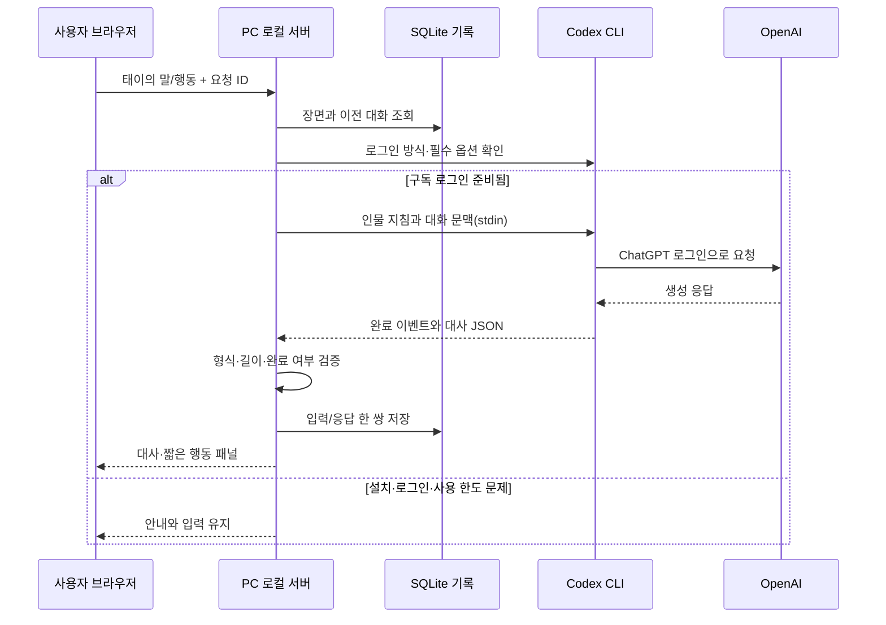

# 개인 PC에서 구동하는 인터랙티브 이야기

## 기본 구조

추가 API 결제를 원하지 않는 사용자를 위해, 공식 Codex CLI에 ChatGPT 계정으로 로그인하는 경로를 기본으로 한다. ChatGPT 화면 자동 조작이나 브라우저 쿠키 재사용이 아니다. 개인 로컬 제작·체험용이며 여러 사람에게 소유자의 구독을 공유하는 공개 서비스로 배포하지 않는다.

## 책임 분리

| 구성 | 책임 |
|---|---|
| public/ | 패널, 자유 입력, 실패 안내, 기록 내려받기 |
| server.py | 로컬 요청, 세션 격리, 요청 중복 방지, SQLite |
| engine.py | 인물별 관찰·동기·전체 장면 대화, 출력 검증 |
| codex_bridge.py | 구독 로그인 확인, CLI 실행·시간 제한·오류 분류 |
| 공식 Codex | 사용자 로그인·모델 통신·사용량 적용 |

이야기 생성 모델과 세계관 속 기본 AI 어시스트는 별개다. 어시스트가 생존 조언을 제공하는 설정으로 바꾸지 않으며, 제로의 성장과 능력 한계도 유지한다.

## 계정과 과금

로그인은 공식 터미널 절차에서 사용자가 수행한다. 프로그램은 비밀번호를 받거나 auth.json을 읽어 추출·전송하지 않는다. CLI 로그인 상태 출력만 확인하며 API 로그인이나 확인 불가능한 상태에서는 멈춘다. 실행에도 ChatGPT 인증을 강제하고 API 환경 변수를 제거한다. API·Ollama로 자동 우회하지 않는다.

준비 상태는 로그인과 필수 옵션 확인을 뜻하며 실제 응답이나 잔여 한도를 보장하지 않는다. 사용 한도는 요청 결과로 판별하고 원문 로그 대신 정리한 안내를 표시한다. 자동 결제·한도 초과 구매 기능은 없다.

## 대화 흐름과 기억

1. 서버가 가진 장면과 SQLite 기록을 읽는다. 브라우저에서 임의의 시스템 프롬프트·실행 파일 경로를 받지 않는다.
2. 인물이 관찰한 사실·동기·같은 장면의 발언만 문맥에 포함한다. 작가용 비밀과 타 세션은 제외한다.
3. 사용자 입력은 태이의 말과 행동이다. 태이의 속마음·결정은 대신 만들지 않는다.
4. 새 임시 폴더에서 CLI를 한 번 실행한다. 대화는 stdin으로 전달하고 CLI 세션은 보존하지 않는다.
5. 완료된 대사 JSON을 검증해 패널로 표시한다. 게임 명령으로 실행하지 않는다.
6. 성공한 턴만 한 쌍으로 저장한다. 실패 입력은 유지하며 같은 요청 ID는 저장된 응답을 재사용한다.

현재는 장면당 40회 제한으로 전체 기록을 유지한다. 장기 연재에는 장면 전환·인물별 기억·사실과 주장·관계 변화의 근거를 별도 상태로 관리하는 확장이 필요하다.

## 검증과 후속 단계

시험용 CLI를 실제 OS 프로세스로 실행해 입출력과 시간 초과 종료를 확인한다. 나머지 시험은 모의 로그인·응답을 사용한다. 사용자 PC의 실제 구독 이용·속도·한국어 품질은 검증하지 않았다. 공식 로그인 후 짧은 대화 한 번으로 연결을 확인하고, 인물별 대화 평가를 진행한다.

참고: [공식 인증](https://learn.chatgpt.com/docs/auth), [비대화형 실행](https://learn.chatgpt.com/docs/non-interactive-mode), [CLI 설정](https://learn.chatgpt.com/docs/config-file/config-reference). 호환성 확인 실패 시 보호 옵션을 빼지 않고 공식 CLI 업데이트를 안내한다.
